# committed_runtime_provenance

**Entry point:** `committed_runtime_provenance` (`api`)
**Source:** [knowledge_orchestration](../modules/knowledge_orchestration.md)
**Modules touched:** [canonical_json](../modules/canonical_json.md), [filesystem_guard](../modules/filesystem_guard.md), [host](../modules/host.md), [immutable](../modules/immutable.md), and 25 more

**Complete modules touched:**

- [canonical_json](../modules/canonical_json.md)
- [filesystem_guard](../modules/filesystem_guard.md)
- [host](../modules/host.md)
- [immutable](../modules/immutable.md)
- [infrastructure_state](../modules/infrastructure_state.md)
- [integrations](../modules/integrations.md)
- [io](../modules/io.md)
- [knowledge_artifacts](../modules/knowledge_artifacts.md)
- [knowledge_envelope](../modules/knowledge_envelope.md)
- [knowledge_evidence](../modules/knowledge_evidence.md)
- [knowledge_governance](../modules/knowledge_governance.md)
- [knowledge_graph](../modules/knowledge_graph.md)
- [knowledge_index](../modules/knowledge_index.md)
- [knowledge_kinds](../modules/knowledge_kinds.md)
- [knowledge_model](../modules/knowledge_model.md)
- [knowledge_orchestration](../modules/knowledge_orchestration.md)
- [knowledge_packs](../modules/knowledge_packs.md)
- [knowledge_reuse_format](../modules/knowledge_reuse_format.md)
- [knowledge_storage](../modules/knowledge_storage.md)
- [knowledge_storage_io](../modules/knowledge_storage_io.md)
- [knowledge_validators](../modules/knowledge_validators.md)
- [maintenance_projection](../modules/maintenance_projection.md)
- [maintenance_protocol](../modules/maintenance_protocol.md)
- [maintenance_state](../modules/maintenance_state.md)
- [manifest_storage](../modules/manifest_storage.md)
- [section_ownership](../modules/section_ownership.md)
- [source_retirement](../modules/source_retirement.md)
- [sync_manifest](../modules/sync_manifest.md)
- [wiki_surface](../modules/wiki_surface.md)

## Call sequence

> Static overview in presentation order, not runtime execution order. Arrows retain captured callers; representative internal continuations and boundary examples precede repeated helper detail.

```mermaid
sequenceDiagram
    participant p0 as committed_runtime_provenance
    participant p1 as _previous_committed_artifacts
    participant p2 as CommittedRuntimeProvenance
    participant p3 as capture_committed_knowledge
    participant p4 as guard_maintenance_owner
    participant p5 as _decode_json_object
    participant p6 as validate_knowledge_artifacts
    participant p7 as _absolute_path
    participant p8 as _validator_identity
    participant p9 as _storage_validator_identity
    participant p10 as attributes
    participant p11 as validate_surface_index_bytes
    participant p12 as load_adoption_marker
    participant p13 as SyncManifest.load
    participant p14 as _unique_json_object
    participant p15 as _reject_json_constant
    participant p16 as _require_validation_receipt
    participant p17 as freeze
    participant p18 as open_knowledge_store
    participant p19 as _validated_index_data
    participant p20 as logical_digest
    participant p21 as _validate_artifact_parity
    participant p22 as provider
    participant p23 as _validation_module_identity
    participant p24 as _validate_surface_payload
    participant p25 as validate_knowledge_index
    participant p26 as first_unsafe_path_component
    participant p27 as _surface_page_index
    participant p28 as read_guarded (src/llm_wiki_engine/knowledge_storage_io.py)
    participant p29 as Path (src/llm_wiki_cli/services…pture_committed_knowledge)
    participant p30 as state.require_for
    p0->>p1: _previous_committed_artifacts
    p0->>p2: CommittedRuntimeProvenance
    p1->>p3: capture_committed_knowledge
    p3->>p4: guard_maintenance_owner
    p3->>p5: _decode_json_object
    p3->>p6: validate_knowledge_artifacts
    p4->>p7: _absolute_path
    p6->>p8: _validator_identity
    p6->>p9: _storage_validator_identity
    p4->>p10: attributes
    p6->>p11: validate_surface_index_bytes
    p4->>p12: load_adoption_marker
    p4->>p13: SyncManifest.load
    p5->>p14: _unique_json_object
    p5->>p15: _reject_json_constant
    p6->>p16: _require_validation_receipt
    p6->>p17: freeze
    p6->>p18: open_knowledge_store
    p6->>p19: _validated_index_data
    p6->>p20: logical_digest
    p6->>p21: _validate_artifact_parity
    p10->>p22: provider
    p9->>p23: _validation_module_identity
    p11->>p24: _validate_surface_payload
    p19->>p25: validate_knowledge_index
    p7->>p26: first_unsafe_path_component
    p11->>p27: _surface_page_index
    p12->>p28: read_guarded (src/llm_wiki_engine/knowledge_storage_io.py)
    p3-->>p29: Path (src/llm_wiki_cli/services…pture_committed_knowledge)(wiki_dir)
    p1-->>p30: state.require_for(wiki_dir)
```

<!-- Auto-generated from static call edges. Dashed arrows are external or unresolved calls. Reviewed runtime conditions and side effects belong in Behavior. -->

> Call sequence diagram shows 30 of 783 interactions; 753 omitted to keep the visualization within the 30-interaction and generated-diagram limits, with uncertain identities omitted rather than inferred.

> Captured boundary calls: external 1 of 272 (271 omitted); unresolved 1 of 147 (146 omitted). These counts cover the captured static trace.

Omitted captured detail, grouped by actual caller occurrence and target module:

| Caller | Parent step | Target module | Kind | Omitted interactions |
| --- | --- | --- | --- | --- |
| `src/llm_wiki_cli/services/knowledge_orchestration.py:capture_committed_knowledge` | 3 | - | unresolved | 7 |
| `src/llm_wiki_engine/knowledge_storage_io.py:_absolute_path` | 7 | - | external | 4 |
| `src/llm_wiki_engine/io.py:first_unsafe_path_component` | 10 | - | external | 19 |
| `src/llm_wiki_engine/io.py:first_unsafe_path_component` | 10 | - | unresolved | 6 |
| `src/llm_wiki_engine/io.py:first_unsafe_path_component` | 10 | [src/llm_wiki_engine/host.py](../modules/host.md) | internal | 1 |
| `src/llm_wiki_engine/knowledge_storage_io.py:_absolute_path` | 7 | [src/llm_wiki_engine/knowledge_storage.py](../modules/knowledge_storage.md) | internal | 1 |
| `src/llm_wiki_engine/knowledge_storage_io.py:_absolute_path` | 7 | - | unresolved | 3 |
| `src/llm_wiki_engine/maintenance_protocol.py:guard_maintenance_owner` | 6 | - | external | 2 |
> Omission summary shows 8 of 156 groups; 148 further groups are not expanded here. Counts above include all omitted interactions.
> Detailed flow queries retain their own coverage and limits; omitted paths may execute at runtime.

> Trace truncated at the depth limit; deeper calls are omitted.

## Data flow

<!-- Auto-generated static analysis. Treat values and boundaries as best-effort hints, not runtime proof. -->

### Analysis coverage

**Effect analysis partially available.** Flow assembly and source effect analysis are separate; empty observations do not prove an empty handler body.

Source steps: 365; effect analysis evaluated: 196, partial: 24, unavailable: 145. Counts include steps omitted from the displayed trace.

Collector observations for 220 source steps with known totals: observed: 1438, emitted: 1360, omitted: 78. Unavailable totals are excluded.

- Callable record unavailable for one or more source steps; those steps have no represented callable body.
- Effect collector omitted observations before flow assembly; displayed effects are partial.
- Effect collector totals unavailable; observed counts cover captured records only.

| Step | Callable record | Effect analysis | Collector totals | Observed | Emitted | Omitted |
|---|---|---|---|---:|---:|---:|
| `committed_runtime_provenance` | `available` | `evaluated` | `available` | `5` | `5` | `0` |
| `_previous_committed_artifacts` | `available` | `evaluated` | `available` | `4` | `4` | `0` |
| `capture_committed_knowledge` | `available` | `partial` | `available` | `15` | `14` | `1` |
| `Path(…).resolve (src/llm_wiki_cli/services…pture_committed_knowledge)` | `not_applicable` | `not_applicable` | `not_applicable` | — | — | — |
| `Path (src/llm_wiki_cli/services…pture_committed_knowledge)` | `not_applicable` | `not_applicable` | `not_applicable` | — | — | — |
| `guard_maintenance_owner` | `available` | `evaluated` | `available` | `5` | `5` | `0` |
| `_absolute_path` | `available` | `evaluated` | `available` | `2` | `2` | `0` |
| `Path (src/llm_wiki_engine/knowl…rage_io.py:_absolute_path)` | `not_applicable` | `not_applicable` | `not_applicable` | — | — | — |
| `os.path.abspath (src/llm_wiki_engine/knowl…rage_io.py:_absolute_path)` | `not_applicable` | `not_applicable` | `not_applicable` | — | — | — |
| `first_unsafe_path_component` | `available` | `evaluated` | `available` | `14` | `14` | `0` |
| `Path (src/llm_wiki_engine/io.py…rst_unsafe_path_component)` | `not_applicable` | `not_applicable` | `not_applicable` | — | — | — |
| `os.fspath` | `not_applicable` | `not_applicable` | `not_applicable` | — | — | — |

```mermaid
flowchart LR
    s1["1. committed_runtime_provenance"]
    s2["2. _previous_committed_artifacts"]
    s3["3. capture_committed_knowledge"]
    s4["4. Path(…).resolve (src/llm_wiki_cli/services…pture_committed_knowledge)"]
    s5["5. Path (src/llm_wiki_cli/services…pture_committed_knowledge)"]
    s6["6. guard_maintenance_owner"]
    s7["7. _absolute_path"]
    s8["8. Path (src/llm_wiki_engine/knowl…rage_io.py:_absolute_path)"]
    s9["9. os.path.abspath (src/llm_wiki_engine/knowl…rage_io.py:_absolute_path)"]
    s10["10. first_unsafe_path_component"]
    s11["11. Path (src/llm_wiki_engine/io.py…rst_unsafe_path_component)"]
    s12["12. os.fspath"]
    s1 -->|"_previous_committed_artifacts(wiki_dir, manifest, committed_state=committed_state)"| s2
    s2 -->|"capture_committed_knowledge(wiki_dir, manifest)"| s3
    s3 -. "Path(…).resolve (src/llm_wiki_cli/services…pture_committed_knowledge)(data not statically known)" .-> s4
    s3 -. "Path (src/llm_wiki_cli/services…pture_committed_knowledge)(wiki_dir)" .-> s5
    s3 -->|"guard_maintenance_owner(root, manifest)"| s6
    s6 -->|"_absolute_path(Path(...))"| s7
    s7 -. "Path (src/llm_wiki_engine/knowl…rage_io.py:_absolute_path)(os.path.abspath(...))" .-> s8
    s7 -. "os.path.abspath (src/llm_wiki_engine/knowl…rage_io.py:_absolute_path)(path)" .-> s9
    s7 -->|"first_unsafe_path_component(path)"| s10
    s10 -. "Path (src/llm_wiki_engine/io.py…rst_unsafe_path_component)(os.fspath(...))" .-> s11
    s10 -. "os.fspath(path)" .-> s12
    b0["mutation captured.update"]
    s3 -. "mutation captured.update" .-> b0
    b1["mutation pending_parts.pop"]
    s10 -. "mutation pending_parts.pop" .-> b1
    click s1 "../modules/knowledge_orchestration.md"
    click s2 "../modules/knowledge_orchestration.md"
    click s3 "../modules/knowledge_orchestration.md"
    click s6 "../modules/maintenance_protocol.md"
    click s7 "../modules/knowledge_storage_io.md"
    click s10 "../modules/io.md"
    classDef boundary stroke:#b45309,stroke-dasharray: 4 2
    class b0 boundary
    class b1 boundary
```

### Step data

| Step | Inputs | Reads | Writes | Returns |
|---|---|---|---|---|
| `committed_runtime_provenance` | `wiki_dir: str \| Path`, `manifest: SyncManifest \| None`, `committed_state: CommittedKnowledgeState \| None` | - | - | `None`, `CommittedRuntimeProvenance(...)` |
| `_previous_committed_artifacts` | `wiki_dir: str \| Path`, `manifest: SyncManifest \| None`, `committed_state: CommittedKnowledgeState \| None` | - | - | `state.artifacts` |
| `capture_committed_knowledge` | `wiki_dir: str \| Path`, `manifest: SyncManifest \| None` | `SURFACE_INDEX_FILENAME`, `KNOWLEDGE_INDEX_FILENAME`, `MANIFEST_FILENAME`, `MANIFEST_FILENAME`, `SURFACE_INDEX_FILENAME`, `KNOWLEDGE_INDEX_FILENAME`, `KnowledgeArtifactError`, `KnowledgeArtifactError` | `captured[...]`, `captured[...]` | `state` |
| `Path(…).resolve (src/llm_wiki_cli/services…pture_committed_knowledge)` | - | - | - | - |
| `Path (src/llm_wiki_cli/services…pture_committed_knowledge)` | - | - | - | - |
| `guard_maintenance_owner` | `wiki_dir: str \| Path`, `manifest` | - | - | `None`, `None`, `marker` |
| `_absolute_path` | `path: Path` | - | - | `path` |
| `Path (src/llm_wiki_engine/knowl…rage_io.py:_absolute_path)` | - | - | - | - |
| `os.path.abspath (src/llm_wiki_engine/knowl…rage_io.py:_absolute_path)` | - | - | - | - |
| `first_unsafe_path_component` | `path: str \| Path`, `trusted_symlink_uids: Set[int] \| None`, `trusted_symlink_owner: Callable[[Path], bool] \| None` | `stat`, `os` | - | `lexical`, `None`, `current`, `current`, `current`, `current`, `current`, `None` |
| `Path (src/llm_wiki_engine/io.py…rst_unsafe_path_component)` | - | - | - | - |
| `os.fspath` | - | - | - | - |

### Call data

| From | To | Line | Call |
|---|---|---:|---|
| committed_runtime_provenance | _previous_committed_artifacts | 803 | `_previous_committed_artifacts(wiki_dir, manifest, committed_state=committed_state)` |
| _previous_committed_artifacts | capture_committed_knowledge | 774 | `capture_committed_knowledge(wiki_dir, manifest)` |
| capture_committed_knowledge | Path(…).resolve (src/llm_wiki_cli/services…pture_committed_knowledge) | 242 | `Path(wiki_dir).resolve(data not statically known)` |
| capture_committed_knowledge | Path (src/llm_wiki_cli/services…pture_committed_knowledge) | 242 | `Path(wiki_dir)` |
| capture_committed_knowledge | guard_maintenance_owner | 245 | `guard_maintenance_owner(root, manifest)` |
| guard_maintenance_owner | _absolute_path | 114 | `_absolute_path(Path(...))` |
| _absolute_path | Path (src/llm_wiki_engine/knowl…rage_io.py:_absolute_path) | 49 | `Path(os.path.abspath(...))` |
| _absolute_path | os.path.abspath (src/llm_wiki_engine/knowl…rage_io.py:_absolute_path) | 49 | `os.path.abspath(path)` |
| _absolute_path | first_unsafe_path_component | 50 | `first_unsafe_path_component(path)` |
| first_unsafe_path_component | Path (src/llm_wiki_engine/io.py…rst_unsafe_path_component) | 52 | `Path(os.fspath(...))` |
| first_unsafe_path_component | os.fspath | 52 | `os.fspath(path)` |

### Boundary effects

| Kind | Target | Step | Line |
|---|---|---|---:|
| mutation | `captured.update` | `capture_committed_knowledge` | 271 |
| mutation | `pending_parts.pop` | `first_unsafe_path_component` | 72 |

### Static analysis gaps

| Kind | Step | Target | Line |
|---|---|---|---:|
| unresolved_call | `capture_committed_knowledge` | `Path(wiki_dir).resolve` | 242 |
| external_call | `_absolute_path` | `os.path.abspath` | 49 |
| external_call | `first_unsafe_path_component` | `os.fspath` | 52 |
| step_limit | `committed_runtime_provenance` | `first 12 steps` | 0 |
| truncated_flow | `committed_runtime_provenance` | `depth limit` | 0 |

## Behavior

This flow starts at `committed_runtime_provenance` and is classified as `api`. The generated call and data-flow sections are bounded static projections; runtime conditions and side effects require source-level confirmation.
