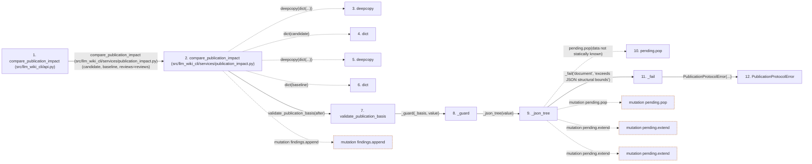

# compare_publication_impact

**Entry point:** `compare_publication_impact` (`api`)
**Source:** [api](../modules/api.md)
**Modules touched:** [api](../modules/api.md), [knowledge_evidence](../modules/knowledge_evidence.md), [publication_contracts](../modules/publication_contracts.md), [publication_impact](../modules/publication_impact.md)

## Call sequence

> Static overview in presentation order, not runtime execution order. Arrows retain captured callers; representative internal continuations and boundary examples precede repeated helper detail.

```mermaid
sequenceDiagram
    participant p0 as compare_publication_impact (src/llm_wiki_cli/api.py)
    participant p1 as compare_publication_impact (src/llm_wiki_cli/services/publication_impact.py)
    participant p2 as validate_publication_basis
    participant p3 as _topic_findings
    participant p4 as validate_publication_reviews
    participant p5 as _seal
    participant p6 as _guard
    participant p7 as _topic_versions
    participant p8 as _topic_inputs
    participant p9 as _finding
    participant p10 as _json_tree
    participant p11 as hash_json
    participant p12 as _fail
    participant p13 as canonical_json_bytes
    participant p14 as PublicationProtocolError
    participant p15 as _dependency_basis
    participant p16 as sha256_bytes
    participant p17 as canonical_json_text
    participant p18 as deepcopy
    participant p19 as findings.append (src/llm_wiki_cli/services…ompare_publication_impact)
    participant p20 as dict
    participant p21 as any (src/llm_wiki_cli/services…ompare_publication_impact)
    participant p22 as fnmatchcase
    participant p23 as sorted (src/llm_wiki_cli/services…ompare_publication_impact)
    participant p24 as all (src/llm_wiki_cli/services…ompare_publication_impact)
    participant p25 as after[…].get(…).get
    p0->>p1: compare_publication_impact (src/llm_wiki_cli/services/publication_impact.py)
    p1->>p2: validate_publication_basis
    p1->>p3: _topic_findings
    p1->>p4: validate_publication_reviews
    p1->>p5: _seal
    p2->>p6: _guard
    p3->>p7: _topic_versions
    p3->>p8: _topic_inputs
    p3->>p9: _finding
    p6->>p10: _json_tree
    p7->>p11: hash_json
    p10->>p12: _fail
    p11->>p13: canonical_json_bytes
    p1->>p14: PublicationProtocolError
    p8->>p15: _dependency_basis
    p11->>p16: sha256_bytes
    p13->>p17: canonical_json_text
    p1-->>p18: deepcopy(dict(...))
    p1-->>p19: findings.append (src/llm_wiki_cli/services…ompare_publication_impact)(_finding(...))
    p1-->>p20: dict(candidate)
    p1-->>p18: deepcopy(dict(...))
    p1-->>p20: dict(baseline)
    p1-->>p21: any (src/llm_wiki_cli/services…ompare_publication_impact)(...)
    p1-->>p22: fnmatchcase(p, e[...])
    p1-->>p23: sorted (src/llm_wiki_cli/services…ompare_publication_impact)(...)
    p1-->>p21: any (src/llm_wiki_cli/services…ompare_publication_impact)(...)
    p1-->>p21: any (src/llm_wiki_cli/services…ompare_publication_impact)(...)
    p1-->>p21: any (src/llm_wiki_cli/services…ompare_publication_impact)(...)
    p1-->>p24: all (src/llm_wiki_cli/services…ompare_publication_impact)(...)
    p1-->>p25: after[…].get(…).get('state')
```

<!-- Auto-generated from static call edges. Dashed arrows are external or unresolved calls. Reviewed runtime conditions and side effects belong in Behavior. -->

> Call sequence diagram shows 30 of 104 interactions; 74 omitted to keep the visualization within the 30-interaction and generated-diagram limits, with uncertain identities omitted rather than inferred.

> Captured boundary calls: external 11 of 29 (18 omitted); unresolved 2 of 43 (41 omitted). These counts cover the captured static trace.

Omitted captured detail, grouped by actual caller occurrence and target module:

| Caller | Parent step | Target module | Kind | Omitted interactions |
| --- | --- | --- | --- | --- |
| `src/llm_wiki_cli/services/publication_contracts.py:_json_tree` | 9 | - | unresolved | 4 |
| `src/llm_wiki_cli/services/publication_contracts.py:_fail` | 11 | [src/llm_wiki_cli/services/publication_contracts.py](../modules/publication_contracts.md) | internal | 1 |
| `src/llm_wiki_cli/services/publication_contracts.py:_json_tree` | 9 | - | external | 7 |
| `src/llm_wiki_cli/services/publication_contracts.py:_json_tree` | 9 | [src/llm_wiki_cli/services/publication_contracts.py](../modules/publication_contracts.md) | internal | 3 |
| `src/llm_wiki_cli/services/publication_contracts.py:_guard` | 8 | - | unresolved | 1 |
| `src/llm_wiki_cli/services/publication_contracts.py:_guard` | 8 | [src/llm_wiki_cli/services/publication_contracts.py](../modules/publication_contracts.md) | internal | 1 |
| `src/llm_wiki_cli/services/publication_impact.py:compare_publication_impact` | 2 | [src/llm_wiki_cli/services/publication_contracts.py](../modules/publication_contracts.md) | internal | 2 |
| `src/llm_wiki_cli/services/publication_impact.py:_topic_versions` | 32 | - | external | 1 |
> Omission summary shows 8 of 27 groups; 19 further groups are not expanded here. Counts above include all omitted interactions.
> Detailed flow queries retain their own coverage and limits; omitted paths may execute at runtime.

> Trace truncated at the depth limit; deeper calls are omitted.

## Data flow

<!-- Auto-generated static analysis. Treat values and boundaries as best-effort hints, not runtime proof. -->

### Analysis coverage

**Effect analysis partially available.** Flow assembly and source effect analysis are separate; empty observations do not prove an empty handler body.

Source steps: 33; effect analysis evaluated: 29, partial: 0, unavailable: 4. Counts include steps omitted from the displayed trace.

Collector observations for 29 source steps with known totals: observed: 96, emitted: 96, omitted: 0. Unavailable totals are excluded.

- Callable record unavailable for one or more source steps; those steps have no represented callable body.
- Effect collector totals unavailable; observed counts cover captured records only.

| Step | Callable record | Effect analysis | Collector totals | Observed | Emitted | Omitted |
|---|---|---|---|---:|---:|---:|
| `compare_publication_impact (src/llm_wiki_cli/api.py)` | `available` | `evaluated` | `available` | `4` | `4` | `0` |
| `compare_publication_impact (src/llm_wiki_cli/services/publication_impact.py)` | `available` | `evaluated` | `available` | `7` | `7` | `0` |
| `deepcopy` | `not_applicable` | `not_applicable` | `not_applicable` | — | — | — |
| `dict` | `not_applicable` | `not_applicable` | `not_applicable` | — | — | — |
| `deepcopy` | `not_applicable` | `not_applicable` | `not_applicable` | — | — | — |
| `dict` | `not_applicable` | `not_applicable` | `not_applicable` | — | — | — |
| `validate_publication_basis` | `available` | `evaluated` | `available` | `2` | `2` | `0` |
| `_guard` | `available` | `evaluated` | `available` | `4` | `4` | `0` |
| `_json_tree` | `available` | `evaluated` | `available` | `5` | `5` | `0` |
| `pending.pop` | `not_applicable` | `not_applicable` | `not_applicable` | — | — | — |
| `_fail` | `available` | `evaluated` | `available` | `2` | `2` | `0` |
| `PublicationProtocolError` | `unavailable` | `unavailable` | `unavailable` | — | — | — |

### Step data

| Step | Inputs | Reads | Writes | Returns |
|---|---|---|---|---|
| `compare_publication_impact (src/llm_wiki_cli/api.py)` | `candidate: Mapping[str, Any]`, `baseline: Mapping[str, Any] \| None`, `reviews: Mapping[str, Any] \| None` | - | - | `compare(...)` |
| `compare_publication_impact (src/llm_wiki_cli/services/publication_impact.py)` | `candidate: Mapping[str, Any]`, `baseline: Mapping[str, Any] \| None`, `reviews: Mapping[str, Any] \| None` | `IMPACT_SCHEMA` | `finding[...]` | `_seal(...)` |
| `deepcopy` | - | - | - | - |
| `dict` | - | - | - | - |
| `deepcopy` | - | - | - | - |
| `dict` | - | - | - | - |
| `validate_publication_basis` | `value: object` | `_basis` | - | - |
| `_guard` | `callback`, `value: object` | `PublicationProtocolError` | - | `callback(...)` |
| `_json_tree` | `value: object` | `Mapping` | - | - |
| `pending.pop` | - | - | - | - |
| `_fail` | `field: str`, `message: str` | - | - | - |
| `PublicationProtocolError` | - | - | - | - |

### Call data

| From | To | Line | Call |
|---|---|---:|---|
| compare_publication_impact (src/llm_wiki_cli/api.py) | compare_publication_impact (src/llm_wiki_cli/services/publication_impact.py) | 3564 | `compare(candidate, baseline, reviews=reviews)` |
| compare_publication_impact (src/llm_wiki_cli/services/publication_impact.py) | deepcopy | 320 | `deepcopy(dict(...))` |
| compare_publication_impact (src/llm_wiki_cli/services/publication_impact.py) | dict | 320 | `dict(candidate)` |
| compare_publication_impact (src/llm_wiki_cli/services/publication_impact.py) | deepcopy | 321 | `deepcopy(dict(...))` |
| compare_publication_impact (src/llm_wiki_cli/services/publication_impact.py) | dict | 321 | `dict(baseline)` |
| compare_publication_impact (src/llm_wiki_cli/services/publication_impact.py) | validate_publication_basis | 322 | `validate_publication_basis(after)` |
| validate_publication_basis | _guard | 744 | `_guard(_basis, value)` |
| _guard | _json_tree | 734 | `_json_tree(value)` |
| _json_tree | pending.pop | 133 | `pending.pop(data not statically known)` |
| _json_tree | _fail | 136 | `_fail('document', 'exceeds JSON structural bounds')` |
| _fail | PublicationProtocolError | 41 | `PublicationProtocolError(...)` |

### Boundary effects

| Kind | Target | Step | Line |
|---|---|---|---:|
| mutation | `findings.append` | `compare_publication_impact` | 346 |
| mutation | `pending.pop` | `_json_tree` | 133 |
| mutation | `pending.extend` | `_json_tree` | 140 |
| mutation | `pending.extend` | `_json_tree` | 142 |

### Static analysis gaps

| Kind | Step | Target | Line |
|---|---|---|---:|
| external_call | `compare_publication_impact` | `deepcopy` | 320 |
| external_call | `compare_publication_impact` | `deepcopy` | 321 |
| step_limit | `compare_publication_impact` | `first 12 steps` | 0 |
| truncated_flow | `compare_publication_impact` | `depth limit` | 0 |

## Behavior

This flow starts at `compare_publication_impact` and is classified as `api`. The generated call and data-flow sections are bounded static projections; runtime conditions and side effects require source-level confirmation.
