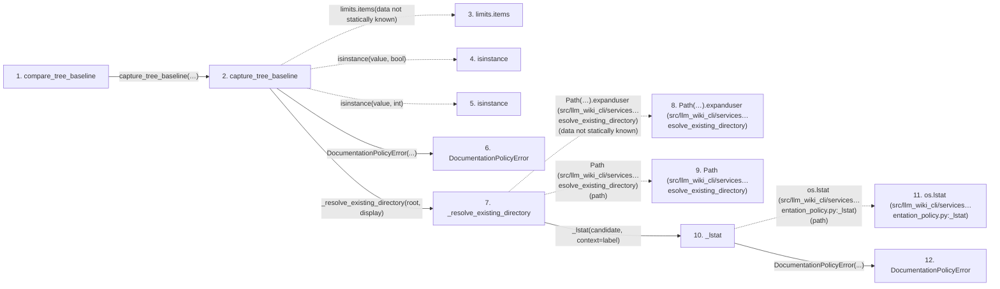

# compare_tree_baseline

**Entry point:** `compare_tree_baseline` (`api`)
**Source:** [documentation_policy](../modules/documentation_policy.md)
**Modules touched:** [documentation_policy](../modules/documentation_policy.md), [filesystem_guard](../modules/filesystem_guard.md)

## Call sequence

> Static overview in presentation order, not runtime execution order. Arrows retain captured callers; representative internal continuations and boundary examples precede repeated helper detail.

```mermaid
sequenceDiagram
    participant p0 as compare_tree_baseline
    participant p1 as capture_tree_baseline
    participant p2 as IntegrityDifference
    participant p3 as _resolve_existing_directory
    participant p4 as _walk_regular_files
    participant p5 as _hash_file
    participant p6 as _lstat
    participant p7 as _assert_safe_directory
    participant p8 as _resolve_path
    participant p9 as _guard_baseline_directory
    participant p10 as _hash_windows_file
    participant p11 as _assert_same_file_identity
    participant p12 as windows_object_identity
    participant p13 as guard_windows_directory_chain
    participant p14 as _assert_safe_regular_file
    participant p15 as open_windows_readonly_file
    participant p16 as _assert_stable_windows_path_handle_metadata
    participant p17 as _assert_stable_file_metadata
    participant p18 as windows_object_identity_from_values
    participant p19 as _windows_path_handle_metadata
    participant p20 as _open_windows_readonly_file_handle
    participant p21 as _open_windows_directory_guard
    participant p22 as create_private_windows_directory
    participant p23 as DocumentationPolicyError
    participant p24 as TreeBaseline
    participant p25 as _hash_labeled_hashes
    participant p26 as fresh_no_follow_stat
    participant p27 as _is_windows_reparse_point
    participant p28 as _stable_metadata_signature
    participant p29 as tuple (src/llm_wiki_cli/services….py:compare_tree_baseline)
    participant p30 as limits.items
    p0->>p1: capture_tree_baseline
    p0->>p2: IntegrityDifference
    p1->>p3: _resolve_existing_directory
    p1->>p4: _walk_regular_files
    p1->>p5: _hash_file
    p3->>p6: _lstat
    p3->>p7: _assert_safe_directory
    p3->>p8: _resolve_path
    p4->>p9: _guard_baseline_directory
    p5->>p10: _hash_windows_file
    p3->>p11: _assert_same_file_identity
    p11->>p12: windows_object_identity
    p9->>p13: guard_windows_directory_chain
    p10->>p14: _assert_safe_regular_file
    p10->>p15: open_windows_readonly_file
    p10->>p16: _assert_stable_windows_path_handle_metadata
    p10->>p17: _assert_stable_file_metadata
    p12->>p18: windows_object_identity_from_values
    p16->>p19: _windows_path_handle_metadata
    p15->>p20: _open_windows_readonly_file_handle
    p13->>p21: _open_windows_directory_guard
    p13->>p22: create_private_windows_directory
    p1->>p23: DocumentationPolicyError
    p1->>p24: TreeBaseline
    p1->>p25: _hash_labeled_hashes
    p4->>p26: fresh_no_follow_stat
    p4->>p27: _is_windows_reparse_point
    p11->>p28: _stable_metadata_signature
    p0-->>p29: tuple (src/llm_wiki_cli/services….py:compare_tree_baseline)(sorted(...))
    p1-->>p30: limits.items
```

<!-- Auto-generated from static call edges. Dashed arrows are external or unresolved calls. Reviewed runtime conditions and side effects belong in Behavior. -->

> Call sequence diagram shows 30 of 323 interactions; 293 omitted to keep the visualization within the 30-interaction and generated-diagram limits, with uncertain identities omitted rather than inferred.

> Captured boundary calls: external 1 of 141 (140 omitted); unresolved 1 of 42 (41 omitted). These counts cover the captured static trace.

Omitted captured detail, grouped by actual caller occurrence and target module:

| Caller | Parent step | Target module | Kind | Omitted interactions |
| --- | --- | --- | --- | --- |
| `src/llm_wiki_cli/services/documentation_policy.py:capture_tree_baseline` | 2 | - | external | 9 |
| `src/llm_wiki_cli/services/documentation_policy.py:_resolve_existing_directory` | 7 | - | unresolved | 1 |
| `src/llm_wiki_cli/services/documentation_policy.py:_resolve_existing_directory` | 7 | - | external | 1 |
| `src/llm_wiki_cli/services/documentation_policy.py:_lstat` | 10 | - | external | 1 |
| `src/llm_wiki_cli/services/documentation_policy.py:_lstat` | 10 | [src/llm_wiki_cli/services/documentation_policy.py](../modules/documentation_policy.md) | internal | 1 |
| `src/llm_wiki_cli/services/documentation_policy.py:_assert_safe_directory` | 13 | - | external | 2 |
| `src/llm_wiki_cli/services/documentation_policy.py:_assert_safe_directory` | 13 | [src/llm_wiki_cli/services/documentation_policy.py](../modules/documentation_policy.md) | internal | 4 |
| `src/llm_wiki_cli/services/documentation_policy.py:_is_windows_reparse_point` | 16 | - | external | 5 |
> Omission summary shows 8 of 60 groups; 52 further groups are not expanded here. Counts above include all omitted interactions.
> Detailed flow queries retain their own coverage and limits; omitted paths may execute at runtime.

> Trace truncated at the depth limit; deeper calls are omitted.

## Data flow

<!-- Auto-generated static analysis. Treat values and boundaries as best-effort hints, not runtime proof. -->

### Step data

| Step | Inputs | Reads | Writes | Returns |
|---|---|---|---|---|
| `compare_tree_baseline` | `baseline: TreeBaseline`, `root: str \| Path`, `max_files: int`, `max_file_bytes: int`, `max_total_bytes: int` | - | - | `IntegrityDifference(...)` |
| `capture_tree_baseline` | `root: str \| Path`, `display: str`, `excluded_directories: Iterable[str]`, `max_files: int`, `max_file_bytes: int`, `max_total_bytes: int` | - | `file_hashes[...]` | `TreeBaseline(...)` |
| `limits.items` | - | - | - | - |
| `isinstance` | - | - | - | - |
| `isinstance` | - | - | - | - |
| `DocumentationPolicyError` | - | - | - | - |
| `_resolve_existing_directory` | `path: str \| Path`, `label: str` | - | - | `resolved` |
| `Path(…).expanduser (src/llm_wiki_cli/services…esolve_existing_directory)` | - | - | - | - |
| `Path (src/llm_wiki_cli/services…esolve_existing_directory)` | - | - | - | - |
| `_lstat` | `path: Path`, `context: str` | - | - | `os.lstat(...)` |
| `os.lstat (src/llm_wiki_cli/services…entation_policy.py:_lstat)` | - | - | - | - |
| `DocumentationPolicyError` | - | - | - | - |

### Call data

| From | To | Line | Call |
|---|---|---:|---|
| compare_tree_baseline | capture_tree_baseline | 351 | `capture_tree_baseline(root, display=baseline.root_display, excluded_directories=baseline.excluded_directories, max_files=max_files, max_file_bytes=max_file_bytes, max_total_bytes=max_total_bytes)` |
| capture_tree_baseline | limits.items | 304 | `limits.items(data not statically known)` |
| capture_tree_baseline | isinstance | 305 | `isinstance(value, bool)` |
| capture_tree_baseline | isinstance | 305 | `isinstance(value, int)` |
| capture_tree_baseline | DocumentationPolicyError | 306 | `DocumentationPolicyError(...)` |
| capture_tree_baseline | _resolve_existing_directory | 308 | `_resolve_existing_directory(root, display)` |
| _resolve_existing_directory | Path(…).expanduser (src/llm_wiki_cli/services…esolve_existing_directory) | 948 | `Path(path).expanduser(data not statically known)` |
| _resolve_existing_directory | Path (src/llm_wiki_cli/services…esolve_existing_directory) | 948 | `Path(path)` |
| _resolve_existing_directory | _lstat | 949 | `_lstat(candidate, context=label)` |
| _lstat | os.lstat (src/llm_wiki_cli/services…entation_policy.py:_lstat) | 782 | `os.lstat(path)` |
| _lstat | DocumentationPolicyError | 784 | `DocumentationPolicyError(...)` |

### Boundary effects

*No boundary effects detected.*

### Static analysis gaps

| Kind | Step | Target | Line |
|---|---|---|---:|
| unresolved_call | `capture_tree_baseline` | `limits.items` | 304 |
| external_call | `capture_tree_baseline` | `isinstance` | 305 |
| unresolved_call | `_resolve_existing_directory` | `Path(path).expanduser` | 948 |
| external_call | `_lstat` | `os.lstat` | 782 |
| step_limit | `compare_tree_baseline` | `first 12 steps` | 0 |
| truncated_flow | `compare_tree_baseline` | `depth limit` | 0 |

## Behavior

This flow starts at `compare_tree_baseline` and is classified as `api`. The generated call and data-flow sections are bounded static projections; runtime conditions and side effects require source-level confirmation.
