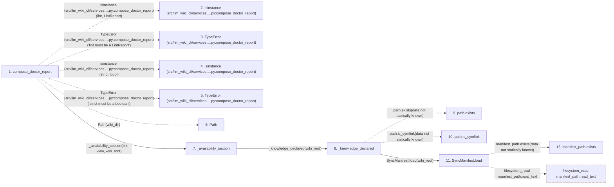

# compose_doctor_report

**Entry point:** `compose_doctor_report` (`api`)
**Source:** [doctor_service](../modules/doctor_service.md)
**Modules touched:** [doctor_service](../modules/doctor_service.md), [health_policy](../modules/health_policy.md), [knowledge_observability](../modules/knowledge_observability.md), and 6 more

**Complete modules touched:**

- [doctor_service](../modules/doctor_service.md)
- [health_policy](../modules/health_policy.md)
- [knowledge_observability](../modules/knowledge_observability.md)
- [knowledge_storage](../modules/knowledge_storage.md)
- [knowledge_storage_io](../modules/knowledge_storage_io.md)
- [maintenance_state](../modules/maintenance_state.md)
- [manifest_storage](../modules/manifest_storage.md)
- [sync_manifest](../modules/sync_manifest.md)
- [validation](../modules/validation.md)

## Call sequence

> Static overview in presentation order, not runtime execution order. Arrows retain captured callers; siblings are shown before deeper helper detail.

```mermaid
sequenceDiagram
    participant p0 as compose_doctor_report
    participant p1 as isinstance (src/llm_wiki_cli/services….py:compose_doctor_report)
    participant p2 as TypeError (src/llm_wiki_cli/services….py:compose_doctor_report)
    participant p3 as Path
    participant p4 as _availability_section
    participant p5 as _freshness_section
    participant p6 as _snapshot_section
    participant p7 as _governance_section
    participant p8 as _drift_section
    participant p9 as _verification_section
    participant p10 as classify_health_sections
    participant p11 as bool (src/llm_wiki_cli/services….py:compose_doctor_report)
    participant p12 as _issues
    participant p13 as DoctorReport
    participant p14 as _knowledge_declared
    participant p15 as int (src/llm_wiki_cli/services…ice.py:_freshness_section)
    participant p16 as sorted (src/llm_wiki_cli/services…vice.py:_snapshot_section)
    participant p17 as isinstance (src/llm_wiki_cli/services…service.py:_drift_section)
    participant p18 as unhealthy.append
    participant p19 as len (src/llm_wiki_cli/services…vice.py:_snapshot_section)
    participant p20 as _reasons
    participant p21 as TypeError (src/llm_wiki_cli/services…service.py:_drift_section)
    participant p22 as knowledge_freshness_disclosure
    p0-->>p1: isinstance (src/llm_wiki_cli/services….py:compose_doctor_report)(lint, LintReport)
    p0-->>p2: TypeError (src/llm_wiki_cli/services….py:compose_doctor_report)('lint must be a LintReport')
    p0-->>p1: isinstance (src/llm_wiki_cli/services….py:compose_doctor_report)(strict, bool)
    p0-->>p2: TypeError (src/llm_wiki_cli/services….py:compose_doctor_report)('strict must be a boolean')
    p0-->>p3: Path(wiki_dir)
    p0->>p4: _availability_section
    p0->>p5: _freshness_section
    p0->>p6: _snapshot_section
    p0->>p7: _governance_section
    p0->>p8: _drift_section
    p0->>p9: _verification_section
    p0->>p10: classify_health_sections
    p0-->>p11: bool (src/llm_wiki_cli/services….py:compose_doctor_report)(_issues(...))
    p0->>p12: _issues
    p0->>p13: DoctorReport
    p4->>p14: _knowledge_declared
    p5-->>p15: int (src/llm_wiki_cli/services…ice.py:_freshness_section)(summary.freshness_counts[...])
    p6-->>p16: sorted (src/llm_wiki_cli/services…vice.py:_snapshot_section)(...)
    p7->>p12: _issues
    p8-->>p17: isinstance (src/llm_wiki_cli/services…service.py:_drift_section)(raw_counts, Mapping)
    p9->>p12: _issues
    p10-->>p18: unhealthy.append('source-selection-mismatch')
    p4->>p14: _knowledge_declared
    p5-->>p15: int (src/llm_wiki_cli/services…ice.py:_freshness_section)(view.freshness.counts[...])
    p6-->>p19: len (src/llm_wiki_cli/services…vice.py:_snapshot_section)(view.projection_findings)
    p7->>p20: _reasons
    p8-->>p21: TypeError (src/llm_wiki_cli/services…service.py:_drift_section)('freshness counts_by_state must be a mapping')
    p9->>p20: _reasons
    p10-->>p18: unhealthy.append('knowledge-unsupported')
    p5->>p22: knowledge_freshness_disclosure
```

<!-- Auto-generated from static call edges. Dashed arrows are external or unresolved calls. Reviewed runtime conditions and side effects belong in Behavior. -->

> Call sequence diagram shows 30 of 316 interactions; 286 omitted to keep the visualization within the 30-interaction and generated-diagram limits, with uncertain identities omitted rather than inferred.

> Captured boundary calls: external 12 of 91 (79 omitted); unresolved 2 of 70 (68 omitted). These counts cover the captured static trace.

Omitted captured detail, grouped by actual caller occurrence and target module:

| Caller | Parent step | Target module | Kind | Omitted interactions |
| --- | --- | --- | --- | --- |
| `src/llm_wiki_cli/services/doctor_service.py:_knowledge_declared` | 8 | - | unresolved | 2 |
| `src/llm_wiki_cli/services/doctor_service.py:_knowledge_declared` | 8 | [src/llm_wiki_cli/services/sync_manifest.py](../modules/sync_manifest.md) | internal | 1 |
| `src/llm_wiki_cli/services/sync_manifest.py:SyncManifest.load` | 11 | - | unresolved | 3 |
| `src/llm_wiki_cli/services/sync_manifest.py:SyncManifest.load` | 11 | - | external | 3 |
| `src/llm_wiki_cli/services/sync_manifest.py:SyncManifest.load` | 11 | [src/llm_wiki_cli/services/knowledge_storage_io.py](../modules/knowledge_storage_io.md) | internal | 3 |
| `src/llm_wiki_cli/services/knowledge_storage_io.py:StorageReadSession.read` | 19 | [src/llm_wiki_cli/services/knowledge_storage_io.py](../modules/knowledge_storage_io.md) | internal | 2 |
| `src/llm_wiki_cli/services/knowledge_storage_io.py:_require_relative_name` | 20 | [src/llm_wiki_cli/services/validation.py](../modules/validation.md) | internal | 1 |
| `src/llm_wiki_cli/services/knowledge_storage_io.py:_require_relative_name` | 20 | [src/llm_wiki_cli/services/knowledge_storage.py](../modules/knowledge_storage.md) | internal | 1 |
> Omission summary shows 8 of 83 groups; 75 further groups are not expanded here. Counts above include all omitted interactions.
> Detailed flow queries retain their own coverage and limits; omitted paths may execute at runtime.

> Trace truncated at the depth limit; deeper calls are omitted.

## Data flow

<!-- Auto-generated static analysis. Treat values and boundaries as best-effort hints, not runtime proof. -->

### Step data

| Step | Inputs | Reads | Writes | Returns |
|---|---|---|---|---|
| `compose_doctor_report` | `lint: LintReport`, `strict: bool`, `wiki_dir: str`, `src_dir: str` | `LintReport` | - | `DoctorReport(...)` |
| `isinstance (src/llm_wiki_cli/services….py:compose_doctor_report)` | - | - | - | - |
| `TypeError (src/llm_wiki_cli/services….py:compose_doctor_report)` | - | - | - | - |
| `isinstance (src/llm_wiki_cli/services….py:compose_doctor_report)` | - | - | - | - |
| `TypeError (src/llm_wiki_cli/services….py:compose_doctor_report)` | - | - | - | - |
| `Path` | - | - | - | - |
| `_availability_section` | `lint: LintReport`, `view: KnowledgeReadView \| None`, `wiki_root: Path` | `KnowledgeAvailability`, `KnowledgeAvailability`, `KnowledgeAvailability`, `KnowledgeAvailability`, `KnowledgeAvailability` | - | `{...}`, `{...}`, `{...}`, `{...}` |
| `_knowledge_declared` | `wiki_root: Path` | `SURFACE_INDEX_FILENAME`, `KNOWLEDGE_INDEX_FILENAME`, `GOVERNANCE_FILENAME`, `VERIFICATION_RECEIPT_FILENAME` | - | `True`, `False`, `...` |
| `path.exists` | - | - | - | - |
| `path.is_symlink` | - | - | - | - |
| `SyncManifest.load` | `wiki_dir: Path` | `MANIFEST_FILENAME`, `MANIFEST_FILENAME` | - | `manifest`, `cls.from_payload(...)` |
| `manifest_path.exists` | - | - | - | - |

### Call data

| From | To | Line | Call |
|---|---|---:|---|
| compose_doctor_report | isinstance (src/llm_wiki_cli/services….py:compose_doctor_report) | 187 | `isinstance(lint, LintReport)` |
| compose_doctor_report | TypeError (src/llm_wiki_cli/services….py:compose_doctor_report) | 188 | `TypeError('lint must be a LintReport')` |
| compose_doctor_report | isinstance (src/llm_wiki_cli/services….py:compose_doctor_report) | 189 | `isinstance(strict, bool)` |
| compose_doctor_report | TypeError (src/llm_wiki_cli/services….py:compose_doctor_report) | 190 | `TypeError('strict must be a boolean')` |
| compose_doctor_report | Path | 193 | `Path(wiki_dir)` |
| compose_doctor_report | _availability_section | 194 | `_availability_section(lint, view, wiki_root)` |
| _availability_section | _knowledge_declared | 309 | `_knowledge_declared(wiki_root)` |
| _knowledge_declared | path.exists | 343 | `path.exists(data not statically known)` |
| _knowledge_declared | path.is_symlink | 343 | `path.is_symlink(data not statically known)` |
| _knowledge_declared | SyncManifest.load | 346 | `SyncManifest.load(wiki_root)` |
| SyncManifest.load | manifest_path.exists | 1160 | `manifest_path.exists(data not statically known)` |

### Boundary effects

| Kind | Target | Step | Line |
|---|---|---|---:|
| filesystem_read | `manifest_path.read_text` | `SyncManifest.load` | 1181 |

### Static analysis gaps

| Kind | Step | Target | Line |
|---|---|---|---:|
| external_call | `compose_doctor_report` | `isinstance` | 187 |
| external_call | `compose_doctor_report` | `TypeError` | 188 |
| external_call | `compose_doctor_report` | `isinstance` | 189 |
| external_call | `compose_doctor_report` | `TypeError` | 190 |
| unresolved_call | `_knowledge_declared` | `path.exists` | 343 |
| unresolved_call | `_knowledge_declared` | `path.is_symlink` | 343 |
| unresolved_call | `SyncManifest.load` | `manifest_path.exists` | 1160 |
| step_limit | `compose_doctor_report` | `first 12 steps` | 0 |
| truncated_flow | `compose_doctor_report` | `depth limit` | 0 |

## Behavior

This flow starts at `compose_doctor_report` and is classified as `api`. The generated call and data-flow sections are bounded static projections; runtime conditions and side effects require source-level confirmation.
