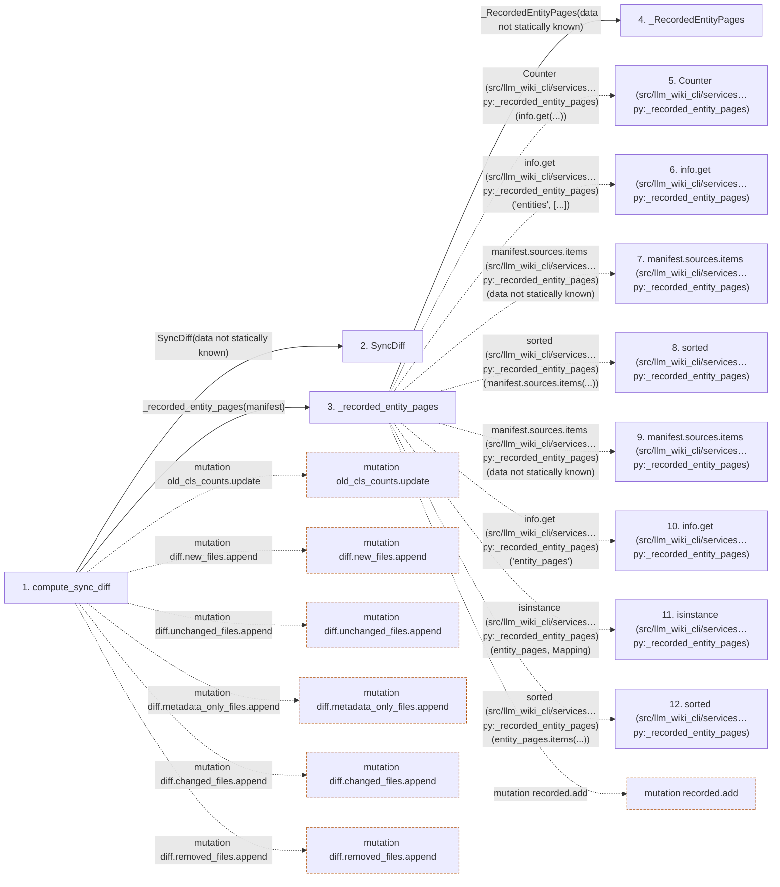

# compute_sync_diff

**Entry point:** `compute_sync_diff` (`api`)
**Source:** [sync_analysis](../modules/sync_analysis.md)
**Modules touched:** [bootstrap_runtime](../modules/bootstrap_runtime.md), [knowledge_evidence](../modules/knowledge_evidence.md), [sync_analysis](../modules/sync_analysis.md), [validation](../modules/validation.md)

## Call sequence

> Static overview in presentation order, not runtime execution order. Arrows retain captured callers; representative internal continuations and boundary examples precede repeated helper detail.

```mermaid
sequenceDiagram
    participant p0 as compute_sync_diff
    participant p1 as _recorded_entity_pages
    participant p2 as _ownership_error
    participant p3 as hash_file
    participant p4 as semantic_hash_for_file
    participant p5 as build_entity_page_map
    participant p6 as SyncDiff
    participant p7 as build_module_page_map
    participant p8 as _module_name_from_path
    participant p9 as _page_name_for_module
    participant p10 as build_entity_occurrence_page_map
    participant p11 as without_line_metadata
    participant p12 as _page_name_for_entity
    participant p13 as _safe_page_component
    participant p14 as portable_page_component
    participant p15 as _disambiguate_paths
    participant p16 as _globally_disambiguate_module_pages
    participant p17 as portable_page_component.<locals>.sanitize
    participant p18 as _page_name_from_source_path
    participant p19 as _RecordedEntityPages
    participant p20 as SyncOwnershipError
    participant p21 as sha256_bytes
    participant p22 as _legacy_entity_page_map
    participant p23 as _entity_occurrences
    participant p24 as portable_path_key
    participant p25 as _page_name_with_extension
    participant p26 as is_portable_path_component
    participant p27 as Counter (src/llm_wiki_cli/services…ysis.py:compute_sync_diff)
    participant p28 as manifest.sources.items (src/llm_wiki_cli/services…ysis.py:compute_sync_diff)
    participant p29 as old_cls_counts.update
    participant p30 as info.get (src/llm_wiki_cli/services…ysis.py:compute_sync_diff)
    p0->>p1: _recorded_entity_pages
    p0->>p2: _ownership_error
    p0->>p3: hash_file
    p0->>p4: semantic_hash_for_file
    p0->>p5: build_entity_page_map
    p0->>p6: SyncDiff
    p0->>p7: build_module_page_map
    p0->>p8: _module_name_from_path
    p0->>p9: _page_name_for_module
    p0->>p10: build_entity_occurrence_page_map
    p4->>p11: without_line_metadata
    p1->>p12: _page_name_for_entity
    p12->>p13: _safe_page_component
    p13->>p14: portable_page_component
    p7->>p15: _disambiguate_paths
    p7->>p16: _globally_disambiguate_module_pages
    p14->>p17: portable_page_component.<locals>.sanitize
    p16->>p18: _page_name_from_source_path
    p1->>p19: _RecordedEntityPages
    p2->>p20: SyncOwnershipError
    p3->>p21: sha256_bytes
    p5->>p22: _legacy_entity_page_map
    p10->>p23: _entity_occurrences
    p10->>p24: portable_path_key
    p15->>p25: _page_name_with_extension
    p17->>p26: is_portable_path_component
    p0-->>p27: Counter (src/llm_wiki_cli/services…ysis.py:compute_sync_diff)
    p0-->>p28: manifest.sources.items (src/llm_wiki_cli/services…ysis.py:compute_sync_diff)
    p0-->>p29: old_cls_counts.update(info.get(...))
    p0-->>p30: info.get (src/llm_wiki_cli/services…ysis.py:compute_sync_diff)('entities', [...])
```

<!-- Auto-generated from static call edges. Dashed arrows are external or unresolved calls. Reviewed runtime conditions and side effects belong in Behavior. -->

> Call sequence diagram shows 30 of 209 interactions; 179 omitted to keep the visualization within the 30-interaction and generated-diagram limits, with uncertain identities omitted rather than inferred.

> Captured boundary calls: external 1 of 72 (71 omitted); unresolved 3 of 86 (83 omitted). These counts cover the captured static trace.

Omitted captured detail, grouped by actual caller occurrence and target module:

| Caller | Parent step | Target module | Kind | Omitted interactions |
| --- | --- | --- | --- | --- |
| `src/llm_wiki_cli/services/sync_analysis.py:_recorded_entity_pages` | 3 | - | external | 12 |
| `src/llm_wiki_cli/services/sync_analysis.py:_recorded_entity_pages` | 3 | - | unresolved | 14 |
| `src/llm_wiki_cli/services/sync_analysis.py:_recorded_entity_pages` | 3 | [src/llm_wiki_cli/services/sync_analysis.py](../modules/sync_analysis.md) | internal | 2 |
| `src/llm_wiki_cli/services/validation.py:portable_page_component.<locals>.sanitize` | 36 | - | unresolved | 6 |
| `src/llm_wiki_cli/services/validation.py:portable_page_component.<locals>.sanitize` | 36 | - | external | 3 |
| `src/llm_wiki_cli/services/validation.py:portable_page_component` | 35 | [src/llm_wiki_cli/services/validation.py](../modules/validation.md) | internal | 1 |
| `src/llm_wiki_cli/services/sync_analysis.py:compute_sync_diff` | 1 | - | unresolved | 26 |
| `src/llm_wiki_cli/services/sync_analysis.py:compute_sync_diff` | 1 | - | external | 18 |
> Omission summary shows 8 of 41 groups; 33 further groups are not expanded here. Counts above include all omitted interactions.
> Detailed flow queries retain their own coverage and limits; omitted paths may execute at runtime.

> Trace truncated at the depth limit; deeper calls are omitted.

## Data flow

<!-- Auto-generated static analysis. Treat values and boundaries as best-effort hints, not runtime proof. -->

### Step data

| Step | Inputs | Reads | Writes | Returns |
|---|---|---|---|---|
| `compute_sync_diff` | `manifest: SyncManifest`, `inventory: dict`, `src_dir: str`, `entity_page_cache: dict[tuple[str, str], str] \| None`, `module_page_map: dict[str, str] \| None`, `source_content_hashes: Mapping[str, str] \| None` | - | `diff.moved_entities[...]`, `diff.renamed_module_pages[...]`, `seen[...]` | `diff` |
| `SyncDiff` | - | - | - | - |
| `_recorded_entity_pages` | `manifest: SyncManifest` | `Mapping`, `Mapping` | - | `recorded` |
| `_RecordedEntityPages` | - | - | - | - |
| `Counter (src/llm_wiki_cli/services…py:_recorded_entity_pages)` | - | - | - | - |
| `info.get (src/llm_wiki_cli/services…py:_recorded_entity_pages)` | - | - | - | - |
| `manifest.sources.items (src/llm_wiki_cli/services…py:_recorded_entity_pages)` | - | - | - | - |
| `sorted (src/llm_wiki_cli/services…py:_recorded_entity_pages)` | - | - | - | - |
| `manifest.sources.items (src/llm_wiki_cli/services…py:_recorded_entity_pages)` | - | - | - | - |
| `info.get (src/llm_wiki_cli/services…py:_recorded_entity_pages)` | - | - | - | - |
| `isinstance (src/llm_wiki_cli/services…py:_recorded_entity_pages)` | - | - | - | - |
| `sorted (src/llm_wiki_cli/services…py:_recorded_entity_pages)` | - | - | - | - |

### Call data

| From | To | Line | Call |
|---|---|---:|---|
| compute_sync_diff | SyncDiff | 191 | `SyncDiff(data not statically known)` |
| compute_sync_diff | _recorded_entity_pages | 192 | `_recorded_entity_pages(manifest)` |
| _recorded_entity_pages | _RecordedEntityPages | 76 | `_RecordedEntityPages(data not statically known)` |
| _recorded_entity_pages | Counter (src/llm_wiki_cli/services…py:_recorded_entity_pages) | 78 | `Counter(info.get(...))` |
| _recorded_entity_pages | info.get (src/llm_wiki_cli/services…py:_recorded_entity_pages) | 78 | `info.get('entities', [...])` |
| _recorded_entity_pages | manifest.sources.items (src/llm_wiki_cli/services…py:_recorded_entity_pages) | 79 | `manifest.sources.items(data not statically known)` |
| _recorded_entity_pages | sorted (src/llm_wiki_cli/services…py:_recorded_entity_pages) | 96 | `sorted(manifest.sources.items(...))` |
| _recorded_entity_pages | manifest.sources.items (src/llm_wiki_cli/services…py:_recorded_entity_pages) | 96 | `manifest.sources.items(data not statically known)` |
| _recorded_entity_pages | info.get (src/llm_wiki_cli/services…py:_recorded_entity_pages) | 97 | `info.get('entity_pages')` |
| _recorded_entity_pages | isinstance (src/llm_wiki_cli/services…py:_recorded_entity_pages) | 98 | `isinstance(entity_pages, Mapping)` |
| _recorded_entity_pages | sorted (src/llm_wiki_cli/services…py:_recorded_entity_pages) | 99 | `sorted(entity_pages.items(...))` |

### Boundary effects

| Kind | Target | Step | Line |
|---|---|---|---:|
| mutation | `old_cls_counts.update` | `compute_sync_diff` | 197 |
| mutation | `diff.new_files.append` | `compute_sync_diff` | 225 |
| mutation | `diff.unchanged_files.append` | `compute_sync_diff` | 233 |
| mutation | `diff.metadata_only_files.append` | `compute_sync_diff` | 237 |
| mutation | `diff.changed_files.append` | `compute_sync_diff` | 239 |
| mutation | `diff.removed_files.append` | `compute_sync_diff` | 243 |
| mutation | `recorded.add` | `_recorded_entity_pages` | 133 |

### Static analysis gaps

| Kind | Step | Target | Line |
|---|---|---|---:|
| external_call | `_recorded_entity_pages` | `Counter` | 78 |
| unresolved_call | `_recorded_entity_pages` | `info.get` | 78 |
| unresolved_call | `_recorded_entity_pages` | `manifest.sources.items` | 79 |
| external_call | `_recorded_entity_pages` | `sorted` | 96 |
| unresolved_call | `_recorded_entity_pages` | `manifest.sources.items` | 96 |
| unresolved_call | `_recorded_entity_pages` | `info.get` | 97 |
| external_call | `_recorded_entity_pages` | `isinstance` | 98 |
| external_call | `_recorded_entity_pages` | `sorted` | 99 |
| step_limit | `compute_sync_diff` | `first 12 steps` | 0 |
| truncated_flow | `compute_sync_diff` | `depth limit` | 0 |

## Behavior

This flow starts at `compute_sync_diff` and is classified as `api`. The generated call and data-flow sections are bounded static projections; runtime conditions and side effects require source-level confirmation.
