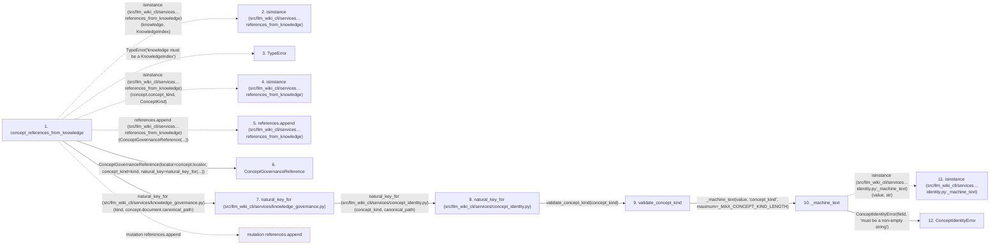

# concept_references_from_knowledge

**Entry point:** `concept_references_from_knowledge` (`api`)
**Source:** [knowledge_governance](../modules/knowledge_governance.md)
**Modules touched:** [concept_identity](../modules/concept_identity.md), [knowledge_governance](../modules/knowledge_governance.md), [validation](../modules/validation.md), [wiki_surface](../modules/wiki_surface.md)

## Call sequence

> Static overview in presentation order, not runtime execution order. Arrows retain captured callers; representative internal continuations and boundary examples precede repeated helper detail.

```mermaid
sequenceDiagram
    participant p0 as concept_references_from_knowledge
    participant p1 as natural_key_for (src/llm_wiki_cli/services/knowledge_governance.py)
    participant p2 as _validated_references
    participant p3 as ConceptGovernanceReference
    participant p4 as natural_key_for (src/llm_wiki_cli/services/concept_identity.py)
    participant p5 as _identity_value
    participant p6 as _concept_kind
    participant p7 as validate_concept_kind
    participant p8 as _alias_type
    participant p9 as require_repository_relative_path
    participant p10 as validate_alias_value
    participant p11 as validate_natural_key
    participant p12 as _machine_text
    participant p13 as validate_alias_type
    participant p14 as validate_locator
    participant p15 as require_portable_relative_path
    participant p16 as _safe_decoded_coordinate
    participant p17 as _default_path_error
    participant p18 as validate_exact_page_coordinate
    participant p19 as _check_path_collision
    participant p20 as require_portable_path_component
    participant p21 as GovernanceError
    participant p22 as ConceptIdentityError
    participant p23 as _syntax_key
    participant p24 as _known_syntax
    participant p25 as _remember_syntax
    participant p26 as _contains_uri_userinfo
    participant p27 as _contains_coordinate_userinfo
    participant p28 as _looks_absolute_path
    participant p29 as isinstance (src/llm_wiki_cli/services…references_from_knowledge)
    participant p30 as references.append (src/llm_wiki_cli/services…references_from_knowledge)
    p0->>p1: natural_key_for (src/llm_wiki_cli/services/knowledge_governance.py)
    p0->>p2: _validated_references
    p0->>p3: ConceptGovernanceReference
    p1->>p4: natural_key_for (src/llm_wiki_cli/services/concept_identity.py)
    p2->>p5: _identity_value
    p2->>p6: _concept_kind
    p4->>p7: validate_concept_kind
    p5->>p8: _alias_type
    p4->>p9: require_repository_relative_path
    p5->>p10: validate_alias_value
    p4->>p11: validate_natural_key
    p7->>p12: _machine_text
    p10->>p13: validate_alias_type
    p10->>p14: validate_locator
    p9->>p15: require_portable_relative_path
    p11->>p16: _safe_decoded_coordinate
    p15->>p17: _default_path_error
    p14->>p18: validate_exact_page_coordinate
    p15->>p19: _check_path_collision
    p15->>p20: require_portable_path_component
    p1->>p21: GovernanceError
    p4->>p22: ConceptIdentityError
    p9->>p23: _syntax_key
    p9->>p24: _known_syntax
    p9->>p25: _remember_syntax
    p11->>p26: _contains_uri_userinfo
    p11->>p27: _contains_coordinate_userinfo
    p11->>p28: _looks_absolute_path
    p0-->>p29: isinstance (src/llm_wiki_cli/services…references_from_knowledge)(knowledge, KnowledgeIndex)
    p0-->>p30: references.append (src/llm_wiki_cli/services…references_from_knowledge)(ConceptGovernanceReference(...))
```

<!-- Auto-generated from static call edges. Dashed arrows are external or unresolved calls. Reviewed runtime conditions and side effects belong in Behavior. -->

> Call sequence diagram shows 30 of 203 interactions; 173 omitted to keep the visualization within the 30-interaction and generated-diagram limits, with uncertain identities omitted rather than inferred.

> Captured boundary calls: external 1 of 54 (53 omitted); unresolved 1 of 54 (53 omitted). These counts cover the captured static trace.

Omitted captured detail, grouped by actual caller occurrence and target module:

| Caller | Parent step | Target module | Kind | Omitted interactions |
| --- | --- | --- | --- | --- |
| `src/llm_wiki_cli/services/knowledge_governance.py:concept_references_from_knowledge` | 1 | - | external | 2 |
| `src/llm_wiki_cli/services/concept_identity.py:_machine_text` | 10 | - | external | 6 |
| `src/llm_wiki_cli/services/concept_identity.py:_machine_text` | 10 | [src/llm_wiki_cli/services/concept_identity.py](../modules/concept_identity.md) | internal | 5 |
| `src/llm_wiki_cli/services/concept_identity.py:_machine_text` | 10 | - | unresolved | 3 |
| `src/llm_wiki_cli/services/concept_identity.py:validate_concept_kind` | 9 | - | unresolved | 1 |
| `src/llm_wiki_cli/services/concept_identity.py:validate_concept_kind` | 9 | [src/llm_wiki_cli/services/concept_identity.py](../modules/concept_identity.md) | internal | 1 |
| `src/llm_wiki_cli/services/validation.py:require_repository_relative_path` | 27 | - | external | 7 |
| `src/llm_wiki_cli/services/validation.py:_syntax_key` | 29 | - | external | 6 |
> Omission summary shows 8 of 47 groups; 39 further groups are not expanded here. Counts above include all omitted interactions.
> Detailed flow queries retain their own coverage and limits; omitted paths may execute at runtime.

> Trace truncated at the depth limit; deeper calls are omitted.

## Data flow

<!-- Auto-generated static analysis. Treat values and boundaries as best-effort hints, not runtime proof. -->

### Step data

| Step | Inputs | Reads | Writes | Returns |
|---|---|---|---|---|
| `concept_references_from_knowledge` | `knowledge: KnowledgeIndex` | `KnowledgeIndex`, `ConceptKind` | - | `_validated_references(...)` |
| `isinstance (src/llm_wiki_cli/services…references_from_knowledge)` | - | - | - | - |
| `TypeError` | - | - | - | - |
| `isinstance (src/llm_wiki_cli/services…references_from_knowledge)` | - | - | - | - |
| `references.append (src/llm_wiki_cli/services…references_from_knowledge)` | - | - | - | - |
| `ConceptGovernanceReference` | - | - | - | - |
| `natural_key_for (src/llm_wiki_cli/services/knowledge_governance.py)` | `concept_kind: str`, `canonical_path: str` | `ConceptIdentityError` | - | `_identity_natural_key_for(...)` |
| `natural_key_for (src/llm_wiki_cli/services/concept_identity.py)` | `concept_kind: str`, `canonical_path: str` | - | - | `validate_natural_key(...)` |
| `validate_concept_kind` | `value: object` | `_MAX_CONCEPT_KIND_LENGTH`, `_UID_TAG_BY_KIND` | - | `text` |
| `_machine_text` | `value: object`, `field: str`, `maximum: int` | - | - | `value` |
| `isinstance (src/llm_wiki_cli/services…identity.py:_machine_text)` | - | - | - | - |
| `ConceptIdentityError` | - | - | - | - |

### Call data

| From | To | Line | Call |
|---|---|---:|---|
| concept_references_from_knowledge | isinstance (src/llm_wiki_cli/services…references_from_knowledge) | 1474 | `isinstance(knowledge, KnowledgeIndex)` |
| concept_references_from_knowledge | TypeError | 1475 | `TypeError('knowledge must be a KnowledgeIndex')` |
| concept_references_from_knowledge | isinstance (src/llm_wiki_cli/services…references_from_knowledge) | 1480 | `isinstance(concept.concept_kind, ConceptKind)` |
| concept_references_from_knowledge | references.append (src/llm_wiki_cli/services…references_from_knowledge) | 1483 | `references.append(ConceptGovernanceReference(...))` |
| concept_references_from_knowledge | ConceptGovernanceReference | 1484 | `ConceptGovernanceReference(locator=concept.locator, concept_kind=kind, natural_key=natural_key_for(...))` |
| concept_references_from_knowledge | natural_key_for (src/llm_wiki_cli/services/knowledge_governance.py) | 1487 | `natural_key_for(kind, concept.document.canonical_path)` |
| natural_key_for (src/llm_wiki_cli/services/knowledge_governance.py) | natural_key_for (src/llm_wiki_cli/services/concept_identity.py) | 396 | `_identity_natural_key_for(concept_kind, canonical_path)` |
| natural_key_for (src/llm_wiki_cli/services/concept_identity.py) | validate_concept_kind | 327 | `validate_concept_kind(concept_kind)` |
| validate_concept_kind | _machine_text | 306 | `_machine_text(value, 'concept_kind', maximum=_MAX_CONCEPT_KIND_LENGTH)` |
| _machine_text | isinstance (src/llm_wiki_cli/services…identity.py:_machine_text) | 942 | `isinstance(value, str)` |
| _machine_text | ConceptIdentityError | 943 | `ConceptIdentityError(field, 'must be a non-empty string')` |

### Boundary effects

| Kind | Target | Step | Line |
|---|---|---|---:|
| mutation | `references.append` | `concept_references_from_knowledge` | 1483 |

### Static analysis gaps

| Kind | Step | Target | Line |
|---|---|---|---:|
| external_call | `concept_references_from_knowledge` | `isinstance` | 1474 |
| external_call | `concept_references_from_knowledge` | `TypeError` | 1475 |
| external_call | `concept_references_from_knowledge` | `isinstance` | 1480 |
| external_call | `_machine_text` | `isinstance` | 942 |
| step_limit | `concept_references_from_knowledge` | `first 12 steps` | 0 |
| truncated_flow | `concept_references_from_knowledge` | `depth limit` | 0 |

## Behavior

This flow starts at `concept_references_from_knowledge` and is classified as `api`. The generated call and data-flow sections are bounded static projections; runtime conditions and side effects require source-level confirmation.
