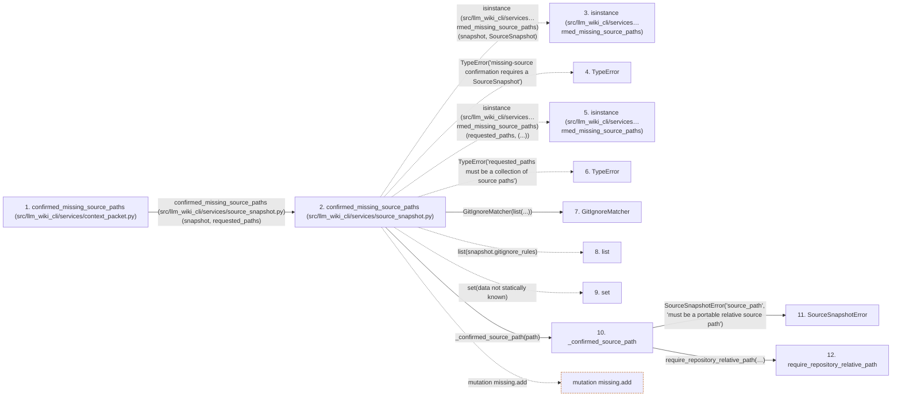

# confirmed_missing_source_paths

**Entry point:** `confirmed_missing_source_paths` (`api`)
**Source:** [context_packet](../modules/context_packet.md)
**Modules touched:** [common](../modules/common.md), [config](../modules/config.md), [context_packet](../modules/context_packet.md), [filesystem_guard](../modules/filesystem_guard.md), and 2 more

**Complete modules touched:**

- [common](../modules/common.md)
- [config](../modules/config.md)
- [context_packet](../modules/context_packet.md)
- [filesystem_guard](../modules/filesystem_guard.md)
- [source_snapshot](../modules/source_snapshot.md)
- [validation](../modules/validation.md)

## Call sequence

> Static overview in presentation order, not runtime execution order. Arrows retain captured callers; representative internal continuations and boundary examples precede repeated helper detail.

```mermaid
sequenceDiagram
    participant p0 as confirmed_missing_source_paths (src/llm_wiki_cli/services/context_packet.py)
    participant p1 as confirmed_missing_source_paths (src/llm_wiki_cli/services/source_snapshot.py)
    participant p2 as ContextPacketSourceMutationError
    participant p3 as ContextPacketPathPolicyError
    participant p4 as _confirmed_source_path
    participant p5 as is_agent_worktree_path
    participant p6 as is_bundled_helper_implementation_path
    participant p7 as GitIgnoreMatcher.is_ignored
    participant p8 as _missing_source_path_no_follow
    participant p9 as GitIgnoreMatcher.last_matching_rule
    participant p10 as require_repository_relative_path
    participant p11 as guard_windows_directory_chain
    participant p12 as _is_absolute_path_text
    participant p13 as _path_text_equal
    participant p14 as _rule_matches
    participant p15 as _open_windows_directory_guard
    participant p16 as require_portable_relative_path
    participant p17 as create_private_windows_directory
    participant p18 as _default_path_error
    participant p19 as _private_windows_security_attributes
    participant p20 as _check_path_collision
    participant p21 as move_windows_path_write_through
    participant p22 as _verify_windows_handle_restrictive_dacl
    participant p23 as require_portable_path_component
    participant p24 as GitIgnoreMatcher
    participant p25 as SourceSnapshotError
    participant p26 as _normalized_rel_parts
    participant p27 as _normalize_path_text
    participant p28 as _is_windows_absolute_path_text
    participant p29 as str (src/llm_wiki_cli/services…rmed_missing_source_paths)
    participant p30 as snapshot.path_is_effectively_selected
    p0->>p1: confirmed_missing_source_paths (src/llm_wiki_cli/services/source_snapshot.py)
    p0->>p2: ContextPacketSourceMutationError
    p0->>p3: ContextPacketPathPolicyError
    p1->>p4: _confirmed_source_path
    p1->>p5: is_agent_worktree_path
    p1->>p6: is_bundled_helper_implementation_path
    p1->>p7: GitIgnoreMatcher.is_ignored
    p1->>p8: _missing_source_path_no_follow
    p7->>p9: GitIgnoreMatcher.last_matching_rule
    p4->>p10: require_repository_relative_path
    p8->>p11: guard_windows_directory_chain
    p6->>p12: _is_absolute_path_text
    p6->>p13: _path_text_equal
    p9->>p14: _rule_matches
    p11->>p15: _open_windows_directory_guard
    p10->>p16: require_portable_relative_path
    p11->>p17: create_private_windows_directory
    p16->>p18: _default_path_error
    p17->>p19: _private_windows_security_attributes
    p16->>p20: _check_path_collision
    p17->>p21: move_windows_path_write_through
    p15->>p22: _verify_windows_handle_restrictive_dacl
    p16->>p23: require_portable_path_component
    p1->>p24: GitIgnoreMatcher
    p4->>p25: SourceSnapshotError
    p5->>p26: _normalized_rel_parts
    p6->>p27: _normalize_path_text
    p6->>p28: _is_windows_absolute_path_text
    p0-->>p29: str (src/llm_wiki_cli/services…rmed_missing_source_paths)(exc)
    p1-->>p30: snapshot.path_is_effectively_selected(path)
```

<!-- Auto-generated from static call edges. Dashed arrows are external or unresolved calls. Reviewed runtime conditions and side effects belong in Behavior. -->

> Call sequence diagram shows 30 of 393 interactions; 363 omitted to keep the visualization within the 30-interaction and generated-diagram limits, with uncertain identities omitted rather than inferred.

> Captured boundary calls: external 1 of 188 (187 omitted); unresolved 1 of 90 (89 omitted). These counts cover the captured static trace.

Omitted captured detail, grouped by actual caller occurrence and target module:

| Caller | Parent step | Target module | Kind | Omitted interactions |
| --- | --- | --- | --- | --- |
| `src/llm_wiki_cli/services/source_snapshot.py:confirmed_missing_source_paths` | 2 | - | external | 8 |
| `src/llm_wiki_cli/services/validation.py:require_repository_relative_path` | 12 | - | external | 7 |
| `src/llm_wiki_cli/services/validation.py:require_repository_relative_path` | 12 | [src/llm_wiki_cli/services/validation.py](../modules/validation.md) | internal | 3 |
| `src/llm_wiki_cli/services/validation.py:_syntax_key` | 14 | - | external | 6 |
| `src/llm_wiki_cli/services/validation.py:_known_syntax` | 21 | - | unresolved | 2 |
| `src/llm_wiki_cli/services/validation.py:require_repository_relative_path` | 12 | - | unresolved | 5 |
| `src/llm_wiki_cli/services/validation.py:require_portable_relative_path` | 35 | - | external | 4 |
| `src/llm_wiki_cli/services/validation.py:_default_path_error` | 37 | [src/llm_wiki_cli/services/validation.py](../modules/validation.md) | internal | 1 |
> Omission summary shows 8 of 68 groups; 60 further groups are not expanded here. Counts above include all omitted interactions.
> Detailed flow queries retain their own coverage and limits; omitted paths may execute at runtime.

> Trace truncated at the depth limit; deeper calls are omitted.

## Data flow

<!-- Auto-generated static analysis. Treat values and boundaries as best-effort hints, not runtime proof. -->

### Analysis coverage

**Effect analysis partially available.** Flow assembly and source effect analysis are separate; empty observations do not prove an empty handler body.

Source steps: 116; effect analysis evaluated: 76, partial: 0, unavailable: 40. Counts include steps omitted from the displayed trace.

- Callable record unavailable; the selected entry symbol has no represented callable body.
- Effect collector totals unavailable; observed counts cover captured records only.

| Step | Callable record | Effect analysis | Collector totals |
|---|---|---|---|
| `confirmed_missing_source_paths (src/llm_wiki_cli/services/context_packet.py)` | `available` | `evaluated` | `available` |
| `confirmed_missing_source_paths (src/llm_wiki_cli/services/source_snapshot.py)` | `available` | `evaluated` | `available` |
| `isinstance (src/llm_wiki_cli/services…rmed_missing_source_paths)` | `not_applicable` | `not_applicable` | `not_applicable` |
| `TypeError` | `not_applicable` | `not_applicable` | `not_applicable` |
| `isinstance (src/llm_wiki_cli/services…rmed_missing_source_paths)` | `not_applicable` | `not_applicable` | `not_applicable` |
| `TypeError` | `not_applicable` | `not_applicable` | `not_applicable` |
| `GitIgnoreMatcher` | `unavailable` | `unavailable` | `unavailable` |
| `list` | `not_applicable` | `not_applicable` | `not_applicable` |
| `set` | `not_applicable` | `not_applicable` | `not_applicable` |
| `_confirmed_source_path` | `available` | `evaluated` | `available` |
| `SourceSnapshotError` | `unavailable` | `unavailable` | `unavailable` |
| `require_repository_relative_path` | `available` | `evaluated` | `available` |

### Step data

| Step | Inputs | Reads | Writes | Returns |
|---|---|---|---|---|
| `confirmed_missing_source_paths (src/llm_wiki_cli/services/context_packet.py)` | `snapshot: SourceSnapshot`, `requested_paths: Iterable[str]` | `SourceSnapshotMutationError`, `SourceSnapshotError` | - | `confirm_missing(...)` |
| `confirmed_missing_source_paths (src/llm_wiki_cli/services/source_snapshot.py)` | `snapshot: SourceSnapshot`, `requested_paths: Iterable[str]` | `SourceSnapshot` | - | `frozenset(...)` |
| `isinstance (src/llm_wiki_cli/services…rmed_missing_source_paths)` | - | - | - | - |
| `TypeError` | - | - | - | - |
| `isinstance (src/llm_wiki_cli/services…rmed_missing_source_paths)` | - | - | - | - |
| `TypeError` | - | - | - | - |
| `GitIgnoreMatcher` | - | - | - | - |
| `list` | - | - | - | - |
| `set` | - | - | - | - |
| `_confirmed_source_path` | `value: object` | - | - | `require_repository_relative_path(...)` |
| `SourceSnapshotError` | - | - | - | - |
| `require_repository_relative_path` | `value: object`, `text_error: Exception`, `posix_error: Exception`, `normalized_error: Exception`, `absolute_error: Exception \| None`, `separator_error: Exception \| None`, `control_error: Exception \| None`, `reject_delete_character: bool` | - | - | `cached`, `_remember_syntax(...)` |

### Call data

| From | To | Line | Call |
|---|---|---:|---|
| confirmed_missing_source_paths (src/llm_wiki_cli/services/context_packet.py) | confirmed_missing_source_paths (src/llm_wiki_cli/services/source_snapshot.py) | 5058 | `confirm_missing(snapshot, requested_paths)` |
| confirmed_missing_source_paths (src/llm_wiki_cli/services/source_snapshot.py) | isinstance (src/llm_wiki_cli/services…rmed_missing_source_paths) | 1916 | `isinstance(snapshot, SourceSnapshot)` |
| confirmed_missing_source_paths (src/llm_wiki_cli/services/source_snapshot.py) | TypeError | 1917 | `TypeError('missing-source confirmation requires a SourceSnapshot')` |
| confirmed_missing_source_paths (src/llm_wiki_cli/services/source_snapshot.py) | isinstance (src/llm_wiki_cli/services…rmed_missing_source_paths) | 1918 | `isinstance(requested_paths, (...))` |
| confirmed_missing_source_paths (src/llm_wiki_cli/services/source_snapshot.py) | TypeError | 1919 | `TypeError('requested_paths must be a collection of source paths')` |
| confirmed_missing_source_paths (src/llm_wiki_cli/services/source_snapshot.py) | GitIgnoreMatcher | 1920 | `GitIgnoreMatcher(list(...))` |
| confirmed_missing_source_paths (src/llm_wiki_cli/services/source_snapshot.py) | list | 1920 | `list(snapshot.gitignore_rules)` |
| confirmed_missing_source_paths (src/llm_wiki_cli/services/source_snapshot.py) | set | 1921 | `set(data not statically known)` |
| confirmed_missing_source_paths (src/llm_wiki_cli/services/source_snapshot.py) | _confirmed_source_path | 1923 | `_confirmed_source_path(path)` |
| _confirmed_source_path | SourceSnapshotError | 1899 | `SourceSnapshotError('source_path', 'must be a portable relative source path')` |
| _confirmed_source_path | require_repository_relative_path | 1900 | `require_repository_relative_path(value, text_error=error, posix_error=error, normalized_error=error, absolute_error=error, separator_error=error, control_error=error, reject_delete_character=True, portability_error=error)` |

### Boundary effects

| Kind | Target | Step | Line |
|---|---|---|---:|
| mutation | `missing.add` | `confirmed_missing_source_paths` | 1935 |

### Static analysis gaps

| Kind | Step | Target | Line |
|---|---|---|---:|
| external_call | `confirmed_missing_source_paths` | `isinstance` | 1916 |
| external_call | `confirmed_missing_source_paths` | `TypeError` | 1917 |
| external_call | `confirmed_missing_source_paths` | `isinstance` | 1918 |
| external_call | `confirmed_missing_source_paths` | `TypeError` | 1919 |
| step_limit | `confirmed_missing_source_paths` | `first 12 steps` | 0 |
| truncated_flow | `confirmed_missing_source_paths` | `depth limit` | 0 |

## Behavior

This flow starts at `confirmed_missing_source_paths` and is classified as `api`. The generated call and data-flow sections are bounded static projections; runtime conditions and side effects require source-level confirmation.
