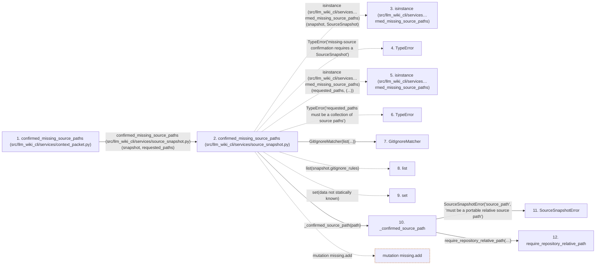

# confirmed_missing_source_paths

**Entry point:** `confirmed_missing_source_paths` (`api`)
**Source:** [context_packet](../modules/context_packet.md)
**Modules touched:** [common](../modules/common.md), [config](../modules/config.md), [context_packet](../modules/context_packet.md), [filesystem_guard](../modules/filesystem_guard.md), and 2 more

**Complete modules touched:**

- [common](../modules/common.md)
- [config](../modules/config.md)
- [context_packet](../modules/context_packet.md)
- [filesystem_guard](../modules/filesystem_guard.md)
- [source_snapshot](../modules/source_snapshot.md)
- [validation](../modules/validation.md)

## Call sequence

> Static overview in presentation order, not runtime execution order. Arrows retain captured callers; siblings are shown before deeper helper detail.

```mermaid
sequenceDiagram
    participant p0 as confirmed_missing_source_paths (src/llm_wiki_cli/services/context_packet.py)
    participant p1 as confirmed_missing_source_paths (src/llm_wiki_cli/services/source_snapshot.py)
    participant p2 as ContextPacketSourceMutationError
    participant p3 as ContextPacketPathPolicyError
    participant p4 as str (src/llm_wiki_cli/services…rmed_missing_source_paths)
    participant p5 as isinstance (src/llm_wiki_cli/services…rmed_missing_source_paths)
    participant p6 as TypeError
    participant p7 as GitIgnoreMatcher
    participant p8 as list
    participant p9 as set
    participant p10 as _confirmed_source_path
    participant p11 as snapshot.path_is_effectively_selected
    participant p12 as EXCLUDED_DIRS.isdisjoint
    participant p13 as Path (src/llm_wiki_cli/services…rmed_missing_source_paths)
    participant p14 as is_agent_worktree_path
    participant p15 as is_bundled_helper_implementation_path
    participant p16 as GitIgnoreMatcher.is_ignored
    participant p17 as _missing_source_path_no_follow
    participant p18 as missing.add
    participant p19 as frozenset
    participant p20 as SourceSnapshotError
    participant p21 as _normalized_rel_parts
    participant p22 as _normalize_path_text
    participant p23 as GitIgnoreMatcher.last_matching_rule
    participant p24 as ExitStack
    participant p25 as require_repository_relative_path
    participant p26 as len (src/llm_wiki_cli/config.py:is_agent_worktree_path)
    participant p27 as stack.enter_context
    p0->>p1: confirmed_missing_source_paths (src/llm_wiki_cli/services/source_snapshot.py)
    p0->>p2: ContextPacketSourceMutationError
    p0->>p3: ContextPacketPathPolicyError
    p0-->>p4: str (src/llm_wiki_cli/services…rmed_missing_source_paths)(exc)
    p1-->>p5: isinstance (src/llm_wiki_cli/services…rmed_missing_source_paths)(snapshot, SourceSnapshot)
    p1-->>p6: TypeError('missing-source confirmation requires a SourceSnapshot')
    p1-->>p5: isinstance (src/llm_wiki_cli/services…rmed_missing_source_paths)(requested_paths, (...))
    p1-->>p6: TypeError('requested_paths must be a collection of source paths')
    p1->>p7: GitIgnoreMatcher
    p1-->>p8: list(snapshot.gitignore_rules)
    p1-->>p9: set
    p1->>p10: _confirmed_source_path
    p1-->>p11: snapshot.path_is_effectively_selected(path)
    p1-->>p12: EXCLUDED_DIRS.isdisjoint(...)
    p1-->>p13: Path (src/llm_wiki_cli/services…rmed_missing_source_paths)(path)
    p1->>p14: is_agent_worktree_path
    p1->>p15: is_bundled_helper_implementation_path
    p1->>p16: GitIgnoreMatcher.is_ignored
    p1->>p17: _missing_source_path_no_follow
    p1-->>p18: missing.add(path)
    p1-->>p19: frozenset(missing)
    p10->>p20: SourceSnapshotError
    p14->>p21: _normalized_rel_parts
    p15->>p22: _normalize_path_text
    p16->>p23: GitIgnoreMatcher.last_matching_rule
    p17-->>p24: ExitStack
    p10->>p25: require_repository_relative_path
    p14-->>p26: len (src/llm_wiki_cli/config.py:is_agent_worktree_path)(pattern)
    p15->>p22: _normalize_path_text
    p17-->>p27: stack.enter_context(guard_windows_directory_chain(...))
```

<!-- Auto-generated from static call edges. Dashed arrows are external or unresolved calls. Reviewed runtime conditions and side effects belong in Behavior. -->

> Call sequence diagram shows 30 of 393 interactions; 363 omitted to keep the visualization within the 30-interaction and generated-diagram limits, with uncertain identities omitted rather than inferred.

> Captured boundary calls: external 11 of 188 (177 omitted); unresolved 4 of 95 (91 omitted). These counts cover the captured static trace.

Omitted captured detail, grouped by actual caller occurrence and target module:

| Caller | Parent step | Target module | Kind | Omitted interactions |
| --- | --- | --- | --- | --- |
| `src/llm_wiki_cli/services/validation.py:require_repository_relative_path` | 12 | - | external | 7 |
| `src/llm_wiki_cli/services/validation.py:require_repository_relative_path` | 12 | [src/llm_wiki_cli/services/validation.py](../modules/validation.md) | internal | 4 |
| `src/llm_wiki_cli/services/validation.py:_syntax_key` | 14 | - | external | 6 |
| `src/llm_wiki_cli/services/validation.py:_known_syntax` | 21 | - | unresolved | 2 |
| `src/llm_wiki_cli/services/validation.py:require_repository_relative_path` | 12 | - | unresolved | 5 |
| `src/llm_wiki_cli/services/validation.py:require_portable_relative_path` | 35 | - | external | 4 |
| `src/llm_wiki_cli/services/validation.py:require_portable_relative_path` | 35 | [src/llm_wiki_cli/services/validation.py](../modules/validation.md) | internal | 13 |
| `src/llm_wiki_cli/services/validation.py:_default_path_error` | 37 | [src/llm_wiki_cli/services/validation.py](../modules/validation.md) | internal | 1 |
> Omission summary shows 8 of 67 groups; 59 further groups are not expanded here. Counts above include all omitted interactions.
> Detailed flow queries retain their own coverage and limits; omitted paths may execute at runtime.

> Trace truncated at the depth limit; deeper calls are omitted.

## Data flow

<!-- Auto-generated static analysis. Treat values and boundaries as best-effort hints, not runtime proof. -->

### Step data

| Step | Inputs | Reads | Writes | Returns |
|---|---|---|---|---|
| `confirmed_missing_source_paths (src/llm_wiki_cli/services/context_packet.py)` | `snapshot: SourceSnapshot`, `requested_paths: Iterable[str]` | `SourceSnapshotMutationError`, `SourceSnapshotError` | - | `confirm_missing(...)` |
| `confirmed_missing_source_paths (src/llm_wiki_cli/services/source_snapshot.py)` | `snapshot: SourceSnapshot`, `requested_paths: Iterable[str]` | `SourceSnapshot` | - | `frozenset(...)` |
| `isinstance (src/llm_wiki_cli/services…rmed_missing_source_paths)` | - | - | - | - |
| `TypeError` | - | - | - | - |
| `isinstance (src/llm_wiki_cli/services…rmed_missing_source_paths)` | - | - | - | - |
| `TypeError` | - | - | - | - |
| `GitIgnoreMatcher` | - | - | - | - |
| `list` | - | - | - | - |
| `set` | - | - | - | - |
| `_confirmed_source_path` | `value: object` | - | - | `require_repository_relative_path(...)` |
| `SourceSnapshotError` | - | - | - | - |
| `require_repository_relative_path` | `value: object`, `text_error: Exception`, `posix_error: Exception`, `normalized_error: Exception`, `absolute_error: Exception \| None`, `separator_error: Exception \| None`, `control_error: Exception \| None`, `reject_delete_character: bool` | - | - | `cached`, `_remember_syntax(...)` |

### Call data

| From | To | Line | Call |
|---|---|---:|---|
| confirmed_missing_source_paths (src/llm_wiki_cli/services/context_packet.py) | confirmed_missing_source_paths (src/llm_wiki_cli/services/source_snapshot.py) | 5007 | `confirm_missing(snapshot, requested_paths)` |
| confirmed_missing_source_paths (src/llm_wiki_cli/services/source_snapshot.py) | isinstance (src/llm_wiki_cli/services…rmed_missing_source_paths) | 1900 | `isinstance(snapshot, SourceSnapshot)` |
| confirmed_missing_source_paths (src/llm_wiki_cli/services/source_snapshot.py) | TypeError | 1901 | `TypeError('missing-source confirmation requires a SourceSnapshot')` |
| confirmed_missing_source_paths (src/llm_wiki_cli/services/source_snapshot.py) | isinstance (src/llm_wiki_cli/services…rmed_missing_source_paths) | 1902 | `isinstance(requested_paths, (...))` |
| confirmed_missing_source_paths (src/llm_wiki_cli/services/source_snapshot.py) | TypeError | 1903 | `TypeError('requested_paths must be a collection of source paths')` |
| confirmed_missing_source_paths (src/llm_wiki_cli/services/source_snapshot.py) | GitIgnoreMatcher | 1904 | `GitIgnoreMatcher(list(...))` |
| confirmed_missing_source_paths (src/llm_wiki_cli/services/source_snapshot.py) | list | 1904 | `list(snapshot.gitignore_rules)` |
| confirmed_missing_source_paths (src/llm_wiki_cli/services/source_snapshot.py) | set | 1905 | `set(data not statically known)` |
| confirmed_missing_source_paths (src/llm_wiki_cli/services/source_snapshot.py) | _confirmed_source_path | 1907 | `_confirmed_source_path(path)` |
| _confirmed_source_path | SourceSnapshotError | 1883 | `SourceSnapshotError('source_path', 'must be a portable relative source path')` |
| _confirmed_source_path | require_repository_relative_path | 1884 | `require_repository_relative_path(value, text_error=error, posix_error=error, normalized_error=error, absolute_error=error, separator_error=error, control_error=error, reject_delete_character=True, portability_error=error)` |

### Boundary effects

| Kind | Target | Step | Line |
|---|---|---|---:|
| mutation | `missing.add` | `confirmed_missing_source_paths` | 1919 |

### Static analysis gaps

| Kind | Step | Target | Line |
|---|---|---|---:|
| external_call | `confirmed_missing_source_paths` | `isinstance` | 1900 |
| external_call | `confirmed_missing_source_paths` | `TypeError` | 1901 |
| external_call | `confirmed_missing_source_paths` | `isinstance` | 1902 |
| external_call | `confirmed_missing_source_paths` | `TypeError` | 1903 |
| step_limit | `confirmed_missing_source_paths` | `first 12 steps` | 0 |
| truncated_flow | `confirmed_missing_source_paths` | `depth limit` | 0 |

## Behavior

This flow starts at `confirmed_missing_source_paths` and is classified as `api`. The generated call and data-flow sections are bounded static projections; runtime conditions and side effects require source-level confirmation.
