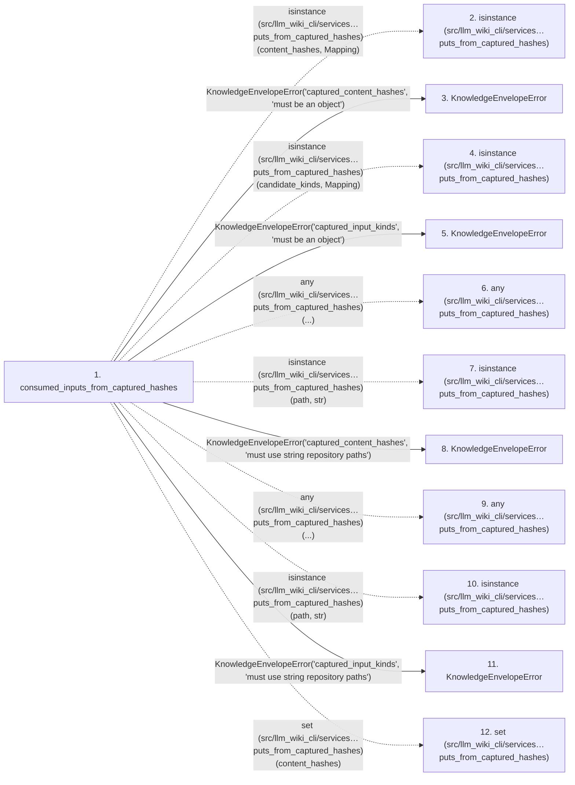

# consumed_inputs_from_captured_hashes

**Entry point:** `consumed_inputs_from_captured_hashes` (`api`)
**Source:** [knowledge_envelope](../modules/knowledge_envelope.md)
**Modules touched:** [knowledge_envelope](../modules/knowledge_envelope.md), [validation](../modules/validation.md)

## Call sequence

> Static overview in presentation order, not runtime execution order. Arrows retain captured callers; siblings are shown before deeper helper detail.

```mermaid
sequenceDiagram
    participant p0 as consumed_inputs_from_captured_hashes
    participant p1 as isinstance (src/llm_wiki_cli/services…puts_from_captured_hashes)
    participant p2 as KnowledgeEnvelopeError
    participant p3 as any (src/llm_wiki_cli/services…puts_from_captured_hashes)
    participant p4 as set (src/llm_wiki_cli/services…puts_from_captured_hashes)
    participant p5 as _repository_relative_path
    participant p6 as tuple (src/llm_wiki_cli/services…puts_from_captured_hashes)
    participant p7 as ConsumedInput
    participant p8 as _canonical_consumed_input_kind
    participant p9 as sorted
    participant p10 as require_repository_relative_path
    participant p11 as isinstance (src/llm_wiki_cli/services…nical_consumed_input_kind)
    participant p12 as tuple (src/llm_wiki_cli/services…nical_consumed_input_kind)
    participant p13 as set (src/llm_wiki_cli/services…nical_consumed_input_kind)
    p0-->>p1: isinstance (src/llm_wiki_cli/services…puts_from_captured_hashes)(content_hashes, Mapping)
    p0->>p2: KnowledgeEnvelopeError
    p0-->>p1: isinstance (src/llm_wiki_cli/services…puts_from_captured_hashes)(candidate_kinds, Mapping)
    p0->>p2: KnowledgeEnvelopeError
    p0-->>p3: any (src/llm_wiki_cli/services…puts_from_captured_hashes)(...)
    p0-->>p1: isinstance (src/llm_wiki_cli/services…puts_from_captured_hashes)(path, str)
    p0->>p2: KnowledgeEnvelopeError
    p0-->>p3: any (src/llm_wiki_cli/services…puts_from_captured_hashes)(...)
    p0-->>p1: isinstance (src/llm_wiki_cli/services…puts_from_captured_hashes)(path, str)
    p0->>p2: KnowledgeEnvelopeError
    p0-->>p4: set (src/llm_wiki_cli/services…puts_from_captured_hashes)(content_hashes)
    p0-->>p4: set (src/llm_wiki_cli/services…puts_from_captured_hashes)(candidate_kinds)
    p0->>p2: KnowledgeEnvelopeError
    p0->>p5: _repository_relative_path
    p0-->>p6: tuple (src/llm_wiki_cli/services…puts_from_captured_hashes)(...)
    p0->>p7: ConsumedInput
    p0->>p8: _canonical_consumed_input_kind
    p0-->>p9: sorted(content_hashes)
    p5->>p10: require_repository_relative_path
    p8-->>p11: isinstance (src/llm_wiki_cli/services…nical_consumed_input_kind)(value, (...))
    p5->>p2: KnowledgeEnvelopeError
    p8-->>p11: isinstance (src/llm_wiki_cli/services…nical_consumed_input_kind)(value, bytes)
    p5->>p2: KnowledgeEnvelopeError
    p8->>p2: KnowledgeEnvelopeError
    p5->>p2: KnowledgeEnvelopeError
    p8-->>p12: tuple (src/llm_wiki_cli/services…nical_consumed_input_kind)(value)
    p8->>p2: KnowledgeEnvelopeError
    p8->>p2: KnowledgeEnvelopeError
    p8-->>p13: set (src/llm_wiki_cli/services…nical_consumed_input_kind)
    p8-->>p11: isinstance (src/llm_wiki_cli/services…nical_consumed_input_kind)(candidate, ConsumedInputKind)
```

<!-- Auto-generated from static call edges. Dashed arrows are external or unresolved calls. Reviewed runtime conditions and side effects belong in Behavior. -->

> Call sequence diagram shows 30 of 113 interactions; 83 omitted to keep the visualization within the 30-interaction and generated-diagram limits, with uncertain identities omitted rather than inferred.

> Captured boundary calls: external 15 of 43 (28 omitted); unresolved 0 of 28 (28 omitted). These counts cover the captured static trace.

Omitted captured detail, grouped by actual caller occurrence and target module:

| Caller | Parent step | Target module | Kind | Omitted interactions |
| --- | --- | --- | --- | --- |
| `src/llm_wiki_cli/services/validation.py:require_repository_relative_path` | 16 | - | external | 7 |
| `src/llm_wiki_cli/services/validation.py:require_repository_relative_path` | 16 | [src/llm_wiki_cli/services/validation.py](../modules/validation.md) | internal | 4 |
| `src/llm_wiki_cli/services/validation.py:_syntax_key` | 18 | - | external | 6 |
| `src/llm_wiki_cli/services/validation.py:_known_syntax` | 25 | - | unresolved | 2 |
| `src/llm_wiki_cli/services/validation.py:require_repository_relative_path` | 16 | - | unresolved | 5 |
| `src/llm_wiki_cli/services/validation.py:require_portable_relative_path` | 39 | - | external | 4 |
| `src/llm_wiki_cli/services/validation.py:require_portable_relative_path` | 39 | [src/llm_wiki_cli/services/validation.py](../modules/validation.md) | internal | 13 |
| `src/llm_wiki_cli/services/validation.py:_default_path_error` | 41 | [src/llm_wiki_cli/services/validation.py](../modules/validation.md) | internal | 1 |
> Omission summary shows 8 of 21 groups; 13 further groups are not expanded here. Counts above include all omitted interactions.
> Detailed flow queries retain their own coverage and limits; omitted paths may execute at runtime.

## Data flow

<!-- Auto-generated static analysis. Treat values and boundaries as best-effort hints, not runtime proof. -->

### Step data

| Step | Inputs | Reads | Writes | Returns |
|---|---|---|---|---|
| `consumed_inputs_from_captured_hashes` | `content_hashes: Mapping[str, str]`, `candidate_kinds: Mapping[str, ConsumedInputKind \| str \| Iterable[ConsumedInputKind \| str]]` | `Mapping`, `Mapping` | - | `tuple(...)` |
| `isinstance (src/llm_wiki_cli/services…puts_from_captured_hashes)` | - | - | - | - |
| `KnowledgeEnvelopeError` | - | - | - | - |
| `isinstance (src/llm_wiki_cli/services…puts_from_captured_hashes)` | - | - | - | - |
| `KnowledgeEnvelopeError` | - | - | - | - |
| `any (src/llm_wiki_cli/services…puts_from_captured_hashes)` | - | - | - | - |
| `isinstance (src/llm_wiki_cli/services…puts_from_captured_hashes)` | - | - | - | - |
| `KnowledgeEnvelopeError` | - | - | - | - |
| `any (src/llm_wiki_cli/services…puts_from_captured_hashes)` | - | - | - | - |
| `isinstance (src/llm_wiki_cli/services…puts_from_captured_hashes)` | - | - | - | - |
| `KnowledgeEnvelopeError` | - | - | - | - |
| `set (src/llm_wiki_cli/services…puts_from_captured_hashes)` | - | - | - | - |

### Call data

| From | To | Line | Call |
|---|---|---:|---|
| consumed_inputs_from_captured_hashes | isinstance (src/llm_wiki_cli/services…puts_from_captured_hashes) | 183 | `isinstance(content_hashes, Mapping)` |
| consumed_inputs_from_captured_hashes | KnowledgeEnvelopeError | 184 | `KnowledgeEnvelopeError('captured_content_hashes', 'must be an object')` |
| consumed_inputs_from_captured_hashes | isinstance (src/llm_wiki_cli/services…puts_from_captured_hashes) | 185 | `isinstance(candidate_kinds, Mapping)` |
| consumed_inputs_from_captured_hashes | KnowledgeEnvelopeError | 186 | `KnowledgeEnvelopeError('captured_input_kinds', 'must be an object')` |
| consumed_inputs_from_captured_hashes | any (src/llm_wiki_cli/services…puts_from_captured_hashes) | 187 | `any(...)` |
| consumed_inputs_from_captured_hashes | isinstance (src/llm_wiki_cli/services…puts_from_captured_hashes) | 187 | `isinstance(path, str)` |
| consumed_inputs_from_captured_hashes | KnowledgeEnvelopeError | 188 | `KnowledgeEnvelopeError('captured_content_hashes', 'must use string repository paths')` |
| consumed_inputs_from_captured_hashes | any (src/llm_wiki_cli/services…puts_from_captured_hashes) | 192 | `any(...)` |
| consumed_inputs_from_captured_hashes | isinstance (src/llm_wiki_cli/services…puts_from_captured_hashes) | 192 | `isinstance(path, str)` |
| consumed_inputs_from_captured_hashes | KnowledgeEnvelopeError | 193 | `KnowledgeEnvelopeError('captured_input_kinds', 'must use string repository paths')` |
| consumed_inputs_from_captured_hashes | set (src/llm_wiki_cli/services…puts_from_captured_hashes) | 197 | `set(content_hashes)` |

### Boundary effects

*No boundary effects detected.*

### Static analysis gaps

| Kind | Step | Target | Line |
|---|---|---|---:|
| external_call | `consumed_inputs_from_captured_hashes` | `isinstance` | 183 |
| external_call | `consumed_inputs_from_captured_hashes` | `isinstance` | 185 |
| external_call | `consumed_inputs_from_captured_hashes` | `any` | 187 |
| external_call | `consumed_inputs_from_captured_hashes` | `isinstance` | 187 |
| external_call | `consumed_inputs_from_captured_hashes` | `any` | 192 |
| external_call | `consumed_inputs_from_captured_hashes` | `isinstance` | 192 |
| step_limit | `consumed_inputs_from_captured_hashes` | `first 12 steps` | 0 |

## Behavior

This flow starts at `consumed_inputs_from_captured_hashes` and is classified as `api`. The generated call and data-flow sections are bounded static projections; runtime conditions and side effects require source-level confirmation.
