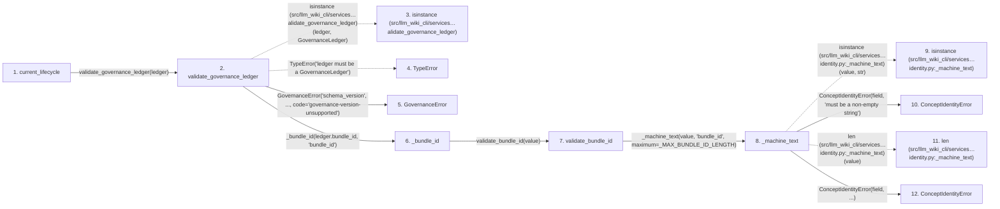

# current_lifecycle

**Entry point:** `current_lifecycle` (`api`)
**Source:** [knowledge_governance](../modules/knowledge_governance.md)
**Modules touched:** [concept_identity](../modules/concept_identity.md), [knowledge_evidence](../modules/knowledge_evidence.md), [knowledge_governance](../modules/knowledge_governance.md), [validation](../modules/validation.md), and 2 more

**Complete modules touched:**

- [concept_identity](../modules/concept_identity.md)
- [knowledge_evidence](../modules/knowledge_evidence.md)
- [knowledge_governance](../modules/knowledge_governance.md)
- [validation](../modules/validation.md)
- [wiki_media](../modules/wiki_media.md)
- [wiki_surface](../modules/wiki_surface.md)

## Call sequence

> Static overview in presentation order, not runtime execution order. Arrows retain captured callers; representative internal continuations and boundary examples precede repeated helper detail.

```mermaid
sequenceDiagram
    participant p0 as current_lifecycle
    participant p1 as validate_governance_ledger
    participant p2 as _existing_uid
    participant p3 as GovernanceError
    participant p4 as _bundle_id
    participant p5 as _concept_uid
    participant p6 as _concept_kind
    participant p7 as _identity_value
    participant p8 as _identity_ownership_key
    participant p9 as _validate_lifecycle_event_fields
    participant p10 as _validate_lifecycle_histories
    participant p11 as _validate_review_event_fields
    participant p12 as validate_bundle_id
    participant p13 as validate_concept_uid
    participant p14 as validate_concept_kind
    participant p15 as _alias_type
    participant p16 as identity_coordinate_key
    participant p17 as _event_id
    participant p18 as validate_alias_value
    participant p19 as _section_locator
    participant p20 as _hash
    participant p21 as _review_evidence
    participant p22 as _actor
    participant p23 as authored_event_time
    participant p24 as _machine_code
    participant p25 as _derived_event_id
    participant p26 as _machine_text
    participant p27 as validate_alias_type
    participant p28 as require_sha256
    participant p29 as len (src/llm_wiki_cli/services…ance.py:current_lifecycle)
    participant p30 as current.lifecycle_events.values
    p0->>p1: validate_governance_ledger
    p0->>p2: _existing_uid
    p0->>p3: GovernanceError
    p1->>p4: _bundle_id
    p1->>p5: _concept_uid
    p1->>p6: _concept_kind
    p1->>p7: _identity_value
    p1->>p8: _identity_ownership_key
    p1->>p9: _validate_lifecycle_event_fields
    p1->>p10: _validate_lifecycle_histories
    p1->>p11: _validate_review_event_fields
    p4->>p12: validate_bundle_id
    p5->>p13: validate_concept_uid
    p6->>p14: validate_concept_kind
    p7->>p15: _alias_type
    p8->>p16: identity_coordinate_key
    p9->>p17: _event_id
    p7->>p18: validate_alias_value
    p11->>p19: _section_locator
    p11->>p20: _hash
    p11->>p21: _review_evidence
    p9->>p22: _actor
    p9->>p23: authored_event_time
    p9->>p24: _machine_code
    p9->>p25: _derived_event_id
    p12->>p26: _machine_text
    p18->>p27: validate_alias_type
    p20->>p28: require_sha256
    p0-->>p29: len (src/llm_wiki_cli/services…ance.py:current_lifecycle)(terminal)
    p0-->>p30: current.lifecycle_events.values
```

<!-- Auto-generated from static call edges. Dashed arrows are external or unresolved calls. Reviewed runtime conditions and side effects belong in Behavior. -->

> Call sequence diagram shows 30 of 324 interactions; 294 omitted to keep the visualization within the 30-interaction and generated-diagram limits, with uncertain identities omitted rather than inferred.

> Captured boundary calls: external 1 of 67 (66 omitted); unresolved 1 of 75 (74 omitted). These counts cover the captured static trace.

Omitted captured detail, grouped by actual caller occurrence and target module:

| Caller | Parent step | Target module | Kind | Omitted interactions |
| --- | --- | --- | --- | --- |
| `src/llm_wiki_cli/services/knowledge_governance.py:validate_governance_ledger` | 2 | - | external | 15 |
| `src/llm_wiki_cli/services/knowledge_governance.py:validate_governance_ledger` | 2 | [src/llm_wiki_cli/services/knowledge_governance.py](../modules/knowledge_governance.md) | internal | 19 |
| `src/llm_wiki_cli/services/concept_identity.py:_machine_text` | 8 | - | external | 6 |
| `src/llm_wiki_cli/services/concept_identity.py:_machine_text` | 8 | [src/llm_wiki_cli/services/concept_identity.py](../modules/concept_identity.md) | internal | 5 |
| `src/llm_wiki_cli/services/concept_identity.py:_machine_text` | 8 | - | unresolved | 3 |
| `src/llm_wiki_cli/services/concept_identity.py:validate_bundle_id` | 7 | - | unresolved | 2 |
| `src/llm_wiki_cli/services/concept_identity.py:validate_bundle_id` | 7 | [src/llm_wiki_cli/services/concept_identity.py](../modules/concept_identity.md) | internal | 3 |
| `src/llm_wiki_cli/services/concept_identity.py:_looks_absolute_path` | 25 | - | unresolved | 2 |
> Omission summary shows 8 of 88 groups; 80 further groups are not expanded here. Counts above include all omitted interactions.
> Detailed flow queries retain their own coverage and limits; omitted paths may execute at runtime.

> Trace truncated at the depth limit; deeper calls are omitted.

## Data flow

<!-- Auto-generated static analysis. Treat values and boundaries as best-effort hints, not runtime proof. -->

### Analysis coverage

**Effect analysis partially available.** Flow assembly and source effect analysis are separate; empty observations do not prove an empty handler body.

Source steps: 183; effect analysis evaluated: 84, partial: 0, unavailable: 99. Counts include steps omitted from the displayed trace.

- Callable record unavailable; the selected entry symbol has no represented callable body.
- Effect collector totals unavailable; observed counts cover captured records only.

| Step | Callable record | Effect analysis | Collector totals |
|---|---|---|---|
| `current_lifecycle` | `available` | `evaluated` | `available` |
| `validate_governance_ledger` | `available` | `evaluated` | `available` |
| `isinstance (src/llm_wiki_cli/services…alidate_governance_ledger)` | `not_applicable` | `not_applicable` | `not_applicable` |
| `TypeError` | `not_applicable` | `not_applicable` | `not_applicable` |
| `GovernanceError` | `unavailable` | `unavailable` | `unavailable` |
| `_bundle_id` | `available` | `evaluated` | `available` |
| `validate_bundle_id` | `available` | `evaluated` | `available` |
| `_machine_text` | `available` | `evaluated` | `available` |
| `isinstance (src/llm_wiki_cli/services…identity.py:_machine_text)` | `not_applicable` | `not_applicable` | `not_applicable` |
| `ConceptIdentityError` | `unavailable` | `unavailable` | `unavailable` |
| `len (src/llm_wiki_cli/services…identity.py:_machine_text)` | `not_applicable` | `not_applicable` | `not_applicable` |
| `ConceptIdentityError` | `unavailable` | `unavailable` | `unavailable` |

### Step data

| Step | Inputs | Reads | Writes | Returns |
|---|---|---|---|---|
| `current_lifecycle` | `ledger: GovernanceLedger`, `uid: str` | `Lifecycle` | - | `(...)`, `(...)` |
| `validate_governance_ledger` | `ledger: GovernanceLedger`, `expected_bundle_id: str \| None` | `GovernanceLedger`, `GOVERNANCE_SCHEMA_VERSION`, `GOVERNANCE_SCHEMA_VERSION`, `GovernanceAllocation`, `ConceptIdentityError`, `ALIAS_NATURAL_KEY`, `ALIAS_LOCATOR`, `ALIAS_NATURAL_KEY` | `current_keys[...]`, `alias_counts[...]`, `alias_owners[...]` | `GovernanceLedger(...)` |
| `isinstance (src/llm_wiki_cli/services…alidate_governance_ledger)` | - | - | - | - |
| `TypeError` | - | - | - | - |
| `GovernanceError` | - | - | - | - |
| `_bundle_id` | `value: object`, `path: str` | `ConceptIdentityError` | - | `validate_bundle_id(...)` |
| `validate_bundle_id` | `value: object` | `_MAX_BUNDLE_ID_LENGTH` | - | `text` |
| `_machine_text` | `value: object`, `field: str`, `maximum: int` | - | - | `value` |
| `isinstance (src/llm_wiki_cli/services…identity.py:_machine_text)` | - | - | - | - |
| `ConceptIdentityError` | - | - | - | - |
| `len (src/llm_wiki_cli/services…identity.py:_machine_text)` | - | - | - | - |
| `ConceptIdentityError` | - | - | - | - |

### Call data

| From | To | Line | Call |
|---|---|---:|---|
| current_lifecycle | validate_governance_ledger | 1250 | `validate_governance_ledger(ledger)` |
| validate_governance_ledger | isinstance (src/llm_wiki_cli/services…alidate_governance_ledger) | 526 | `isinstance(ledger, GovernanceLedger)` |
| validate_governance_ledger | TypeError | 527 | `TypeError('ledger must be a GovernanceLedger')` |
| validate_governance_ledger | GovernanceError | 529 | `GovernanceError('schema_version', ..., code='governance-version-unsupported')` |
| validate_governance_ledger | _bundle_id | 534 | `_bundle_id(ledger.bundle_id, 'bundle_id')` |
| _bundle_id | validate_bundle_id | 3387 | `validate_bundle_id(value)` |
| validate_bundle_id | _machine_text | 289 | `_machine_text(value, 'bundle_id', maximum=_MAX_BUNDLE_ID_LENGTH)` |
| _machine_text | isinstance (src/llm_wiki_cli/services…identity.py:_machine_text) | 942 | `isinstance(value, str)` |
| _machine_text | ConceptIdentityError | 943 | `ConceptIdentityError(field, 'must be a non-empty string')` |
| _machine_text | len (src/llm_wiki_cli/services…identity.py:_machine_text) | 944 | `len(value)` |
| _machine_text | ConceptIdentityError | 945 | `ConceptIdentityError(field, ...)` |

### Boundary effects

*No boundary-effect observations were captured in this static trace.*

### Static analysis gaps

| Kind | Step | Target | Line |
|---|---|---|---:|
| external_call | `validate_governance_ledger` | `isinstance` | 526 |
| external_call | `validate_governance_ledger` | `TypeError` | 527 |
| external_call | `_machine_text` | `isinstance` | 942 |
| step_limit | `current_lifecycle` | `first 12 steps` | 0 |
| truncated_flow | `current_lifecycle` | `depth limit` | 0 |

## Behavior

This flow starts at `current_lifecycle` and is classified as `api`. The generated call and data-flow sections are bounded static projections; runtime conditions and side effects require source-level confirmation.
