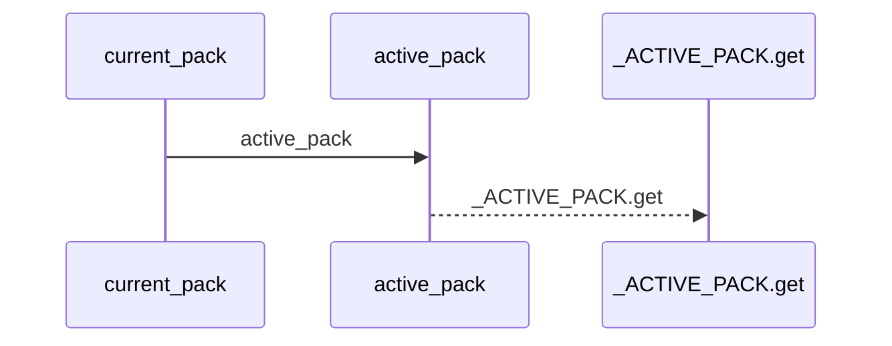
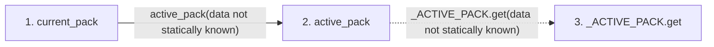

# current_pack

**Entry point:** `current_pack` (`api`)
**Source:** [domain_pack](../modules/domain_pack.md)
**Modules touched:** [domain_pack](../modules/domain_pack.md), [pack_interfaces](../modules/pack_interfaces.md)

## Call sequence

> Static overview in presentation order, not runtime execution order. Arrows retain captured callers; representative internal continuations and boundary examples precede repeated helper detail.

<!-- Auto-generated from static call edges. Dashed arrows are external or unresolved calls. Reviewed runtime conditions and side effects belong in Behavior. -->

> Call sequence diagram shows 2 of 2 interactions; 0 omitted to keep the visualization within the 30-interaction and generated-diagram limits, with uncertain identities omitted rather than inferred.

> Captured boundary calls: external 0 of 0 (0 omitted); unresolved 1 of 1 (0 omitted). These counts cover the captured static trace.
> Detailed flow queries retain their own coverage and limits; omitted paths may execute at runtime.

## Data flow

<!-- Auto-generated static analysis. Treat values and boundaries as best-effort hints, not runtime proof. -->

### Analysis coverage

**Effect analysis evaluated.** Flow assembly and source effect analysis are separate; empty observations do not prove an empty handler body.

Source steps: 2; effect analysis evaluated: 2, partial: 0, unavailable: 0. Counts include steps omitted from the displayed trace.

Collector observations for 2 source steps with known totals: observed: 3, emitted: 3, omitted: 0. Unavailable totals are excluded.

### Step data

| Step | Inputs | Reads | Writes | Returns |
|---|---|---|---|---|
| `current_pack` | - | `CODE_DOCS_PACK` | - | `...` |
| `active_pack` | - | - | - | `_ACTIVE_PACK.get(...)` |
| `_ACTIVE_PACK.get` | - | - | - | - |

### Call data

| From | To | Line | Call |
|---|---|---:|---|
| current_pack | active_pack | 324 | `active_pack(data not statically known)` |
| active_pack | _ACTIVE_PACK.get | 643 | `_ACTIVE_PACK.get(data not statically known)` |

### Boundary effects

*No boundary-effect observations were captured in this static trace.*

### Static analysis gaps

| Kind | Step | Target | Line |
|---|---|---|---:|
| unresolved_call | `active_pack` | `_ACTIVE_PACK.get` | 643 |

## Behavior

This flow starts at `current_pack` and is classified as `api`. The generated call and data-flow sections are bounded static projections; runtime conditions and side effects require source-level confirmation.
