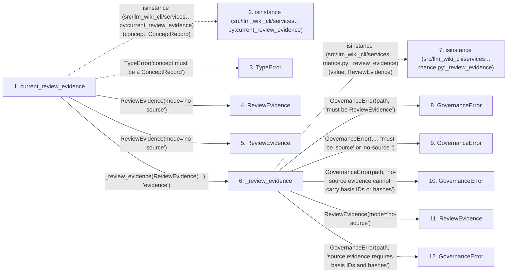

# current_review_evidence

**Entry point:** `current_review_evidence` (`api`)
**Source:** [knowledge_governance](../modules/knowledge_governance.md)
**Modules touched:** [knowledge_governance](../modules/knowledge_governance.md), [validation](../modules/validation.md), [wiki_media](../modules/wiki_media.md)

## Call sequence

> Static overview in presentation order, not runtime execution order. Arrows retain captured callers; representative internal continuations and boundary examples precede repeated helper detail.

```mermaid
sequenceDiagram
    participant p0 as current_review_evidence
    participant p1 as _review_evidence
    participant p2 as ReviewEvidence
    participant p3 as _safe_name
    participant p4 as _hash
    participant p5 as require_sha256
    participant p6 as _safe_text
    participant p7 as require_no_control_characters
    participant p8 as require_trimmed_text
    participant p9 as contains_uri_authority_userinfo
    participant p10 as require_nonempty_text
    participant p11 as GovernanceError
    participant p12 as contains_control_character
    participant p13 as _uri_candidate_contains_authority_userinfo
    participant p14 as isinstance (src/llm_wiki_cli/services…py:current_review_evidence)
    participant p15 as value.strip (src/llm_wiki_cli/services…e_governance.py:_safe_name)
    participant p16 as TypeError
    participant p17 as isinstance (src/llm_wiki_cli/services…rnance.py:_review_evidence)
    participant p18 as tuple
    participant p19 as sorted
    participant p20 as isinstance (src/llm_wiki_cli/services…e_governance.py:_safe_name)
    participant p21 as len (src/llm_wiki_cli/services…e_governance.py:_safe_name)
    participant p22 as _CONTROL_RE.search
    participant p23 as isinstance (src/llm_wiki_cli/services…lidation.py:require_sha256)
    participant p24 as _SENSITIVE_RE.search
    participant p25 as _SHA256_RE.fullmatch
    participant p26 as value.startswith
    participant p27 as _WINDOWS_ABSOLUTE_RE.match
    participant p28 as isinstance (src/llm_wiki_cli/services…uire_no_control_characters)
    p0->>p1: _review_evidence
    p0->>p2: ReviewEvidence
    p1->>p3: _safe_name
    p1->>p4: _hash
    p4->>p5: require_sha256
    p3->>p6: _safe_text
    p6->>p7: require_no_control_characters
    p5->>p8: require_trimmed_text
    p6->>p9: contains_uri_authority_userinfo
    p8->>p10: require_nonempty_text
    p1->>p11: GovernanceError
    p7->>p12: contains_control_character
    p9->>p13: _uri_candidate_contains_authority_userinfo
    p0-->>p14: isinstance (src/llm_wiki_cli/services…py:current_review_evidence)(concept, ConceptRecord)
    p3-->>p15: value.strip (src/llm_wiki_cli/services…e_governance.py:_safe_name)
    p0-->>p16: TypeError('concept must be a ConceptRecord')
    p1-->>p17: isinstance (src/llm_wiki_cli/services…rnance.py:_review_evidence)(value, ReviewEvidence)
    p1-->>p18: tuple(sorted(...))
    p1-->>p19: sorted(...)
    p1-->>p18: tuple(sorted(...))
    p1-->>p19: sorted(...)
    p3-->>p20: isinstance (src/llm_wiki_cli/services…e_governance.py:_safe_name)(value, str)
    p3-->>p21: len (src/llm_wiki_cli/services…e_governance.py:_safe_name)(value)
    p3-->>p22: _CONTROL_RE.search(value)
    p5-->>p23: isinstance (src/llm_wiki_cli/services…lidation.py:require_sha256)(value, str)
    p6-->>p24: _SENSITIVE_RE.search(value)
    p5-->>p25: _SHA256_RE.fullmatch(parsed)
    p6-->>p26: value.startswith('/')
    p6-->>p27: _WINDOWS_ABSOLUTE_RE.match(value)
    p7-->>p28: isinstance (src/llm_wiki_cli/services…uire_no_control_characters)(value, str)
```

<!-- Auto-generated from static call edges. Dashed arrows are external or unresolved calls. Reviewed runtime conditions and side effects belong in Behavior. -->

> Call sequence diagram shows 30 of 67 interactions; 37 omitted to keep the visualization within the 30-interaction and generated-diagram limits, with uncertain identities omitted rather than inferred.

> Captured boundary calls: external 11 of 15 (4 omitted); unresolved 6 of 23 (17 omitted). These counts cover the captured static trace.

Omitted captured detail, grouped by actual caller occurrence and target module:

| Caller | Parent step | Target module | Kind | Omitted interactions |
| --- | --- | --- | --- | --- |
| `src/llm_wiki_cli/services/knowledge_governance.py:current_review_evidence` | 1 | [src/llm_wiki_cli/services/knowledge_governance.py](../modules/knowledge_governance.md) | internal | 2 |
| `src/llm_wiki_cli/services/knowledge_governance.py:_review_evidence` | 6 | [src/llm_wiki_cli/services/knowledge_governance.py](../modules/knowledge_governance.md) | internal | 5 |
| `src/llm_wiki_cli/services/knowledge_governance.py:_safe_name` | 15 | [src/llm_wiki_cli/services/knowledge_governance.py](../modules/knowledge_governance.md) | internal | 1 |
| `src/llm_wiki_cli/services/validation.py:contains_control_character` | 24 | - | unresolved | 1 |
| `src/llm_wiki_cli/services/knowledge_governance.py:_safe_text` | 21 | [src/llm_wiki_cli/services/knowledge_governance.py](../modules/knowledge_governance.md) | internal | 4 |
| `src/llm_wiki_cli/services/wiki_media.py:contains_uri_authority_userinfo` | 29 | - | unresolved | 14 |
| `src/llm_wiki_cli/services/wiki_media.py:contains_uri_authority_userinfo` | 29 | - | external | 1 |
| `src/llm_wiki_cli/services/wiki_media.py:_uri_candidate_contains_authority_userinfo` | 39 | - | unresolved | 1 |
> Omission summary shows 8 of 14 groups; 6 further groups are not expanded here. Counts above include all omitted interactions.
> Detailed flow queries retain their own coverage and limits; omitted paths may execute at runtime.

## Data flow

<!-- Auto-generated static analysis. Treat values and boundaries as best-effort hints, not runtime proof. -->

### Analysis coverage

**Effect analysis partially available.** Flow assembly and source effect analysis are separate; empty observations do not prove an empty handler body.

Source steps: 30; effect analysis evaluated: 15, partial: 0, unavailable: 15. Counts include steps omitted from the displayed trace.

- Callable record unavailable; the selected entry symbol has no represented callable body.
- Effect collector totals unavailable; observed counts cover captured records only.

| Step | Callable record | Effect analysis | Collector totals |
|---|---|---|---|
| `current_review_evidence` | `available` | `evaluated` | `available` |
| `isinstance (src/llm_wiki_cli/services…py:current_review_evidence)` | `not_applicable` | `not_applicable` | `not_applicable` |
| `TypeError` | `not_applicable` | `not_applicable` | `not_applicable` |
| `ReviewEvidence` | `unavailable` | `unavailable` | `unavailable` |
| `ReviewEvidence` | `unavailable` | `unavailable` | `unavailable` |
| `_review_evidence` | `available` | `evaluated` | `available` |
| `isinstance (src/llm_wiki_cli/services…rnance.py:_review_evidence)` | `not_applicable` | `not_applicable` | `not_applicable` |
| `GovernanceError` | `unavailable` | `unavailable` | `unavailable` |
| `GovernanceError` | `unavailable` | `unavailable` | `unavailable` |
| `GovernanceError` | `unavailable` | `unavailable` | `unavailable` |
| `ReviewEvidence` | `unavailable` | `unavailable` | `unavailable` |
| `GovernanceError` | `unavailable` | `unavailable` | `unavailable` |

### Step data

| Step | Inputs | Reads | Writes | Returns |
|---|---|---|---|---|
| `current_review_evidence` | `concept: ConceptRecord` | `ConceptRecord`, `EvidenceState`, `EvidenceState`, `EvidenceState` | - | `ReviewEvidence(...)`, `ReviewEvidence(...)`, `None`, `None`, `_review_evidence(...)` |
| `isinstance (src/llm_wiki_cli/services…py:current_review_evidence)` | - | - | - | - |
| `TypeError` | - | - | - | - |
| `ReviewEvidence` | - | - | - | - |
| `ReviewEvidence` | - | - | - | - |
| `_review_evidence` | `value: ReviewEvidence`, `path: str` | `ReviewEvidence`, `REVIEW_EVIDENCE_MODES` | - | `ReviewEvidence(...)`, `ReviewEvidence(...)` |
| `isinstance (src/llm_wiki_cli/services…rnance.py:_review_evidence)` | - | - | - | - |
| `GovernanceError` | - | - | - | - |
| `GovernanceError` | - | - | - | - |
| `GovernanceError` | - | - | - | - |
| `ReviewEvidence` | - | - | - | - |
| `GovernanceError` | - | - | - | - |

### Call data

| From | To | Line | Call |
|---|---|---:|---|
| current_review_evidence | isinstance (src/llm_wiki_cli/services…py:current_review_evidence) | 1525 | `isinstance(concept, ConceptRecord)` |
| current_review_evidence | TypeError | 1526 | `TypeError('concept must be a ConceptRecord')` |
| current_review_evidence | ReviewEvidence | 1530 | `ReviewEvidence(mode='no-source')` |
| current_review_evidence | ReviewEvidence | 1534 | `ReviewEvidence(mode='no-source')` |
| current_review_evidence | _review_evidence | 1553 | `_review_evidence(ReviewEvidence(...), 'evidence')` |
| _review_evidence | isinstance (src/llm_wiki_cli/services…rnance.py:_review_evidence) | 2922 | `isinstance(value, ReviewEvidence)` |
| _review_evidence | GovernanceError | 2923 | `GovernanceError(path, 'must be ReviewEvidence')` |
| _review_evidence | GovernanceError | 2925 | `GovernanceError(..., "must be 'source' or 'no-source'")` |
| _review_evidence | GovernanceError | 2931 | `GovernanceError(path, 'no-source evidence cannot carry basis IDs or hashes')` |
| _review_evidence | ReviewEvidence | 2935 | `ReviewEvidence(mode='no-source')` |
| _review_evidence | GovernanceError | 2937 | `GovernanceError(path, 'source evidence requires basis IDs and hashes')` |

### Boundary effects

*No boundary-effect observations were captured in this static trace.*

### Static analysis gaps

| Kind | Step | Target | Line |
|---|---|---|---:|
| external_call | `current_review_evidence` | `isinstance` | 1525 |
| external_call | `current_review_evidence` | `TypeError` | 1526 |
| external_call | `_review_evidence` | `isinstance` | 2922 |
| step_limit | `current_review_evidence` | `first 12 steps` | 0 |

## Behavior

This flow starts at `current_review_evidence` and is classified as `api`. The generated call and data-flow sections are bounded static projections; runtime conditions and side effects require source-level confirmation.
