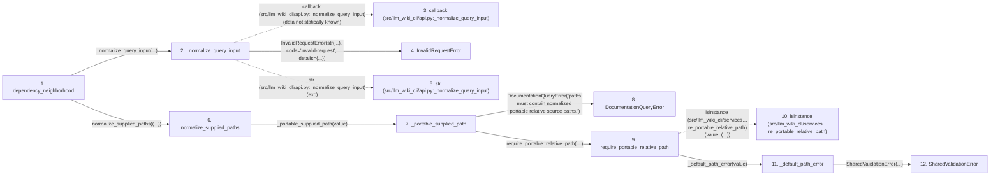

# dependency_neighborhood

**Entry point:** `dependency_neighborhood` (`api`)
**Source:** [api](../modules/api.md)
**Modules touched:** [api](../modules/api.md), [common](../modules/common.md), [config](../modules/config.md), [context_packet](../modules/context_packet.md), and 20 more

**Complete modules touched:**

- [api](../modules/api.md)
- [common](../modules/common.md)
- [config](../modules/config.md)
- [context_packet](../modules/context_packet.md)
- [documentation_queries](../modules/documentation_queries.md)
- [documentation_query_builder](../modules/documentation_query_builder.md)
- [filesystem_guard](../modules/filesystem_guard.md)
- [implementation_evidence](../modules/implementation_evidence.md)
- [io](../modules/io.md)
- [knowledge_consumption](../modules/knowledge_consumption.md)
- [knowledge_evidence](../modules/knowledge_evidence.md)
- [knowledge_governance](../modules/knowledge_governance.md)
- [knowledge_storage](../modules/knowledge_storage.md)
- [knowledge_storage_io](../modules/knowledge_storage_io.md)
- [maintenance_evidence](../modules/maintenance_evidence.md)
- [maintenance_shapes](../modules/maintenance_shapes.md)
- [maintenance_state](../modules/maintenance_state.md)
- [maintenance_status](../modules/maintenance_status.md)
- [python_implementation](../modules/python_implementation.md)
- [source_path_diagnostics](../modules/source_path_diagnostics.md)
- [source_selection](../modules/source_selection.md)
- [source_snapshot](../modules/source_snapshot.md)
- [sync_manifest](../modules/sync_manifest.md)
- [validation](../modules/validation.md)

## Call sequence

> Static overview in presentation order, not runtime execution order. Arrows retain captured callers; representative internal continuations and boundary examples precede repeated helper detail.

```mermaid
sequenceDiagram
    participant p0 as dependency_neighborhood
    participant p1 as _normalize_query_input
    participant p2 as normalize_supplied_paths
    participant p3 as _effective_query_limit
    participant p4 as _run_query
    participant p5 as _query_service
    participant p6 as _portable_supplied_path
    participant p7 as _normalize_query_limit
    participant p8 as _supplied_path_values
    participant p9 as build_documentation_query_service
    participant p10 as require_portable_relative_path
    participant p11 as normalize_documentation_query_limit
    participant p12 as validate_source_root
    participant p13 as _validate_wiki_dir
    participant p14 as build_live_documentation_query_service
    participant p15 as validate_path
    participant p16 as _default_path_error
    participant p17 as resolve_source_selection
    participant p18 as _check_path_collision
    participant p19 as capture_source_selection_inputs
    participant p20 as validate_live_query_source_selection
    participant p21 as windows_current_user_sid
    participant p22 as _source_anchor
    participant p23 as _wiki_anchor
    participant p24 as source_path_diagnostics
    participant p25 as require_portable_path_component
    participant p26 as _live_source_selection_identity
    participant p27 as confirmed_missing_source_paths (src/llm_wiki_cli/services/context_packet.py)
    participant p28 as attach_implementation_read_view
    participant p29 as cast
    participant p30 as _query_service(…).dependency_neighborhood
    p0->>p1: _normalize_query_input
    p0->>p2: normalize_supplied_paths
    p0->>p3: _effective_query_limit
    p0->>p4: _run_query
    p0->>p5: _query_service
    p2->>p6: _portable_supplied_path
    p3->>p7: _normalize_query_limit
    p2->>p8: _supplied_path_values
    p5->>p9: build_documentation_query_service
    p6->>p10: require_portable_relative_path
    p7->>p11: normalize_documentation_query_limit
    p9->>p12: validate_source_root
    p9->>p13: _validate_wiki_dir
    p9->>p14: build_live_documentation_query_service
    p12->>p15: validate_path
    p10->>p16: _default_path_error
    p14->>p17: resolve_source_selection
    p10->>p18: _check_path_collision
    p14->>p19: capture_source_selection_inputs
    p14->>p20: validate_live_query_source_selection
    p12->>p21: windows_current_user_sid
    p14->>p22: _source_anchor
    p14->>p23: _wiki_anchor
    p14->>p24: source_path_diagnostics
    p10->>p25: require_portable_path_component
    p14->>p26: _live_source_selection_identity
    p14->>p27: confirmed_missing_source_paths (src/llm_wiki_cli/services/context_packet.py)
    p14->>p28: attach_implementation_read_view
    p0-->>p29: cast(DependencyNeighborhoodResult, _run_query(...))
    p0-->>p30: _query_service(…).dependency_neighborhood(query)
```

<!-- Auto-generated from static call edges. Dashed arrows are external or unresolved calls. Reviewed runtime conditions and side effects belong in Behavior. -->

> Call sequence diagram shows 30 of 963 interactions; 933 omitted to keep the visualization within the 30-interaction and generated-diagram limits, with uncertain identities omitted rather than inferred.

> Captured boundary calls: external 1 of 387 (386 omitted); unresolved 1 of 218 (217 omitted). These counts cover the captured static trace.

Omitted captured detail, grouped by actual caller occurrence and target module:

| Caller | Parent step | Target module | Kind | Omitted interactions |
| --- | --- | --- | --- | --- |
| `src/llm_wiki_cli/api.py:_normalize_query_input` | 2 | - | unresolved | 1 |
| `src/llm_wiki_cli/api.py:_normalize_query_input` | 2 | [src/llm_wiki_cli/api.py](../modules/api.md) | internal | 1 |
| `src/llm_wiki_cli/api.py:_normalize_query_input` | 2 | - | external | 1 |
| `src/llm_wiki_cli/services/documentation_query_builder.py:_portable_supplied_path` | 7 | [src/llm_wiki_cli/services/documentation_queries.py](../modules/documentation_queries.md) | internal | 1 |
| `src/llm_wiki_cli/services/validation.py:require_portable_relative_path` | 9 | - | external | 4 |
| `src/llm_wiki_cli/services/validation.py:_default_path_error` | 11 | [src/llm_wiki_cli/services/validation.py](../modules/validation.md) | internal | 1 |
| `src/llm_wiki_cli/services/validation.py:require_portable_relative_path` | 9 | [src/llm_wiki_cli/services/validation.py](../modules/validation.md) | internal | 10 |
| `src/llm_wiki_cli/services/validation.py:_syntax_key` | 16 | - | external | 6 |
> Omission summary shows 8 of 210 groups; 202 further groups are not expanded here. Counts above include all omitted interactions.
> Detailed flow queries retain their own coverage and limits; omitted paths may execute at runtime.

> Trace truncated at the depth limit; deeper calls are omitted.

## Data flow

<!-- Auto-generated static analysis. Treat values and boundaries as best-effort hints, not runtime proof. -->

### Analysis coverage

**Effect analysis partially available.** Flow assembly and source effect analysis are separate; empty observations do not prove an empty handler body.

Source steps: 359; effect analysis evaluated: 246, partial: 0, unavailable: 113. Counts include steps omitted from the displayed trace.

- Callable record unavailable; the selected entry symbol has no represented callable body.
- Effect collector totals unavailable; observed counts cover captured records only.

| Step | Callable record | Effect analysis | Collector totals |
|---|---|---|---|
| `dependency_neighborhood` | `available` | `evaluated` | `available` |
| `_normalize_query_input` | `available` | `evaluated` | `available` |
| `callback (src/llm_wiki_cli/api.py:_normalize_query_input)` | `not_applicable` | `not_applicable` | `not_applicable` |
| `InvalidRequestError` | `unavailable` | `unavailable` | `unavailable` |
| `str (src/llm_wiki_cli/api.py:_normalize_query_input)` | `not_applicable` | `not_applicable` | `not_applicable` |
| `normalize_supplied_paths` | `available` | `evaluated` | `available` |
| `_portable_supplied_path` | `available` | `evaluated` | `available` |
| `DocumentationQueryError` | `unavailable` | `unavailable` | `unavailable` |
| `require_portable_relative_path` | `available` | `evaluated` | `available` |
| `isinstance (src/llm_wiki_cli/services…re_portable_relative_path)` | `not_applicable` | `not_applicable` | `not_applicable` |
| `_default_path_error` | `available` | `evaluated` | `available` |
| `SharedValidationError` | `unavailable` | `unavailable` | `unavailable` |

### Step data

| Step | Inputs | Reads | Writes | Returns |
|---|---|---|---|---|
| `dependency_neighborhood` | `path: object`, `service: DocumentationGraphQueryService \| None`, `src_dir: str`, `wiki_dir: str`, `limit: int`, `allow_external_src: bool`, `read_only: bool`, `source_selection: str \| Path \| None` | `DependencyNeighborhoodResult` | - | `cast(...)` |
| `_normalize_query_input` | `callback: Callable[[], _R]`, `field: str` | `DocumentationQueryError` | - | `callback(...)` |
| `callback (src/llm_wiki_cli/api.py:_normalize_query_input)` | - | - | - | - |
| `InvalidRequestError` | - | - | - | - |
| `str (src/llm_wiki_cli/api.py:_normalize_query_input)` | - | - | - | - |
| `normalize_supplied_paths` | `values: object` | - | - | `tuple(...)` |
| `_portable_supplied_path` | `value: object` | - | - | `require_portable_relative_path(...)` |
| `DocumentationQueryError` | - | - | - | - |
| `require_portable_relative_path` | `value: object`, `normalize_backslashes: bool`, `normalize_posix_spelling: bool`, `required_suffix: str \| None`, `defer_non_nfc_error: bool`, `reject_delete_character: bool`, `text_error: Exception \| None`, `relative_error: Exception \| None` | `os` | - | `cached`, `_remember_syntax(...)` |
| `isinstance (src/llm_wiki_cli/services…re_portable_relative_path)` | - | - | - | - |
| `_default_path_error` | `value: object` | - | - | `SharedValidationError(...)` |
| `SharedValidationError` | - | - | - | - |

### Call data

| From | To | Line | Call |
|---|---|---:|---|
| dependency_neighborhood | _normalize_query_input | 2294 | `_normalize_query_input(...)` |
| _normalize_query_input | callback (src/llm_wiki_cli/api.py:_normalize_query_input) | 2013 | `callback(data not statically known)` |
| _normalize_query_input | InvalidRequestError | 2015 | `InvalidRequestError(str(...), code='invalid-request', details={...})` |
| _normalize_query_input | str (src/llm_wiki_cli/api.py:_normalize_query_input) | 2016 | `str(exc)` |
| dependency_neighborhood | normalize_supplied_paths | 2294 | `normalize_supplied_paths((...))` |
| normalize_supplied_paths | _portable_supplied_path | 140 | `_portable_supplied_path(value)` |
| _portable_supplied_path | DocumentationQueryError | 118 | `DocumentationQueryError('paths must contain normalized portable relative source paths.')` |
| _portable_supplied_path | require_portable_relative_path | 121 | `require_portable_relative_path(value, text_error=error, relative_error=error, escape_error=error, traversal_error=error, separator_error=error, utf8_error=error, control_error=error, non_nfc_error=error, nonportable_error=error, reserved_error=error)` |
| require_portable_relative_path | isinstance (src/llm_wiki_cli/services…re_portable_relative_path) | 216 | `isinstance(value, (...))` |
| require_portable_relative_path | _default_path_error | 217 | `_default_path_error(value)` |
| _default_path_error | SharedValidationError | 113 | `SharedValidationError(...)` |

### Boundary effects

*No boundary-effect observations were captured in this static trace.*

### Static analysis gaps

| Kind | Step | Target | Line |
|---|---|---|---:|
| unresolved_call | `_normalize_query_input` | `callback` | 2013 |
| external_call | `require_portable_relative_path` | `isinstance` | 216 |
| step_limit | `dependency_neighborhood` | `first 12 steps` | 0 |
| truncated_flow | `dependency_neighborhood` | `depth limit` | 0 |

## Behavior

This flow starts at `dependency_neighborhood` and is classified as `api`. The generated call and data-flow sections are bounded static projections; runtime conditions and side effects require source-level confirmation.
