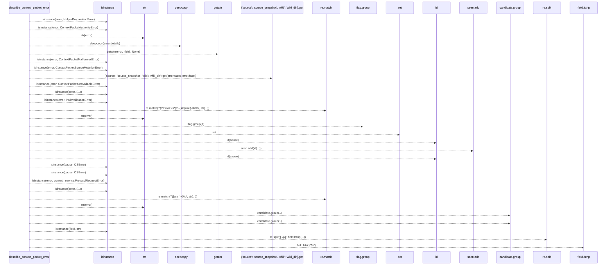
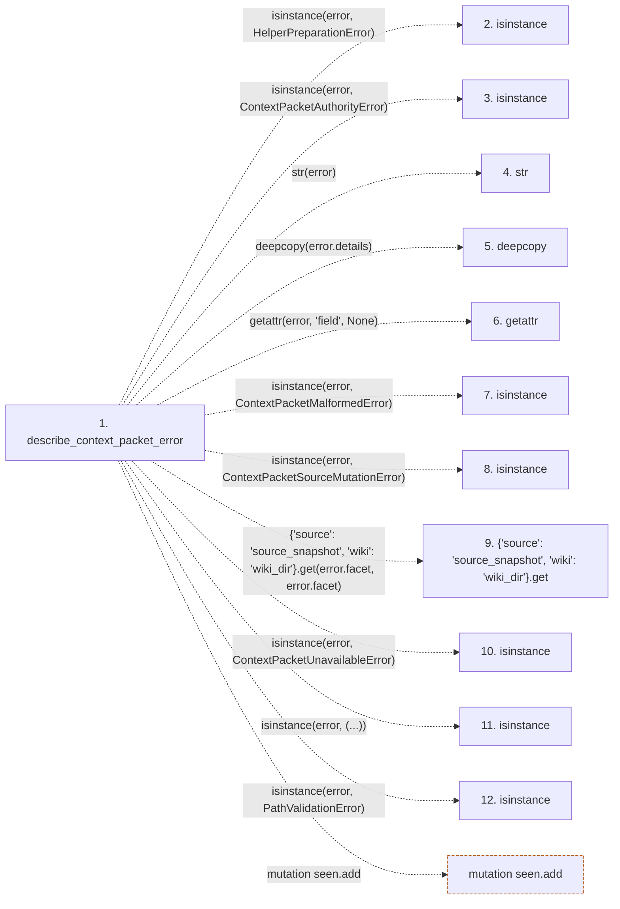

# describe_context_packet_error

**Entry point:** `describe_context_packet_error` (`api`)
**Source:** [context_packet_builder](../modules/context_packet_builder.md)
**Modules touched:** [context_packet_builder](../modules/context_packet_builder.md)

## Call sequence

> Static overview in presentation order, not runtime execution order. Arrows retain captured callers; representative internal continuations and boundary examples precede repeated helper detail.

<!-- Auto-generated from static call edges. Dashed arrows are external or unresolved calls. Reviewed runtime conditions and side effects belong in Behavior. -->

> Call sequence diagram shows 29 of 29 interactions; 0 omitted to keep the visualization within the 30-interaction and generated-diagram limits, with uncertain identities omitted rather than inferred.

> Captured boundary calls: external 23 of 23 (0 omitted); unresolved 6 of 6 (0 omitted). These counts cover the captured static trace.
> Detailed flow queries retain their own coverage and limits; omitted paths may execute at runtime.

## Data flow

<!-- Auto-generated static analysis. Treat values and boundaries as best-effort hints, not runtime proof. -->

### Analysis coverage

**Effect analysis evaluated.** Flow assembly and source effect analysis are separate; empty observations do not prove an empty handler body.

Source steps: 1; effect analysis evaluated: 1, partial: 0, unavailable: 0. Counts include steps omitted from the displayed trace.

Collector observations for 1 source steps with known totals: observed: 13, emitted: 13, omitted: 0. Unavailable totals are excluded.

### Step data

| Step | Inputs | Reads | Writes | Returns |
|---|---|---|---|---|
| `describe_context_packet_error` | `error: BaseException` | `ContextPacketAuthorityError`, `ContextPacketMalformedError`, `ContextPacketSourceMutationError`, `ContextPacketUnavailableError`, `ContextPacketPathPolicyError`, `PathValidationError`, `PathValidationError`, `context_service` | - | `{...}`, `{...}`, `{...}` |
| `isinstance` | - | - | - | - |
| `isinstance` | - | - | - | - |
| `str` | - | - | - | - |
| `deepcopy` | - | - | - | - |
| `getattr` | - | - | - | - |
| `isinstance` | - | - | - | - |
| `isinstance` | - | - | - | - |
| `{'source': 'source_snapshot', 'wiki': 'wiki_dir'}.get` | - | - | - | - |
| `isinstance` | - | - | - | - |
| `isinstance` | - | - | - | - |
| `isinstance` | - | - | - | - |

### Call data

| From | To | Line | Call |
|---|---|---:|---|
| describe_context_packet_error | isinstance | 176 | `isinstance(error, HelperPreparationError)` |
| describe_context_packet_error | isinstance | 184 | `isinstance(error, ContextPacketAuthorityError)` |
| describe_context_packet_error | str | 185 | `str(error)` |
| describe_context_packet_error | deepcopy | 185 | `deepcopy(error.details)` |
| describe_context_packet_error | getattr | 186 | `getattr(error, 'field', None)` |
| describe_context_packet_error | isinstance | 189 | `isinstance(error, ContextPacketMalformedError)` |
| describe_context_packet_error | isinstance | 200 | `isinstance(error, ContextPacketSourceMutationError)` |
| describe_context_packet_error | {'source': 'source_snapshot', 'wiki': 'wiki_dir'}.get | 202 | `{'source': 'source_snapshot', 'wiki': 'wiki_dir'}.get(error.facet, error.facet)` |
| describe_context_packet_error | isinstance | 206 | `isinstance(error, ContextPacketUnavailableError)` |
| describe_context_packet_error | isinstance | 209 | `isinstance(error, (...))` |
| describe_context_packet_error | isinstance | 211 | `isinstance(error, PathValidationError)` |

### Boundary effects

| Kind | Target | Step | Line |
|---|---|---|---:|
| mutation | `seen.add` | `describe_context_packet_error` | 217 |

### Static analysis gaps

| Kind | Step | Target | Line |
|---|---|---|---:|
| external_call | `describe_context_packet_error` | `isinstance` | 176 |
| external_call | `describe_context_packet_error` | `isinstance` | 184 |
| external_call | `describe_context_packet_error` | `deepcopy` | 185 |
| external_call | `describe_context_packet_error` | `getattr` | 186 |
| external_call | `describe_context_packet_error` | `isinstance` | 189 |
| external_call | `describe_context_packet_error` | `isinstance` | 200 |
| unresolved_call | `describe_context_packet_error` | `{'source': 'source_snapshot', 'wiki': 'wiki_dir'}.get` | 202 |
| external_call | `describe_context_packet_error` | `isinstance` | 206 |
| external_call | `describe_context_packet_error` | `isinstance` | 209 |
| external_call | `describe_context_packet_error` | `isinstance` | 211 |
| step_limit | `describe_context_packet_error` | `first 12 steps` | 0 |

## Behavior

This flow starts at `describe_context_packet_error` and is classified as `api`. The generated call and data-flow sections are bounded static projections; runtime conditions and side effects require source-level confirmation.
