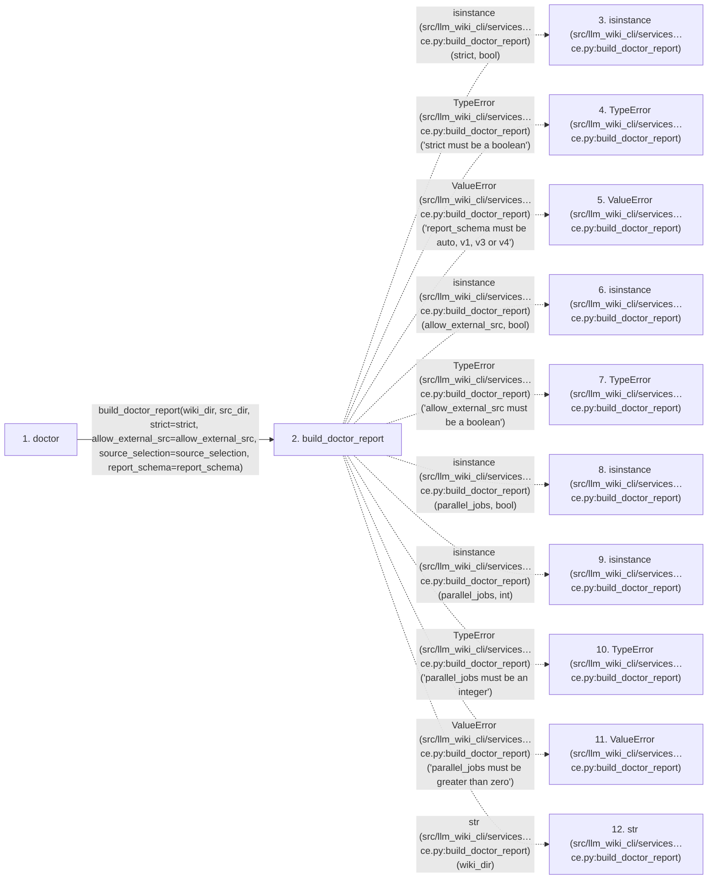

# doctor

**Entry point:** `doctor` (`api`)
**Source:** [api](../modules/api.md)
**Modules touched:** [analysis_compatibility](../modules/analysis_compatibility.md), [api](../modules/api.md), [bootstrap_runtime](../modules/bootstrap_runtime.md), [common](../modules/common.md), and 54 more

**Complete modules touched:**

- [analysis_compatibility](../modules/analysis_compatibility.md)
- [api](../modules/api.md)
- [bootstrap_runtime](../modules/bootstrap_runtime.md)
- [common](../modules/common.md)
- [config](../modules/config.md)
- [data_flow](../modules/data_flow.md)
- [dockerfile_parser](../modules/dockerfile_parser.md)
- [doctor_service](../modules/doctor_service.md)
- [documentation_queries](../modules/documentation_queries.md)
- [entrypoints](../modules/entrypoints.md)
- [evidence_diagnostics](../modules/evidence_diagnostics.md)
- [extraction_service](../modules/extraction_service.md)
- [filesystem_guard](../modules/filesystem_guard.md)
- [flow_followup](../modules/flow_followup.md)
- [health_contract](../modules/health_contract.md)
- [health_details](../modules/health_details.md)
- [health_policy](../modules/health_policy.md)
- [immutable](../modules/immutable.md)
- [imports](../modules/imports.md)
- [infrastructure_inventory](../modules/infrastructure_inventory.md)
- [infrastructure_sync](../modules/infrastructure_sync.md)
- [inventory_cache](../modules/inventory_cache.md)
- [io](../modules/io.md)
- [knowledge_artifacts](../modules/knowledge_artifacts.md)
- [knowledge_consumption](../modules/knowledge_consumption.md)
- [knowledge_envelope](../modules/knowledge_envelope.md)
- [knowledge_evidence](../modules/knowledge_evidence.md)
- [knowledge_freshness](../modules/knowledge_freshness.md)
- [knowledge_governance](../modules/knowledge_governance.md)
- [knowledge_loader](../modules/knowledge_loader.md)
- [knowledge_observability](../modules/knowledge_observability.md)
- [knowledge_orchestration](../modules/knowledge_orchestration.md)
- [knowledge_storage](../modules/knowledge_storage.md)
- [knowledge_storage_io](../modules/knowledge_storage_io.md)
- [knowledge_verification](../modules/knowledge_verification.md)
- [lint_service](../modules/lint_service.md)
- [maintenance_protocol](../modules/maintenance_protocol.md)
- [module_coverage](../modules/module_coverage.md)
- [plugins](../modules/plugins.md)
- [progress](../modules/progress.md)
- [python_extractor](../modules/python_extractor.md)
- [python_implementation](../modules/python_implementation.md)
- [python_imports](../modules/python_imports.md)
- [runtime_output](../modules/runtime_output.md)
- [services_dependencies](../modules/services_dependencies.md)
- [source_retirement](../modules/source_retirement.md)
- [source_selection](../modules/source_selection.md)
- [source_snapshot](../modules/source_snapshot.md)
- [sync_analysis](../modules/sync_analysis.md)
- [sync_manifest](../modules/sync_manifest.md)
- [team](../modules/team.md)
- [validation](../modules/validation.md)
- [verification_contracts](../modules/verification_contracts.md)
- [wiki_lifecycle](../modules/wiki_lifecycle.md)
- [wiki_media](../modules/wiki_media.md)
- [wiki_surface](../modules/wiki_surface.md)
- [yaml_formats](../modules/yaml_formats.md)
- [yaml_syntax](../modules/yaml_syntax.md)

## Call sequence

> Static overview in presentation order, not runtime execution order. Arrows retain captured callers; representative internal continuations and boundary examples precede repeated helper detail.

```mermaid
sequenceDiagram
    participant p0 as doctor
    participant p1 as build_doctor_report
    participant p2 as validate_path
    participant p3 as validate_source_root
    participant p4 as build_report
    participant p5 as compose_doctor_report
    participant p6 as _new_lint_report
    participant p7 as _preflight_lint_inputs
    participant p8 as _availability_section
    participant p9 as _finalize_lint_report
    participant p10 as _freshness_section
    participant p11 as prepare_cache_options
    participant p12 as _collect_lint_inputs
    participant p13 as _governance_section
    participant p14 as _drift_section
    participant p15 as _run_report_checks
    participant p16 as _verification_section
    participant p17 as windows_current_user_sid
    participant p18 as resolve_team_policy
    participant p19 as capture_health_details
    participant p20 as _knowledge_declared
    participant p21 as _current_windows_user_sid
    participant p22 as _profile_phase
    participant p23 as _coerce_plugin_issue
    participant p24 as resolve_inventory_cache_path
    participant p25 as _check_unsupported_source_diagnostics
    participant p26 as knowledge_freshness_disclosure
    participant p27 as team_config_issue
    participant p28 as _check_broken_links
    participant p29 as cast (src/llm_wiki_cli/api.py:doctor)
    participant p30 as report.to_payload
    p0->>p1: build_doctor_report
    p1->>p2: validate_path
    p1->>p3: validate_source_root
    p1->>p4: build_report
    p1->>p5: compose_doctor_report
    p4->>p6: _new_lint_report
    p4->>p7: _preflight_lint_inputs
    p5->>p8: _availability_section
    p4->>p9: _finalize_lint_report
    p5->>p10: _freshness_section
    p4->>p11: prepare_cache_options
    p4->>p12: _collect_lint_inputs
    p5->>p13: _governance_section
    p5->>p14: _drift_section
    p4->>p15: _run_report_checks
    p5->>p16: _verification_section
    p3->>p17: windows_current_user_sid
    p7->>p18: resolve_team_policy
    p9->>p19: capture_health_details
    p8->>p20: _knowledge_declared
    p17->>p21: _current_windows_user_sid
    p12->>p22: _profile_phase
    p7->>p23: _coerce_plugin_issue
    p11->>p24: resolve_inventory_cache_path
    p15->>p25: _check_unsupported_source_diagnostics
    p10->>p26: knowledge_freshness_disclosure
    p7->>p27: team_config_issue
    p15->>p28: _check_broken_links
    p0-->>p29: cast (src/llm_wiki_cli/api.py:doctor)(DoctorResult, report.to_payload(...))
    p0-->>p30: report.to_payload(**=...)
```

<!-- Auto-generated from static call edges. Dashed arrows are external or unresolved calls. Reviewed runtime conditions and side effects belong in Behavior. -->

> Call sequence diagram shows 30 of 1727 interactions; 1697 omitted to keep the visualization within the 30-interaction and generated-diagram limits, with uncertain identities omitted rather than inferred.

> Captured boundary calls: external 1 of 557 (556 omitted); unresolved 1 of 506 (505 omitted). These counts cover the captured static trace.

Omitted captured detail, grouped by actual caller occurrence and target module:

| Caller | Parent step | Target module | Kind | Omitted interactions |
| --- | --- | --- | --- | --- |
| `src/llm_wiki_cli/services/doctor_service.py:build_doctor_report` | 2 | - | external | 13 |
| `src/llm_wiki_cli/config.py:validate_path` | 14 | [src/llm_wiki_cli/config.py](../modules/config.md) | internal | 2 |
| `src/llm_wiki_cli/config.py:validate_path` | 14 | - | unresolved | 3 |
| `src/llm_wiki_cli/config.py:validate_path` | 14 | - | external | 2 |
| `src/llm_wiki_cli/config.py:validate_source_root` | 22 | [src/llm_wiki_cli/config.py](../modules/config.md) | internal | 7 |
| `src/llm_wiki_cli/config.py:validate_source_root` | 22 | - | unresolved | 5 |
| `src/llm_wiki_cli/config.py:validate_source_root` | 22 | - | external | 11 |
| `src/llm_wiki_cli/services/filesystem_guard.py:windows_current_user_sid` | 34 | [src/llm_wiki_cli/services/filesystem_guard.py](../modules/filesystem_guard.md) | internal | 1 |
> Omission summary shows 8 of 493 groups; 485 further groups are not expanded here. Counts above include all omitted interactions.
> Detailed flow queries retain their own coverage and limits; omitted paths may execute at runtime.

> Trace truncated at the depth limit; deeper calls are omitted.

## Data flow

<!-- Auto-generated static analysis. Treat values and boundaries as best-effort hints, not runtime proof. -->

### Analysis coverage

**Effect analysis partially available.** Flow assembly and source effect analysis are separate; empty observations do not prove an empty handler body.

Source steps: 665; effect analysis evaluated: 535, partial: 30, unavailable: 100. Counts include steps omitted from the displayed trace.

Collector observations for 565 source steps with known totals: observed: 3719, emitted: 3545, omitted: 174. Unavailable totals are excluded.

- Callable record unavailable; the selected entry symbol has no represented callable body.
- Effect collector omitted observations before flow assembly; displayed effects are partial.
- Effect collector totals unavailable; observed counts cover captured records only.

| Step | Callable record | Effect analysis | Collector totals | Observed | Emitted | Omitted |
|---|---|---|---|---:|---:|---:|
| `doctor` | `available` | `evaluated` | `available` | `9` | `9` | `0` |
| `build_doctor_report` | `available` | `partial` | `available` | `12` | `9` | `3` |
| `isinstance (src/llm_wiki_cli/services…ce.py:build_doctor_report)` | `not_applicable` | `not_applicable` | `not_applicable` | — | — | — |
| `TypeError (src/llm_wiki_cli/services…ce.py:build_doctor_report)` | `not_applicable` | `not_applicable` | `not_applicable` | — | — | — |
| `ValueError (src/llm_wiki_cli/services…ce.py:build_doctor_report)` | `not_applicable` | `not_applicable` | `not_applicable` | — | — | — |
| `isinstance (src/llm_wiki_cli/services…ce.py:build_doctor_report)` | `not_applicable` | `not_applicable` | `not_applicable` | — | — | — |
| `TypeError (src/llm_wiki_cli/services…ce.py:build_doctor_report)` | `not_applicable` | `not_applicable` | `not_applicable` | — | — | — |
| `isinstance (src/llm_wiki_cli/services…ce.py:build_doctor_report)` | `not_applicable` | `not_applicable` | `not_applicable` | — | — | — |
| `isinstance (src/llm_wiki_cli/services…ce.py:build_doctor_report)` | `not_applicable` | `not_applicable` | `not_applicable` | — | — | — |
| `TypeError (src/llm_wiki_cli/services…ce.py:build_doctor_report)` | `not_applicable` | `not_applicable` | `not_applicable` | — | — | — |
| `ValueError (src/llm_wiki_cli/services…ce.py:build_doctor_report)` | `not_applicable` | `not_applicable` | `not_applicable` | — | — | — |
| `str (src/llm_wiki_cli/services…ce.py:build_doctor_report)` | `not_applicable` | `not_applicable` | `not_applicable` | — | — | — |

### Step data

| Step | Inputs | Reads | Writes | Returns |
|---|---|---|---|---|
| `doctor` | `src_dir: str`, `wiki_dir: str`, `strict: bool`, `allow_external_src: bool`, `source_selection: str \| Path \| None`, `report_schema: Literal['auto', 'v1', 'v3', 'v4']`, `comparison_policy: str \| None` | `DoctorResult` | - | `cast(...)` |
| `build_doctor_report` | `wiki_dir: str \| Path`, `src_dir: str \| Path`, `strict: bool`, `allow_external_src: bool`, `helper_cache_dir: str \| Path \| None`, `include_tests: Iterable[str] \| None`, `parallel_jobs: int`, `job_request: ExtractionJobRequest \| None` | - | - | `compose_doctor_report(...)` |
| `isinstance (src/llm_wiki_cli/services…ce.py:build_doctor_report)` | - | - | - | - |
| `TypeError (src/llm_wiki_cli/services…ce.py:build_doctor_report)` | - | - | - | - |
| `ValueError (src/llm_wiki_cli/services…ce.py:build_doctor_report)` | - | - | - | - |
| `isinstance (src/llm_wiki_cli/services…ce.py:build_doctor_report)` | - | - | - | - |
| `TypeError (src/llm_wiki_cli/services…ce.py:build_doctor_report)` | - | - | - | - |
| `isinstance (src/llm_wiki_cli/services…ce.py:build_doctor_report)` | - | - | - | - |
| `isinstance (src/llm_wiki_cli/services…ce.py:build_doctor_report)` | - | - | - | - |
| `TypeError (src/llm_wiki_cli/services…ce.py:build_doctor_report)` | - | - | - | - |
| `ValueError (src/llm_wiki_cli/services…ce.py:build_doctor_report)` | - | - | - | - |
| `str (src/llm_wiki_cli/services…ce.py:build_doctor_report)` | - | - | - | - |

### Call data

| From | To | Line | Call |
|---|---|---:|---|
| doctor | build_doctor_report | 1894 | `build_doctor_report(wiki_dir, src_dir, strict=strict, allow_external_src=allow_external_src, source_selection=source_selection, report_schema=report_schema)` |
| build_doctor_report | isinstance (src/llm_wiki_cli/services…ce.py:build_doctor_report) | 135 | `isinstance(strict, bool)` |
| build_doctor_report | TypeError (src/llm_wiki_cli/services…ce.py:build_doctor_report) | 136 | `TypeError('strict must be a boolean')` |
| build_doctor_report | ValueError (src/llm_wiki_cli/services…ce.py:build_doctor_report) | 138 | `ValueError('report_schema must be auto, v1, v3 or v4')` |
| build_doctor_report | isinstance (src/llm_wiki_cli/services…ce.py:build_doctor_report) | 139 | `isinstance(allow_external_src, bool)` |
| build_doctor_report | TypeError (src/llm_wiki_cli/services…ce.py:build_doctor_report) | 140 | `TypeError('allow_external_src must be a boolean')` |
| build_doctor_report | isinstance (src/llm_wiki_cli/services…ce.py:build_doctor_report) | 141 | `isinstance(parallel_jobs, bool)` |
| build_doctor_report | isinstance (src/llm_wiki_cli/services…ce.py:build_doctor_report) | 141 | `isinstance(parallel_jobs, int)` |
| build_doctor_report | TypeError (src/llm_wiki_cli/services…ce.py:build_doctor_report) | 142 | `TypeError('parallel_jobs must be an integer')` |
| build_doctor_report | ValueError (src/llm_wiki_cli/services…ce.py:build_doctor_report) | 144 | `ValueError('parallel_jobs must be greater than zero')` |
| build_doctor_report | str (src/llm_wiki_cli/services…ce.py:build_doctor_report) | 146 | `str(wiki_dir)` |

### Boundary effects

*No boundary-effect observations were captured in this static trace.*

### Static analysis gaps

| Kind | Step | Target | Line |
|---|---|---|---:|
| external_call | `build_doctor_report` | `isinstance` | 135 |
| external_call | `build_doctor_report` | `TypeError` | 136 |
| external_call | `build_doctor_report` | `ValueError` | 138 |
| external_call | `build_doctor_report` | `isinstance` | 139 |
| external_call | `build_doctor_report` | `TypeError` | 140 |
| external_call | `build_doctor_report` | `isinstance` | 141 |
| external_call | `build_doctor_report` | `TypeError` | 142 |
| external_call | `build_doctor_report` | `ValueError` | 144 |
| step_limit | `doctor` | `first 12 steps` | 0 |
| truncated_flow | `doctor` | `depth limit` | 0 |

## Behavior

This flow starts at `doctor` and is classified as `api`. The generated call and data-flow sections are bounded static projections; runtime conditions and side effects require source-level confirmation.
