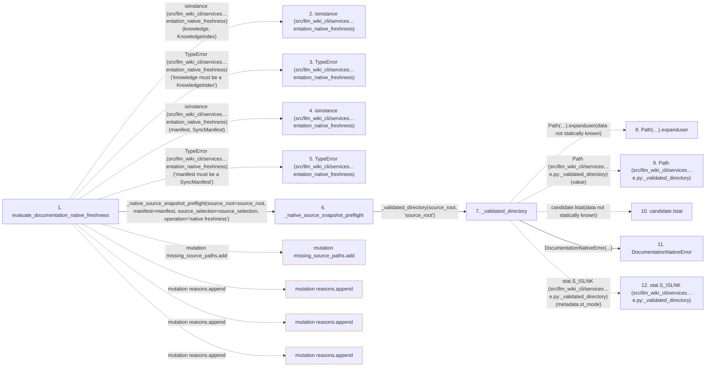

# evaluate_documentation_native_freshness

**Entry point:** `evaluate_documentation_native_freshness` (`api`)
**Source:** [documentation_native](../modules/documentation_native.md)
**Modules touched:** [analysis_capture](../modules/analysis_capture.md), [analysis_compatibility](../modules/analysis_compatibility.md), [common](../modules/common.md), [concept_identity](../modules/concept_identity.md), and 41 more

**Complete modules touched:**

- [analysis_capture](../modules/analysis_capture.md)
- [analysis_compatibility](../modules/analysis_compatibility.md)
- [common](../modules/common.md)
- [concept_identity](../modules/concept_identity.md)
- [config](../modules/config.md)
- [data_flow](../modules/data_flow.md)
- [documentation_native](../modules/documentation_native.md)
- [extraction_jobs](../modules/extraction_jobs.md)
- [extraction_service](../modules/extraction_service.md)
- [extractor_helpers](../modules/extractor_helpers.md)
- [go_calls](../modules/go_calls.md)
- [implementation_evidence](../modules/implementation_evidence.md)
- [imports](../modules/imports.md)
- [infrastructure_inventory](../modules/infrastructure_inventory.md)
- [infrastructure_sync](../modules/infrastructure_sync.md)
- [inventory_cache](../modules/inventory_cache.md)
- [knowledge_artifacts](../modules/knowledge_artifacts.md)
- [knowledge_envelope](../modules/knowledge_envelope.md)
- [knowledge_evidence](../modules/knowledge_evidence.md)
- [knowledge_freshness](../modules/knowledge_freshness.md)
- [knowledge_generation](../modules/knowledge_generation.md)
- [knowledge_governance](../modules/knowledge_governance.md)
- [knowledge_graph](../modules/knowledge_graph.md)
- [knowledge_model](../modules/knowledge_model.md)
- [knowledge_orchestration](../modules/knowledge_orchestration.md)
- [knowledge_reuse](../modules/knowledge_reuse.md)
- [knowledge_storage](../modules/knowledge_storage.md)
- [maintenance_evidence](../modules/maintenance_evidence.md)
- [maintenance_projection](../modules/maintenance_projection.md)
- [maintenance_shapes](../modules/maintenance_shapes.md)
- [maintenance_state](../modules/maintenance_state.md)
- [markdown_sections](../modules/markdown_sections.md)
- [packages](../modules/packages.md)
- [plugins](../modules/plugins.md)
- [progress](../modules/progress.md)
- [python_contracts](../modules/python_contracts.md)
- [python_implementation](../modules/python_implementation.md)
- [python_observations](../modules/python_observations.md)
- [resource_diagnostics](../modules/resource_diagnostics.md)
- [section_ownership](../modules/section_ownership.md)
- [source_selection](../modules/source_selection.md)
- [source_snapshot](../modules/source_snapshot.md)
- [validation](../modules/validation.md)
- [wiki_media](../modules/wiki_media.md)
- [wiki_surface](../modules/wiki_surface.md)

## Call sequence

> Static overview in presentation order, not runtime execution order. Arrows retain captured callers; siblings are shown before deeper helper detail.

```mermaid
sequenceDiagram
    participant p0 as evaluate_documentation_native_freshness
    participant p1 as isinstance (src/llm_wiki_cli/services…entation_native_freshness)
    participant p2 as TypeError (src/llm_wiki_cli/services…entation_native_freshness)
    participant p3 as _native_source_snapshot_preflight
    participant p4 as _generation_input_paths
    participant p5 as _collect_runtime
    participant p6 as _runtime_generation_options
    participant p7 as _source_mismatches
    participant p8 as set (src/llm_wiki_cli/services…entation_native_freshness)
    participant p9 as (…).lstat
    participant p10 as missing_source_paths.add
    participant p11 as build_runtime_live_evaluation
    participant p12 as RuntimeLiveEvaluationInputs
    participant p13 as tuple (src/llm_wiki_cli/services…entation_native_freshness)
    participant p14 as evaluate_knowledge_freshness
    participant p15 as DocumentationNativeError
    participant p16 as list (src/llm_wiki_cli/services…entation_native_freshness)
    participant p17 as reasons.append (src/llm_wiki_cli/services…entation_native_freshness)
    participant p18 as sorted (src/llm_wiki_cli/services…entation_native_freshness)
    participant p19 as DocumentationNativeFreshness
    participant p20 as _validated_directory
    participant p21 as manifest.generation_inputs.get (src/llm_wiki_cli/services…y:_generation_input_paths)
    participant p22 as runtime_generation_options
    participant p23 as set (src/llm_wiki_cli/services…ive.py:_source_mismatches)
    p0-->>p1: isinstance (src/llm_wiki_cli/services…entation_native_freshness)(knowledge, KnowledgeIndex)
    p0-->>p2: TypeError (src/llm_wiki_cli/services…entation_native_freshness)('knowledge must be a KnowledgeIndex')
    p0-->>p1: isinstance (src/llm_wiki_cli/services…entation_native_freshness)(manifest, SyncManifest)
    p0-->>p2: TypeError (src/llm_wiki_cli/services…entation_native_freshness)('manifest must be a SyncManifest')
    p0->>p3: _native_source_snapshot_preflight
    p0->>p4: _generation_input_paths
    p0->>p5: _collect_runtime
    p0->>p6: _runtime_generation_options
    p0->>p7: _source_mismatches
    p0-->>p8: set (src/llm_wiki_cli/services…entation_native_freshness)(manifest.sources)
    p0-->>p8: set (src/llm_wiki_cli/services…entation_native_freshness)(runtime.inventory)
    p0-->>p9: (…).lstat
    p0-->>p10: missing_source_paths.add(basis.source_path)
    p0->>p11: build_runtime_live_evaluation
    p0->>p12: RuntimeLiveEvaluationInputs
    p0-->>p13: tuple (src/llm_wiki_cli/services…entation_native_freshness)(RUNTIME_GENERATION_OPTION_DEFAULTS)
    p0->>p14: evaluate_knowledge_freshness
    p0->>p15: DocumentationNativeError
    p0-->>p16: list (src/llm_wiki_cli/services…entation_native_freshness)(source_mismatches)
    p0-->>p17: reasons.append (src/llm_wiki_cli/services…entation_native_freshness)('generation-options-changed')
    p0-->>p17: reasons.append (src/llm_wiki_cli/services…entation_native_freshness)('producer-basis-changed')
    p0-->>p18: sorted (src/llm_wiki_cli/services…entation_native_freshness)(structural_locators)
    p0-->>p17: reasons.append (src/llm_wiki_cli/services…entation_native_freshness)(...)
    p0->>p19: DocumentationNativeFreshness
    p0-->>p13: tuple (src/llm_wiki_cli/services…entation_native_freshness)(reasons)
    p3->>p20: _validated_directory
    p4-->>p21: manifest.generation_inputs.get (src/llm_wiki_cli/services…y:_generation_input_paths)('openapi')
    p5->>p20: _validated_directory
    p6->>p22: runtime_generation_options
    p7-->>p23: set (src/llm_wiki_cli/services…ive.py:_source_mismatches)(manifest.sources)
```

<!-- Auto-generated from static call edges. Dashed arrows are external or unresolved calls. Reviewed runtime conditions and side effects belong in Behavior. -->

> Call sequence diagram shows 30 of 3439 interactions; 3409 omitted to keep the visualization within the 30-interaction and generated-diagram limits, with uncertain identities omitted rather than inferred.

> Captured boundary calls: external 11 of 935 (924 omitted); unresolved 6 of 876 (870 omitted). These counts cover the captured static trace.

Omitted captured detail, grouped by actual caller occurrence and target module:

| Caller | Parent step | Target module | Kind | Omitted interactions |
| --- | --- | --- | --- | --- |
| `src/llm_wiki_cli/services/documentation_native.py:_validated_directory` | 7 | - | unresolved | 3 |
| `src/llm_wiki_cli/services/documentation_native.py:_validated_directory` | 7 | - | external | 3 |
| `src/llm_wiki_cli/services/documentation_native.py:_validated_directory` | 7 | [src/llm_wiki_cli/services/documentation_native.py](../modules/documentation_native.md) | internal | 2 |
| `src/llm_wiki_cli/services/documentation_native.py:_native_source_snapshot_preflight` | 6 | [src/llm_wiki_cli/services/source_selection.py](../modules/source_selection.md) | internal | 3 |
| `src/llm_wiki_cli/services/source_selection.py:resolve_source_selection` | 16 | - | unresolved | 2 |
| `src/llm_wiki_cli/services/source_selection.py:resolve_source_selection` | 16 | - | external | 1 |
| `src/llm_wiki_cli/services/source_selection.py:resolve_source_selection` | 16 | [src/llm_wiki_cli/services/source_selection.py](../modules/source_selection.md) | internal | 8 |
| `src/llm_wiki_cli/services/source_selection.py:_override_text` | 20 | - | external | 3 |
> Omission summary shows 8 of 920 groups; 912 further groups are not expanded here. Counts above include all omitted interactions.
> Detailed flow queries retain their own coverage and limits; omitted paths may execute at runtime.

> Trace truncated at the depth limit; deeper calls are omitted.

## Data flow

<!-- Auto-generated static analysis. Treat values and boundaries as best-effort hints, not runtime proof. -->

### Step data

| Step | Inputs | Reads | Writes | Returns |
|---|---|---|---|---|
| `evaluate_documentation_native_freshness` | `knowledge: KnowledgeIndex`, `manifest: SyncManifest`, `source_root: str \| Path`, `trust_source_plugins: bool`, `helper_cache_dir: str \| Path \| None`, `source_selection: str \| Path \| None` | `KnowledgeIndex`, `SyncManifest`, `ObservationScope`, `RUNTIME_GENERATION_OPTION_DEFAULTS`, `RUNTIME_GENERATION_OPTION_DEFAULTS`, `PageKind`, `ComputedFreshness` | - | `DocumentationNativeFreshness(...)` |
| `isinstance (src/llm_wiki_cli/services…entation_native_freshness)` | - | - | - | - |
| `TypeError (src/llm_wiki_cli/services…entation_native_freshness)` | - | - | - | - |
| `isinstance (src/llm_wiki_cli/services…entation_native_freshness)` | - | - | - | - |
| `TypeError (src/llm_wiki_cli/services…entation_native_freshness)` | - | - | - | - |
| `_native_source_snapshot_preflight` | `source_root: str \| Path`, `manifest: SyncManifest`, `source_selection: str \| Path \| None`, `operation: str`, `allow_same_path_identity_update: bool` | `SourceSelectionError`, `SourceSnapshotError` | - | `(...)` |
| `_validated_directory` | `value: str \| Path`, `field_name: str` | - | - | `candidate.resolve(...)` |
| `Path(…).expanduser` | - | - | - | - |
| `Path (src/llm_wiki_cli/services…e.py:_validated_directory)` | - | - | - | - |
| `candidate.lstat` | - | - | - | - |
| `DocumentationNativeError` | - | - | - | - |
| `stat.S_ISLNK (src/llm_wiki_cli/services…e.py:_validated_directory)` | - | - | - | - |

### Call data

| From | To | Line | Call |
|---|---|---:|---|
| evaluate_documentation_native_freshness | isinstance (src/llm_wiki_cli/services…entation_native_freshness) | 203 | `isinstance(knowledge, KnowledgeIndex)` |
| evaluate_documentation_native_freshness | TypeError (src/llm_wiki_cli/services…entation_native_freshness) | 204 | `TypeError('knowledge must be a KnowledgeIndex')` |
| evaluate_documentation_native_freshness | isinstance (src/llm_wiki_cli/services…entation_native_freshness) | 205 | `isinstance(manifest, SyncManifest)` |
| evaluate_documentation_native_freshness | TypeError (src/llm_wiki_cli/services…entation_native_freshness) | 206 | `TypeError('manifest must be a SyncManifest')` |
| evaluate_documentation_native_freshness | _native_source_snapshot_preflight | 207 | `_native_source_snapshot_preflight(source_root=source_root, manifest=manifest, source_selection=source_selection, operation='native freshness')` |
| _native_source_snapshot_preflight | _validated_directory | 156 | `_validated_directory(source_root, 'source_root')` |
| _validated_directory | Path(…).expanduser | 1114 | `Path(value).expanduser(data not statically known)` |
| _validated_directory | Path (src/llm_wiki_cli/services…e.py:_validated_directory) | 1114 | `Path(value)` |
| _validated_directory | candidate.lstat | 1116 | `candidate.lstat(data not statically known)` |
| _validated_directory | DocumentationNativeError | 1118 | `DocumentationNativeError(...)` |
| _validated_directory | stat.S_ISLNK (src/llm_wiki_cli/services…e.py:_validated_directory) | 1121 | `stat.S_ISLNK(metadata.st_mode)` |

### Boundary effects

| Kind | Target | Step | Line |
|---|---|---|---:|
| mutation | `missing_source_paths.add` | `evaluate_documentation_native_freshness` | 243 |
| mutation | `reasons.append` | `evaluate_documentation_native_freshness` | 284 |
| mutation | `reasons.append` | `evaluate_documentation_native_freshness` | 286 |
| mutation | `reasons.append` | `evaluate_documentation_native_freshness` | 296 |

### Static analysis gaps

| Kind | Step | Target | Line |
|---|---|---|---:|
| external_call | `evaluate_documentation_native_freshness` | `isinstance` | 203 |
| external_call | `evaluate_documentation_native_freshness` | `TypeError` | 204 |
| external_call | `evaluate_documentation_native_freshness` | `isinstance` | 205 |
| external_call | `evaluate_documentation_native_freshness` | `TypeError` | 206 |
| unresolved_call | `_validated_directory` | `Path(value).expanduser` | 1114 |
| unresolved_call | `_validated_directory` | `candidate.lstat` | 1116 |
| external_call | `_validated_directory` | `stat.S_ISLNK` | 1121 |
| step_limit | `evaluate_documentation_native_freshness` | `first 12 steps` | 0 |
| truncated_flow | `evaluate_documentation_native_freshness` | `depth limit` | 0 |

## Behavior

This flow starts at `evaluate_documentation_native_freshness` and is classified as `api`. The generated call and data-flow sections are bounded static projections; runtime conditions and side effects require source-level confirmation.
