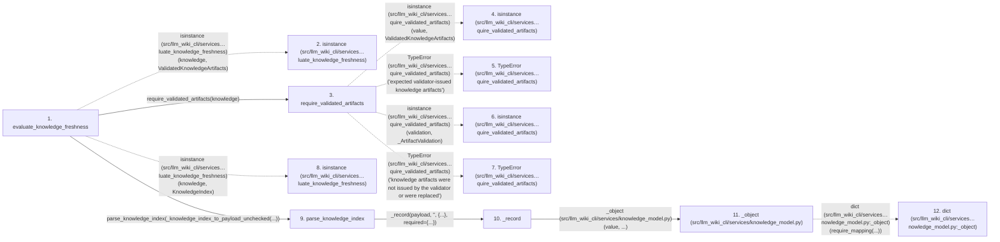

# evaluate_knowledge_freshness

**Entry point:** `evaluate_knowledge_freshness` (`api`)
**Source:** [knowledge_freshness](../modules/knowledge_freshness.md)
**Modules touched:** [analysis_compatibility](../modules/analysis_compatibility.md), [concept_identity](../modules/concept_identity.md), [implementation_evidence](../modules/implementation_evidence.md), and 20 more

**Complete modules touched:**

- [analysis_compatibility](../modules/analysis_compatibility.md)
- [concept_identity](../modules/concept_identity.md)
- [implementation_evidence](../modules/implementation_evidence.md)
- [knowledge_artifacts](../modules/knowledge_artifacts.md)
- [knowledge_evidence](../modules/knowledge_evidence.md)
- [knowledge_freshness](../modules/knowledge_freshness.md)
- [knowledge_governance](../modules/knowledge_governance.md)
- [knowledge_graph](../modules/knowledge_graph.md)
- [knowledge_model](../modules/knowledge_model.md)
- [knowledge_reuse](../modules/knowledge_reuse.md)
- [knowledge_storage](../modules/knowledge_storage.md)
- [maintenance_evidence](../modules/maintenance_evidence.md)
- [maintenance_projection](../modules/maintenance_projection.md)
- [maintenance_shapes](../modules/maintenance_shapes.md)
- [maintenance_state](../modules/maintenance_state.md)
- [markdown_sections](../modules/markdown_sections.md)
- [python_implementation](../modules/python_implementation.md)
- [section_ownership](../modules/section_ownership.md)
- [source_retirement](../modules/source_retirement.md)
- [sync_manifest](../modules/sync_manifest.md)
- [validation](../modules/validation.md)
- [wiki_media](../modules/wiki_media.md)
- [wiki_surface](../modules/wiki_surface.md)

## Call sequence

> Static overview in presentation order, not runtime execution order. Arrows retain captured callers; representative internal continuations and boundary examples precede repeated helper detail.

```mermaid
sequenceDiagram
    participant p0 as evaluate_knowledge_freshness
    participant p1 as parse_knowledge_index
    participant p2 as _knowledge_index_to_payload_unchecked
    participant p3 as qualified_retired_entity_locators
    participant p4 as _evaluate_model_freshness
    participant p5 as require_validated_artifacts
    participant p6 as KnowledgeFreshnessError
    participant p7 as _record
    participant p8 as _bundle_to_payload
    participant p9 as retired_entity_mappings
    participant p10 as _validate_live_evaluation
    participant p11 as _parse_bundle
    participant p12 as _evaluate_concept
    participant p13 as _concept_to_payload
    participant p14 as _parse_concept
    participant p15 as _relationship_to_payload
    participant p16 as _parse_relationship
    participant p17 as _validated_reserved_extensions
    participant p18 as _validate_index_references
    participant p19 as validate_implementation_collection
    participant p20 as validate_maintenance_projection
    participant p21 as validate_governance_projection
    participant p22 as _object (src/llm_wiki_cli/services/knowledge_model.py)
    participant p23 as _emit_extensions
    participant p24 as read_entity_retirement_state
    participant p25 as _recorded_basis_details
    participant p26 as _parse_document
    participant p27 as validate_reuse_commitment
    participant p28 as _result
    participant p29 as isinstance (src/llm_wiki_cli/services…luate_knowledge_freshness)
    participant p30 as mappings.get
    p0->>p1: parse_knowledge_index
    p0->>p2: _knowledge_index_to_payload_unchecked
    p0->>p3: qualified_retired_entity_locators
    p0->>p4: _evaluate_model_freshness
    p0->>p5: require_validated_artifacts
    p0->>p6: KnowledgeFreshnessError
    p1->>p7: _record
    p2->>p8: _bundle_to_payload
    p3->>p9: retired_entity_mappings
    p4->>p10: _validate_live_evaluation
    p1->>p11: _parse_bundle
    p4->>p12: _evaluate_concept
    p2->>p13: _concept_to_payload
    p1->>p14: _parse_concept
    p2->>p15: _relationship_to_payload
    p1->>p16: _parse_relationship
    p1->>p17: _validated_reserved_extensions
    p1->>p18: _validate_index_references
    p1->>p19: validate_implementation_collection
    p1->>p20: validate_maintenance_projection
    p1->>p21: validate_governance_projection
    p7->>p22: _object (src/llm_wiki_cli/services/knowledge_model.py)
    p8->>p23: _emit_extensions
    p9->>p24: read_entity_retirement_state
    p12->>p25: _recorded_basis_details
    p14->>p26: _parse_document
    p17->>p27: validate_reuse_commitment
    p12->>p28: _result
    p0-->>p29: isinstance (src/llm_wiki_cli/services…luate_knowledge_freshness)(knowledge, ValidatedKnowledgeArtifacts)
    p3-->>p30: mappings.get(path)
```

<!-- Auto-generated from static call edges. Dashed arrows are external or unresolved calls. Reviewed runtime conditions and side effects belong in Behavior. -->

> Call sequence diagram shows 30 of 2026 interactions; 1996 omitted to keep the visualization within the 30-interaction and generated-diagram limits, with uncertain identities omitted rather than inferred.

> Captured boundary calls: external 1 of 541 (540 omitted); unresolved 1 of 350 (349 omitted). These counts cover the captured static trace.

Omitted captured detail, grouped by actual caller occurrence and target module:

| Caller | Parent step | Target module | Kind | Omitted interactions |
| --- | --- | --- | --- | --- |
| `src/llm_wiki_cli/services/knowledge_artifacts.py:require_validated_artifacts` | 3 | - | external | 4 |
| `src/llm_wiki_cli/services/knowledge_freshness.py:evaluate_knowledge_freshness` | 1 | - | external | 3 |
| `src/llm_wiki_cli/services/knowledge_model.py:_object` | 11 | - | external | 1 |
| `src/llm_wiki_cli/services/knowledge_model.py:_object` | 11 | [src/llm_wiki_cli/services/validation.py](../modules/validation.md) | internal | 1 |
| `src/llm_wiki_cli/services/validation.py:require_mapping` | 13 | - | external | 2 |
| `src/llm_wiki_cli/services/validation.py:require_mapping` | 13 | [src/llm_wiki_cli/services/validation.py](../modules/validation.md) | internal | 3 |
| `src/llm_wiki_cli/services/validation.py:_validation_error` | 15 | - | external | 1 |
| `src/llm_wiki_cli/services/validation.py:_validation_error` | 15 | - | unresolved | 1 |
> Omission summary shows 8 of 503 groups; 495 further groups are not expanded here. Counts above include all omitted interactions.
> Detailed flow queries retain their own coverage and limits; omitted paths may execute at runtime.

> Trace truncated at the depth limit; deeper calls are omitted.

## Data flow

<!-- Auto-generated static analysis. Treat values and boundaries as best-effort hints, not runtime proof. -->

### Analysis coverage

**Effect analysis partially available.** Flow assembly and source effect analysis are separate; empty observations do not prove an empty handler body.

Source steps: 1136; effect analysis evaluated: 743, partial: 25, unavailable: 368. Counts include steps omitted from the displayed trace.

Collector observations for 768 source steps with known totals: observed: 3917, emitted: 3689, omitted: 228. Unavailable totals are excluded.

- Callable record unavailable for one or more source steps; those steps have no represented callable body.
- Effect collector omitted observations before flow assembly; displayed effects are partial.
- Effect collector totals unavailable; observed counts cover captured records only.

| Step | Callable record | Effect analysis | Collector totals | Observed | Emitted | Omitted |
|---|---|---|---|---:|---:|---:|
| `evaluate_knowledge_freshness` | `available` | `evaluated` | `available` | `6` | `6` | `0` |
| `isinstance (src/llm_wiki_cli/services…luate_knowledge_freshness)` | `not_applicable` | `not_applicable` | `not_applicable` | — | — | — |
| `require_validated_artifacts` | `available` | `evaluated` | `available` | `4` | `4` | `0` |
| `isinstance (src/llm_wiki_cli/services…quire_validated_artifacts)` | `not_applicable` | `not_applicable` | `not_applicable` | — | — | — |
| `TypeError (src/llm_wiki_cli/services…quire_validated_artifacts)` | `not_applicable` | `not_applicable` | `not_applicable` | — | — | — |
| `isinstance (src/llm_wiki_cli/services…quire_validated_artifacts)` | `not_applicable` | `not_applicable` | `not_applicable` | — | — | — |
| `TypeError (src/llm_wiki_cli/services…quire_validated_artifacts)` | `not_applicable` | `not_applicable` | `not_applicable` | — | — | — |
| `isinstance (src/llm_wiki_cli/services…luate_knowledge_freshness)` | `not_applicable` | `not_applicable` | `not_applicable` | — | — | — |
| `parse_knowledge_index` | `available` | `evaluated` | `available` | `4` | `4` | `0` |
| `_record` | `available` | `evaluated` | `available` | `5` | `5` | `0` |
| `_object (src/llm_wiki_cli/services/knowledge_model.py)` | `available` | `evaluated` | `available` | `6` | `6` | `0` |
| `dict (src/llm_wiki_cli/services…nowledge_model.py:_object)` | `not_applicable` | `not_applicable` | `not_applicable` | — | — | — |

### Step data

| Step | Inputs | Reads | Writes | Returns |
|---|---|---|---|---|
| `evaluate_knowledge_freshness` | `knowledge: KnowledgeIndex \| object`, `live: LiveKnowledgeEvaluation \| None`, `retirement_manifest: SyncManifest \| None` | `KnowledgeIndex`, `KnowledgeModelError` | - | `_evaluate_model_freshness(...)` |
| `isinstance (src/llm_wiki_cli/services…luate_knowledge_freshness)` | - | - | - | - |
| `require_validated_artifacts` | `value: object` | `ValidatedKnowledgeArtifacts`, `_ArtifactValidation` | - | `value` |
| `isinstance (src/llm_wiki_cli/services…quire_validated_artifacts)` | - | - | - | - |
| `TypeError (src/llm_wiki_cli/services…quire_validated_artifacts)` | - | - | - | - |
| `isinstance (src/llm_wiki_cli/services…quire_validated_artifacts)` | - | - | - | - |
| `TypeError (src/llm_wiki_cli/services…quire_validated_artifacts)` | - | - | - | - |
| `isinstance (src/llm_wiki_cli/services…luate_knowledge_freshness)` | - | - | - | - |
| `parse_knowledge_index` | `payload: object` | `KNOWLEDGE_SCHEMA_VERSION`, `KNOWLEDGE_SCHEMA_VERSION` | - | `model` |
| `_record` | `value: object`, `path: str`, `fields: AbstractSet[str]`, `required: AbstractSet[str]` | - | - | `(...)` |
| `_object (src/llm_wiki_cli/services/knowledge_model.py)` | `value: object`, `path: str` | `_OBJECT_ERROR`, `_OBJECT_KEYS_ERROR`, `_UTF8_ERROR` | - | `dict(...)` |
| `dict (src/llm_wiki_cli/services…nowledge_model.py:_object)` | - | - | - | - |

### Call data

| From | To | Line | Call |
|---|---|---:|---|
| evaluate_knowledge_freshness | isinstance (src/llm_wiki_cli/services…luate_knowledge_freshness) | 271 | `isinstance(knowledge, ValidatedKnowledgeArtifacts)` |
| evaluate_knowledge_freshness | require_validated_artifacts | 270 | `require_validated_artifacts(knowledge)` |
| require_validated_artifacts | isinstance (src/llm_wiki_cli/services…quire_validated_artifacts) | 183 | `isinstance(value, ValidatedKnowledgeArtifacts)` |
| require_validated_artifacts | TypeError (src/llm_wiki_cli/services…quire_validated_artifacts) | 184 | `TypeError('expected validator-issued knowledge artifacts')` |
| require_validated_artifacts | isinstance (src/llm_wiki_cli/services…quire_validated_artifacts) | 187 | `isinstance(validation, _ArtifactValidation)` |
| require_validated_artifacts | TypeError (src/llm_wiki_cli/services…quire_validated_artifacts) | 202 | `TypeError('knowledge artifacts were not issued by the validator or were replaced')` |
| evaluate_knowledge_freshness | isinstance (src/llm_wiki_cli/services…luate_knowledge_freshness) | 277 | `isinstance(knowledge, KnowledgeIndex)` |
| evaluate_knowledge_freshness | parse_knowledge_index | 276 | `parse_knowledge_index(_knowledge_index_to_payload_unchecked(...))` |
| parse_knowledge_index | _record | 551 | `_record(payload, '', {...}, required={...})` |
| _record | _object (src/llm_wiki_cli/services/knowledge_model.py) | 1633 | `_object(value, ...)` |
| _object (src/llm_wiki_cli/services/knowledge_model.py) | dict (src/llm_wiki_cli/services…nowledge_model.py:_object) | 1719 | `dict(require_mapping(...))` |

### Boundary effects

*No boundary-effect observations were captured in this static trace.*

### Static analysis gaps

| Kind | Step | Target | Line |
|---|---|---|---:|
| external_call | `evaluate_knowledge_freshness` | `isinstance` | 271 |
| external_call | `require_validated_artifacts` | `isinstance` | 183 |
| external_call | `require_validated_artifacts` | `TypeError` | 184 |
| external_call | `require_validated_artifacts` | `isinstance` | 187 |
| external_call | `require_validated_artifacts` | `TypeError` | 202 |
| external_call | `evaluate_knowledge_freshness` | `isinstance` | 277 |
| step_limit | `evaluate_knowledge_freshness` | `first 12 steps` | 0 |
| truncated_flow | `evaluate_knowledge_freshness` | `depth limit` | 0 |

## Behavior

Compares recorded concept evidence with already evaluated live inputs without
extracting source or persisting freshness. If the recorded basis is unreliable,
the result remains unknown and reports no structural comparison. An independently
computed live basis is retained for explanation, including its normalization
failure when applicable; it cannot establish current committed evidence.
