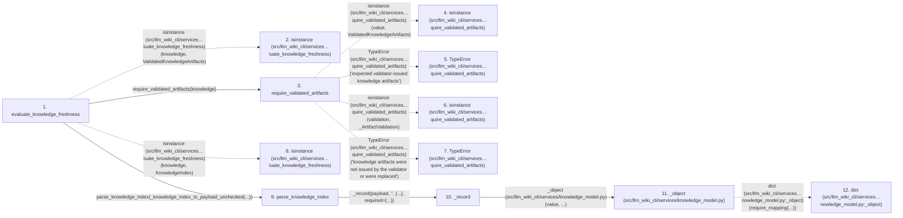

# evaluate_knowledge_freshness

**Entry point:** `evaluate_knowledge_freshness` (`api`)
**Source:** [knowledge_freshness](../modules/knowledge_freshness.md)
**Modules touched:** [analysis_compatibility](../modules/analysis_compatibility.md), [concept_identity](../modules/concept_identity.md), [implementation_evidence](../modules/implementation_evidence.md), and 18 more

**Complete modules touched:**

- [analysis_compatibility](../modules/analysis_compatibility.md)
- [concept_identity](../modules/concept_identity.md)
- [implementation_evidence](../modules/implementation_evidence.md)
- [knowledge_artifacts](../modules/knowledge_artifacts.md)
- [knowledge_evidence](../modules/knowledge_evidence.md)
- [knowledge_freshness](../modules/knowledge_freshness.md)
- [knowledge_governance](../modules/knowledge_governance.md)
- [knowledge_graph](../modules/knowledge_graph.md)
- [knowledge_model](../modules/knowledge_model.md)
- [knowledge_reuse](../modules/knowledge_reuse.md)
- [knowledge_storage](../modules/knowledge_storage.md)
- [maintenance_evidence](../modules/maintenance_evidence.md)
- [maintenance_projection](../modules/maintenance_projection.md)
- [maintenance_shapes](../modules/maintenance_shapes.md)
- [maintenance_state](../modules/maintenance_state.md)
- [markdown_sections](../modules/markdown_sections.md)
- [python_implementation](../modules/python_implementation.md)
- [section_ownership](../modules/section_ownership.md)
- [validation](../modules/validation.md)
- [wiki_media](../modules/wiki_media.md)
- [wiki_surface](../modules/wiki_surface.md)

## Call sequence

> Static overview in presentation order, not runtime execution order. Arrows retain captured callers; siblings are shown before deeper helper detail.

```mermaid
sequenceDiagram
    participant p0 as evaluate_knowledge_freshness
    participant p1 as isinstance (src/llm_wiki_cli/services…luate_knowledge_freshness)
    participant p2 as require_validated_artifacts
    participant p3 as parse_knowledge_index
    participant p4 as _knowledge_index_to_payload_unchecked
    participant p5 as KnowledgeFreshnessError
    participant p6 as _evaluate_model_freshness
    participant p7 as isinstance (src/llm_wiki_cli/services…quire_validated_artifacts)
    participant p8 as _record
    participant p9 as _bundle_to_payload
    participant p10 as _validate_live_evaluation
    participant p11 as TypeError (src/llm_wiki_cli/services…quire_validated_artifacts)
    participant p12 as _string
    participant p13 as sorted (src/llm_wiki_cli/services…ndex_to_payload_unchecked)
    participant p14 as Counter
    participant p15 as KnowledgeModelError
    participant p16 as sorted (src/llm_wiki_cli/services…_evaluate_model_freshness)
    participant p17 as _parse_bundle
    participant p18 as _evaluate_concept
    participant p19 as _array (src/llm_wiki_cli/services/knowledge_model.py)
    participant p20 as _concept_to_payload
    participant p21 as counts.get
    participant p22 as tuple (src/llm_wiki_cli/services….py:parse_knowledge_index)
    participant p23 as KnowledgeFreshnessReport
    p0-->>p1: isinstance (src/llm_wiki_cli/services…luate_knowledge_freshness)(knowledge, ValidatedKnowledgeArtifacts)
    p0->>p2: require_validated_artifacts
    p0-->>p1: isinstance (src/llm_wiki_cli/services…luate_knowledge_freshness)(knowledge, KnowledgeIndex)
    p0->>p3: parse_knowledge_index
    p0->>p4: _knowledge_index_to_payload_unchecked
    p0->>p3: parse_knowledge_index
    p0->>p5: KnowledgeFreshnessError
    p0->>p6: _evaluate_model_freshness
    p2-->>p7: isinstance (src/llm_wiki_cli/services…quire_validated_artifacts)(value, ValidatedKnowledgeArtifacts)
    p3->>p8: _record
    p4->>p9: _bundle_to_payload
    p6->>p10: _validate_live_evaluation
    p2-->>p11: TypeError (src/llm_wiki_cli/services…quire_validated_artifacts)('expected validator-issued knowledge artifacts')
    p3->>p12: _string
    p4-->>p13: sorted (src/llm_wiki_cli/services…ndex_to_payload_unchecked)(producer[...], key=...)
    p6-->>p14: Counter
    p2-->>p7: isinstance (src/llm_wiki_cli/services…quire_validated_artifacts)(validation, _ArtifactValidation)
    p3->>p15: KnowledgeModelError
    p4-->>p13: sorted (src/llm_wiki_cli/services…ndex_to_payload_unchecked)(producer[...], key=...)
    p6-->>p16: sorted (src/llm_wiki_cli/services…_evaluate_model_freshness)(model.concepts, key=...)
    p2-->>p11: TypeError (src/llm_wiki_cli/services…quire_validated_artifacts)('knowledge artifacts were not issued by the validator or were replaced')
    p3->>p17: _parse_bundle
    p4-->>p13: sorted (src/llm_wiki_cli/services…ndex_to_payload_unchecked)(..., key=...)
    p6->>p18: _evaluate_concept
    p3->>p19: _array (src/llm_wiki_cli/services/knowledge_model.py)
    p4->>p20: _concept_to_payload
    p6-->>p21: counts.get(state, 0)
    p3-->>p22: tuple (src/llm_wiki_cli/services….py:parse_knowledge_index)(...)
    p4-->>p13: sorted (src/llm_wiki_cli/services…ndex_to_payload_unchecked)(..., key=_canonical_relationship_key)
    p6->>p23: KnowledgeFreshnessReport
```

<!-- Auto-generated from static call edges. Dashed arrows are external or unresolved calls. Reviewed runtime conditions and side effects belong in Behavior. -->

> Call sequence diagram shows 30 of 1931 interactions; 1901 omitted to keep the visualization within the 30-interaction and generated-diagram limits, with uncertain identities omitted rather than inferred.

> Captured boundary calls: external 13 of 512 (499 omitted); unresolved 1 of 334 (333 omitted). These counts cover the captured static trace.

Omitted captured detail, grouped by actual caller occurrence and target module:

| Caller | Parent step | Target module | Kind | Omitted interactions |
| --- | --- | --- | --- | --- |
| `src/llm_wiki_cli/services/knowledge_model.py:_record` | 10 | [src/llm_wiki_cli/services/knowledge_model.py](../modules/knowledge_model.md) | internal | 7 |
| `src/llm_wiki_cli/services/knowledge_model.py:_object` | 11 | - | external | 1 |
| `src/llm_wiki_cli/services/knowledge_model.py:_object` | 11 | [src/llm_wiki_cli/services/validation.py](../modules/validation.md) | internal | 1 |
| `src/llm_wiki_cli/services/validation.py:require_mapping` | 13 | - | external | 2 |
| `src/llm_wiki_cli/services/validation.py:require_mapping` | 13 | - | unresolved | 1 |
| `src/llm_wiki_cli/services/knowledge_model.py:_object` | 11 | [src/llm_wiki_cli/services/knowledge_model.py](../modules/knowledge_model.md) | internal | 3 |
| `src/llm_wiki_cli/services/knowledge_model.py:_record` | 10 | - | external | 4 |
| `src/llm_wiki_cli/services/knowledge_model.py:_parse_extensions` | 28 | [src/llm_wiki_cli/services/knowledge_model.py](../modules/knowledge_model.md) | internal | 7 |
> Omission summary shows 8 of 466 groups; 458 further groups are not expanded here. Counts above include all omitted interactions.
> Detailed flow queries retain their own coverage and limits; omitted paths may execute at runtime.

> Trace truncated at the depth limit; deeper calls are omitted.

## Data flow

<!-- Auto-generated static analysis. Treat values and boundaries as best-effort hints, not runtime proof. -->

### Step data

| Step | Inputs | Reads | Writes | Returns |
|---|---|---|---|---|
| `evaluate_knowledge_freshness` | `knowledge: KnowledgeIndex \| object`, `live: LiveKnowledgeEvaluation \| None` | `KnowledgeIndex`, `KnowledgeModelError` | - | `_evaluate_model_freshness(...)` |
| `isinstance (src/llm_wiki_cli/services…luate_knowledge_freshness)` | - | - | - | - |
| `require_validated_artifacts` | `value: object` | `ValidatedKnowledgeArtifacts`, `_ArtifactValidation` | - | `value` |
| `isinstance (src/llm_wiki_cli/services…quire_validated_artifacts)` | - | - | - | - |
| `TypeError (src/llm_wiki_cli/services…quire_validated_artifacts)` | - | - | - | - |
| `isinstance (src/llm_wiki_cli/services…quire_validated_artifacts)` | - | - | - | - |
| `TypeError (src/llm_wiki_cli/services…quire_validated_artifacts)` | - | - | - | - |
| `isinstance (src/llm_wiki_cli/services…luate_knowledge_freshness)` | - | - | - | - |
| `parse_knowledge_index` | `payload: object` | `KNOWLEDGE_SCHEMA_VERSION`, `KNOWLEDGE_SCHEMA_VERSION` | - | `model` |
| `_record` | `value: object`, `path: str`, `fields: AbstractSet[str]`, `required: AbstractSet[str]` | - | - | `(...)` |
| `_object (src/llm_wiki_cli/services/knowledge_model.py)` | `value: object`, `path: str` | - | - | `dict(...)` |
| `dict (src/llm_wiki_cli/services…nowledge_model.py:_object)` | - | - | - | - |

### Call data

| From | To | Line | Call |
|---|---|---:|---|
| evaluate_knowledge_freshness | isinstance (src/llm_wiki_cli/services…luate_knowledge_freshness) | 262 | `isinstance(knowledge, ValidatedKnowledgeArtifacts)` |
| evaluate_knowledge_freshness | require_validated_artifacts | 261 | `require_validated_artifacts(knowledge)` |
| require_validated_artifacts | isinstance (src/llm_wiki_cli/services…quire_validated_artifacts) | 164 | `isinstance(value, ValidatedKnowledgeArtifacts)` |
| require_validated_artifacts | TypeError (src/llm_wiki_cli/services…quire_validated_artifacts) | 165 | `TypeError('expected validator-issued knowledge artifacts')` |
| require_validated_artifacts | isinstance (src/llm_wiki_cli/services…quire_validated_artifacts) | 168 | `isinstance(validation, _ArtifactValidation)` |
| require_validated_artifacts | TypeError (src/llm_wiki_cli/services…quire_validated_artifacts) | 181 | `TypeError('knowledge artifacts were not issued by the validator or were replaced')` |
| evaluate_knowledge_freshness | isinstance (src/llm_wiki_cli/services…luate_knowledge_freshness) | 264 | `isinstance(knowledge, KnowledgeIndex)` |
| evaluate_knowledge_freshness | parse_knowledge_index | 263 | `parse_knowledge_index(_knowledge_index_to_payload_unchecked(...))` |
| parse_knowledge_index | _record | 526 | `_record(payload, '', {...}, required={...})` |
| _record | _object (src/llm_wiki_cli/services/knowledge_model.py) | 1608 | `_object(value, ...)` |
| _object (src/llm_wiki_cli/services/knowledge_model.py) | dict (src/llm_wiki_cli/services…nowledge_model.py:_object) | 1694 | `dict(require_mapping(...))` |

### Boundary effects

*No boundary effects detected.*

### Static analysis gaps

| Kind | Step | Target | Line |
|---|---|---|---:|
| external_call | `evaluate_knowledge_freshness` | `isinstance` | 262 |
| external_call | `require_validated_artifacts` | `isinstance` | 164 |
| external_call | `require_validated_artifacts` | `TypeError` | 165 |
| external_call | `require_validated_artifacts` | `isinstance` | 168 |
| external_call | `require_validated_artifacts` | `TypeError` | 181 |
| external_call | `evaluate_knowledge_freshness` | `isinstance` | 264 |
| step_limit | `evaluate_knowledge_freshness` | `first 12 steps` | 0 |
| truncated_flow | `evaluate_knowledge_freshness` | `depth limit` | 0 |

## Behavior

This flow starts at `evaluate_knowledge_freshness` and is classified as `api`. The generated call and data-flow sections are bounded static projections; runtime conditions and side effects require source-level confirmation.
