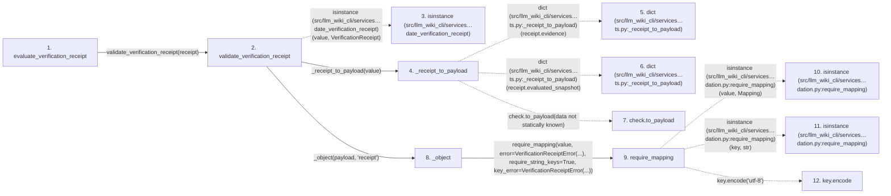

# evaluate_verification_receipt

**Entry point:** `evaluate_verification_receipt` (`api`)
**Source:** [verification_contracts](../modules/verification_contracts.md)
**Modules touched:** [knowledge_evidence](../modules/knowledge_evidence.md), [validation](../modules/validation.md), [verification_contracts](../modules/verification_contracts.md)

## Call sequence

> Static overview in presentation order, not runtime execution order. Arrows retain captured callers; representative internal continuations and boundary examples precede repeated helper detail.

```mermaid
sequenceDiagram
    participant p0 as evaluate_verification_receipt
    participant p1 as validate_verification_receipt
    participant p2 as VerificationReceiptEvaluation
    participant p3 as _object
    participant p4 as _exact_fields
    participant p5 as _string
    participant p6 as _receipt_hash
    participant p7 as _scope_uid
    participant p8 as _receipt_anchor_mapping
    participant p9 as hash_json
    participant p10 as _parse_check
    participant p11 as _sha256
    participant p12 as _checker_id
    participant p13 as _normalized_anchor_mapping
    participant p14 as canonical_json_bytes
    participant p15 as _checker_version
    participant p16 as _array
    participant p17 as _parse_diagnostic
    participant p18 as _parse_coverage
    participant p19 as require_sha256
    participant p20 as _nonnegative_int
    participant p21 as require_nonnegative_int
    participant p22 as require_trimmed_text
    participant p23 as _receipt_to_payload
    participant p24 as VerificationReceiptError
    participant p25 as VerificationResult
    participant p26 as VerificationReceipt
    participant p27 as require_mapping
    participant p28 as require_string
    participant p29 as isinstance (src/llm_wiki_cli/services…uate_verification_receipt)
    participant p30 as add
    p0->>p1: validate_verification_receipt
    p0->>p2: VerificationReceiptEvaluation
    p1->>p3: _object
    p1->>p4: _exact_fields
    p1->>p5: _string
    p1->>p6: _receipt_hash
    p1->>p7: _scope_uid
    p1->>p8: _receipt_anchor_mapping
    p1->>p9: hash_json
    p1->>p10: _parse_check
    p6->>p11: _sha256
    p10->>p12: _checker_id
    p8->>p13: _normalized_anchor_mapping
    p9->>p14: canonical_json_bytes
    p10->>p15: _checker_version
    p10->>p16: _array
    p10->>p17: _parse_diagnostic
    p10->>p18: _parse_coverage
    p11->>p19: require_sha256
    p18->>p20: _nonnegative_int
    p20->>p21: require_nonnegative_int
    p19->>p22: require_trimmed_text
    p1->>p23: _receipt_to_payload
    p1->>p24: VerificationReceiptError
    p1->>p25: VerificationResult
    p1->>p26: VerificationReceipt
    p3->>p27: require_mapping
    p5->>p28: require_string
    p0-->>p29: isinstance (src/llm_wiki_cli/services…uate_verification_receipt)(context, VerificationContext)
    p0-->>p30: add(VerificationInvalidationReason.KNOWLEDGE_CHANGED)
```

<!-- Auto-generated from static call edges. Dashed arrows are external or unresolved calls. Reviewed runtime conditions and side effects belong in Behavior. -->

> Call sequence diagram shows 30 of 178 interactions; 148 omitted to keep the visualization within the 30-interaction and generated-diagram limits, with uncertain identities omitted rather than inferred.

> Captured boundary calls: external 1 of 55 (54 omitted); unresolved 1 of 25 (24 omitted). These counts cover the captured static trace.

Omitted captured detail, grouped by actual caller occurrence and target module:

| Caller | Parent step | Target module | Kind | Omitted interactions |
| --- | --- | --- | --- | --- |
| `src/llm_wiki_cli/services/verification_contracts.py:validate_verification_receipt` | 2 | - | external | 7 |
| `src/llm_wiki_cli/services/verification_contracts.py:_receipt_to_payload` | 4 | - | external | 2 |
| `src/llm_wiki_cli/services/verification_contracts.py:_receipt_to_payload` | 4 | - | unresolved | 1 |
| `src/llm_wiki_cli/services/validation.py:require_mapping` | 9 | - | external | 2 |
| `src/llm_wiki_cli/services/validation.py:require_mapping` | 9 | - | unresolved | 1 |
| `src/llm_wiki_cli/services/verification_contracts.py:_object` | 8 | [src/llm_wiki_cli/services/verification_contracts.py](../modules/verification_contracts.md) | internal | 2 |
| `src/llm_wiki_cli/services/verification_contracts.py:_exact_fields` | 15 | - | external | 1 |
| `src/llm_wiki_cli/services/verification_contracts.py:_exact_fields` | 15 | [src/llm_wiki_cli/services/validation.py](../modules/validation.md) | internal | 1 |
> Omission summary shows 8 of 56 groups; 48 further groups are not expanded here. Counts above include all omitted interactions.
> Detailed flow queries retain their own coverage and limits; omitted paths may execute at runtime.

> Trace truncated at the depth limit; deeper calls are omitted.

## Data flow

<!-- Auto-generated static analysis. Treat values and boundaries as best-effort hints, not runtime proof. -->

### Analysis coverage

**Effect analysis partially available.** Flow assembly and source effect analysis are separate; empty observations do not prove an empty handler body.

Source steps: 99; effect analysis evaluated: 58, partial: 0, unavailable: 41. Counts include steps omitted from the displayed trace.

- Callable record unavailable; the selected entry symbol has no represented callable body.
- Effect collector totals unavailable; observed counts cover captured records only.

| Step | Callable record | Effect analysis | Collector totals |
|---|---|---|---|
| `evaluate_verification_receipt` | `available` | `evaluated` | `available` |
| `validate_verification_receipt` | `available` | `evaluated` | `available` |
| `isinstance (src/llm_wiki_cli/services…date_verification_receipt)` | `not_applicable` | `not_applicable` | `not_applicable` |
| `_receipt_to_payload` | `available` | `evaluated` | `available` |
| `dict (src/llm_wiki_cli/services…ts.py:_receipt_to_payload)` | `not_applicable` | `not_applicable` | `not_applicable` |
| `dict (src/llm_wiki_cli/services…ts.py:_receipt_to_payload)` | `not_applicable` | `not_applicable` | `not_applicable` |
| `check.to_payload` | `not_applicable` | `not_applicable` | `not_applicable` |
| `_object` | `available` | `evaluated` | `available` |
| `require_mapping` | `available` | `evaluated` | `available` |
| `isinstance (src/llm_wiki_cli/services…dation.py:require_mapping)` | `not_applicable` | `not_applicable` | `not_applicable` |
| `isinstance (src/llm_wiki_cli/services…dation.py:require_mapping)` | `not_applicable` | `not_applicable` | `not_applicable` |
| `key.encode` | `not_applicable` | `not_applicable` | `not_applicable` |

### Step data

| Step | Inputs | Reads | Writes | Returns |
|---|---|---|---|---|
| `evaluate_verification_receipt` | `receipt: VerificationReceipt \| object`, `context: VerificationContext` | `VerificationContext`, `VerificationInvalidationReason`, `VerificationInvalidationReason`, `VerificationInvalidationReason`, `VerificationInvalidationReason`, `VerificationInvalidationReason`, `VerificationInvalidationReason` | - | `VerificationReceiptEvaluation(...)` |
| `validate_verification_receipt` | `value: VerificationReceipt \| object` | `VerificationReceipt`, `VERIFICATION_RECEIPT_SCHEMA_VERSION`, `VERIFICATION_RECEIPT_SCHEMA_VERSION`, `VerificationContractError`, `MAX_CHECKS_PER_RECEIPT` | - | `VerificationReceipt(...)` |
| `isinstance (src/llm_wiki_cli/services…date_verification_receipt)` | - | - | - | - |
| `_receipt_to_payload` | `receipt: VerificationReceipt` | - | - | `{...}` |
| `dict (src/llm_wiki_cli/services…ts.py:_receipt_to_payload)` | - | - | - | - |
| `dict (src/llm_wiki_cli/services…ts.py:_receipt_to_payload)` | - | - | - | - |
| `check.to_payload` | - | - | - | - |
| `_object` | `value: object`, `field_name: str` | - | - | `require_mapping(...)` |
| `require_mapping` | `value: object`, `error: Exception`, `require_string_keys: bool`, `key_error: Exception \| None`, `require_utf8_keys: bool`, `utf8_key_error: Exception \| None` | `Mapping` | - | `value` |
| `isinstance (src/llm_wiki_cli/services…dation.py:require_mapping)` | - | - | - | - |
| `isinstance (src/llm_wiki_cli/services…dation.py:require_mapping)` | - | - | - | - |
| `key.encode` | - | - | - | - |

### Call data

| From | To | Line | Call |
|---|---|---:|---|
| evaluate_verification_receipt | validate_verification_receipt | 1037 | `validate_verification_receipt(receipt)` |
| validate_verification_receipt | isinstance (src/llm_wiki_cli/services…date_verification_receipt) | 806 | `isinstance(value, VerificationReceipt)` |
| validate_verification_receipt | _receipt_to_payload | 805 | `_receipt_to_payload(value)` |
| _receipt_to_payload | dict (src/llm_wiki_cli/services…ts.py:_receipt_to_payload) | 1101 | `dict(receipt.evidence)` |
| _receipt_to_payload | dict (src/llm_wiki_cli/services…ts.py:_receipt_to_payload) | 1103 | `dict(receipt.evaluated_snapshot)` |
| _receipt_to_payload | check.to_payload | 1107 | `check.to_payload(data not statically known)` |
| validate_verification_receipt | _object | 809 | `_object(payload, 'receipt')` |
| _object | require_mapping | 1441 | `require_mapping(value, error=VerificationReceiptError(...), require_string_keys=True, key_error=VerificationReceiptError(...))` |
| require_mapping | isinstance (src/llm_wiki_cli/services…dation.py:require_mapping) | 765 | `isinstance(value, Mapping)` |
| require_mapping | isinstance (src/llm_wiki_cli/services…dation.py:require_mapping) | 769 | `isinstance(key, str)` |
| require_mapping | key.encode | 774 | `key.encode('utf-8')` |

### Boundary effects

*No boundary-effect observations were captured in this static trace.*

### Static analysis gaps

| Kind | Step | Target | Line |
|---|---|---|---:|
| external_call | `validate_verification_receipt` | `isinstance` | 806 |
| unresolved_call | `_receipt_to_payload` | `check.to_payload` | 1107 |
| external_call | `require_mapping` | `isinstance` | 765 |
| external_call | `require_mapping` | `isinstance` | 769 |
| unresolved_call | `require_mapping` | `key.encode` | 774 |
| step_limit | `evaluate_verification_receipt` | `first 12 steps` | 0 |
| truncated_flow | `evaluate_verification_receipt` | `depth limit` | 0 |

## Behavior

This flow starts at `evaluate_verification_receipt` and is classified as `api`. The generated call and data-flow sections are bounded static projections; runtime conditions and side effects require source-level confirmation.
