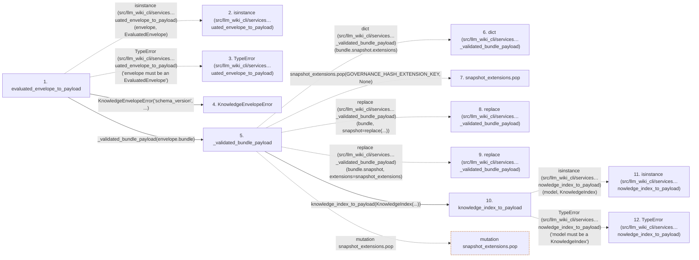

# evaluated_envelope_to_payload

**Entry point:** `evaluated_envelope_to_payload` (`api`)
**Source:** [knowledge_envelope](../modules/knowledge_envelope.md)
**Modules touched:** [concept_identity](../modules/concept_identity.md), [implementation_evidence](../modules/implementation_evidence.md), [knowledge_envelope](../modules/knowledge_envelope.md), and 13 more

**Complete modules touched:**

- [concept_identity](../modules/concept_identity.md)
- [implementation_evidence](../modules/implementation_evidence.md)
- [knowledge_envelope](../modules/knowledge_envelope.md)
- [knowledge_evidence](../modules/knowledge_evidence.md)
- [knowledge_governance](../modules/knowledge_governance.md)
- [knowledge_graph](../modules/knowledge_graph.md)
- [knowledge_model](../modules/knowledge_model.md)
- [knowledge_reuse](../modules/knowledge_reuse.md)
- [knowledge_storage](../modules/knowledge_storage.md)
- [maintenance_evidence](../modules/maintenance_evidence.md)
- [maintenance_projection](../modules/maintenance_projection.md)
- [maintenance_shapes](../modules/maintenance_shapes.md)
- [maintenance_state](../modules/maintenance_state.md)
- [section_ownership](../modules/section_ownership.md)
- [validation](../modules/validation.md)
- [wiki_surface](../modules/wiki_surface.md)

## Call sequence

> Static overview in presentation order, not runtime execution order. Arrows retain captured callers; siblings are shown before deeper helper detail.

```mermaid
sequenceDiagram
    participant p0 as evaluated_envelope_to_payload
    participant p1 as isinstance (src/llm_wiki_cli/services…uated_envelope_to_payload)
    participant p2 as TypeError (src/llm_wiki_cli/services…uated_envelope_to_payload)
    participant p3 as KnowledgeEnvelopeError
    participant p4 as _validated_bundle_payload
    participant p5 as bundle_payload[…].get(…).get
    participant p6 as bundle_payload[…].get
    participant p7 as is_valid_sha256
    participant p8 as dict (src/llm_wiki_cli/services…_validated_bundle_payload)
    participant p9 as snapshot_extensions.pop
    participant p10 as replace (src/llm_wiki_cli/services…_validated_bundle_payload)
    participant p11 as knowledge_index_to_payload
    participant p12 as KnowledgeIndex
    participant p13 as isinstance (src/llm_wiki_cli/services…nowledge_index_to_payload)
    participant p14 as TypeError (src/llm_wiki_cli/services…nowledge_index_to_payload)
    participant p15 as _emit_extensions
    participant p16 as _bundle_to_payload
    participant p17 as _concept_to_payload
    participant p18 as _relationship_to_payload
    participant p19 as KnowledgeModelError
    participant p20 as parse_knowledge_index
    participant p21 as _knowledge_index_to_payload_unchecked
    participant p22 as isinstance (src/llm_wiki_cli/services…model.py:_emit_extensions)
    participant p23 as _wire_enum
    participant p24 as _record
    p0-->>p1: isinstance (src/llm_wiki_cli/services…uated_envelope_to_payload)(envelope, EvaluatedEnvelope)
    p0-->>p2: TypeError (src/llm_wiki_cli/services…uated_envelope_to_payload)('envelope must be an EvaluatedEnvelope')
    p0->>p3: KnowledgeEnvelopeError
    p0->>p4: _validated_bundle_payload
    p0-->>p5: bundle_payload[…].get(…).get(INVENTORY_HASH_EXTENSION)
    p0-->>p6: bundle_payload[…].get('extensions', {...})
    p0->>p7: is_valid_sha256
    p0->>p3: KnowledgeEnvelopeError
    p4-->>p8: dict (src/llm_wiki_cli/services…_validated_bundle_payload)(bundle.snapshot.extensions)
    p4-->>p9: snapshot_extensions.pop(GOVERNANCE_HASH_EXTENSION_KEY, None)
    p4-->>p10: replace (src/llm_wiki_cli/services…_validated_bundle_payload)(bundle, snapshot=replace(...))
    p4-->>p10: replace (src/llm_wiki_cli/services…_validated_bundle_payload)(bundle.snapshot, extensions=snapshot_extensions)
    p4->>p11: knowledge_index_to_payload
    p4->>p12: KnowledgeIndex
    p4->>p3: KnowledgeEnvelopeError
    p11-->>p13: isinstance (src/llm_wiki_cli/services…nowledge_index_to_payload)(model, KnowledgeIndex)
    p11-->>p14: TypeError (src/llm_wiki_cli/services…nowledge_index_to_payload)('model must be a KnowledgeIndex')
    p11->>p15: _emit_extensions
    p11->>p16: _bundle_to_payload
    p11->>p17: _concept_to_payload
    p11->>p18: _relationship_to_payload
    p11->>p19: KnowledgeModelError
    p11->>p20: parse_knowledge_index
    p11->>p21: _knowledge_index_to_payload_unchecked
    p15-->>p22: isinstance (src/llm_wiki_cli/services…model.py:_emit_extensions)(extensions, FrozenDict)
    p16->>p15: _emit_extensions
    p17->>p23: _wire_enum
    p18->>p23: _wire_enum
    p20->>p24: _record
    p21->>p16: _bundle_to_payload
```

<!-- Auto-generated from static call edges. Dashed arrows are external or unresolved calls. Reviewed runtime conditions and side effects belong in Behavior. -->

> Call sequence diagram shows 30 of 812 interactions; 782 omitted to keep the visualization within the 30-interaction and generated-diagram limits, with uncertain identities omitted rather than inferred.

> Captured boundary calls: external 8 of 192 (184 omitted); unresolved 3 of 117 (114 omitted). These counts cover the captured static trace.

Omitted captured detail, grouped by actual caller occurrence and target module:

| Caller | Parent step | Target module | Kind | Omitted interactions |
| --- | --- | --- | --- | --- |
| `src/llm_wiki_cli/services/knowledge_model.py:_emit_extensions` | 13 | [src/llm_wiki_cli/services/knowledge_model.py](../modules/knowledge_model.md) | internal | 1 |
| `src/llm_wiki_cli/services/knowledge_model.py:_parse_extensions` | 15 | [src/llm_wiki_cli/services/knowledge_model.py](../modules/knowledge_model.md) | internal | 7 |
| `src/llm_wiki_cli/services/knowledge_model.py:_object` | 16 | - | external | 1 |
| `src/llm_wiki_cli/services/knowledge_model.py:_object` | 16 | [src/llm_wiki_cli/services/validation.py](../modules/validation.md) | internal | 1 |
| `src/llm_wiki_cli/services/knowledge_model.py:_object` | 16 | [src/llm_wiki_cli/services/knowledge_model.py](../modules/knowledge_model.md) | internal | 3 |
| `src/llm_wiki_cli/services/knowledge_model.py:_parse_extensions` | 15 | - | external | 1 |
| `src/llm_wiki_cli/services/knowledge_model.py:_parse_extensions` | 15 | - | unresolved | 1 |
| `src/llm_wiki_cli/services/knowledge_model.py:_normalize_json_value` | 26 | [src/llm_wiki_cli/services/knowledge_model.py](../modules/knowledge_model.md) | internal | 1 |
> Omission summary shows 8 of 158 groups; 150 further groups are not expanded here. Counts above include all omitted interactions.
> Detailed flow queries retain their own coverage and limits; omitted paths may execute at runtime.

> Trace truncated at the depth limit; deeper calls are omitted.

## Data flow

<!-- Auto-generated static analysis. Treat values and boundaries as best-effort hints, not runtime proof. -->

### Step data

| Step | Inputs | Reads | Writes | Returns |
|---|---|---|---|---|
| `evaluated_envelope_to_payload` | `envelope: EvaluatedEnvelope` | `EvaluatedEnvelope`, `EVALUATED_ENVELOPE_VERSION`, `EVALUATED_ENVELOPE_VERSION`, `INVENTORY_HASH_EXTENSION`, `INVENTORY_HASH_EXTENSION` | - | `{...}` |
| `isinstance (src/llm_wiki_cli/services…uated_envelope_to_payload)` | - | - | - | - |
| `TypeError (src/llm_wiki_cli/services…uated_envelope_to_payload)` | - | - | - | - |
| `KnowledgeEnvelopeError` | - | - | - | - |
| `_validated_bundle_payload` | `bundle: BundleRecord` | `GOVERNANCE_HASH_EXTENSION_KEY`, `KNOWLEDGE_SCHEMA_VERSION`, `KnowledgeModelError` | - | `payload[...]` |
| `dict (src/llm_wiki_cli/services…_validated_bundle_payload)` | - | - | - | - |
| `snapshot_extensions.pop` | - | - | - | - |
| `replace (src/llm_wiki_cli/services…_validated_bundle_payload)` | - | - | - | - |
| `replace (src/llm_wiki_cli/services…_validated_bundle_payload)` | - | - | - | - |
| `knowledge_index_to_payload` | `model: KnowledgeIndex` | `KnowledgeIndex`, `KnowledgeModelError` | - | `_knowledge_index_to_payload_unchecked(...)` |
| `isinstance (src/llm_wiki_cli/services…nowledge_index_to_payload)` | - | - | - | - |
| `TypeError (src/llm_wiki_cli/services…nowledge_index_to_payload)` | - | - | - | - |

### Call data

| From | To | Line | Call |
|---|---|---:|---|
| evaluated_envelope_to_payload | isinstance (src/llm_wiki_cli/services…uated_envelope_to_payload) | 1141 | `isinstance(envelope, EvaluatedEnvelope)` |
| evaluated_envelope_to_payload | TypeError (src/llm_wiki_cli/services…uated_envelope_to_payload) | 1142 | `TypeError('envelope must be an EvaluatedEnvelope')` |
| evaluated_envelope_to_payload | KnowledgeEnvelopeError | 1144 | `KnowledgeEnvelopeError('schema_version', ...)` |
| evaluated_envelope_to_payload | _validated_bundle_payload | 1148 | `_validated_bundle_payload(envelope.bundle)` |
| _validated_bundle_payload | dict (src/llm_wiki_cli/services…_validated_bundle_payload) | 1946 | `dict(bundle.snapshot.extensions)` |
| _validated_bundle_payload | snapshot_extensions.pop | 1947 | `snapshot_extensions.pop(GOVERNANCE_HASH_EXTENSION_KEY, None)` |
| _validated_bundle_payload | replace (src/llm_wiki_cli/services…_validated_bundle_payload) | 1948 | `replace(bundle, snapshot=replace(...))` |
| _validated_bundle_payload | replace (src/llm_wiki_cli/services…_validated_bundle_payload) | 1950 | `replace(bundle.snapshot, extensions=snapshot_extensions)` |
| _validated_bundle_payload | knowledge_index_to_payload | 1956 | `knowledge_index_to_payload(KnowledgeIndex(...))` |
| knowledge_index_to_payload | isinstance (src/llm_wiki_cli/services…nowledge_index_to_payload) | 663 | `isinstance(model, KnowledgeIndex)` |
| knowledge_index_to_payload | TypeError (src/llm_wiki_cli/services…nowledge_index_to_payload) | 664 | `TypeError('model must be a KnowledgeIndex')` |

### Boundary effects

| Kind | Target | Step | Line |
|---|---|---|---:|
| mutation | `snapshot_extensions.pop` | `_validated_bundle_payload` | 1947 |

### Static analysis gaps

| Kind | Step | Target | Line |
|---|---|---|---:|
| external_call | `evaluated_envelope_to_payload` | `isinstance` | 1141 |
| external_call | `evaluated_envelope_to_payload` | `TypeError` | 1142 |
| external_call | `_validated_bundle_payload` | `replace` | 1948 |
| external_call | `_validated_bundle_payload` | `replace` | 1950 |
| external_call | `knowledge_index_to_payload` | `isinstance` | 663 |
| external_call | `knowledge_index_to_payload` | `TypeError` | 664 |
| step_limit | `evaluated_envelope_to_payload` | `first 12 steps` | 0 |
| truncated_flow | `evaluated_envelope_to_payload` | `depth limit` | 0 |

## Behavior

This flow starts at `evaluated_envelope_to_payload` and is classified as `api`. The generated call and data-flow sections are bounded static projections; runtime conditions and side effects require source-level confirmation.
