# expand_compact_task_context

**Entry point:** `expand_compact_task_context` (`api`)
**Source:** [api](../modules/api.md)
**Modules touched:** [api](../modules/api.md), [change_selection](../modules/change_selection.md), [context_budget](../modules/context_budget.md), [context_packet](../modules/context_packet.md), and 9 more

**Complete modules touched:**

- [api](../modules/api.md)
- [change_selection](../modules/change_selection.md)
- [context_budget](../modules/context_budget.md)
- [context_packet](../modules/context_packet.md)
- [documentation_query_builder](../modules/documentation_query_builder.md)
- [task_compact](../modules/task_compact.md)
- [task_context](../modules/task_context.md)
- [task_context_v2](../modules/task_context_v2.md)
- [task_contract](../modules/task_contract.md)
- [task_evidence](../modules/task_evidence.md)
- [task_implementation](../modules/task_implementation.md)
- [token_counting](../modules/token_counting.md)
- [workflow_profile](../modules/workflow_profile.md)

## Call sequence

> Static overview in presentation order, not runtime execution order. Arrows retain captured callers; siblings are shown before deeper helper detail.

```mermaid
sequenceDiagram
    participant p0 as expand_compact_task_context (src/llm_wiki_cli/api.py)
    participant p1 as expand_compact_task_context (src/llm_wiki_cli/services/task_compact.py)
    participant p2 as validate_compact_task_context
    participant p3 as _expanded
    participant p4 as render_compact_task_context
    participant p5 as dict
    participant p6 as isinstance (src/llm_wiki_cli/services…date_compact_task_context)
    participant p7 as zip
    participant p8 as TaskCompactError
    participant p9 as _decode_observation
    participant p10 as json.loads (src/llm_wiki_cli/services…date_compact_task_context)
    participant p11 as deepcopy (src/llm_wiki_cli/services/task_compact.py:_expanded)
    participant p12 as fact.pop
    participant p13 as canonical_json(…).decode (src/llm_wiki_cli/services…date_compact_task_context)
    participant p14 as canonical_json
    participant p15 as facts.append
    participant p16 as deepcopy (src/llm_wiki_cli/services…date_compact_task_context)
    participant p17 as requirements.append (src/llm_wiki_cli/services/task_compact.py:_expanded)
    participant p18 as coverage.append
    participant p19 as _decode_limits
    participant p20 as _validated
    participant p21 as deepcopy (src/llm_wiki_cli/services…ct.py:_decode_observation)
    participant p22 as _LIMIT_SUMMARIES.index
    p0->>p1: expand_compact_task_context (src/llm_wiki_cli/services/task_compact.py)
    p1->>p2: validate_compact_task_context
    p1->>p3: _expanded
    p2->>p4: render_compact_task_context
    p3-->>p5: dict(zip(...))
    p2-->>p6: isinstance (src/llm_wiki_cli/services…date_compact_task_context)(compact_text, str)
    p3-->>p7: zip(FACT_COLUMNS, row)
    p2->>p8: TaskCompactError
    p3->>p9: _decode_observation
    p2-->>p10: json.loads (src/llm_wiki_cli/services…date_compact_task_context)(compact_text, object_pairs_hook=_pairs, parse_constant=_constant)
    p3-->>p11: deepcopy (src/llm_wiki_cli/services/task_compact.py:_expanded)(...)
    p2->>p8: TaskCompactError
    p3-->>p12: fact.pop('citation_refs')
    p2-->>p13: canonical_json(…).decode (src/llm_wiki_cli/services…date_compact_task_context)('utf-8')
    p3-->>p11: deepcopy (src/llm_wiki_cli/services/task_compact.py:_expanded)(payload[...])
    p2->>p14: canonical_json
    p3-->>p15: facts.append(fact)
    p2->>p8: TaskCompactError
    p3-->>p5: dict(zip(...))
    p2-->>p16: deepcopy (src/llm_wiki_cli/services…date_compact_task_context)(payload)
    p3-->>p7: zip(REQUIREMENT_COLUMNS, row)
    p3-->>p17: requirements.append (src/llm_wiki_cli/services/task_compact.py:_expanded)(...)
    p3-->>p18: coverage.append({...})
    p3-->>p11: deepcopy (src/llm_wiki_cli/services/task_compact.py:_expanded)(payload[...])
    p3-->>p11: deepcopy (src/llm_wiki_cli/services/task_compact.py:_expanded)(payload[...])
    p3-->>p11: deepcopy (src/llm_wiki_cli/services/task_compact.py:_expanded)(...)
    p3->>p19: _decode_limits
    p4->>p20: _validated
    p9-->>p21: deepcopy (src/llm_wiki_cli/services…ct.py:_decode_observation)(value[...])
    p19-->>p22: _LIMIT_SUMMARIES.index(value[...])
```

<!-- Auto-generated from static call edges. Dashed arrows are external or unresolved calls. Reviewed runtime conditions and side effects belong in Behavior. -->

> Call sequence diagram shows 30 of 277 interactions; 247 omitted to keep the visualization within the 30-interaction and generated-diagram limits, with uncertain identities omitted rather than inferred.

> Captured boundary calls: external 13 of 123 (110 omitted); unresolved 6 of 69 (63 omitted). These counts cover the captured static trace.

Omitted captured detail, grouped by actual caller occurrence and target module:

| Caller | Parent step | Target module | Kind | Omitted interactions |
| --- | --- | --- | --- | --- |
| `src/llm_wiki_cli/services/task_compact.py:_validated` | 5 | - | external | 3 |
| `src/llm_wiki_cli/services/task_compact.py:_validated` | 5 | [src/llm_wiki_cli/services/task_compact.py](../modules/task_compact.md) | internal | 5 |
| `src/llm_wiki_cli/services/task_compact.py:_validated` | 5 | [src/llm_wiki_cli/services/task_contract.py](../modules/task_contract.md) | internal | 1 |
| `src/llm_wiki_cli/services/task_contract.py:normalize_task_request` | 10 | [src/llm_wiki_cli/services/workflow_profile.py](../modules/workflow_profile.md) | internal | 20 |
| `src/llm_wiki_cli/services/task_contract.py:normalize_task_request` | 10 | - | unresolved | 22 |
| `src/llm_wiki_cli/services/task_contract.py:normalize_task_request` | 10 | - | external | 10 |
| `src/llm_wiki_cli/services/task_contract.py:normalize_task_request` | 10 | [src/llm_wiki_cli/services/task_contract.py](../modules/task_contract.md) | internal | 4 |
| `src/llm_wiki_cli/services/task_contract.py:normalize_task_request` | 10 | [src/llm_wiki_cli/services/change_selection.py](../modules/change_selection.md) | internal | 1 |
> Omission summary shows 8 of 41 groups; 33 further groups are not expanded here. Counts above include all omitted interactions.
> Detailed flow queries retain their own coverage and limits; omitted paths may execute at runtime.

> Trace truncated at the depth limit; deeper calls are omitted.

## Data flow

```mermaid
flowchart LR
    s1["1. expand_compact_task_context (src/llm_wiki_cli/api.py)"]
    s2["2. expand_compact_task_context (src/llm_wiki_cli/services/task_compact.py)"]
    s3["3. validate_compact_task_context"]
    s4["4. render_compact_task_context"]
    s5["5. _validated"]
    s6["6. isinstance (src/llm_wiki_cli/services…ask_compact.py:_validated)"]
    s7["7. TaskCompactError"]
    s8["8. isinstance (src/llm_wiki_cli/services…ask_compact.py:_validated)"]
    s9["9. TaskCompactError"]
    s10["10. normalize_task_request"]
    s11["11. exact_fields"]
    s12["12. raw.get"]
    s1 -->|"expand_compact_task_context (src/llm_wiki_cli/services/task_compact.py)(…)"| s2
    s2 -->|"validate_compact_task_context(compact_text, canonical_text, request, view_options=view_options, profile=profile, policy=policy, counter=counter)"| s3
    s3 -->|"render_compact_task_context(canonical_text, request, view_options=view_options, profile=profile, policy=policy, counter=counter)"| s4
    s4 -->|"_validated(canonical_text, request, profile, policy, counter)"| s5
    s5 -. "isinstance (src/llm_wiki_cli/services…ask_compact.py:_validated)(canonical_text, TaskContext)" .-> s6
    s5 -->|"TaskCompactError('canonical-unavailable', 'An unsuccessful canonical result has no compact context')"| s7
    s5 -. "isinstance (src/llm_wiki_cli/services…ask_compact.py:_validated)(canonical_text, str)" .-> s8
    s5 -->|"TaskCompactError('canonical-invalid', 'Canonical context must be original text')"| s9
    s5 -->|"normalize_task_request(request, profile=profile, policy=policy)"| s10
    s10 -->|"exact_fields(request, {...}, 'request')"| s11
    s10 -. "raw.get('schema_version')" .-> s12
    b0["mutation anchors.append"]
    s10 -. "mutation anchors.append" .-> b0
    b1["mutation ids.add"]
    s10 -. "mutation ids.add" .-> b1
    b2["mutation requirements.append"]
    s10 -. "mutation requirements.append" .-> b2
    b3["mutation requirements.sort"]
    s10 -. "mutation requirements.sort" .-> b3
    click s1 "../modules/api.md"
    click s2 "../modules/task_compact.md"
    click s3 "../modules/task_compact.md"
    click s4 "../modules/task_compact.md"
    click s5 "../modules/task_compact.md"
    click s7 "../modules/task_compact.md"
    click s9 "../modules/task_compact.md"
    click s10 "../modules/task_contract.md"
    click s11 "../modules/workflow_profile.md"
    classDef boundary stroke:#b45309,stroke-dasharray: 4 2
    class b0 boundary
    class b1 boundary
    class b2 boundary
    class b3 boundary
```

<!-- Auto-generated static analysis. Treat values and boundaries as best-effort hints, not runtime proof. -->

### Step data

| Step | Inputs | Reads | Writes | Returns |
|---|---|---|---|---|
| `expand_compact_task_context (src/llm_wiki_cli/api.py)` | `compact_text: str`, `canonical_text: str`, `request: Mapping[str, Any]`, `view_options: Mapping[str, Any]`, `profile: WorkflowProfile \| Mapping[str, Any] \| None`, `policy: WorkflowPolicy \| None`, `counter: TokenCounter \| None` | - | - | `expand(...)` |
| `expand_compact_task_context (src/llm_wiki_cli/services/task_compact.py)` | `compact_text`, `canonical_text`, `request`, `view_options`, `profile`, `policy`, `counter` | - | - | `_expanded(...)` |
| `validate_compact_task_context` | `compact_text`, `canonical_text`, `request`, `view_options`, `profile`, `policy`, `counter` | `_pairs`, `_constant` | - | `deepcopy(...)` |
| `render_compact_task_context` | `canonical_text`, `request`, `view_options`, `profile`, `policy`, `counter` | - | - | `CompactTaskContext(...)`, `CompactTaskContext(...)` |
| `_validated` | `canonical_text`, `request`, `profile`, `policy`, `counter` | `TaskContext`, `TASK_REQUEST_SCHEMA_V2` | - | `(...)` |
| `isinstance (src/llm_wiki_cli/services…ask_compact.py:_validated)` | - | - | - | - |
| `TaskCompactError` | - | - | - | - |
| `isinstance (src/llm_wiki_cli/services…ask_compact.py:_validated)` | - | - | - | - |
| `TaskCompactError` | - | - | - | - |
| `normalize_task_request` | `request: Mapping[str, Any]`, `profile: WorkflowProfile \| Mapping[str, Any] \| None`, `policy: WorkflowPolicy \| None` | `TASK_REQUEST_SCHEMA`, `TASK_REQUEST_SCHEMA_V2`, `TASK_KINDS`, `ANCHOR_KINDS`, `canonical_json`, `FACETS`, `MAX_SELECTORS`, `TASK_REQUEST_SCHEMA_V2` | `changes[...]`, `normalized[...]`, `normalized[...]`, `normalized[...]` | `(...)` |
| `exact_fields` | `value: object`, `allowed: set[str]`, `field: str` | `Mapping` | - | `dict(...)` |
| `raw.get` | - | - | - | - |

### Call data

| From | To | Line | Call |
|---|---|---:|---|
| expand_compact_task_context (src/llm_wiki_cli/api.py) | expand_compact_task_context (src/llm_wiki_cli/services/task_compact.py) | 1476 | `expand(compact_text, canonical_text, request, view_options=view_options, profile=profile, policy=policy, counter=counter)` |
| expand_compact_task_context (src/llm_wiki_cli/services/task_compact.py) | validate_compact_task_context | 594 | `validate_compact_task_context(compact_text, canonical_text, request, view_options=view_options, profile=profile, policy=policy, counter=counter)` |
| validate_compact_task_context | render_compact_task_context | 553 | `render_compact_task_context(canonical_text, request, view_options=view_options, profile=profile, policy=policy, counter=counter)` |
| render_compact_task_context | _validated | 473 | `_validated(canonical_text, request, profile, policy, counter)` |
| _validated | isinstance (src/llm_wiki_cli/services…ask_compact.py:_validated) | 169 | `isinstance(canonical_text, TaskContext)` |
| _validated | TaskCompactError | 171 | `TaskCompactError('canonical-unavailable', 'An unsuccessful canonical result has no compact context')` |
| _validated | isinstance (src/llm_wiki_cli/services…ask_compact.py:_validated) | 176 | `isinstance(canonical_text, str)` |
| _validated | TaskCompactError | 177 | `TaskCompactError('canonical-invalid', 'Canonical context must be original text')` |
| _validated | normalize_task_request | 180 | `normalize_task_request(request, profile=profile, policy=policy)` |
| normalize_task_request | exact_fields | 53 | `exact_fields(request, {...}, 'request')` |
| normalize_task_request | raw.get | 55 | `raw.get('schema_version')` |

### Boundary effects

| Kind | Target | Step | Line |
|---|---|---|---:|
| mutation | `anchors.append` | `normalize_task_request` | 71 |
| mutation | `ids.add` | `normalize_task_request` | 79 |
| mutation | `requirements.append` | `normalize_task_request` | 89 |
| mutation | `requirements.sort` | `normalize_task_request` | 90 |

### Static analysis gaps

| Kind | Step | Target | Line |
|---|---|---|---:|
| external_call | `_validated` | `isinstance` | 169 |
| external_call | `_validated` | `isinstance` | 176 |
| unresolved_call | `normalize_task_request` | `raw.get` | 55 |
| step_limit | `expand_compact_task_context` | `first 12 steps` | 0 |
| truncated_flow | `expand_compact_task_context` | `depth limit` | 0 |

## Behavior

This flow starts at `expand_compact_task_context` and is classified as `api`. The generated call and data-flow sections are bounded static projections; runtime conditions and side effects require source-level confirmation.
