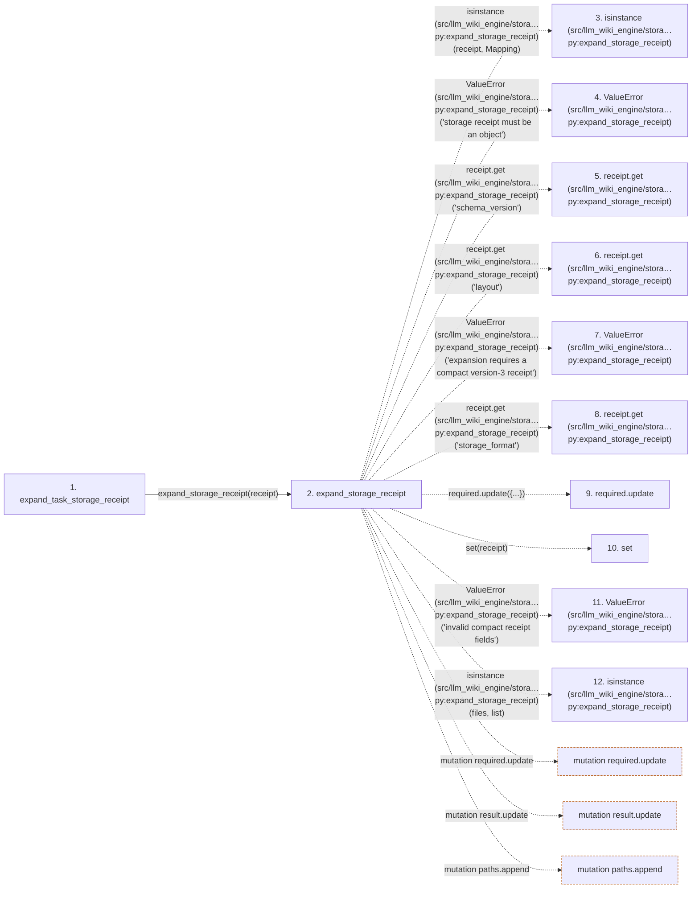

# expand_task_storage_receipt

**Entry point:** `expand_task_storage_receipt` (`api`)
**Source:** [api](../modules/api.md)
**Modules touched:** [api](../modules/api.md), [canonical_json](../modules/canonical_json.md), [knowledge_packs](../modules/knowledge_packs.md), [knowledge_storage](../modules/knowledge_storage.md), and 2 more

**Complete modules touched:**

- [api](../modules/api.md)
- [canonical_json](../modules/canonical_json.md)
- [knowledge_packs](../modules/knowledge_packs.md)
- [knowledge_storage](../modules/knowledge_storage.md)
- [storage_receipts](../modules/storage_receipts.md)
- [validation](../modules/validation.md)

## Call sequence

> Static overview in presentation order, not runtime execution order. Arrows retain captured callers; representative internal continuations and boundary examples precede repeated helper detail.

```mermaid
sequenceDiagram
    participant p0 as expand_task_storage_receipt
    participant p1 as expand_storage_receipt
    participant p2 as _decode_hash
    participant p3 as is_portable_relative_path
    participant p4 as index_page_path
    participant p5 as canonical_bytes
    participant p6 as compact_storage_receipt
    participant p7 as require_portable_relative_path
    participant p8 as _hash (src/llm_wiki_engine/knowledge_storage.py)
    participant p9 as compact_line_bytes
    participant p10 as _encode_hash
    participant p11 as _default_path_error
    participant p12 as _fail
    participant p13 as _check_path_collision
    participant p14 as require_portable_path_component
    participant p15 as _hash (src/llm_wiki_engine/storage_receipts.py)
    participant p16 as _file_path
    participant p17 as pack_path
    participant p18 as KnowledgeStorageError
    participant p19 as compact_text
    participant p20 as _syntax_key
    participant p21 as _known_syntax
    participant p22 as _remember_syntax
    participant p23 as SharedValidationError
    participant p24 as portable_path_key
    participant p25 as isinstance (src/llm_wiki_engine/stora…py:expand_storage_receipt)
    participant p26 as receipt.get (src/llm_wiki_engine/stora…py:expand_storage_receipt)
    participant p27 as ValueError (src/llm_wiki_engine/stora…py:expand_storage_receipt)
    p0->>p1: expand_storage_receipt
    p1->>p2: _decode_hash
    p1->>p3: is_portable_relative_path
    p1->>p4: index_page_path
    p1->>p5: canonical_bytes
    p1->>p6: compact_storage_receipt
    p3->>p7: require_portable_relative_path
    p4->>p8: _hash (src/llm_wiki_engine/knowledge_storage.py)
    p5->>p9: compact_line_bytes
    p2->>p10: _encode_hash
    p7->>p11: _default_path_error
    p8->>p12: _fail
    p7->>p13: _check_path_collision
    p7->>p14: require_portable_path_component
    p1->>p15: _hash (src/llm_wiki_engine/storage_receipts.py)
    p1->>p16: _file_path
    p1->>p17: pack_path
    p5->>p18: KnowledgeStorageError
    p9->>p19: compact_text
    p7->>p20: _syntax_key
    p7->>p21: _known_syntax
    p7->>p22: _remember_syntax
    p11->>p23: SharedValidationError
    p13->>p24: portable_path_key
    p1-->>p25: isinstance (src/llm_wiki_engine/stora…py:expand_storage_receipt)(receipt, Mapping)
    p1-->>p26: receipt.get (src/llm_wiki_engine/stora…py:expand_storage_receipt)('schema_version')
    p1-->>p27: ValueError (src/llm_wiki_engine/stora…py:expand_storage_receipt)('storage receipt must be an object')
    p1-->>p26: receipt.get (src/llm_wiki_engine/stora…py:expand_storage_receipt)('layout')
    p1-->>p27: ValueError (src/llm_wiki_engine/stora…py:expand_storage_receipt)('expansion requires a compact version-3 receipt')
    p1-->>p26: receipt.get (src/llm_wiki_engine/stora…py:expand_storage_receipt)('storage_format')
```

<!-- Auto-generated from static call edges. Dashed arrows are external or unresolved calls. Reviewed runtime conditions and side effects belong in Behavior. -->

> Call sequence diagram shows 30 of 167 interactions; 137 omitted to keep the visualization within the 30-interaction and generated-diagram limits, with uncertain identities omitted rather than inferred.

> Captured boundary calls: external 3 of 73 (70 omitted); unresolved 3 of 44 (41 omitted). These counts cover the captured static trace.

Omitted captured detail, grouped by actual caller occurrence and target module:

| Caller | Parent step | Target module | Kind | Omitted interactions |
| --- | --- | --- | --- | --- |
| `src/llm_wiki_engine/storage_receipts.py:expand_storage_receipt` | 2 | - | unresolved | 7 |
| `src/llm_wiki_engine/storage_receipts.py:expand_storage_receipt` | 2 | - | external | 33 |
| `src/llm_wiki_engine/storage_receipts.py:_decode_hash` | 23 | - | external | 5 |
| `src/llm_wiki_engine/storage_receipts.py:_decode_hash` | 23 | - | unresolved | 1 |
| `src/llm_wiki_engine/storage_receipts.py:_encode_hash` | 29 | - | external | 4 |
| `src/llm_wiki_engine/storage_receipts.py:_encode_hash` | 29 | - | unresolved | 3 |
| `src/llm_wiki_engine/storage_receipts.py:_encode_hash` | 29 | [src/llm_wiki_engine/storage_receipts.py](../modules/storage_receipts.md) | internal | 1 |
| `src/llm_wiki_engine/storage_receipts.py:_hash` | 33 | - | external | 2 |
> Omission summary shows 8 of 34 groups; 26 further groups are not expanded here. Counts above include all omitted interactions.
> Detailed flow queries retain their own coverage and limits; omitted paths may execute at runtime.

## Data flow

<!-- Auto-generated static analysis. Treat values and boundaries as best-effort hints, not runtime proof. -->

### Analysis coverage

**Effect analysis partially available.** Flow assembly and source effect analysis are separate; empty observations do not prove an empty handler body.

Source steps: 51; effect analysis evaluated: 40, partial: 2, unavailable: 9. Counts include steps omitted from the displayed trace.

Collector observations for 42 source steps with known totals: observed: 159, emitted: 148, omitted: 11. Unavailable totals are excluded.

- Callable record unavailable for one or more source steps; those steps have no represented callable body.
- Effect collector omitted observations before flow assembly; displayed effects are partial.
- Effect collector totals unavailable; observed counts cover captured records only.

| Step | Callable record | Effect analysis | Collector totals | Observed | Emitted | Omitted |
|---|---|---|---|---:|---:|---:|
| `expand_task_storage_receipt` | `available` | `evaluated` | `available` | `2` | `2` | `0` |
| `expand_storage_receipt` | `available` | `evaluated` | `available` | `8` | `8` | `0` |
| `isinstance (src/llm_wiki_engine/stora…py:expand_storage_receipt)` | `not_applicable` | `not_applicable` | `not_applicable` | — | — | — |
| `ValueError (src/llm_wiki_engine/stora…py:expand_storage_receipt)` | `not_applicable` | `not_applicable` | `not_applicable` | — | — | — |
| `receipt.get (src/llm_wiki_engine/stora…py:expand_storage_receipt)` | `not_applicable` | `not_applicable` | `not_applicable` | — | — | — |
| `receipt.get (src/llm_wiki_engine/stora…py:expand_storage_receipt)` | `not_applicable` | `not_applicable` | `not_applicable` | — | — | — |
| `ValueError (src/llm_wiki_engine/stora…py:expand_storage_receipt)` | `not_applicable` | `not_applicable` | `not_applicable` | — | — | — |
| `receipt.get (src/llm_wiki_engine/stora…py:expand_storage_receipt)` | `not_applicable` | `not_applicable` | `not_applicable` | — | — | — |
| `required.update` | `not_applicable` | `not_applicable` | `not_applicable` | — | — | — |
| `set` | `not_applicable` | `not_applicable` | `not_applicable` | — | — | — |
| `ValueError (src/llm_wiki_engine/stora…py:expand_storage_receipt)` | `not_applicable` | `not_applicable` | `not_applicable` | — | — | — |
| `isinstance (src/llm_wiki_engine/stora…py:expand_storage_receipt)` | `not_applicable` | `not_applicable` | `not_applicable` | — | — | — |

### Step data

| Step | Inputs | Reads | Writes | Returns |
|---|---|---|---|---|
| `expand_task_storage_receipt` | `receipt: Mapping[str, Any]` | - | - | `expand_storage_receipt(...)` |
| `expand_storage_receipt` | `receipt: Mapping[str, Any]` | `Mapping`, `RECEIPT_SCHEMA` | `result[...]` | `result` |
| `isinstance (src/llm_wiki_engine/stora…py:expand_storage_receipt)` | - | - | - | - |
| `ValueError (src/llm_wiki_engine/stora…py:expand_storage_receipt)` | - | - | - | - |
| `receipt.get (src/llm_wiki_engine/stora…py:expand_storage_receipt)` | - | - | - | - |
| `receipt.get (src/llm_wiki_engine/stora…py:expand_storage_receipt)` | - | - | - | - |
| `ValueError (src/llm_wiki_engine/stora…py:expand_storage_receipt)` | - | - | - | - |
| `receipt.get (src/llm_wiki_engine/stora…py:expand_storage_receipt)` | - | - | - | - |
| `required.update` | - | - | - | - |
| `set` | - | - | - | - |
| `ValueError (src/llm_wiki_engine/stora…py:expand_storage_receipt)` | - | - | - | - |
| `isinstance (src/llm_wiki_engine/stora…py:expand_storage_receipt)` | - | - | - | - |

### Call data

| From | To | Line | Call |
|---|---|---:|---|
| expand_task_storage_receipt | expand_storage_receipt | 1701 | `expand_storage_receipt(receipt)` |
| expand_storage_receipt | isinstance (src/llm_wiki_engine/stora…py:expand_storage_receipt) | 96 | `isinstance(receipt, Mapping)` |
| expand_storage_receipt | ValueError (src/llm_wiki_engine/stora…py:expand_storage_receipt) | 97 | `ValueError('storage receipt must be an object')` |
| expand_storage_receipt | receipt.get (src/llm_wiki_engine/stora…py:expand_storage_receipt) | 98 | `receipt.get('schema_version')` |
| expand_storage_receipt | receipt.get (src/llm_wiki_engine/stora…py:expand_storage_receipt) | 98 | `receipt.get('layout')` |
| expand_storage_receipt | ValueError (src/llm_wiki_engine/stora…py:expand_storage_receipt) | 99 | `ValueError('expansion requires a compact version-3 receipt')` |
| expand_storage_receipt | receipt.get (src/llm_wiki_engine/stora…py:expand_storage_receipt) | 100 | `receipt.get('storage_format')` |
| expand_storage_receipt | required.update | 105 | `required.update({...})` |
| expand_storage_receipt | set | 106 | `set(receipt)` |
| expand_storage_receipt | ValueError (src/llm_wiki_engine/stora…py:expand_storage_receipt) | 107 | `ValueError('invalid compact receipt fields')` |
| expand_storage_receipt | isinstance (src/llm_wiki_engine/stora…py:expand_storage_receipt) | 109 | `isinstance(files, list)` |

### Boundary effects

| Kind | Target | Step | Line |
|---|---|---|---:|
| mutation | `required.update` | `expand_storage_receipt` | 105 |
| mutation | `result.update` | `expand_storage_receipt` | 112 |
| mutation | `paths.append` | `expand_storage_receipt` | 137 |

### Static analysis gaps

| Kind | Step | Target | Line |
|---|---|---|---:|
| external_call | `expand_storage_receipt` | `isinstance` | 96 |
| external_call | `expand_storage_receipt` | `ValueError` | 97 |
| unresolved_call | `expand_storage_receipt` | `receipt.get` | 98 |
| external_call | `expand_storage_receipt` | `ValueError` | 99 |
| unresolved_call | `expand_storage_receipt` | `receipt.get` | 100 |
| external_call | `expand_storage_receipt` | `ValueError` | 107 |
| external_call | `expand_storage_receipt` | `isinstance` | 109 |
| step_limit | `expand_task_storage_receipt` | `first 12 steps` | 0 |

## Behavior

This flow starts at `expand_task_storage_receipt` and is classified as `api`. The generated call and data-flow sections are bounded static projections; runtime conditions and side effects require source-level confirmation.
