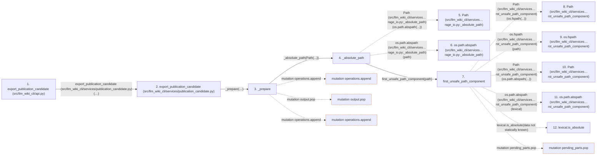

# export_publication_candidate

**Entry point:** `export_publication_candidate` (`api`)
**Source:** [api](../modules/api.md)
**Modules touched:** [api](../modules/api.md), [behavior_reference](../modules/behavior_reference.md), [cli_reference](../modules/cli_reference.md), [common](../modules/common.md), and 19 more

**Complete modules touched:**

- [api](../modules/api.md)
- [behavior_reference](../modules/behavior_reference.md)
- [cli_reference](../modules/cli_reference.md)
- [common](../modules/common.md)
- [config](../modules/config.md)
- [filesystem_guard](../modules/filesystem_guard.md)
- [instruction_ownership](../modules/instruction_ownership.md)
- [io](../modules/io.md)
- [knowledge_evidence](../modules/knowledge_evidence.md)
- [knowledge_storage](../modules/knowledge_storage.md)
- [knowledge_storage_io](../modules/knowledge_storage_io.md)
- [markdown_sections](../modules/markdown_sections.md)
- [publication_candidate](../modules/publication_candidate.md)
- [publication_config](../modules/publication_config.md)
- [publication_contracts](../modules/publication_contracts.md)
- [publication_delivery](../modules/publication_delivery.md)
- [publication_impact](../modules/publication_impact.md)
- [publication_links](../modules/publication_links.md)
- [publication_references](../modules/publication_references.md)
- [publication_snapshot](../modules/publication_snapshot.md)
- [source_selection](../modules/source_selection.md)
- [source_snapshot](../modules/source_snapshot.md)
- [validation](../modules/validation.md)

## Call sequence

> Static overview in presentation order, not runtime execution order. Arrows retain captured callers; representative internal continuations and boundary examples precede repeated helper detail.

```mermaid
sequenceDiagram
    participant p0 as export_publication_candidate (src/llm_wiki_cli/api.py)
    participant p1 as export_publication_candidate (src/llm_wiki_cli/services/publication_candidate.py)
    participant p2 as _prepare
    participant p3 as _output_path
    participant p4 as assert_bootstrap_output_excluded
    participant p5 as ensure_guarded_directory
    participant p6 as atomic_write_private_bytes
    participant p7 as _recheck_basis
    participant p8 as _absolute_path
    participant p9 as load_publication_config
    participant p10 as _candidate_path
    participant p11 as guard_windows_directory_chain
    participant p12 as _atomic_write_private_bytes_windows
    participant p13 as validate_publication_receipt
    participant p14 as _atomic_write_private_bytes_posix
    participant p15 as _target_path
    participant p16 as publication_control_overlap
    participant p17 as _output_payload_path
    participant p18 as _within
    participant p19 as is_agent_worktree_path
    participant p20 as _language_for_path
    participant p21 as _provider
    participant p22 as _read_tree
    participant p23 as capture_publication_basis
    participant p24 as build_source_snapshot
    participant p25 as GitIgnoreMatcher.is_ignored
    participant p26 as prepare_wiki_markdown
    participant p27 as check_github_wiki
    participant p28 as project_publication_targets
    participant p29 as sorted (src/llm_wiki_cli/services…ort_publication_candidate)
    participant p30 as files.items (src/llm_wiki_cli/services…ort_publication_candidate)
    p0->>p1: export_publication_candidate (src/llm_wiki_cli/services/publication_candidate.py)
    p1->>p2: _prepare
    p1->>p3: _output_path
    p1->>p4: assert_bootstrap_output_excluded
    p1->>p5: ensure_guarded_directory
    p1->>p6: atomic_write_private_bytes
    p1->>p7: _recheck_basis
    p2->>p8: _absolute_path
    p2->>p9: load_publication_config
    p3->>p10: _candidate_path
    p5->>p11: guard_windows_directory_chain
    p6->>p12: _atomic_write_private_bytes_windows
    p2->>p13: validate_publication_receipt
    p6->>p14: _atomic_write_private_bytes_posix
    p2->>p15: _target_path
    p2->>p16: publication_control_overlap
    p4->>p17: _output_payload_path
    p2->>p18: _within
    p4->>p19: is_agent_worktree_path
    p4->>p20: _language_for_path
    p2->>p21: _provider
    p2->>p22: _read_tree
    p2->>p23: capture_publication_basis
    p4->>p24: build_source_snapshot
    p4->>p25: GitIgnoreMatcher.is_ignored
    p2->>p26: prepare_wiki_markdown
    p2->>p27: check_github_wiki
    p2->>p28: project_publication_targets
    p1-->>p29: sorted (src/llm_wiki_cli/services…ort_publication_candidate)(files.items(...))
    p1-->>p30: files.items (src/llm_wiki_cli/services…ort_publication_candidate)
```

<!-- Auto-generated from static call edges. Dashed arrows are external or unresolved calls. Reviewed runtime conditions and side effects belong in Behavior. -->

> Call sequence diagram shows 30 of 2137 interactions; 2107 omitted to keep the visualization within the 30-interaction and generated-diagram limits, with uncertain identities omitted rather than inferred.

> Captured boundary calls: external 1 of 884 (883 omitted); unresolved 1 of 560 (559 omitted). These counts cover the captured static trace.

Omitted captured detail, grouped by actual caller occurrence and target module:

| Caller | Parent step | Target module | Kind | Omitted interactions |
| --- | --- | --- | --- | --- |
| `src/llm_wiki_cli/services/knowledge_storage_io.py:_absolute_path` | 4 | - | external | 4 |
| `src/llm_wiki_cli/services/knowledge_storage_io.py:_absolute_path` | 4 | [src/llm_wiki_cli/services/io.py](../modules/io.md) | internal | 1 |
| `src/llm_wiki_cli/services/io.py:first_unsafe_path_component` | 7 | - | external | 20 |
| `src/llm_wiki_cli/services/io.py:first_unsafe_path_component` | 7 | - | unresolved | 5 |
| `src/llm_wiki_cli/services/knowledge_storage_io.py:_absolute_path` | 4 | [src/llm_wiki_cli/services/knowledge_storage.py](../modules/knowledge_storage.md) | internal | 1 |
| `src/llm_wiki_cli/services/knowledge_storage_io.py:_absolute_path` | 4 | - | unresolved | 3 |
| `src/llm_wiki_cli/services/publication_candidate.py:_prepare` | 3 | - | external | 47 |
| `src/llm_wiki_cli/services/publication_config.py:load_publication_config` | 40 | [src/llm_wiki_cli/services/publication_config.py](../modules/publication_config.md) | internal | 7 |
> Omission summary shows 8 of 422 groups; 414 further groups are not expanded here. Counts above include all omitted interactions.
> Detailed flow queries retain their own coverage and limits; omitted paths may execute at runtime.

> Trace truncated at the depth limit; deeper calls are omitted.

## Data flow

<!-- Auto-generated static analysis. Treat values and boundaries as best-effort hints, not runtime proof. -->

### Analysis coverage

**Effect analysis partially available.** Flow assembly and source effect analysis are separate; empty observations do not prove an empty handler body.

Source steps: 694; effect analysis evaluated: 503, partial: 23, unavailable: 168. Counts include steps omitted from the displayed trace.

Collector observations for 526 source steps with known totals: observed: 2688, emitted: 2610, omitted: 78. Unavailable totals are excluded.

- Callable record unavailable for one or more source steps; those steps have no represented callable body.
- Effect collector omitted observations before flow assembly; displayed effects are partial.
- Effect collector totals unavailable; observed counts cover captured records only.

| Step | Callable record | Effect analysis | Collector totals | Observed | Emitted | Omitted |
|---|---|---|---|---:|---:|---:|
| `export_publication_candidate (src/llm_wiki_cli/api.py)` | `available` | `partial` | `available` | `11` | `9` | `2` |
| `export_publication_candidate (src/llm_wiki_cli/services/publication_candidate.py)` | `available` | `partial` | `available` | `11` | `9` | `2` |
| `_prepare` | `available` | `partial` | `available` | `26` | `25` | `1` |
| `_absolute_path` | `available` | `evaluated` | `available` | `2` | `2` | `0` |
| `Path (src/llm_wiki_cli/services…rage_io.py:_absolute_path)` | `not_applicable` | `not_applicable` | `not_applicable` | — | — | — |
| `os.path.abspath (src/llm_wiki_cli/services…rage_io.py:_absolute_path)` | `not_applicable` | `not_applicable` | `not_applicable` | — | — | — |
| `first_unsafe_path_component` | `available` | `evaluated` | `available` | `14` | `14` | `0` |
| `Path (src/llm_wiki_cli/services…rst_unsafe_path_component)` | `not_applicable` | `not_applicable` | `not_applicable` | — | — | — |
| `os.fspath (src/llm_wiki_cli/services…rst_unsafe_path_component)` | `not_applicable` | `not_applicable` | `not_applicable` | — | — | — |
| `Path (src/llm_wiki_cli/services…rst_unsafe_path_component)` | `not_applicable` | `not_applicable` | `not_applicable` | — | — | — |
| `os.path.abspath (src/llm_wiki_cli/services…rst_unsafe_path_component)` | `not_applicable` | `not_applicable` | `not_applicable` | — | — | — |
| `lexical.is_absolute` | `not_applicable` | `not_applicable` | `not_applicable` | — | — | — |

### Step data

| Step | Inputs | Reads | Writes | Returns |
|---|---|---|---|---|
| `export_publication_candidate (src/llm_wiki_cli/api.py)` | `consumer_root: str \| Path`, `output_dir: str \| Path`, `config_path: str \| Path`, `target_dir: str \| Path \| None`, `baseline: Mapping[str, Any] \| None`, `reviews: Mapping[str, Any] \| None`, `previous_receipt: Mapping[str, Any] \| None`, `candidate_review: Mapping[str, Any] \| None` | - | - | `export(...)` |
| `export_publication_candidate (src/llm_wiki_cli/services/publication_candidate.py)` | `consumer_root: str \| Path`, `output_dir: str \| Path`, `config_path: str \| Path`, `target_dir: str \| Path \| None`, `baseline: Mapping[str, Any] \| None`, `reviews: Mapping[str, Any] \| None`, `previous_receipt: Mapping[str, Any] \| None`, `candidate_review: Mapping[str, Any] \| None` | - | - | `receipt` |
| `_prepare` | `consumer_root`, `config_path`, `target_dir`, `baseline`, `reviews`, `previous_receipt`, `candidate_review`, `source_revision` | `MAX_FILE_BYTES`, `MAX_FILES`, `MAX_FILE_BYTES`, `MAX_TREE_BYTES`, `RECEIPT_SCHEMA` | `ownership[...]`, `authored[...]`, `authored[...]`, `output[...]`, `receipt[...]`, `receipt[...]`, `receipt[...]`, `receipt[...]` | `(...)` |
| `_absolute_path` | `path: Path` | - | - | `path` |
| `Path (src/llm_wiki_cli/services…rage_io.py:_absolute_path)` | - | - | - | - |
| `os.path.abspath (src/llm_wiki_cli/services…rage_io.py:_absolute_path)` | - | - | - | - |
| `first_unsafe_path_component` | `path: str \| Path`, `trusted_symlink_uids: Set[int] \| None`, `trusted_symlink_owner: Callable[[Path], bool] \| None` | `stat`, `os` | - | `lexical`, `None`, `current`, `current`, `current`, `current`, `current`, `None` |
| `Path (src/llm_wiki_cli/services…rst_unsafe_path_component)` | - | - | - | - |
| `os.fspath (src/llm_wiki_cli/services…rst_unsafe_path_component)` | - | - | - | - |
| `Path (src/llm_wiki_cli/services…rst_unsafe_path_component)` | - | - | - | - |
| `os.path.abspath (src/llm_wiki_cli/services…rst_unsafe_path_component)` | - | - | - | - |
| `lexical.is_absolute` | - | - | - | - |

### Call data

| From | To | Line | Call |
|---|---|---:|---|
| export_publication_candidate (src/llm_wiki_cli/api.py) | export_publication_candidate (src/llm_wiki_cli/services/publication_candidate.py) | 3633 | `export(consumer_root, output_dir=output_dir, config_path=config_path, target_dir=target_dir, baseline=baseline, reviews=reviews, previous_receipt=previous_receipt, candidate_review=candidate_review, source_revision=source_revision, target_revision=target_revision)` |
| export_publication_candidate (src/llm_wiki_cli/services/publication_candidate.py) | _prepare | 909 | `_prepare(consumer_root, config_path=config_path, target_dir=target_dir, baseline=baseline, reviews=reviews, previous_receipt=previous_receipt, candidate_review=candidate_review, source_revision=source_revision, target_revision=target_revision)` |
| _prepare | _absolute_path | 647 | `_absolute_path(Path(...))` |
| _absolute_path | Path (src/llm_wiki_cli/services…rage_io.py:_absolute_path) | 49 | `Path(os.path.abspath(...))` |
| _absolute_path | os.path.abspath (src/llm_wiki_cli/services…rage_io.py:_absolute_path) | 49 | `os.path.abspath(path)` |
| _absolute_path | first_unsafe_path_component | 50 | `first_unsafe_path_component(path)` |
| first_unsafe_path_component | Path (src/llm_wiki_cli/services…rst_unsafe_path_component) | 51 | `Path(os.fspath(...))` |
| first_unsafe_path_component | os.fspath (src/llm_wiki_cli/services…rst_unsafe_path_component) | 51 | `os.fspath(path)` |
| first_unsafe_path_component | Path (src/llm_wiki_cli/services…rst_unsafe_path_component) | 59 | `Path(os.path.abspath(...))` |
| first_unsafe_path_component | os.path.abspath (src/llm_wiki_cli/services…rst_unsafe_path_component) | 59 | `os.path.abspath(lexical)` |
| first_unsafe_path_component | lexical.is_absolute | 60 | `lexical.is_absolute(data not statically known)` |

### Boundary effects

| Kind | Target | Step | Line |
|---|---|---|---:|
| mutation | `operations.append` | `_prepare` | 791 |
| mutation | `output.pop` | `_prepare` | 810 |
| mutation | `operations.append` | `_prepare` | 811 |
| mutation | `pending_parts.pop` | `first_unsafe_path_component` | 71 |

### Static analysis gaps

| Kind | Step | Target | Line |
|---|---|---|---:|
| external_call | `_absolute_path` | `os.path.abspath` | 49 |
| external_call | `first_unsafe_path_component` | `os.fspath` | 51 |
| external_call | `first_unsafe_path_component` | `os.path.abspath` | 59 |
| unresolved_call | `first_unsafe_path_component` | `lexical.is_absolute` | 60 |
| step_limit | `export_publication_candidate` | `first 12 steps` | 0 |
| truncated_flow | `export_publication_candidate` | `depth limit` | 0 |

## Behavior

This flow starts at `export_publication_candidate` and is classified as `api`. The generated call and data-flow sections are bounded static projections; runtime conditions and side effects require source-level confirmation.
