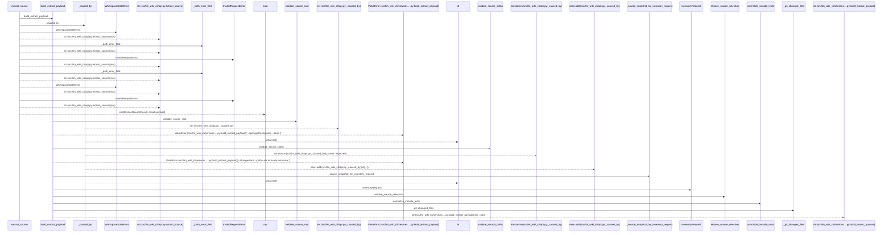
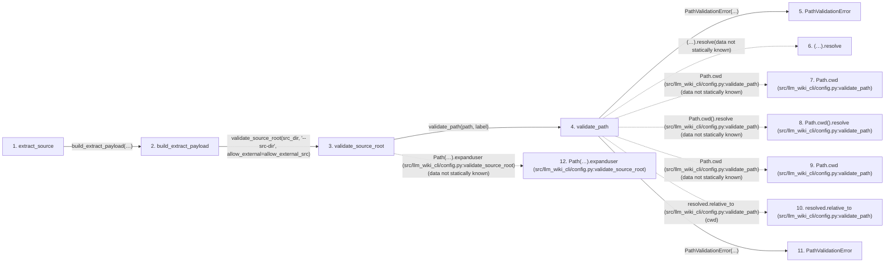

# extract_source

**Entry point:** `extract_source` (`api`)
**Source:** [api](../modules/api.md)
**Modules touched:** [analysis_capture](../modules/analysis_capture.md), [analysis_compatibility](../modules/analysis_compatibility.md), [api](../modules/api.md), [api_contracts](../modules/api_contracts.md), and 28 more

**Complete modules touched:**

- [analysis_capture](../modules/analysis_capture.md)
- [analysis_compatibility](../modules/analysis_compatibility.md)
- [api](../modules/api.md)
- [api_contracts](../modules/api_contracts.md)
- [common](../modules/common.md)
- [config](../modules/config.md)
- [data_flow](../modules/data_flow.md)
- [dependency_versions](../modules/dependency_versions.md)
- [entrypoints](../modules/entrypoints.md)
- [extraction_jobs](../modules/extraction_jobs.md)
- [extraction_service](../modules/extraction_service.md)
- [extractor_helpers](../modules/extractor_helpers.md)
- [filesystem_guard](../modules/filesystem_guard.md)
- [go_calls](../modules/go_calls.md)
- [imports](../modules/imports.md)
- [inventory_cache](../modules/inventory_cache.md)
- [io](../modules/io.md)
- [packages](../modules/packages.md)
- [paths](../modules/paths.md)
- [plugins](../modules/plugins.md)
- [progress](../modules/progress.md)
- [python_bindings](../modules/python_bindings.md)
- [python_calls](../modules/python_calls.md)
- [python_contracts](../modules/python_contracts.md)
- [python_implementation](../modules/python_implementation.md)
- [python_imports](../modules/python_imports.md)
- [python_observations](../modules/python_observations.md)
- [resource_diagnostics](../modules/resource_diagnostics.md)
- [services_dependencies](../modules/services_dependencies.md)
- [source_selection](../modules/source_selection.md)
- [source_snapshot](../modules/source_snapshot.md)
- [validation](../modules/validation.md)

## Call sequence

> Static overview in presentation order, not runtime execution order. Arrows retain captured callers; siblings are shown before deeper helper detail.

<!-- Auto-generated from static call edges. Dashed arrows are external or unresolved calls. Reviewed runtime conditions and side effects belong in Behavior. -->

> Call sequence diagram shows 30 of 3039 interactions; 3009 omitted to keep the visualization within the 30-interaction and generated-diagram limits, with uncertain identities omitted rather than inferred.

> Captured boundary calls: external 14 of 983 (969 omitted); unresolved 1 of 1294 (1293 omitted). These counts cover the captured static trace.

Omitted captured detail, grouped by actual caller occurrence and target module:

| Caller | Parent step | Target module | Kind | Omitted interactions |
| --- | --- | --- | --- | --- |
| `src/llm_wiki_cli/config.py:validate_source_root` | 3 | [src/llm_wiki_cli/config.py](../modules/config.md) | internal | 7 |
| `src/llm_wiki_cli/config.py:validate_path` | 4 | [src/llm_wiki_cli/config.py](../modules/config.md) | internal | 2 |
| `src/llm_wiki_cli/config.py:validate_path` | 4 | - | unresolved | 3 |
| `src/llm_wiki_cli/config.py:validate_path` | 4 | - | external | 2 |
| `src/llm_wiki_cli/config.py:validate_source_root` | 3 | - | unresolved | 5 |
| `src/llm_wiki_cli/config.py:validate_source_root` | 3 | - | external | 11 |
| `src/llm_wiki_cli/config.py:validate_source_root` | 3 | [src/llm_wiki_cli/services/filesystem_guard.py](../modules/filesystem_guard.md) | internal | 1 |
| `src/llm_wiki_cli/services/filesystem_guard.py:windows_current_user_sid` | 22 | [src/llm_wiki_cli/services/filesystem_guard.py](../modules/filesystem_guard.md) | internal | 2 |
> Omission summary shows 8 of 676 groups; 668 further groups are not expanded here. Counts above include all omitted interactions.
> Detailed flow queries retain their own coverage and limits; omitted paths may execute at runtime.

> Trace truncated at the depth limit; deeper calls are omitted.

## Data flow

<!-- Auto-generated static analysis. Treat values and boundaries as best-effort hints, not runtime proof. -->

### Step data

| Step | Inputs | Reads | Writes | Returns |
|---|---|---|---|---|
| `extract_source` | `src_dir: str`, `changed: bool`, `summary: bool`, `deep: bool`, `paths: list[str] \| None`, `package: str \| None`, `include_empty: bool`, `allow_external_src: bool` | `PathValidationError`, `extract_cmd`, `ExtractSourceResult` | - | `cast(...)` |
| `build_extract_payload` | `src_dir: str`, `changed: bool`, `summary: bool`, `deep: bool`, `paths: list[str] \| None`, `package_filter: str \| None`, `include_empty: bool`, `helper_cache_dir: str \| None` | `EXTRACT_SCHEMA_VERSION`, `DEFAULT_FLOW_DEPTH`, `EXTRACT_SCHEMA_VERSION` | `empty_output[...]`, `empty_output[...]`, `empty_output[...]`, `empty_output[...]`, `output[...]`, `output[...]`, `output[...]`, `output[...]` | `ExtractPayloadResult(...)`, `ExtractPayloadResult(...)` |
| `validate_source_root` | `path: str`, `label: str`, `allow_external: bool` | `sys`, `os`, `WindowsSecurityGuardError`, `sys` | - | `validate_path(...)`, `resolved` |
| `validate_path` | `path: str`, `label: str` | - | - | `resolved` |
| `PathValidationError` | - | - | - | - |
| `(…).resolve` | - | - | - | - |
| `Path.cwd (src/llm_wiki_cli/config.py:validate_path)` | - | - | - | - |
| `Path.cwd().resolve (src/llm_wiki_cli/config.py:validate_path)` | - | - | - | - |
| `Path.cwd (src/llm_wiki_cli/config.py:validate_path)` | - | - | - | - |
| `resolved.relative_to (src/llm_wiki_cli/config.py:validate_path)` | - | - | - | - |
| `PathValidationError` | - | - | - | - |
| `Path(…).expanduser (src/llm_wiki_cli/config.py:validate_source_root)` | - | - | - | - |

### Call data

| From | To | Line | Call |
|---|---|---:|---|
| extract_source | build_extract_payload | 1136 | `extract_cmd.build_extract_payload(src_dir, changed=changed, summary=summary, deep=deep, paths=paths, package_filter=package, include_empty=include_empty, allow_external_src=allow_external_src, read_only=read_only, source_selection=source_selection)` |
| build_extract_payload | validate_source_root | 2071 | `validate_source_root(src_dir, '--src-dir', allow_external=allow_external_src)` |
| validate_source_root | validate_path | 160 | `validate_path(path, label)` |
| validate_path | PathValidationError | 134 | `PathValidationError(...)` |
| validate_path | (…).resolve | 135 | `(Path.cwd() / path).resolve(data not statically known)` |
| validate_path | Path.cwd (src/llm_wiki_cli/config.py:validate_path) | 135 | `Path.cwd(data not statically known)` |
| validate_path | Path.cwd().resolve (src/llm_wiki_cli/config.py:validate_path) | 136 | `Path.cwd().resolve(data not statically known)` |
| validate_path | Path.cwd (src/llm_wiki_cli/config.py:validate_path) | 136 | `Path.cwd(data not statically known)` |
| validate_path | resolved.relative_to (src/llm_wiki_cli/config.py:validate_path) | 138 | `resolved.relative_to(cwd)` |
| validate_path | PathValidationError | 140 | `PathValidationError(...)` |
| validate_source_root | Path(…).expanduser (src/llm_wiki_cli/config.py:validate_source_root) | 163 | `Path(path).expanduser(data not statically known)` |

### Boundary effects

*No boundary effects detected.*

### Static analysis gaps

| Kind | Step | Target | Line |
|---|---|---|---:|
| unresolved_call | `validate_path` | `(Path.cwd() / path).resolve` | 135 |
| external_call | `validate_path` | `Path.cwd` | 135 |
| unresolved_call | `validate_path` | `Path.cwd().resolve` | 136 |
| external_call | `validate_path` | `Path.cwd` | 136 |
| unresolved_call | `validate_path` | `resolved.relative_to` | 138 |
| unresolved_call | `validate_source_root` | `Path(path).expanduser` | 163 |
| step_limit | `extract_source` | `first 12 steps` | 0 |
| truncated_flow | `extract_source` | `depth limit` | 0 |

## Behavior

Returns the stable extraction payload directly instead of printing it. The API
supports changed, summary, deep, path, package, and source-selection controls
and defaults to a read-only source boundary. It maps invalid options, path
policy failures, and extractor/workspace failures to distinct public API error
types so callers need not parse command output.
