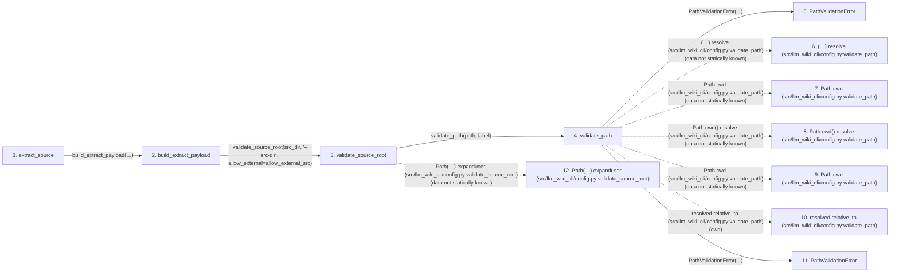

# extract_source

**Entry point:** `extract_source` (`api`)
**Source:** [api](../modules/api.md)
**Modules touched:** [analysis_capture](../modules/analysis_capture.md), [analysis_compatibility](../modules/analysis_compatibility.md), [api](../modules/api.md), [api_contracts](../modules/api_contracts.md), and 30 more

**Complete modules touched:**

- [analysis_capture](../modules/analysis_capture.md)
- [analysis_compatibility](../modules/analysis_compatibility.md)
- [api](../modules/api.md)
- [api_contracts](../modules/api_contracts.md)
- [common](../modules/common.md)
- [config](../modules/config.md)
- [data_flow](../modules/data_flow.md)
- [dependency_versions](../modules/dependency_versions.md)
- [dockerfile_parser](../modules/dockerfile_parser.md)
- [entrypoints](../modules/entrypoints.md)
- [extraction_jobs](../modules/extraction_jobs.md)
- [extraction_service](../modules/extraction_service.md)
- [extractor_helpers](../modules/extractor_helpers.md)
- [filesystem_guard](../modules/filesystem_guard.md)
- [go_calls](../modules/go_calls.md)
- [imports](../modules/imports.md)
- [inventory_cache](../modules/inventory_cache.md)
- [io](../modules/io.md)
- [packages](../modules/packages.md)
- [paths](../modules/paths.md)
- [plugins](../modules/plugins.md)
- [progress](../modules/progress.md)
- [python_bindings](../modules/python_bindings.md)
- [python_calls](../modules/python_calls.md)
- [python_contracts](../modules/python_contracts.md)
- [python_implementation](../modules/python_implementation.md)
- [python_imports](../modules/python_imports.md)
- [python_observations](../modules/python_observations.md)
- [resource_diagnostics](../modules/resource_diagnostics.md)
- [services_dependencies](../modules/services_dependencies.md)
- [source_selection](../modules/source_selection.md)
- [source_snapshot](../modules/source_snapshot.md)
- [validation](../modules/validation.md)
- [yaml_syntax](../modules/yaml_syntax.md)

## Call sequence

> Static overview in presentation order, not runtime execution order. Arrows retain captured callers; representative internal continuations and boundary examples precede repeated helper detail.

```mermaid
sequenceDiagram
    participant p0 as extract_source
    participant p1 as build_extract_payload
    participant p2 as _caused_by
    participant p3 as WorkspaceStateError
    participant p4 as _path_error_field
    participant p5 as InvalidRequestError
    participant p6 as validate_source_root
    participant p7 as validate_source_paths
    participant p8 as _source_snapshot_for_inventory_request
    participant p9 as _git_changed_files
    participant p10 as _build_extract_source_snapshot
    participant p11 as _partition_snapshot_git_changes
    participant p12 as analyze_dependencies
    participant p13 as build_api_contracts
    participant p14 as _data_flow_details_contract
    participant p15 as _extract_output_paths
    participant p16 as get_inventory_result
    participant p17 as get_docker_inventory
    participant p18 as unsupported_source_summary
    participant p19 as read_console_scripts
    participant p20 as detect_entry_points
    participant p21 as attach_routes_to_entry_points
    participant p22 as resolve_call_edges
    participant p23 as build_data_flow_context
    participant p24 as analyze_data_flow_detailed
    participant p25 as build_flow_detailed
    participant p26 as _summarize_inventory
    participant p27 as validate_path
    participant p28 as build_source_snapshot
    participant p29 as str (src/llm_wiki_cli/api.py:extract_source)
    participant p30 as package_filter.strip
    p0->>p1: build_extract_payload
    p0->>p2: _caused_by
    p0->>p3: WorkspaceStateError
    p0->>p4: _path_error_field
    p0->>p5: InvalidRequestError
    p1->>p6: validate_source_root
    p1->>p7: validate_source_paths
    p1->>p8: _source_snapshot_for_inventory_request
    p1->>p9: _git_changed_files
    p1->>p10: _build_extract_source_snapshot
    p1->>p11: _partition_snapshot_git_changes
    p1->>p12: analyze_dependencies
    p1->>p13: build_api_contracts
    p1->>p14: _data_flow_details_contract
    p1->>p15: _extract_output_paths
    p1->>p16: get_inventory_result
    p1->>p17: get_docker_inventory
    p1->>p18: unsupported_source_summary
    p1->>p19: read_console_scripts
    p1->>p20: detect_entry_points
    p1->>p21: attach_routes_to_entry_points
    p1->>p22: resolve_call_edges
    p1->>p23: build_data_flow_context
    p1->>p24: analyze_data_flow_detailed
    p1->>p25: build_flow_detailed
    p1->>p26: _summarize_inventory
    p6->>p27: validate_path
    p8->>p28: build_source_snapshot
    p0-->>p29: str (src/llm_wiki_cli/api.py:extract_source)(exc)
    p1-->>p30: package_filter.strip
```

<!-- Auto-generated from static call edges. Dashed arrows are external or unresolved calls. Reviewed runtime conditions and side effects belong in Behavior. -->

> Call sequence diagram shows 30 of 3211 interactions; 3181 omitted to keep the visualization within the 30-interaction and generated-diagram limits, with uncertain identities omitted rather than inferred.

> Captured boundary calls: external 1 of 1067 (1066 omitted); unresolved 1 of 1324 (1323 omitted). These counts cover the captured static trace.

Omitted captured detail, grouped by actual caller occurrence and target module:

| Caller | Parent step | Target module | Kind | Omitted interactions |
| --- | --- | --- | --- | --- |
| `src/llm_wiki_cli/config.py:validate_path` | 4 | [src/llm_wiki_cli/config.py](../modules/config.md) | internal | 2 |
| `src/llm_wiki_cli/config.py:validate_path` | 4 | - | unresolved | 3 |
| `src/llm_wiki_cli/config.py:validate_path` | 4 | - | external | 2 |
| `src/llm_wiki_cli/config.py:validate_source_root` | 3 | - | unresolved | 5 |
| `src/llm_wiki_cli/config.py:validate_source_root` | 3 | - | external | 11 |
| `src/llm_wiki_cli/config.py:validate_source_root` | 3 | [src/llm_wiki_cli/config.py](../modules/config.md) | internal | 6 |
| `src/llm_wiki_cli/config.py:validate_source_root` | 3 | [src/llm_wiki_cli/services/filesystem_guard.py](../modules/filesystem_guard.md) | internal | 1 |
| `src/llm_wiki_cli/services/filesystem_guard.py:windows_current_user_sid` | 22 | [src/llm_wiki_cli/services/filesystem_guard.py](../modules/filesystem_guard.md) | internal | 2 |
> Omission summary shows 8 of 716 groups; 708 further groups are not expanded here. Counts above include all omitted interactions.
> Detailed flow queries retain their own coverage and limits; omitted paths may execute at runtime.

> Trace truncated at the depth limit; deeper calls are omitted.

## Data flow

<!-- Auto-generated static analysis. Treat values and boundaries as best-effort hints, not runtime proof. -->

### Analysis coverage

**Effect analysis partially available.** Flow assembly and source effect analysis are separate; empty observations do not prove an empty handler body.

Source steps: 821; effect analysis evaluated: 663, partial: 38, unavailable: 120. Counts include steps omitted from the displayed trace.

Collector observations for 701 source steps with known totals: observed: 4268, emitted: 4141, omitted: 127. Unavailable totals are excluded.

- Callable record unavailable for one or more source steps; those steps have no represented callable body.
- Effect collector omitted observations before flow assembly; displayed effects are partial.
- Effect collector totals unavailable; observed counts cover captured records only.

| Step | Callable record | Effect analysis | Collector totals | Observed | Emitted | Omitted |
|---|---|---|---|---:|---:|---:|
| `extract_source` | `available` | `partial` | `available` | `14` | `12` | `2` |
| `build_extract_payload` | `available` | `partial` | `available` | `35` | `21` | `14` |
| `validate_source_root` | `available` | `evaluated` | `available` | `9` | `9` | `0` |
| `validate_path` | `available` | `evaluated` | `available` | `3` | `3` | `0` |
| `PathValidationError` | `unavailable` | `unavailable` | `unavailable` | — | — | — |
| `(…).resolve (src/llm_wiki_cli/config.py:validate_path)` | `not_applicable` | `not_applicable` | `not_applicable` | — | — | — |
| `Path.cwd (src/llm_wiki_cli/config.py:validate_path)` | `not_applicable` | `not_applicable` | `not_applicable` | — | — | — |
| `Path.cwd().resolve (src/llm_wiki_cli/config.py:validate_path)` | `not_applicable` | `not_applicable` | `not_applicable` | — | — | — |
| `Path.cwd (src/llm_wiki_cli/config.py:validate_path)` | `not_applicable` | `not_applicable` | `not_applicable` | — | — | — |
| `resolved.relative_to (src/llm_wiki_cli/config.py:validate_path)` | `not_applicable` | `not_applicable` | `not_applicable` | — | — | — |
| `PathValidationError` | `unavailable` | `unavailable` | `unavailable` | — | — | — |
| `Path(…).expanduser (src/llm_wiki_cli/config.py:validate_source_root)` | `not_applicable` | `not_applicable` | `not_applicable` | — | — | — |

### Step data

| Step | Inputs | Reads | Writes | Returns |
|---|---|---|---|---|
| `extract_source` | `src_dir: str`, `changed: bool`, `summary: bool`, `deep: bool`, `paths: list[str] \| None`, `package: str \| None`, `include_empty: bool`, `allow_external_src: bool` | `PathValidationError`, `extract_cmd`, `ExtractSourceResult` | - | `cast(...)` |
| `build_extract_payload` | `src_dir: str`, `changed: bool`, `summary: bool`, `deep: bool`, `paths: list[str] \| None`, `package_filter: str \| None`, `include_empty: bool`, `helper_cache_dir: str \| None` | `EXTRACT_SCHEMA_VERSION`, `DEFAULT_FLOW_DEPTH`, `EXTRACT_SCHEMA_VERSION` | `empty_output[...]`, `empty_output[...]`, `empty_output[...]`, `empty_output[...]`, `output[...]`, `output[...]`, `output[...]`, `output[...]` | `ExtractPayloadResult(...)`, `ExtractPayloadResult(...)` |
| `validate_source_root` | `path: str`, `label: str`, `allow_external: bool` | `sys`, `os`, `WindowsSecurityGuardError`, `sys` | - | `validate_path(...)`, `resolved` |
| `validate_path` | `path: str`, `label: str` | - | - | `resolved` |
| `PathValidationError` | - | - | - | - |
| `(…).resolve (src/llm_wiki_cli/config.py:validate_path)` | - | - | - | - |
| `Path.cwd (src/llm_wiki_cli/config.py:validate_path)` | - | - | - | - |
| `Path.cwd().resolve (src/llm_wiki_cli/config.py:validate_path)` | - | - | - | - |
| `Path.cwd (src/llm_wiki_cli/config.py:validate_path)` | - | - | - | - |
| `resolved.relative_to (src/llm_wiki_cli/config.py:validate_path)` | - | - | - | - |
| `PathValidationError` | - | - | - | - |
| `Path(…).expanduser (src/llm_wiki_cli/config.py:validate_source_root)` | - | - | - | - |

### Call data

| From | To | Line | Call |
|---|---|---:|---|
| extract_source | build_extract_payload | 1143 | `extract_cmd.build_extract_payload(src_dir, changed=changed, summary=summary, deep=deep, paths=paths, package_filter=package, include_empty=include_empty, allow_external_src=allow_external_src, read_only=read_only, source_selection=source_selection)` |
| build_extract_payload | validate_source_root | 2187 | `validate_source_root(src_dir, '--src-dir', allow_external=allow_external_src)` |
| validate_source_root | validate_path | 160 | `validate_path(path, label)` |
| validate_path | PathValidationError | 134 | `PathValidationError(...)` |
| validate_path | (…).resolve (src/llm_wiki_cli/config.py:validate_path) | 135 | `(Path.cwd() / path).resolve(data not statically known)` |
| validate_path | Path.cwd (src/llm_wiki_cli/config.py:validate_path) | 135 | `Path.cwd(data not statically known)` |
| validate_path | Path.cwd().resolve (src/llm_wiki_cli/config.py:validate_path) | 136 | `Path.cwd().resolve(data not statically known)` |
| validate_path | Path.cwd (src/llm_wiki_cli/config.py:validate_path) | 136 | `Path.cwd(data not statically known)` |
| validate_path | resolved.relative_to (src/llm_wiki_cli/config.py:validate_path) | 138 | `resolved.relative_to(cwd)` |
| validate_path | PathValidationError | 140 | `PathValidationError(...)` |
| validate_source_root | Path(…).expanduser (src/llm_wiki_cli/config.py:validate_source_root) | 163 | `Path(path).expanduser(data not statically known)` |

### Boundary effects

*No boundary-effect observations were captured in this static trace.*

### Static analysis gaps

| Kind | Step | Target | Line |
|---|---|---|---:|
| unresolved_call | `validate_path` | `(Path.cwd() / path).resolve` | 135 |
| external_call | `validate_path` | `Path.cwd` | 135 |
| unresolved_call | `validate_path` | `Path.cwd().resolve` | 136 |
| external_call | `validate_path` | `Path.cwd` | 136 |
| unresolved_call | `validate_path` | `resolved.relative_to` | 138 |
| unresolved_call | `validate_source_root` | `Path(path).expanduser` | 163 |
| step_limit | `extract_source` | `first 12 steps` | 0 |
| truncated_flow | `extract_source` | `depth limit` | 0 |

## Behavior

Returns the stable extraction payload directly instead of printing it. The API
supports changed, summary, deep, path, package, and source-selection controls
and defaults to a read-only source boundary. It maps invalid options, path
policy failures, and extractor/workspace failures to distinct public API error
types so callers need not parse command output.

Python import observations include class and method scopes without duplicating declaration metadata. Consumers can distinguish dependency imports from captured module bindings; raw extraction still performs no owning evidence repair.
