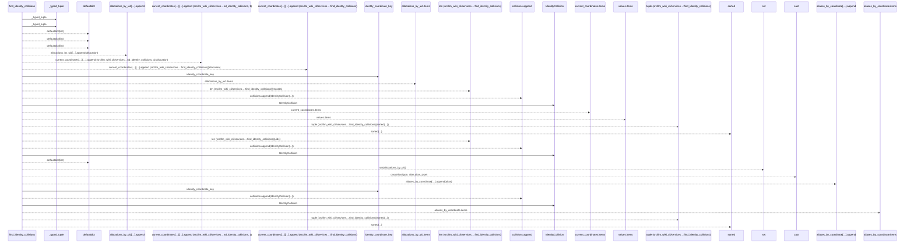
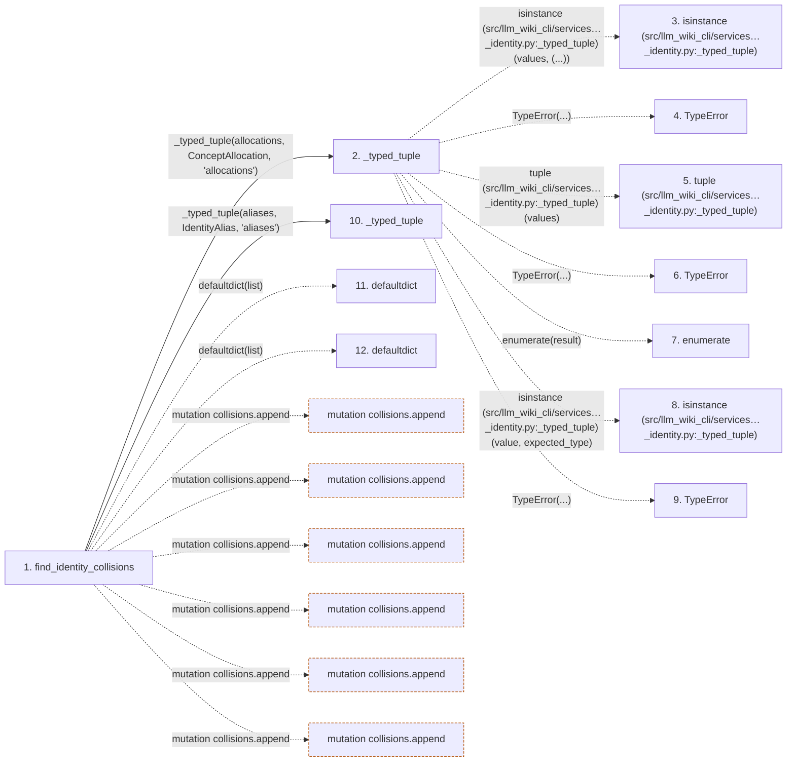

# find_identity_collisions

**Entry point:** `find_identity_collisions` (`api`)
**Source:** [concept_identity](../modules/concept_identity.md)
**Modules touched:** [concept_identity](../modules/concept_identity.md), [wiki_surface](../modules/wiki_surface.md)

## Call sequence

> Static overview in presentation order, not runtime execution order. Arrows retain captured callers; siblings are shown before deeper helper detail.

<!-- Auto-generated from static call edges. Dashed arrows are external or unresolved calls. Reviewed runtime conditions and side effects belong in Behavior. -->

> Call sequence diagram shows 30 of 167 interactions; 137 omitted to keep the visualization within the 30-interaction and generated-diagram limits, with uncertain identities omitted rather than inferred.

> Captured boundary calls: external 12 of 60 (48 omitted); unresolved 11 of 45 (34 omitted). These counts cover the captured static trace.

Omitted captured detail, grouped by actual caller occurrence and target module:

| Caller | Parent step | Target module | Kind | Omitted interactions |
| --- | --- | --- | --- | --- |
| `src/llm_wiki_cli/services/concept_identity.py:_typed_tuple` | 2 | - | external | 7 |
| `src/llm_wiki_cli/services/concept_identity.py:identity_coordinate_key` | 17 | [src/llm_wiki_cli/services/concept_identity.py](../modules/concept_identity.md) | internal | 2 |
| `src/llm_wiki_cli/services/concept_identity.py:validate_alias_type` | 18 | - | external | 1 |
| `src/llm_wiki_cli/services/concept_identity.py:validate_alias_type` | 18 | [src/llm_wiki_cli/services/concept_identity.py](../modules/concept_identity.md) | internal | 2 |
| `src/llm_wiki_cli/services/concept_identity.py:validate_alias_value` | 22 | [src/llm_wiki_cli/services/concept_identity.py](../modules/concept_identity.md) | internal | 3 |
| `src/llm_wiki_cli/services/concept_identity.py:validate_locator` | 24 | [src/llm_wiki_cli/services/concept_identity.py](../modules/concept_identity.md) | internal | 6 |
| `src/llm_wiki_cli/services/concept_identity.py:_machine_text` | 25 | - | external | 6 |
| `src/llm_wiki_cli/services/concept_identity.py:_machine_text` | 25 | [src/llm_wiki_cli/services/concept_identity.py](../modules/concept_identity.md) | internal | 5 |
> Omission summary shows 8 of 35 groups; 27 further groups are not expanded here. Counts above include all omitted interactions.
> Detailed flow queries retain their own coverage and limits; omitted paths may execute at runtime.

> Trace truncated at the depth limit; deeper calls are omitted.

## Data flow

<!-- Auto-generated static analysis. Treat values and boundaries as best-effort hints, not runtime proof. -->

### Step data

| Step | Inputs | Reads | Writes | Returns |
|---|---|---|---|---|
| `find_identity_collisions` | `allocations: Iterable[ConceptAllocation]`, `aliases: Iterable[IdentityAlias]` | `ConceptAllocation`, `IdentityAlias`, `AliasType`, `AliasType`, `AliasType` | - | `tuple(...)` |
| `_typed_tuple` | `values: Iterable[_RecordT]`, `expected_type: type[_RecordT]`, `field: str` | - | - | `result` |
| `isinstance (src/llm_wiki_cli/services…_identity.py:_typed_tuple)` | - | - | - | - |
| `TypeError` | - | - | - | - |
| `tuple (src/llm_wiki_cli/services…_identity.py:_typed_tuple)` | - | - | - | - |
| `TypeError` | - | - | - | - |
| `enumerate` | - | - | - | - |
| `isinstance (src/llm_wiki_cli/services…_identity.py:_typed_tuple)` | - | - | - | - |
| `TypeError` | - | - | - | - |
| `_typed_tuple` | `values: Iterable[_RecordT]`, `expected_type: type[_RecordT]`, `field: str` | - | - | `result` |
| `defaultdict` | - | - | - | - |
| `defaultdict` | - | - | - | - |

### Call data

| From | To | Line | Call |
|---|---|---:|---|
| find_identity_collisions | _typed_tuple | 645 | `_typed_tuple(allocations, ConceptAllocation, 'allocations')` |
| _typed_tuple | isinstance (src/llm_wiki_cli/services…_identity.py:_typed_tuple) | 1013 | `isinstance(values, (...))` |
| _typed_tuple | TypeError | 1014 | `TypeError(...)` |
| _typed_tuple | tuple (src/llm_wiki_cli/services…_identity.py:_typed_tuple) | 1016 | `tuple(values)` |
| _typed_tuple | TypeError | 1018 | `TypeError(...)` |
| _typed_tuple | enumerate | 1021 | `enumerate(result)` |
| _typed_tuple | isinstance (src/llm_wiki_cli/services…_identity.py:_typed_tuple) | 1022 | `isinstance(value, expected_type)` |
| _typed_tuple | TypeError | 1023 | `TypeError(...)` |
| find_identity_collisions | _typed_tuple | 650 | `_typed_tuple(aliases, IdentityAlias, 'aliases')` |
| find_identity_collisions | defaultdict | 653 | `defaultdict(list)` |
| find_identity_collisions | defaultdict | 657 | `defaultdict(list)` |

### Boundary effects

| Kind | Target | Step | Line |
|---|---|---|---:|
| mutation | `collisions.append` | `find_identity_collisions` | 671 |
| mutation | `collisions.append` | `find_identity_collisions` | 683 |
| mutation | `collisions.append` | `find_identity_collisions` | 705 |
| mutation | `collisions.append` | `find_identity_collisions` | 717 |
| mutation | `collisions.append` | `find_identity_collisions` | 726 |
| mutation | `collisions.append` | `find_identity_collisions` | 740 |

### Static analysis gaps

| Kind | Step | Target | Line |
|---|---|---|---:|
| external_call | `_typed_tuple` | `isinstance` | 1013 |
| external_call | `_typed_tuple` | `TypeError` | 1014 |
| external_call | `_typed_tuple` | `TypeError` | 1018 |
| external_call | `_typed_tuple` | `enumerate` | 1021 |
| external_call | `_typed_tuple` | `isinstance` | 1022 |
| external_call | `_typed_tuple` | `TypeError` | 1023 |
| external_call | `find_identity_collisions` | `defaultdict` | 653 |
| external_call | `find_identity_collisions` | `defaultdict` | 657 |
| step_limit | `find_identity_collisions` | `first 12 steps` | 0 |
| truncated_flow | `find_identity_collisions` | `depth limit` | 0 |

## Behavior

This flow starts at `find_identity_collisions` and is classified as `api`. The generated call and data-flow sections are bounded static projections; runtime conditions and side effects require source-level confirmation.
