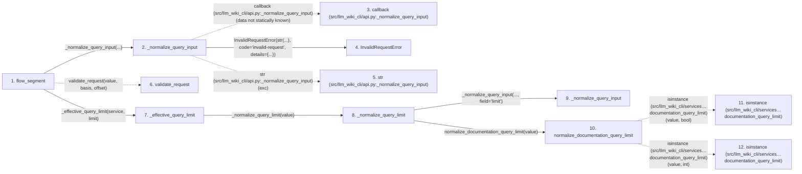

# flow_segment

**Entry point:** `flow_segment` (`api`)
**Source:** [api](../modules/api.md)
**Modules touched:** [api](../modules/api.md), [common](../modules/common.md), [config](../modules/config.md), [context_packet](../modules/context_packet.md), and 20 more

**Complete modules touched:**

- [api](../modules/api.md)
- [common](../modules/common.md)
- [config](../modules/config.md)
- [context_packet](../modules/context_packet.md)
- [documentation_queries](../modules/documentation_queries.md)
- [documentation_query_builder](../modules/documentation_query_builder.md)
- [filesystem_guard](../modules/filesystem_guard.md)
- [implementation_evidence](../modules/implementation_evidence.md)
- [io](../modules/io.md)
- [knowledge_consumption](../modules/knowledge_consumption.md)
- [knowledge_evidence](../modules/knowledge_evidence.md)
- [knowledge_governance](../modules/knowledge_governance.md)
- [knowledge_storage](../modules/knowledge_storage.md)
- [knowledge_storage_io](../modules/knowledge_storage_io.md)
- [maintenance_evidence](../modules/maintenance_evidence.md)
- [maintenance_shapes](../modules/maintenance_shapes.md)
- [maintenance_state](../modules/maintenance_state.md)
- [maintenance_status](../modules/maintenance_status.md)
- [python_implementation](../modules/python_implementation.md)
- [source_path_diagnostics](../modules/source_path_diagnostics.md)
- [source_selection](../modules/source_selection.md)
- [source_snapshot](../modules/source_snapshot.md)
- [sync_manifest](../modules/sync_manifest.md)
- [validation](../modules/validation.md)

## Call sequence

> Static overview in presentation order, not runtime execution order. Arrows retain captured callers; representative internal continuations and boundary examples precede repeated helper detail.

```mermaid
sequenceDiagram
    participant p0 as flow_segment
    participant p1 as _normalize_query_input
    participant p2 as _effective_query_limit
    participant p3 as _run_query
    participant p4 as _query_service
    participant p5 as _normalize_query_limit
    participant p6 as build_documentation_query_service
    participant p7 as normalize_documentation_query_limit
    participant p8 as validate_source_root
    participant p9 as _validate_wiki_dir
    participant p10 as build_live_documentation_query_service
    participant p11 as validate_path
    participant p12 as normalize_supplied_paths
    participant p13 as resolve_source_selection
    participant p14 as capture_source_selection_inputs
    participant p15 as validate_live_query_source_selection
    participant p16 as windows_current_user_sid
    participant p17 as _source_anchor
    participant p18 as _wiki_anchor
    participant p19 as source_path_diagnostics
    participant p20 as _live_source_selection_identity
    participant p21 as confirmed_missing_source_paths (src/llm_wiki_cli/services/context_packet.py)
    participant p22 as attach_implementation_read_view
    participant p23 as analysis_identity
    participant p24 as read_guarded
    participant p25 as attach_maintenance_view_from_inputs
    participant p26 as _assert_source_unchanged
    participant p27 as _assert_wiki_unchanged
    participant p28 as _portable_supplied_path
    participant p29 as cast
    participant p30 as validate_request
    p0->>p1: _normalize_query_input
    p0->>p2: _effective_query_limit
    p0->>p3: _run_query
    p0->>p4: _query_service
    p2->>p5: _normalize_query_limit
    p4->>p6: build_documentation_query_service
    p5->>p7: normalize_documentation_query_limit
    p6->>p8: validate_source_root
    p6->>p9: _validate_wiki_dir
    p6->>p10: build_live_documentation_query_service
    p8->>p11: validate_path
    p10->>p12: normalize_supplied_paths
    p10->>p13: resolve_source_selection
    p10->>p14: capture_source_selection_inputs
    p10->>p15: validate_live_query_source_selection
    p8->>p16: windows_current_user_sid
    p10->>p17: _source_anchor
    p10->>p18: _wiki_anchor
    p10->>p19: source_path_diagnostics
    p10->>p20: _live_source_selection_identity
    p10->>p21: confirmed_missing_source_paths (src/llm_wiki_cli/services/context_packet.py)
    p10->>p22: attach_implementation_read_view
    p10->>p23: analysis_identity
    p10->>p24: read_guarded
    p10->>p25: attach_maintenance_view_from_inputs
    p10->>p26: _assert_source_unchanged
    p10->>p27: _assert_wiki_unchanged
    p12->>p28: _portable_supplied_path
    p0-->>p29: cast(FlowSegmentResult, _run_query(...))
    p0-->>p30: validate_request(value, basis, offset)
```

<!-- Auto-generated from static call edges. Dashed arrows are external or unresolved calls. Reviewed runtime conditions and side effects belong in Behavior. -->

> Call sequence diagram shows 30 of 905 interactions; 875 omitted to keep the visualization within the 30-interaction and generated-diagram limits, with uncertain identities omitted rather than inferred.

> Captured boundary calls: external 1 of 370 (369 omitted); unresolved 1 of 199 (198 omitted). These counts cover the captured static trace.

Omitted captured detail, grouped by actual caller occurrence and target module:

| Caller | Parent step | Target module | Kind | Omitted interactions |
| --- | --- | --- | --- | --- |
| `src/llm_wiki_cli/api.py:_normalize_query_input` | 2 | - | unresolved | 1 |
| `src/llm_wiki_cli/api.py:_normalize_query_input` | 2 | [src/llm_wiki_cli/api.py](../modules/api.md) | internal | 1 |
| `src/llm_wiki_cli/api.py:_normalize_query_input` | 2 | - | external | 1 |
| `src/llm_wiki_cli/api.py:_normalize_query_limit` | 8 | [src/llm_wiki_cli/api.py](../modules/api.md) | internal | 1 |
| `src/llm_wiki_cli/services/documentation_query_builder.py:normalize_documentation_query_limit` | 10 | - | external | 3 |
| `src/llm_wiki_cli/services/documentation_query_builder.py:normalize_documentation_query_limit` | 10 | [src/llm_wiki_cli/services/documentation_queries.py](../modules/documentation_queries.md) | internal | 1 |
| `src/llm_wiki_cli/api.py:_run_query` | 16 | - | unresolved | 1 |
| `src/llm_wiki_cli/api.py:_run_query` | 16 | [src/llm_wiki_cli/api.py](../modules/api.md) | internal | 1 |
> Omission summary shows 8 of 194 groups; 186 further groups are not expanded here. Counts above include all omitted interactions.
> Detailed flow queries retain their own coverage and limits; omitted paths may execute at runtime.

> Trace truncated at the depth limit; deeper calls are omitted.

## Data flow

<!-- Auto-generated static analysis. Treat values and boundaries as best-effort hints, not runtime proof. -->

### Analysis coverage

**Effect analysis partially available.** Flow assembly and source effect analysis are separate; empty observations do not prove an empty handler body.

Source steps: 337; effect analysis evaluated: 231, partial: 0, unavailable: 106. Counts include steps omitted from the displayed trace.

- Callable record unavailable; the selected entry symbol has no represented callable body.
- Effect collector totals unavailable; observed counts cover captured records only.

| Step | Callable record | Effect analysis | Collector totals |
|---|---|---|---|
| `flow_segment` | `available` | `evaluated` | `available` |
| `_normalize_query_input` | `available` | `evaluated` | `available` |
| `callback (src/llm_wiki_cli/api.py:_normalize_query_input)` | `not_applicable` | `not_applicable` | `not_applicable` |
| `InvalidRequestError` | `unavailable` | `unavailable` | `unavailable` |
| `str (src/llm_wiki_cli/api.py:_normalize_query_input)` | `not_applicable` | `not_applicable` | `not_applicable` |
| `validate_request` | `not_applicable` | `not_applicable` | `not_applicable` |
| `_effective_query_limit` | `available` | `evaluated` | `available` |
| `_normalize_query_limit` | `available` | `evaluated` | `available` |
| `_normalize_query_input` | `available` | `evaluated` | `available` |
| `normalize_documentation_query_limit` | `available` | `evaluated` | `available` |
| `isinstance (src/llm_wiki_cli/services…documentation_query_limit)` | `not_applicable` | `not_applicable` | `not_applicable` |
| `isinstance (src/llm_wiki_cli/services…documentation_query_limit)` | `not_applicable` | `not_applicable` | `not_applicable` |

### Step data

| Step | Inputs | Reads | Writes | Returns |
|---|---|---|---|---|
| `flow_segment` | `value: str`, `basis: str \| None`, `offset: int`, `service: DocumentationGraphQueryService \| None`, `src_dir: str`, `wiki_dir: str`, `limit: int`, `allow_external_src: bool` | `FlowSegmentResult` | - | `cast(...)` |
| `_normalize_query_input` | `callback: Callable[[], _R]`, `field: str` | `DocumentationQueryError` | - | `callback(...)` |
| `callback (src/llm_wiki_cli/api.py:_normalize_query_input)` | - | - | - | - |
| `InvalidRequestError` | - | - | - | - |
| `str (src/llm_wiki_cli/api.py:_normalize_query_input)` | - | - | - | - |
| `validate_request` | - | - | - | - |
| `_effective_query_limit` | `service: DocumentationGraphQueryService \| None`, `value: int` | - | - | `...` |
| `_normalize_query_limit` | `value: object` | - | - | `_normalize_query_input(...)` |
| `_normalize_query_input` | `callback: Callable[[], _R]`, `field: str` | `DocumentationQueryError` | - | `callback(...)` |
| `normalize_documentation_query_limit` | `value: object` | `MAX_DOCUMENTATION_QUERY_LIMIT` | - | `min(...)` |
| `isinstance (src/llm_wiki_cli/services…documentation_query_limit)` | - | - | - | - |
| `isinstance (src/llm_wiki_cli/services…documentation_query_limit)` | - | - | - | - |

### Call data

| From | To | Line | Call |
|---|---|---:|---|
| flow_segment | _normalize_query_input | 2134 | `_normalize_query_input(...)` |
| _normalize_query_input | callback (src/llm_wiki_cli/api.py:_normalize_query_input) | 2013 | `callback(data not statically known)` |
| _normalize_query_input | InvalidRequestError | 2015 | `InvalidRequestError(str(...), code='invalid-request', details={...})` |
| _normalize_query_input | str (src/llm_wiki_cli/api.py:_normalize_query_input) | 2016 | `str(exc)` |
| flow_segment | validate_request | 2134 | `validate_request(value, basis, offset)` |
| flow_segment | _effective_query_limit | 2135 | `_effective_query_limit(service, limit)` |
| _effective_query_limit | _normalize_query_limit | 2115 | `_normalize_query_limit(value)` |
| _normalize_query_limit | _normalize_query_input | 2103 | `_normalize_query_input(..., field='limit')` |
| _normalize_query_limit | normalize_documentation_query_limit | 2104 | `normalize_documentation_query_limit(value)` |
| normalize_documentation_query_limit | isinstance (src/llm_wiki_cli/services…documentation_query_limit) | 57 | `isinstance(value, bool)` |
| normalize_documentation_query_limit | isinstance (src/llm_wiki_cli/services…documentation_query_limit) | 57 | `isinstance(value, int)` |

### Boundary effects

*No boundary-effect observations were captured in this static trace.*

### Static analysis gaps

| Kind | Step | Target | Line |
|---|---|---|---:|
| unresolved_call | `_normalize_query_input` | `callback` | 2013 |
| unresolved_call | `flow_segment` | `validate_request` | 2134 |
| external_call | `normalize_documentation_query_limit` | `isinstance` | 57 |
| step_limit | `flow_segment` | `first 12 steps` | 0 |
| truncated_flow | `flow_segment` | `depth limit` | 0 |

## Behavior

This flow starts at `flow_segment` and is classified as `api`. The generated call and data-flow sections are bounded static projections; runtime conditions and side effects require source-level confirmation.
