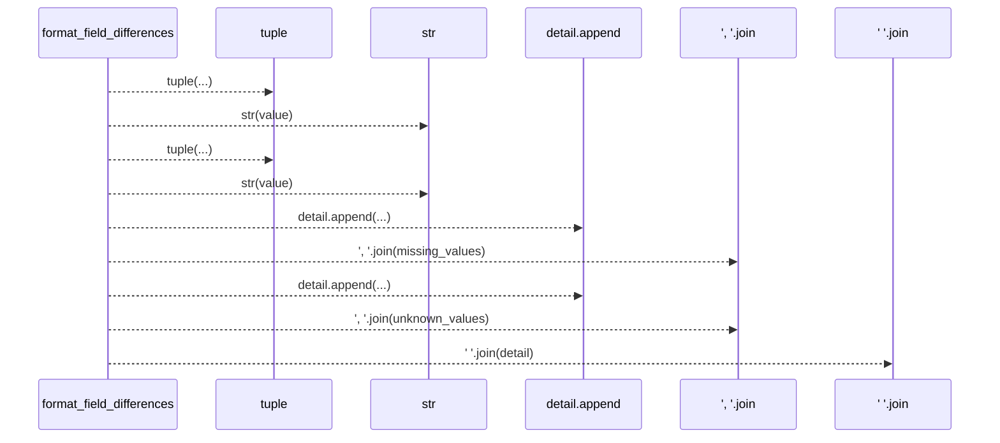
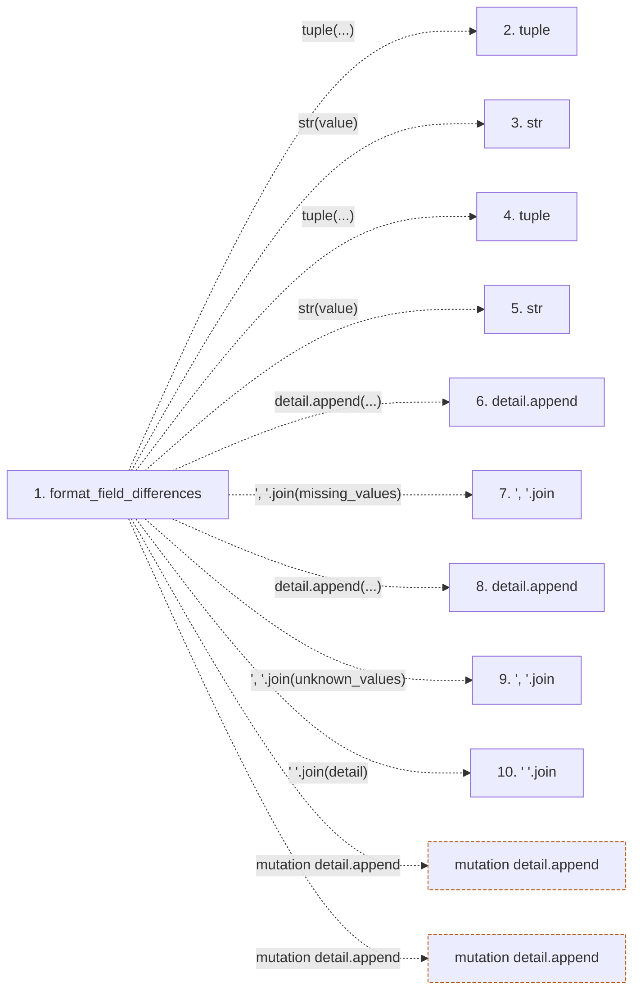

# format_field_differences

**Entry point:** `format_field_differences` (`api`)
**Source:** [validation](../modules/validation.md)
**Modules touched:** [validation](../modules/validation.md)

## Call sequence

> Static overview in presentation order, not runtime execution order. Arrows retain captured callers; representative internal continuations and boundary examples precede repeated helper detail.

<!-- Auto-generated from static call edges. Dashed arrows are external or unresolved calls. Reviewed runtime conditions and side effects belong in Behavior. -->

> Call sequence diagram shows 9 of 9 interactions; 0 omitted to keep the visualization within the 30-interaction and generated-diagram limits, with uncertain identities omitted rather than inferred.

> Captured boundary calls: external 4 of 4 (0 omitted); unresolved 5 of 5 (0 omitted). These counts cover the captured static trace.
> Detailed flow queries retain their own coverage and limits; omitted paths may execute at runtime.

## Data flow

<!-- Auto-generated static analysis. Treat values and boundaries as best-effort hints, not runtime proof. -->

### Analysis coverage

**Effect analysis evaluated.** Flow assembly and source effect analysis are separate; empty observations do not prove an empty handler body.

Source steps: 1; effect analysis evaluated: 1, partial: 0, unavailable: 0. Counts include steps omitted from the displayed trace.

Collector observations for 1 source steps with known totals: observed: 5, emitted: 5, omitted: 0. Unavailable totals are excluded.

### Step data

| Step | Inputs | Reads | Writes | Returns |
|---|---|---|---|---|
| `format_field_differences` | `missing: Iterable[object]`, `unknown: Iterable[object]` | - | - | `...` |
| `tuple` | - | - | - | - |
| `str` | - | - | - | - |
| `tuple` | - | - | - | - |
| `str` | - | - | - | - |
| `detail.append` | - | - | - | - |
| `', '.join` | - | - | - | - |
| `detail.append` | - | - | - | - |
| `', '.join` | - | - | - | - |
| `' '.join` | - | - | - | - |

### Call data

| From | To | Line | Call |
|---|---|---:|---|
| format_field_differences | tuple | 103 | `tuple(...)` |
| format_field_differences | str | 103 | `str(value)` |
| format_field_differences | tuple | 104 | `tuple(...)` |
| format_field_differences | str | 104 | `str(value)` |
| format_field_differences | detail.append | 106 | `detail.append(...)` |
| format_field_differences | ', '.join | 106 | `', '.join(missing_values)` |
| format_field_differences | detail.append | 108 | `detail.append(...)` |
| format_field_differences | ', '.join | 108 | `', '.join(unknown_values)` |
| format_field_differences | ' '.join | 109 | `'; '.join(detail)` |

### Boundary effects

| Kind | Target | Step | Line |
|---|---|---|---:|
| mutation | `detail.append` | `format_field_differences` | 106 |
| mutation | `detail.append` | `format_field_differences` | 108 |

### Static analysis gaps

| Kind | Step | Target | Line |
|---|---|---|---:|
| unresolved_call | `format_field_differences` | `'; '.join` | 109 |

## Behavior

This flow starts at `format_field_differences` and is classified as `api`. The generated call and data-flow sections are bounded static projections; runtime conditions and side effects require source-level confirmation.
