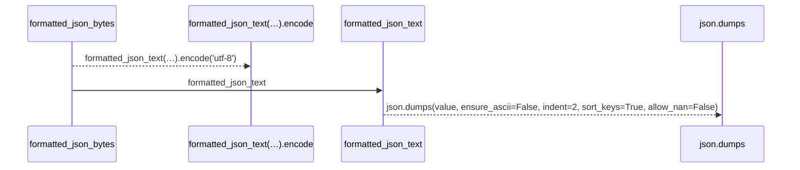
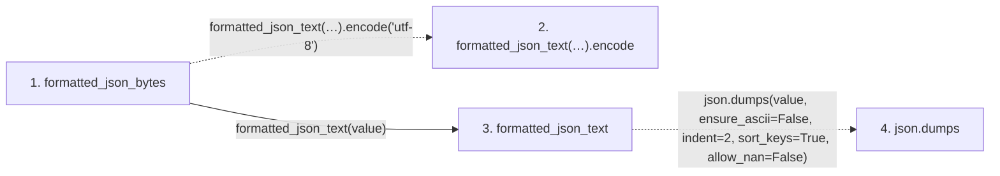

# formatted_json_bytes

**Entry point:** `formatted_json_bytes` (`api`)
**Source:** [knowledge_evidence](../modules/knowledge_evidence.md)
**Modules touched:** [knowledge_evidence](../modules/knowledge_evidence.md)

## Call sequence

> Static overview in presentation order, not runtime execution order. Arrows retain captured callers; representative internal continuations and boundary examples precede repeated helper detail.

<!-- Auto-generated from static call edges. Dashed arrows are external or unresolved calls. Reviewed runtime conditions and side effects belong in Behavior. -->

> Call sequence diagram shows 3 of 3 interactions; 0 omitted to keep the visualization within the 30-interaction and generated-diagram limits, with uncertain identities omitted rather than inferred.

> Captured boundary calls: external 1 of 1 (0 omitted); unresolved 1 of 1 (0 omitted). These counts cover the captured static trace.
> Detailed flow queries retain their own coverage and limits; omitted paths may execute at runtime.

## Data flow

<!-- Auto-generated static analysis. Treat values and boundaries as best-effort hints, not runtime proof. -->

### Analysis coverage

**Effect analysis evaluated.** Flow assembly and source effect analysis are separate; empty observations do not prove an empty handler body.

Source steps: 2; effect analysis evaluated: 2, partial: 0, unavailable: 0. Counts include steps omitted from the displayed trace.

### Step data

| Step | Inputs | Reads | Writes | Returns |
|---|---|---|---|---|
| `formatted_json_bytes` | `value: Any` | - | - | `...` |
| `formatted_json_text(…).encode` | - | - | - | - |
| `formatted_json_text` | `value: Any` | - | - | `...` |
| `json.dumps` | - | - | - | - |

### Call data

| From | To | Line | Call |
|---|---|---:|---|
| formatted_json_bytes | formatted_json_text(…).encode | 215 | `formatted_json_text(value).encode('utf-8')` |
| formatted_json_bytes | formatted_json_text | 215 | `formatted_json_text(value)` |
| formatted_json_text | json.dumps | 201 | `json.dumps(value, ensure_ascii=False, indent=2, sort_keys=True, allow_nan=False)` |

### Boundary effects

*No boundary-effect observations were captured in this static trace.*

### Static analysis gaps

| Kind | Step | Target | Line |
|---|---|---|---:|
| unresolved_call | `formatted_json_bytes` | `formatted_json_text(value).encode` | 215 |
| external_call | `formatted_json_text` | `json.dumps` | 201 |

## Behavior

This flow starts at `formatted_json_bytes` and is classified as `api`. The generated call and data-flow sections are bounded static projections; runtime conditions and side effects require source-level confirmation.
