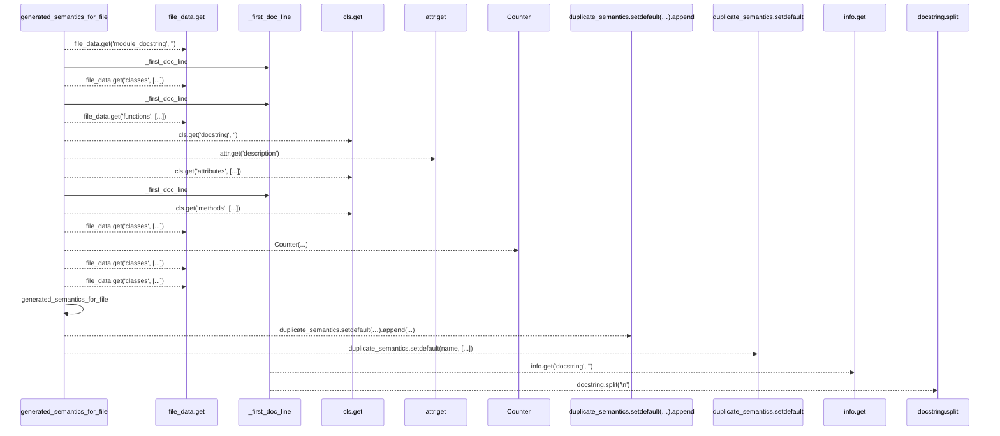
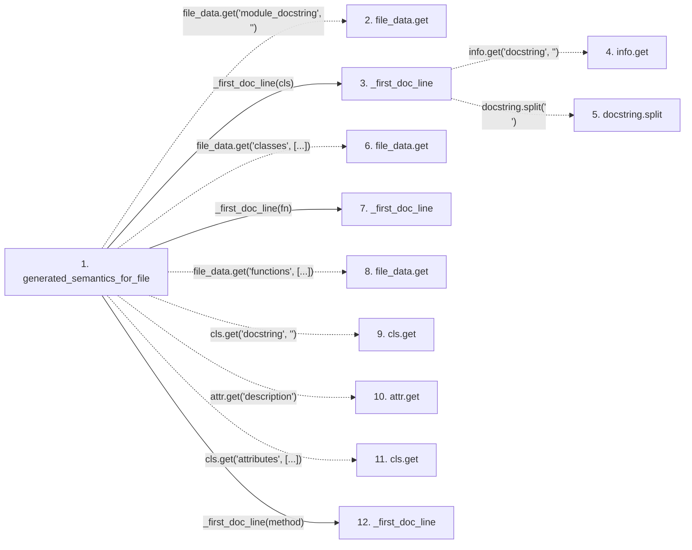

# generated_semantics_for_file

**Entry point:** `generated_semantics_for_file` (`api`)
**Source:** [sync_manifest](../modules/sync_manifest.md)
**Modules touched:** [sync_manifest](../modules/sync_manifest.md)

## Call sequence

> Static overview in presentation order, not runtime execution order. Arrows retain captured callers; representative internal continuations and boundary examples precede repeated helper detail.

<!-- Auto-generated from static call edges. Dashed arrows are external or unresolved calls. Reviewed runtime conditions and side effects belong in Behavior. -->

> Call sequence diagram shows 19 of 19 interactions; 0 omitted to keep the visualization within the 30-interaction and generated-diagram limits, with uncertain identities omitted rather than inferred.

> Captured boundary calls: external 1 of 1 (0 omitted); unresolved 14 of 14 (0 omitted). These counts cover the captured static trace.
> Detailed flow queries retain their own coverage and limits; omitted paths may execute at runtime.

## Data flow

<!-- Auto-generated static analysis. Treat values and boundaries as best-effort hints, not runtime proof. -->

### Analysis coverage

**Effect analysis evaluated.** Flow assembly and source effect analysis are separate; empty observations do not prove an empty handler body.

Source steps: 5; effect analysis evaluated: 5, partial: 0, unavailable: 0. Counts include steps omitted from the displayed trace.

### Step data

| Step | Inputs | Reads | Writes | Returns |
|---|---|---|---|---|
| `generated_semantics_for_file` | `filepath: str`, `file_data: Mapping[str, Any]` | - | `result[...]` | `result` |
| `file_data.get` | - | - | - | - |
| `_first_doc_line` | `info: Mapping[str, Any]` | - | - | `...` |
| `info.get` | - | - | - | - |
| `docstring.split` | - | - | - | - |
| `file_data.get` | - | - | - | - |
| `_first_doc_line` | `info: Mapping[str, Any]` | - | - | `...` |
| `file_data.get` | - | - | - | - |
| `cls.get` | - | - | - | - |
| `attr.get` | - | - | - | - |
| `cls.get` | - | - | - | - |
| `_first_doc_line` | `info: Mapping[str, Any]` | - | - | `...` |

### Call data

| From | To | Line | Call |
|---|---|---:|---|
| generated_semantics_for_file | file_data.get | 683 | `file_data.get('module_docstring', '')` |
| generated_semantics_for_file | _first_doc_line | 689 | `_first_doc_line(cls)` |
| _first_doc_line | info.get | 529 | `info.get('docstring', '')` |
| _first_doc_line | docstring.split | 530 | `docstring.split('\n')` |
| generated_semantics_for_file | file_data.get | 690 | `file_data.get('classes', [...])` |
| generated_semantics_for_file | _first_doc_line | 693 | `_first_doc_line(fn)` |
| generated_semantics_for_file | file_data.get | 693 | `file_data.get('functions', [...])` |
| generated_semantics_for_file | cls.get | 698 | `cls.get('docstring', '')` |
| generated_semantics_for_file | attr.get | 701 | `attr.get('description')` |
| generated_semantics_for_file | cls.get | 702 | `cls.get('attributes', [...])` |
| generated_semantics_for_file | _first_doc_line | 705 | `_first_doc_line(method)` |

### Boundary effects

*No boundary-effect observations were captured in this static trace.*

### Static analysis gaps

| Kind | Step | Target | Line |
|---|---|---|---:|
| unresolved_call | `generated_semantics_for_file` | `file_data.get` | 683 |
| unresolved_call | `_first_doc_line` | `info.get` | 529 |
| unresolved_call | `_first_doc_line` | `docstring.split` | 530 |
| unresolved_call | `generated_semantics_for_file` | `file_data.get` | 690 |
| unresolved_call | `generated_semantics_for_file` | `file_data.get` | 693 |
| unresolved_call | `generated_semantics_for_file` | `cls.get` | 698 |
| unresolved_call | `generated_semantics_for_file` | `attr.get` | 701 |
| unresolved_call | `generated_semantics_for_file` | `cls.get` | 702 |
| step_limit | `generated_semantics_for_file` | `first 12 steps` | 0 |

## Behavior

This flow starts at `generated_semantics_for_file` and is classified as `api`. The generated call and data-flow sections are bounded static projections; runtime conditions and side effects require source-level confirmation.
