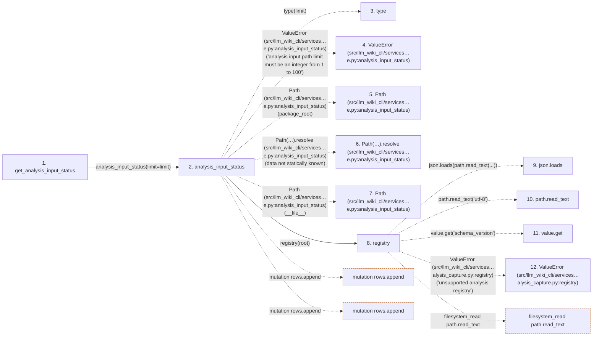

# get_analysis_input_status

**Entry point:** `get_analysis_input_status` (`api`)
**Source:** [api](../modules/api.md)
**Modules touched:** [analysis_capture](../modules/analysis_capture.md), [api](../modules/api.md)

## Call sequence

> Static overview in presentation order, not runtime execution order. Arrows retain captured callers; representative internal continuations and boundary examples precede repeated helper detail.

```mermaid
sequenceDiagram
    participant p0 as get_analysis_input_status
    participant p1 as analysis_input_status
    participant p2 as _input_rows
    participant p3 as engine_input
    participant p4 as registry
    participant p5 as _status
    participant p6 as engine_package_root
    participant p7 as type
    participant p8 as Path(…).resolve (src/llm_wiki_cli/services…e.py:analysis_input_status)
    participant p9 as ValueError (src/llm_wiki_cli/services…e.py:analysis_input_status)
    participant p10 as Path (src/llm_wiki_cli/services…e.py:analysis_input_status)
    participant p11 as set (src/llm_wiki_cli/services…e.py:analysis_input_status)
    participant p12 as rules[…].values
    participant p13 as sorted (src/llm_wiki_cli/services…e.py:analysis_input_status)
    participant p14 as path.is_absolute (src/llm_wiki_cli/services…e.py:analysis_input_status)
    participant p15 as target.is_symlink
    participant p16 as target.is_file
    participant p17 as rows.append
    participant p18 as rules.get (src/llm_wiki_cli/services…e.py:analysis_input_status)
    participant p19 as any
    participant p20 as r[…].startswith
    participant p21 as json.loads
    participant p22 as v.relative_to(…).as_posix (src/llm_wiki_cli/services…_capture.py:_input_rows, 1)
    participant p23 as len (src/llm_wiki_cli/services…nalysis_capture.py:_status)
    participant p24 as isinstance
    p0->>p1: analysis_input_status
    p1->>p2: _input_rows
    p1->>p3: engine_input
    p1->>p4: registry
    p1->>p5: _status
    p3->>p6: engine_package_root
    p1-->>p7: type(limit)
    p1-->>p8: Path(…).resolve (src/llm_wiki_cli/services…e.py:analysis_input_status)
    p1-->>p9: ValueError (src/llm_wiki_cli/services…e.py:analysis_input_status)('analysis input path limit must be an integer from 1 to 100')
    p1-->>p10: Path (src/llm_wiki_cli/services…e.py:analysis_input_status)(package_root)
    p1-->>p10: Path (src/llm_wiki_cli/services…e.py:analysis_input_status)(__file__)
    p1-->>p11: set (src/llm_wiki_cli/services…e.py:analysis_input_status)(rules[...])
    p1-->>p12: rules[…].values
    p1-->>p13: sorted (src/llm_wiki_cli/services…e.py:analysis_input_status)(required)
    p1-->>p10: Path (src/llm_wiki_cli/services…e.py:analysis_input_status)(name)
    p1-->>p14: path.is_absolute (src/llm_wiki_cli/services…e.py:analysis_input_status)
    p1-->>p15: target.is_symlink
    p1-->>p16: target.is_file
    p1-->>p17: rows.append({...})
    p1-->>p13: sorted (src/llm_wiki_cli/services…e.py:analysis_input_status)(rules.get(...))
    p1-->>p18: rules.get (src/llm_wiki_cli/services…e.py:analysis_input_status)('engine_shared', [...])
    p1-->>p15: target.is_symlink
    p1-->>p16: target.is_file
    p1-->>p17: rows.append({...})
    p1-->>p19: any(...)
    p1-->>p20: r[…].startswith('unclassified')
    p4-->>p21: json.loads(path.read_text(...))
    p2-->>p22: v.relative_to(…).as_posix (src/llm_wiki_cli/services…_capture.py:_input_rows, 1)
    p5-->>p23: len (src/llm_wiki_cli/services…nalysis_capture.py:_status)(rows)
    p3-->>p24: isinstance(name, str)
```

<!-- Auto-generated from static call edges. Dashed arrows are external or unresolved calls. Reviewed runtime conditions and side effects belong in Behavior. -->

> Call sequence diagram shows 30 of 82 interactions; 52 omitted to keep the visualization within the 30-interaction and generated-diagram limits, with uncertain identities omitted rather than inferred.

> Captured boundary calls: external 12 of 36 (24 omitted); unresolved 12 of 36 (24 omitted). These counts cover the captured static trace.

Omitted captured detail, grouped by actual caller occurrence and target module:

| Caller | Parent step | Target module | Kind | Omitted interactions |
| --- | --- | --- | --- | --- |
| `src/llm_wiki_cli/services/analysis_capture.py:registry` | 8 | - | unresolved | 2 |
| `src/llm_wiki_cli/services/analysis_capture.py:registry` | 8 | - | external | 1 |
| `src/llm_wiki_cli/services/analysis_capture.py:_input_rows` | 13 | - | unresolved | 14 |
| `src/llm_wiki_cli/services/analysis_capture.py:_input_rows` | 13 | - | external | 9 |
| `src/llm_wiki_cli/services/analysis_capture.py:_input_rows` | 13 | [src/llm_wiki_cli/services/analysis_capture.py](../modules/analysis_capture.md) | internal | 1 |
| `src/llm_wiki_cli/services/analysis_capture.py:engine_package_root` | 32 | - | unresolved | 2 |
| `src/llm_wiki_cli/services/analysis_capture.py:engine_package_root` | 32 | - | external | 1 |
| `src/llm_wiki_cli/services/analysis_capture.py:_status` | 47 | - | external | 9 |
> Omission summary shows 8 of 12 groups; 4 further groups are not expanded here. Counts above include all omitted interactions.
> Detailed flow queries retain their own coverage and limits; omitted paths may execute at runtime.

## Data flow

<!-- Auto-generated static analysis. Treat values and boundaries as best-effort hints, not runtime proof. -->

### Analysis coverage

**Effect analysis evaluated.** Flow assembly and source effect analysis are separate; empty observations do not prove an empty handler body.

Source steps: 11; effect analysis evaluated: 11, partial: 0, unavailable: 0. Counts include steps omitted from the displayed trace.

Collector observations for 11 source steps with known totals: observed: 62, emitted: 62, omitted: 0. Unavailable totals are excluded.

### Step data

| Step | Inputs | Reads | Writes | Returns |
|---|---|---|---|---|
| `get_analysis_input_status` | `limit: int` | - | - | `analysis_input_status(...)` |
| `analysis_input_status` | `package_root`, `limit` | - | - | `_status(...)`, `_status(...)`, `_status(...)`, `_status(...)` |
| `type` | - | - | - | - |
| `ValueError (src/llm_wiki_cli/services…e.py:analysis_input_status)` | - | - | - | - |
| `Path (src/llm_wiki_cli/services…e.py:analysis_input_status)` | - | - | - | - |
| `Path(…).resolve (src/llm_wiki_cli/services…e.py:analysis_input_status)` | - | - | - | - |
| `Path (src/llm_wiki_cli/services…e.py:analysis_input_status)` | - | - | - | - |
| `registry` | `root: Path \| None` | `REGISTRY_PATH` | - | `value` |
| `json.loads` | - | - | - | - |
| `path.read_text` | - | - | - | - |
| `value.get` | - | - | - | - |
| `ValueError (src/llm_wiki_cli/services…alysis_capture.py:registry)` | - | - | - | - |

### Call data

| From | To | Line | Call |
|---|---|---:|---|
| get_analysis_input_status | analysis_input_status | 2131 | `analysis_input_status(limit=limit)` |
| analysis_input_status | type | 128 | `type(limit)` |
| analysis_input_status | ValueError (src/llm_wiki_cli/services…e.py:analysis_input_status) | 129 | `ValueError('analysis input path limit must be an integer from 1 to 100')` |
| analysis_input_status | Path (src/llm_wiki_cli/services…e.py:analysis_input_status) | 130 | `Path(package_root)` |
| analysis_input_status | Path(…).resolve (src/llm_wiki_cli/services…e.py:analysis_input_status) | 130 | `Path(__file__).resolve(data not statically known)` |
| analysis_input_status | Path (src/llm_wiki_cli/services…e.py:analysis_input_status) | 130 | `Path(__file__)` |
| analysis_input_status | registry | 132 | `registry(root)` |
| registry | json.loads | 208 | `json.loads(path.read_text(...))` |
| registry | path.read_text | 208 | `path.read_text('utf-8')` |
| registry | value.get | 209 | `value.get('schema_version')` |
| registry | ValueError (src/llm_wiki_cli/services…alysis_capture.py:registry) | 210 | `ValueError('unsupported analysis registry')` |

### Boundary effects

| Kind | Target | Step | Line |
|---|---|---|---:|
| mutation | `rows.append` | `analysis_input_status` | 141 |
| mutation | `rows.append` | `analysis_input_status` | 148 |
| filesystem_read | `path.read_text` | `registry` | 208 |

### Static analysis gaps

| Kind | Step | Target | Line |
|---|---|---|---:|
| external_call | `analysis_input_status` | `type` | 128 |
| external_call | `analysis_input_status` | `ValueError` | 129 |
| unresolved_call | `analysis_input_status` | `Path(__file__).resolve` | 130 |
| unresolved_call | `registry` | `value.get` | 209 |
| external_call | `registry` | `ValueError` | 210 |
| step_limit | `get_analysis_input_status` | `first 12 steps` | 0 |

## Behavior

This flow starts at `get_analysis_input_status` and is classified as `api`. The generated call and data-flow sections are bounded static projections; runtime conditions and side effects require source-level confirmation.
