# get_behavior_facts

**Entry point:** `get_behavior_facts` (`api`)
**Source:** [api](../modules/api.md)
**Modules touched:** [api](../modules/api.md), [behavior_reference](../modules/behavior_reference.md), [canonical_json](../modules/canonical_json.md), [cli_declarations](../modules/cli_declarations.md), and 9 more

**Complete modules touched:**

- [api](../modules/api.md)
- [behavior_reference](../modules/behavior_reference.md)
- [canonical_json](../modules/canonical_json.md)
- [cli_declarations](../modules/cli_declarations.md)
- [cli_reference](../modules/cli_reference.md)
- [current_contracts](../modules/current_contracts.md)
- [helper_runtime](../modules/helper_runtime.md)
- [io](../modules/io.md)
- [knowledge_evidence](../modules/knowledge_evidence.md)
- [llm_wiki_cli___init__](../modules/llm_wiki_cli___init__.md)
- [skills](../modules/skills.md)
- [task_compact](../modules/task_compact.md)
- [validation](../modules/validation.md)

## Call sequence

> Static overview in presentation order, not runtime execution order. Arrows retain captured callers; representative internal continuations and boundary examples precede repeated helper detail.

```mermaid
sequenceDiagram
    participant p0 as get_behavior_facts (src/llm_wiki_cli/api.py)
    participant p1 as get_behavior_facts (src/llm_wiki_cli/services/behavior_reference.py)
    participant p2 as get_cli_contract
    participant p3 as _task_facts
    participant p4 as list_bundled_skills
    participant p5 as validate_behavior_facts
    participant p6 as build_cli_contract
    participant p7 as build_cli_parser
    participant p8 as _provider_package_identity
    participant p9 as normalize_view_options
    participant p10 as read_md
    participant p11 as _validate_paths
    participant p12 as _build_parser
    participant p13 as decode_markdown_bytes
    participant p14 as require_portable_relative_path
    participant p15 as _value
    participant p16 as _command
    participant p17 as hash_json
    participant p18 as validate_cli_contract
    participant p19 as _installed_identity
    participant p20 as _json_tree
    participant p21 as compact_bytes
    participant p22 as _default_path_error
    participant p23 as _register_commands
    participant p24 as _add_helper_preparation_arguments
    participant p25 as _validate_schema
    participant p26 as _check_path_collision
    participant p27 as _validate_command
    participant p28 as _text
    participant p29 as dict (src/llm_wiki_cli/services…nce.py:get_behavior_facts)
    participant p30 as skill.to_dict
    p0->>p1: get_behavior_facts (src/llm_wiki_cli/services/behavior_reference.py)
    p1->>p2: get_cli_contract
    p1->>p3: _task_facts
    p1->>p4: list_bundled_skills
    p1->>p5: validate_behavior_facts
    p2->>p6: build_cli_contract
    p2->>p7: build_cli_parser
    p2->>p8: _provider_package_identity
    p3->>p9: normalize_view_options
    p4->>p10: read_md
    p5->>p11: _validate_paths
    p7->>p12: _build_parser
    p10->>p13: decode_markdown_bytes
    p11->>p14: require_portable_relative_path
    p6->>p15: _value
    p6->>p16: _command
    p6->>p17: hash_json
    p6->>p18: validate_cli_contract
    p8->>p19: _installed_identity
    p18->>p20: _json_tree
    p17->>p21: compact_bytes
    p14->>p22: _default_path_error
    p12->>p23: _register_commands
    p12->>p24: _add_helper_preparation_arguments
    p18->>p25: _validate_schema
    p14->>p26: _check_path_collision
    p18->>p27: _validate_command
    p16->>p28: _text
    p1-->>p29: dict (src/llm_wiki_cli/services…nce.py:get_behavior_facts)(config._DEFAULT_CONFIG)
    p1-->>p30: skill.to_dict
```

<!-- Auto-generated from static call edges. Dashed arrows are external or unresolved calls. Reviewed runtime conditions and side effects belong in Behavior. -->

> Call sequence diagram shows 30 of 449 interactions; 419 omitted to keep the visualization within the 30-interaction and generated-diagram limits, with uncertain identities omitted rather than inferred.

> Captured boundary calls: external 1 of 162 (161 omitted); unresolved 1 of 112 (111 omitted). These counts cover the captured static trace.

Omitted captured detail, grouped by actual caller occurrence and target module:

| Caller | Parent step | Target module | Kind | Omitted interactions |
| --- | --- | --- | --- | --- |
| `src/llm_wiki_cli/services/cli_reference.py:build_cli_contract` | 4 | - | external | 2 |
| `src/llm_wiki_cli/services/cli_reference.py:build_cli_contract` | 4 | [src/llm_wiki_cli/services/cli_reference.py](../modules/cli_reference.md) | internal | 1 |
| `src/llm_wiki_cli/services/cli_reference.py:_value` | 7 | [src/llm_wiki_cli/services/cli_reference.py](../modules/cli_reference.md) | internal | 5 |
| `src/llm_wiki_cli/services/cli_reference.py:_value` | 7 | - | external | 9 |
| `src/llm_wiki_cli/services/cli_reference.py:_value` | 7 | - | unresolved | 2 |
| `src/llm_wiki_cli/services/cli_reference.py:_command` | 25 | - | external | 24 |
| `src/llm_wiki_cli/services/cli_reference.py:_command` | 25 | [src/llm_wiki_cli/services/cli_reference.py](../modules/cli_reference.md) | internal | 9 |
| `src/llm_wiki_cli/services/cli_reference.py:_command` | 25 | - | unresolved | 14 |
> Omission summary shows 8 of 92 groups; 84 further groups are not expanded here. Counts above include all omitted interactions.
> Detailed flow queries retain their own coverage and limits; omitted paths may execute at runtime.

> Trace truncated at the depth limit; deeper calls are omitted.

## Data flow

<!-- Auto-generated static analysis. Treat values and boundaries as best-effort hints, not runtime proof. -->

### Analysis coverage

**Effect analysis partially available.** Flow assembly and source effect analysis are separate; empty observations do not prove an empty handler body.

Source steps: 176; effect analysis evaluated: 130, partial: 2, unavailable: 44. Counts include steps omitted from the displayed trace.

Collector observations for 132 source steps with known totals: observed: 585, emitted: 574, omitted: 11. Unavailable totals are excluded.

- Callable record unavailable for one or more source steps; those steps have no represented callable body.
- Effect collector omitted observations before flow assembly; displayed effects are partial.
- Effect collector totals unavailable; observed counts cover captured records only.

| Step | Callable record | Effect analysis | Collector totals | Observed | Emitted | Omitted |
|---|---|---|---|---:|---:|---:|
| `get_behavior_facts (src/llm_wiki_cli/api.py)` | `available` | `evaluated` | `available` | `1` | `1` | `0` |
| `get_behavior_facts (src/llm_wiki_cli/services/behavior_reference.py)` | `available` | `evaluated` | `available` | `6` | `6` | `0` |
| `get_cli_contract` | `available` | `evaluated` | `available` | `1` | `1` | `0` |
| `build_cli_contract` | `available` | `evaluated` | `available` | `6` | `6` | `0` |
| `isinstance (src/llm_wiki_cli/services…nce.py:build_cli_contract)` | `not_applicable` | `not_applicable` | `not_applicable` | — | — | — |
| `CLIReferenceError` | `unavailable` | `unavailable` | `unavailable` | — | — | — |
| `_value` | `available` | `evaluated` | `available` | `10` | `10` | `0` |
| `CLIReferenceError` | `unavailable` | `unavailable` | `unavailable` | — | — | — |
| `isinstance (src/llm_wiki_cli/services/cli_reference.py:_value)` | `not_applicable` | `not_applicable` | `not_applicable` | — | — | — |
| `CLIReferenceError` | `unavailable` | `unavailable` | `unavailable` | — | — | — |
| `value.as_posix` | `not_applicable` | `not_applicable` | `not_applicable` | — | — | — |
| `type (src/llm_wiki_cli/services/cli_reference.py:_value)` | `not_applicable` | `not_applicable` | `not_applicable` | — | — | — |

```mermaid
flowchart LR
    s1["1. get_behavior_facts (src/llm_wiki_cli/api.py)"]
    s2["2. get_behavior_facts (src/llm_wiki_cli/services/behavior_reference.py)"]
    s3["3. get_cli_contract"]
    s4["4. build_cli_contract"]
    s5["5. isinstance (src/llm_wiki_cli/services…nce.py:build_cli_contract)"]
    s6["6. CLIReferenceError"]
    s7["7. _value"]
    s8["8. CLIReferenceError"]
    s9["9. isinstance (src/llm_wiki_cli/services/cli_reference.py:_value)"]
    s10["10. CLIReferenceError"]
    s11["11. value.as_posix"]
    s12["12. type (src/llm_wiki_cli/services/cli_reference.py:_value)"]
    s1 -->|"get_behavior_facts (src/llm_wiki_cli/services/behavior_reference.py)(data not statically known)"| s2
    s2 -->|"get_cli_contract(data not statically known)"| s3
    s3 -->|"build_cli_contract(build_cli_parser(...), package=_provider_package_identity(...), program='llm-wiki')"| s4
    s4 -. "isinstance (src/llm_wiki_cli/services…nce.py:build_cli_contract)(parser, argparse.ArgumentParser)" .-> s5
    s4 -->|"CLIReferenceError('Reference generation requires an ArgumentParser')"| s6
    s4 -->|"_value(dict(...))"| s7
    s7 -->|"CLIReferenceError('Reference values exceed the supported nesting depth')"| s8
    s7 -. "isinstance (src/llm_wiki_cli/services/cli_reference.py:_value)(value, Path)" .-> s9
    s7 -->|"CLIReferenceError('Reference defaults require Path objects without a drive or root')"| s10
    s7 -. "value.as_posix(data not statically known)" .-> s11
    s7 -. "type (src/llm_wiki_cli/services/cli_reference.py:_value)(value)" .-> s12
    click s1 "../modules/api.md"
    click s2 "../modules/behavior_reference.md"
    click s3 "../modules/cli_reference.md"
    click s4 "../modules/cli_reference.md"
    click s6 "../modules/cli_reference.md"
    click s7 "../modules/cli_reference.md"
    click s8 "../modules/cli_reference.md"
    click s10 "../modules/cli_reference.md"
```

### Step data

| Step | Inputs | Reads | Writes | Returns |
|---|---|---|---|---|
| `get_behavior_facts (src/llm_wiki_cli/api.py)` | - | - | - | `get_facts(...)` |
| `get_behavior_facts (src/llm_wiki_cli/services/behavior_reference.py)` | - | `config`, `config`, `config`, `skills`, `BEHAVIOR_FACTS_SCHEMA_VERSION` | - | `result` |
| `get_cli_contract` | - | - | - | `build_cli_contract(...)` |
| `build_cli_contract` | `parser: argparse.ArgumentParser`, `package: Mapping[str, Any]`, `program: str` | `argparse`, `CLI_CONTRACT_SCHEMA_VERSION` | - | `result` |
| `isinstance (src/llm_wiki_cli/services…nce.py:build_cli_contract)` | - | - | - | - |
| `CLIReferenceError` | - | - | - | - |
| `_value` | `value: object`, `depth: int` | `_MAX_DEPTH`, `Path`, `Mapping` | - | `value`, `value`, `value`, `...`, `...` |
| `CLIReferenceError` | - | - | - | - |
| `isinstance (src/llm_wiki_cli/services/cli_reference.py:_value)` | - | - | - | - |
| `CLIReferenceError` | - | - | - | - |
| `value.as_posix` | - | - | - | - |
| `type (src/llm_wiki_cli/services/cli_reference.py:_value)` | - | - | - | - |

### Call data

| From | To | Line | Call |
|---|---|---:|---|
| get_behavior_facts (src/llm_wiki_cli/api.py) | get_behavior_facts (src/llm_wiki_cli/services/behavior_reference.py) | 4094 | `get_facts(data not statically known)` |
| get_behavior_facts (src/llm_wiki_cli/services/behavior_reference.py) | get_cli_contract | 90 | `cli_reference.get_cli_contract(data not statically known)` |
| get_cli_contract | build_cli_contract | 273 | `build_cli_contract(build_cli_parser(...), package=_provider_package_identity(...), program='llm-wiki')` |
| build_cli_contract | isinstance (src/llm_wiki_cli/services…nce.py:build_cli_contract) | 256 | `isinstance(parser, argparse.ArgumentParser)` |
| build_cli_contract | CLIReferenceError | 257 | `CLIReferenceError('Reference generation requires an ArgumentParser')` |
| build_cli_contract | _value | 260 | `_value(dict(...))` |
| _value | CLIReferenceError | 70 | `CLIReferenceError('Reference values exceed the supported nesting depth')` |
| _value | isinstance (src/llm_wiki_cli/services/cli_reference.py:_value) | 71 | `isinstance(value, Path)` |
| _value | CLIReferenceError | 73 | `CLIReferenceError('Reference defaults require Path objects without a drive or root')` |
| _value | value.as_posix | 76 | `value.as_posix(data not statically known)` |
| _value | type (src/llm_wiki_cli/services/cli_reference.py:_value) | 77 | `type(value)` |

### Boundary effects

*No boundary-effect observations were captured in this static trace.*

### Static analysis gaps

| Kind | Step | Target | Line |
|---|---|---|---:|
| external_call | `build_cli_contract` | `isinstance` | 256 |
| external_call | `_value` | `isinstance` | 71 |
| unresolved_call | `_value` | `value.as_posix` | 76 |
| external_call | `_value` | `type` | 77 |
| step_limit | `get_behavior_facts` | `first 12 steps` | 0 |
| truncated_flow | `get_behavior_facts` | `depth limit` | 0 |

## Behavior

This flow starts at `get_behavior_facts` and is classified as `api`. The generated call and data-flow sections are bounded static projections; runtime conditions and side effects require source-level confirmation.
