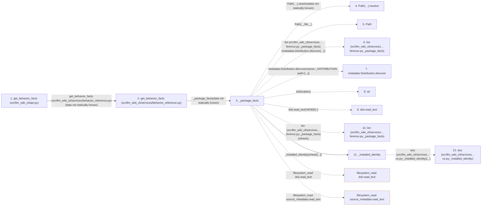

# get_behavior_facts

**Entry point:** `get_behavior_facts` (`api`)
**Source:** [api](../modules/api.md)
**Modules touched:** [api](../modules/api.md), [behavior_reference](../modules/behavior_reference.md), [change_selection](../modules/change_selection.md), [cli](../modules/cli.md), and 16 more

**Complete modules touched:**

- [api](../modules/api.md)
- [behavior_reference](../modules/behavior_reference.md)
- [change_selection](../modules/change_selection.md)
- [cli](../modules/cli.md)
- [cli_reference](../modules/cli_reference.md)
- [current_contracts](../modules/current_contracts.md)
- [docs_cmd](../modules/docs_cmd.md)
- [documentation_queries](../modules/documentation_queries.md)
- [documentation_query_builder](../modules/documentation_query_builder.md)
- [helper_runtime](../modules/helper_runtime.md)
- [io](../modules/io.md)
- [knowledge_evidence](../modules/knowledge_evidence.md)
- [publication_cmd](../modules/publication_cmd.md)
- [reference_cmd](../modules/reference_cmd.md)
- [skills](../modules/skills.md)
- [task_compact](../modules/task_compact.md)
- [task_contract](../modules/task_contract.md)
- [validation](../modules/validation.md)
- [wiki_surface](../modules/wiki_surface.md)
- [workflow_profile](../modules/workflow_profile.md)

## Call sequence

> Static overview in presentation order, not runtime execution order. Arrows retain captured callers; representative internal continuations and boundary examples precede repeated helper detail.

```mermaid
sequenceDiagram
    participant p0 as get_behavior_facts (src/llm_wiki_cli/api.py)
    participant p1 as get_behavior_facts (src/llm_wiki_cli/services/behavior_reference.py)
    participant p2 as _package_facts
    participant p3 as build_cli_contract
    participant p4 as build_cli_parser
    participant p5 as _task_facts
    participant p6 as list_bundled_skills
    participant p7 as validate_behavior_facts
    participant p8 as _build_parser
    participant p9 as normalize_task_request
    participant p10 as _value
    participant p11 as normalize_view_options
    participant p12 as _request_defaults
    participant p13 as _command
    participant p14 as hash_json
    participant p15 as validate_cli_contract
    participant p16 as read_md
    participant p17 as _installed_identity
    participant p18 as _validate_paths
    participant p19 as _json_tree
    participant p20 as exact_fields
    participant p21 as require_portable_relative_path
    participant p22 as canonical_json_bytes
    participant p23 as _register_commands
    participant p24 as _add_helper_preparation_arguments
    participant p25 as bounded_text
    participant p26 as _validate_schema
    participant p27 as _validate_command
    participant p28 as _text
    participant p29 as dict (src/llm_wiki_cli/services…nce.py:get_behavior_facts)
    participant p30 as skill.to_dict
    p0->>p1: get_behavior_facts (src/llm_wiki_cli/services/behavior_reference.py)
    p1->>p2: _package_facts
    p1->>p3: build_cli_contract
    p1->>p4: build_cli_parser
    p1->>p5: _task_facts
    p1->>p6: list_bundled_skills
    p1->>p7: validate_behavior_facts
    p4->>p8: _build_parser
    p5->>p9: normalize_task_request
    p3->>p10: _value
    p5->>p11: normalize_view_options
    p5->>p12: _request_defaults
    p3->>p13: _command
    p3->>p14: hash_json
    p3->>p15: validate_cli_contract
    p6->>p16: read_md
    p2->>p17: _installed_identity
    p7->>p18: _validate_paths
    p15->>p19: _json_tree
    p9->>p20: exact_fields
    p18->>p21: require_portable_relative_path
    p14->>p22: canonical_json_bytes
    p8->>p23: _register_commands
    p8->>p24: _add_helper_preparation_arguments
    p9->>p25: bounded_text
    p15->>p26: _validate_schema
    p15->>p27: _validate_command
    p13->>p28: _text
    p1-->>p29: dict (src/llm_wiki_cli/services…nce.py:get_behavior_facts)(config._DEFAULT_CONFIG)
    p1-->>p30: skill.to_dict
```

<!-- Auto-generated from static call edges. Dashed arrows are external or unresolved calls. Reviewed runtime conditions and side effects belong in Behavior. -->

> Call sequence diagram shows 30 of 1269 interactions; 1239 omitted to keep the visualization within the 30-interaction and generated-diagram limits, with uncertain identities omitted rather than inferred.

> Captured boundary calls: external 1 of 230 (229 omitted); unresolved 1 of 709 (708 omitted). These counts cover the captured static trace.

Omitted captured detail, grouped by actual caller occurrence and target module:

| Caller | Parent step | Target module | Kind | Omitted interactions |
| --- | --- | --- | --- | --- |
| `src/llm_wiki_cli/services/behavior_reference.py:_package_facts` | 3 | - | unresolved | 4 |
| `src/llm_wiki_cli/services/behavior_reference.py:_package_facts` | 3 | - | external | 10 |
| `src/llm_wiki_cli/services/behavior_reference.py:_installed_identity` | 11 | - | external | 3 |
| `src/llm_wiki_cli/services/behavior_reference.py:_installed_identity` | 11 | - | unresolved | 1 |
| `src/llm_wiki_cli/services/behavior_reference.py:_installed_identity` | 11 | [src/llm_wiki_cli/services/behavior_reference.py](../modules/behavior_reference.md) | internal | 1 |
| `src/llm_wiki_cli/services/behavior_reference.py:_identity` | 16 | - | external | 3 |
| `src/llm_wiki_cli/services/behavior_reference.py:_identity` | 16 | - | unresolved | 2 |
| `src/llm_wiki_cli/services/behavior_reference.py:_package_facts` | 3 | [src/llm_wiki_cli/services/behavior_reference.py](../modules/behavior_reference.md) | internal | 2 |
> Omission summary shows 8 of 210 groups; 202 further groups are not expanded here. Counts above include all omitted interactions.
> Detailed flow queries retain their own coverage and limits; omitted paths may execute at runtime.

> Trace truncated at the depth limit; deeper calls are omitted.

## Data flow

<!-- Auto-generated static analysis. Treat values and boundaries as best-effort hints, not runtime proof. -->

### Analysis coverage

**Effect analysis partially available.** Flow assembly and source effect analysis are separate; empty observations do not prove an empty handler body.

Source steps: 331; effect analysis evaluated: 258, partial: 5, unavailable: 68. Counts include steps omitted from the displayed trace.

Collector observations for 263 source steps with known totals: observed: 970, emitted: 953, omitted: 17. Unavailable totals are excluded.

- Callable record unavailable for one or more source steps; those steps have no represented callable body.
- Effect collector omitted observations before flow assembly; displayed effects are partial.
- Effect collector totals unavailable; observed counts cover captured records only.

| Step | Callable record | Effect analysis | Collector totals | Observed | Emitted | Omitted |
|---|---|---|---|---:|---:|---:|
| `get_behavior_facts (src/llm_wiki_cli/api.py)` | `available` | `evaluated` | `available` | `1` | `1` | `0` |
| `get_behavior_facts (src/llm_wiki_cli/services/behavior_reference.py)` | `available` | `evaluated` | `available` | `6` | `6` | `0` |
| `_package_facts` | `available` | `evaluated` | `available` | `6` | `6` | `0` |
| `Path(…).resolve` | `not_applicable` | `not_applicable` | `not_applicable` | — | — | — |
| `Path` | `not_applicable` | `not_applicable` | `not_applicable` | — | — | — |
| `list (src/llm_wiki_cli/services…ference.py:_package_facts)` | `not_applicable` | `not_applicable` | `not_applicable` | — | — | — |
| `metadata.Distribution.discover` | `not_applicable` | `not_applicable` | `not_applicable` | — | — | — |
| `str` | `not_applicable` | `not_applicable` | `not_applicable` | — | — | — |
| `dist.read_text` | `not_applicable` | `not_applicable` | `not_applicable` | — | — | — |
| `len (src/llm_wiki_cli/services…ference.py:_package_facts)` | `not_applicable` | `not_applicable` | `not_applicable` | — | — | — |
| `_installed_identity` | `available` | `evaluated` | `available` | `2` | `2` | `0` |
| `any (src/llm_wiki_cli/services…ce.py:_installed_identity)` | `not_applicable` | `not_applicable` | `not_applicable` | — | — | — |

### Step data

| Step | Inputs | Reads | Writes | Returns |
|---|---|---|---|---|
| `get_behavior_facts (src/llm_wiki_cli/api.py)` | - | - | - | `get_facts(...)` |
| `get_behavior_facts (src/llm_wiki_cli/services/behavior_reference.py)` | - | `config`, `config`, `config`, `skills`, `BEHAVIOR_FACTS_SCHEMA_VERSION` | - | `result` |
| `_package_facts` | - | `_DISTRIBUTION` | - | `_installed_identity(...)`, `_identity(...)`, `_installed_identity(...)` |
| `Path(…).resolve` | - | - | - | - |
| `Path` | - | - | - | - |
| `list (src/llm_wiki_cli/services…ference.py:_package_facts)` | - | - | - | - |
| `metadata.Distribution.discover` | - | - | - | - |
| `str` | - | - | - | - |
| `dist.read_text` | - | - | - | - |
| `len (src/llm_wiki_cli/services…ference.py:_package_facts)` | - | - | - | - |
| `_installed_identity` | `distribution: metadata.Distribution` | - | - | `_identity(...)` |
| `any (src/llm_wiki_cli/services…ce.py:_installed_identity)` | - | - | - | - |

### Call data

| From | To | Line | Call |
|---|---|---:|---|
| get_behavior_facts (src/llm_wiki_cli/api.py) | get_behavior_facts (src/llm_wiki_cli/services/behavior_reference.py) | 3593 | `get_facts(data not statically known)` |
| get_behavior_facts (src/llm_wiki_cli/services/behavior_reference.py) | _package_facts | 148 | `_package_facts(data not statically known)` |
| _package_facts | Path(…).resolve | 31 | `Path(__file__).resolve(data not statically known)` |
| _package_facts | Path | 31 | `Path(__file__)` |
| _package_facts | list (src/llm_wiki_cli/services…ference.py:_package_facts) | 32 | `list(metadata.Distribution.discover(...))` |
| _package_facts | metadata.Distribution.discover | 33 | `metadata.Distribution.discover(name=_DISTRIBUTION, path=[...])` |
| _package_facts | str | 33 | `str(location)` |
| _package_facts | dist.read_text | 35 | `dist.read_text('WHEEL')` |
| _package_facts | len (src/llm_wiki_cli/services…ference.py:_package_facts) | 36 | `len(wheels)` |
| _package_facts | _installed_identity | 37 | `_installed_identity(wheels[...])` |
| _installed_identity | any (src/llm_wiki_cli/services…ce.py:_installed_identity) | 61 | `any(...)` |

### Boundary effects

| Kind | Target | Step | Line |
|---|---|---|---:|
| filesystem_read | `dist.read_text` | `_package_facts` | 35 |
| filesystem_read | `source_metadata.read_text` | `_package_facts` | 44 |

### Static analysis gaps

| Kind | Step | Target | Line |
|---|---|---|---:|
| unresolved_call | `_package_facts` | `Path(__file__).resolve` | 31 |
| external_call | `_package_facts` | `metadata.Distribution.discover` | 33 |
| external_call | `_installed_identity` | `any` | 61 |
| step_limit | `get_behavior_facts` | `first 12 steps` | 0 |
| truncated_flow | `get_behavior_facts` | `depth limit` | 0 |

## Behavior

This flow starts at `get_behavior_facts` and is classified as `api`. The generated call and data-flow sections are bounded static projections; runtime conditions and side effects require source-level confirmation.
