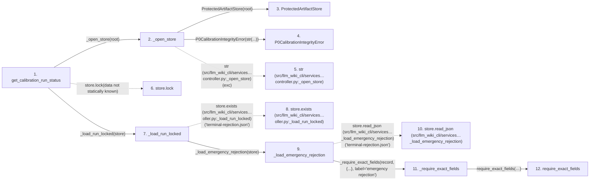

# get_calibration_run_status

**Entry point:** `get_calibration_run_status` (`api`)
**Source:** [controller](../modules/controller.md)
**Modules touched:** [calibration_contracts](../modules/calibration_contracts.md), [controller](../modules/controller.md), [documentation_policy](../modules/documentation_policy.md), and 4 more

**Complete modules touched:**

- [calibration_contracts](../modules/calibration_contracts.md)
- [controller](../modules/controller.md)
- [documentation_policy](../modules/documentation_policy.md)
- [filesystem_guard](../modules/filesystem_guard.md)
- [host_broker](../modules/host_broker.md)
- [protected_artifacts](../modules/protected_artifacts.md)
- [validation](../modules/validation.md)

## Call sequence

> Static overview in presentation order, not runtime execution order. Arrows retain captured callers; siblings are shown before deeper helper detail.

```mermaid
sequenceDiagram
    participant p0 as get_calibration_run_status
    participant p1 as _open_store
    participant p2 as store.lock
    participant p3 as _load_run_locked
    participant p4 as _recheck_bound_controls
    participant p5 as _terminal_transition_locked
    participant p6 as _authority_freshness_failure
    participant p7 as _has_indeterminate_admission_probe
    participant p8 as _stale_active_dispatches
    participant p9 as _status_from_run
    participant p10 as ProtectedArtifactStore
    participant p11 as store.exists (src/llm_wiki_cli/services…oller.py:_load_run_locked)
    participant p12 as store.read_json (src/llm_wiki_cli/services…y:_recheck_bound_controls)
    participant p13 as run.payload[…].get
    participant p14 as run.payload.get (src/llm_wiki_cli/services…terminate_admission_probe)
    participant p15 as datetime.now (src/llm_wiki_cli/services…:_stale_active_dispatches)
    participant p16 as P0CalibrationStatus
    participant p17 as P0CalibrationIntegrityError
    participant p18 as _load_emergency_rejection
    participant p19 as _require_exact_fields
    participant p20 as isinstance (src/llm_wiki_cli/services…thority_freshness_failure)
    participant p21 as isinstance (src/llm_wiki_cli/services…terminate_admission_probe)
    participant p22 as run.payload[…].items
    participant p23 as str (src/llm_wiki_cli/services…oller.py:_status_from_run)
    participant p24 as str (src/llm_wiki_cli/services…controller.py:_open_store)
    participant p25 as _recover_pending_transaction
    participant p26 as bindings.get
    p0->>p1: _open_store
    p0-->>p2: store.lock
    p0->>p3: _load_run_locked
    p0->>p4: _recheck_bound_controls
    p0->>p5: _terminal_transition_locked
    p0->>p6: _authority_freshness_failure
    p0->>p5: _terminal_transition_locked
    p0->>p7: _has_indeterminate_admission_probe
    p0->>p5: _terminal_transition_locked
    p0->>p8: _stale_active_dispatches
    p0->>p5: _terminal_transition_locked
    p0->>p9: _status_from_run
    p1->>p10: ProtectedArtifactStore
    p3-->>p11: store.exists (src/llm_wiki_cli/services…oller.py:_load_run_locked)('terminal-rejection.json')
    p4-->>p12: store.read_json (src/llm_wiki_cli/services…y:_recheck_bound_controls)('baseline/runtime-bindings.json')
    p6-->>p13: run.payload[…].get('authority_grant')
    p7-->>p14: run.payload.get (src/llm_wiki_cli/services…terminate_admission_probe)('authority_hash')
    p8-->>p15: datetime.now (src/llm_wiki_cli/services…:_stale_active_dispatches)(timezone.utc)
    p9->>p16: P0CalibrationStatus
    p1->>p17: P0CalibrationIntegrityError
    p3->>p18: _load_emergency_rejection
    p4->>p19: _require_exact_fields
    p6-->>p20: isinstance (src/llm_wiki_cli/services…thority_freshness_failure)(authority_path, str)
    p7-->>p21: isinstance (src/llm_wiki_cli/services…terminate_admission_probe)(..., str)
    p8-->>p22: run.payload[…].items
    p9-->>p23: str (src/llm_wiki_cli/services…oller.py:_status_from_run)(...)
    p1-->>p24: str (src/llm_wiki_cli/services…controller.py:_open_store)(exc)
    p3->>p25: _recover_pending_transaction
    p4-->>p26: bindings.get('schema_version')
    p6->>p17: P0CalibrationIntegrityError
```

<!-- Auto-generated from static call edges. Dashed arrows are external or unresolved calls. Reviewed runtime conditions and side effects belong in Behavior. -->

> Call sequence diagram shows 30 of 1230 interactions; 1200 omitted to keep the visualization within the 30-interaction and generated-diagram limits, with uncertain identities omitted rather than inferred.

> Captured boundary calls: external 5 of 279 (274 omitted); unresolved 7 of 439 (432 omitted). These counts cover the captured static trace.

Omitted captured detail, grouped by actual caller occurrence and target module:

| Caller | Parent step | Target module | Kind | Omitted interactions |
| --- | --- | --- | --- | --- |
| `src/llm_wiki_cli/services/calibration/controller.py:_load_emergency_rejection` | 9 | - | unresolved | 7 |
| `src/llm_wiki_cli/services/calibration/controller.py:_load_emergency_rejection` | 9 | [src/llm_wiki_cli/services/calibration/controller.py](../modules/controller.md) | internal | 5 |
| `src/llm_wiki_cli/services/calibration/controller.py:_require_exact_fields` | 11 | [src/llm_wiki_cli/services/validation.py](../modules/validation.md) | internal | 2 |
| `src/llm_wiki_cli/services/validation.py:require_exact_fields` | 12 | - | external | 9 |
| `src/llm_wiki_cli/services/validation.py:require_exact_fields` | 12 | - | unresolved | 2 |
| `src/llm_wiki_cli/services/calibration/controller.py:_require_exact_fields` | 11 | [src/llm_wiki_cli/services/calibration/controller.py](../modules/controller.md) | internal | 2 |
| `src/llm_wiki_cli/services/calibration/controller.py:_require_exact_fields` | 11 | - | unresolved | 2 |
| `src/llm_wiki_cli/services/calibration/controller.py:_require_exact_fields` | 11 | - | external | 2 |
> Omission summary shows 8 of 186 groups; 178 further groups are not expanded here. Counts above include all omitted interactions.
> Detailed flow queries retain their own coverage and limits; omitted paths may execute at runtime.

> Trace truncated at the depth limit; deeper calls are omitted.

## Data flow

<!-- Auto-generated static analysis. Treat values and boundaries as best-effort hints, not runtime proof. -->

### Step data

| Step | Inputs | Reads | Writes | Returns |
|---|---|---|---|---|
| `get_calibration_run_status` | `root: str \| Path` | `CALIBRATION_TERMINAL_STATES`, `CALIBRATION_TERMINAL_STATES` | - | `_status_from_run(...)` |
| `_open_store` | `root: str \| Path` | `ProtectedArtifactError` | - | `ProtectedArtifactStore(...)` |
| `ProtectedArtifactStore` | - | - | - | - |
| `P0CalibrationIntegrityError` | - | - | - | - |
| `str (src/llm_wiki_cli/services…controller.py:_open_store)` | - | - | - | - |
| `store.lock` | - | - | - | - |
| `_load_run_locked` | `store: ProtectedArtifactStore` | `P0CalibrationRecoveryError`, `P0CalibrationError`, `ProtectedArtifactError`, `ProtectedArtifactError`, `CALIBRATION_TERMINAL_STATES`, `P0CalibrationError`, `ProtectedArtifactError` | - | `_load_emergency_rejection(...)`, `_block_ambiguous_recovery(...)`, `_persist_emergency_rejection(...)`, `_terminal_transition_locked(...)`, `run`, `_persist_emergency_rejection(...)` |
| `store.exists (src/llm_wiki_cli/services…oller.py:_load_run_locked)` | - | - | - | - |
| `_load_emergency_rejection` | `store: ProtectedArtifactStore` | `P0_CALIBRATION_EMERGENCY_REJECTION_SCHEMA_VERSION`, `P0_CALIBRATION_DECISION_SCOPE` | - | `run` |
| `store.read_json (src/llm_wiki_cli/services…_load_emergency_rejection)` | - | - | - | - |
| `_require_exact_fields` | `payload: Mapping[str, Any]`, `fields: set[str]`, `label: str` | - | - | `require_shared_exact_fields(...)` |
| `require_exact_fields` | `value: object`, `allowed: Iterable[str]`, `required: Iterable[str]`, `mapping_error: Exception`, `missing_error: _ErrorFactory`, `unknown_error: _ErrorFactory`, `invalid_error: Callable[[tuple[str, ...], tuple[str, ...]], Exception] \| None`, `stringify_keys: bool` | `Mapping` | - | - |

### Call data

| From | To | Line | Call |
|---|---|---:|---|
| get_calibration_run_status | _open_store | 658 | `_open_store(root)` |
| _open_store | ProtectedArtifactStore | 5824 | `ProtectedArtifactStore(root)` |
| _open_store | P0CalibrationIntegrityError | 5826 | `P0CalibrationIntegrityError(str(...))` |
| _open_store | str (src/llm_wiki_cli/services…controller.py:_open_store) | 5826 | `str(exc)` |
| get_calibration_run_status | store.lock | 659 | `store.lock(data not statically known)` |
| get_calibration_run_status | _load_run_locked | 660 | `_load_run_locked(store)` |
| _load_run_locked | store.exists (src/llm_wiki_cli/services…oller.py:_load_run_locked) | 4771 | `store.exists('terminal-rejection.json')` |
| _load_run_locked | _load_emergency_rejection | 4772 | `_load_emergency_rejection(store)` |
| _load_emergency_rejection | store.read_json (src/llm_wiki_cli/services…_load_emergency_rejection) | 4931 | `store.read_json('terminal-rejection.json')` |
| _load_emergency_rejection | _require_exact_fields | 4932 | `_require_exact_fields(record, {...}, label='emergency rejection')` |
| _require_exact_fields | require_exact_fields | 6663 | `require_shared_exact_fields(payload, allowed=fields, required=fields, mapping_error=P0CalibrationSchemaError(...), missing_error=..., unknown_error=..., invalid_error=...)` |

### Boundary effects

*No boundary effects detected.*

### Static analysis gaps

| Kind | Step | Target | Line |
|---|---|---|---:|
| unresolved_call | `get_calibration_run_status` | `store.lock` | 659 |
| unresolved_call | `_load_run_locked` | `store.exists` | 4771 |
| unresolved_call | `_load_emergency_rejection` | `store.read_json` | 4931 |
| step_limit | `get_calibration_run_status` | `first 12 steps` | 0 |
| truncated_flow | `get_calibration_run_status` | `depth limit` | 0 |

## Behavior

This flow starts at `get_calibration_run_status` and is classified as `api`. The generated call and data-flow sections are bounded static projections; runtime conditions and side effects require source-level confirmation.
