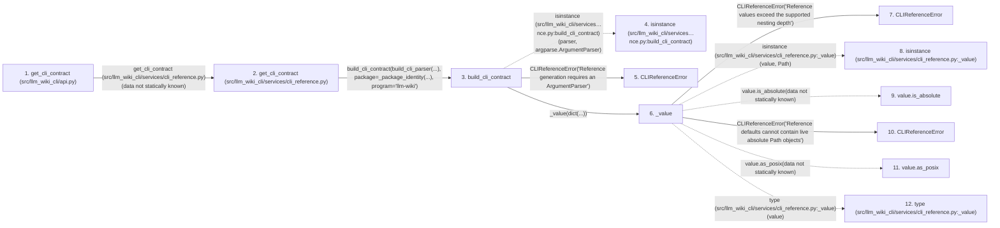

# get_cli_contract

**Entry point:** `get_cli_contract` (`api`)
**Source:** [api](../modules/api.md)
**Modules touched:** [api](../modules/api.md), [cli](../modules/cli.md), [cli_reference](../modules/cli_reference.md), [docs_cmd](../modules/docs_cmd.md), and 3 more

**Complete modules touched:**

- [api](../modules/api.md)
- [cli](../modules/cli.md)
- [cli_reference](../modules/cli_reference.md)
- [docs_cmd](../modules/docs_cmd.md)
- [knowledge_evidence](../modules/knowledge_evidence.md)
- [publication_cmd](../modules/publication_cmd.md)
- [reference_cmd](../modules/reference_cmd.md)

## Call sequence

> Static overview in presentation order, not runtime execution order. Arrows retain captured callers; representative internal continuations and boundary examples precede repeated helper detail.

```mermaid
sequenceDiagram
    participant p0 as get_cli_contract (src/llm_wiki_cli/api.py)
    participant p1 as get_cli_contract (src/llm_wiki_cli/services/cli_reference.py)
    participant p2 as build_cli_contract
    participant p3 as build_cli_parser
    participant p4 as _build_parser
    participant p5 as _value
    participant p6 as _command
    participant p7 as hash_json
    participant p8 as validate_cli_contract
    participant p9 as _json_tree
    participant p10 as canonical_json_bytes
    participant p11 as _register_commands
    participant p12 as _add_helper_preparation_arguments
    participant p13 as _validate_schema
    participant p14 as _validate_command
    participant p15 as _text
    participant p16 as _argument
    participant p17 as _add_init_command
    participant p18 as _custom_symbol
    participant p19 as _add_extract_command
    participant p20 as _add_lint_command
    participant p21 as _add_prepare_extractors_command
    participant p22 as _add_ci_check_command
    participant p23 as _add_knowledge_command
    participant p24 as _add_team_command
    participant p25 as _symbol
    participant p26 as _add_trigger_agent_command
    participant p27 as _add_bootstrap_command
    participant p28 as _add_generate_prompt_command
    participant p29 as isinstance (src/llm_wiki_cli/services…nce.py:build_cli_contract)
    participant p30 as _package_identity
    participant p31 as source_metadata.read_text
    p0->>p1: get_cli_contract (src/llm_wiki_cli/services/cli_reference.py)
    p1->>p2: build_cli_contract
    p1->>p3: build_cli_parser
    p3->>p4: _build_parser
    p2->>p5: _value
    p2->>p6: _command
    p2->>p7: hash_json
    p2->>p8: validate_cli_contract
    p8->>p9: _json_tree
    p7->>p10: canonical_json_bytes
    p4->>p11: _register_commands
    p4->>p12: _add_helper_preparation_arguments
    p8->>p13: _validate_schema
    p8->>p14: _validate_command
    p6->>p15: _text
    p6->>p16: _argument
    p11->>p17: _add_init_command
    p16->>p18: _custom_symbol
    p11->>p19: _add_extract_command
    p11->>p20: _add_lint_command
    p11->>p21: _add_prepare_extractors_command
    p11->>p22: _add_ci_check_command
    p11->>p23: _add_knowledge_command
    p11->>p24: _add_team_command
    p16->>p25: _symbol
    p11->>p26: _add_trigger_agent_command
    p11->>p27: _add_bootstrap_command
    p11->>p28: _add_generate_prompt_command
    p2-->>p29: isinstance (src/llm_wiki_cli/services…nce.py:build_cli_contract)(parser, argparse.ArgumentParser)
    p30-->>p31: source_metadata.read_text(encoding='utf-8')
```

<!-- Auto-generated from static call edges. Dashed arrows are external or unresolved calls. Reviewed runtime conditions and side effects belong in Behavior. -->

> Call sequence diagram shows 30 of 936 interactions; 906 omitted to keep the visualization within the 30-interaction and generated-diagram limits, with uncertain identities omitted rather than inferred.

> Captured boundary calls: external 1 of 116 (115 omitted); unresolved 1 of 607 (606 omitted). These counts cover the captured static trace.

Omitted captured detail, grouped by actual caller occurrence and target module:

| Caller | Parent step | Target module | Kind | Omitted interactions |
| --- | --- | --- | --- | --- |
| `src/llm_wiki_cli/services/cli_reference.py:build_cli_contract` | 3 | [src/llm_wiki_cli/services/cli_reference.py](../modules/cli_reference.md) | internal | 1 |
| `src/llm_wiki_cli/services/cli_reference.py:_value` | 6 | [src/llm_wiki_cli/services/cli_reference.py](../modules/cli_reference.md) | internal | 5 |
| `src/llm_wiki_cli/services/cli_reference.py:_value` | 6 | - | external | 9 |
| `src/llm_wiki_cli/services/cli_reference.py:_value` | 6 | - | unresolved | 3 |
| `src/llm_wiki_cli/services/cli_reference.py:build_cli_contract` | 3 | - | external | 1 |
| `src/llm_wiki_cli/services/cli_reference.py:_command` | 25 | - | external | 24 |
| `src/llm_wiki_cli/services/cli_reference.py:_command` | 25 | [src/llm_wiki_cli/services/cli_reference.py](../modules/cli_reference.md) | internal | 8 |
| `src/llm_wiki_cli/services/cli_reference.py:_command` | 25 | - | unresolved | 14 |
> Omission summary shows 8 of 122 groups; 114 further groups are not expanded here. Counts above include all omitted interactions.
> Detailed flow queries retain their own coverage and limits; omitted paths may execute at runtime.

> Trace truncated at the depth limit; deeper calls are omitted.

## Data flow

<!-- Auto-generated static analysis. Treat values and boundaries as best-effort hints, not runtime proof. -->

### Analysis coverage

**Effect analysis partially available.** Flow assembly and source effect analysis are separate; empty observations do not prove an empty handler body.

Source steps: 214; effect analysis evaluated: 179, partial: 0, unavailable: 35. Counts include steps omitted from the displayed trace.

Collector observations for 179 source steps with known totals: observed: 547, emitted: 547, omitted: 0. Unavailable totals are excluded.

- Callable record unavailable for one or more source steps; those steps have no represented callable body.
- Effect collector totals unavailable; observed counts cover captured records only.

| Step | Callable record | Effect analysis | Collector totals | Observed | Emitted | Omitted |
|---|---|---|---|---:|---:|---:|
| `get_cli_contract (src/llm_wiki_cli/api.py)` | `available` | `evaluated` | `available` | `1` | `1` | `0` |
| `get_cli_contract (src/llm_wiki_cli/services/cli_reference.py)` | `available` | `evaluated` | `available` | `1` | `1` | `0` |
| `build_cli_contract` | `available` | `evaluated` | `available` | `6` | `6` | `0` |
| `isinstance (src/llm_wiki_cli/services…nce.py:build_cli_contract)` | `not_applicable` | `not_applicable` | `not_applicable` | — | — | — |
| `CLIReferenceError` | `unavailable` | `unavailable` | `unavailable` | — | — | — |
| `_value` | `available` | `evaluated` | `available` | `10` | `10` | `0` |
| `CLIReferenceError` | `unavailable` | `unavailable` | `unavailable` | — | — | — |
| `isinstance (src/llm_wiki_cli/services/cli_reference.py:_value)` | `not_applicable` | `not_applicable` | `not_applicable` | — | — | — |
| `value.is_absolute` | `not_applicable` | `not_applicable` | `not_applicable` | — | — | — |
| `CLIReferenceError` | `unavailable` | `unavailable` | `unavailable` | — | — | — |
| `value.as_posix` | `not_applicable` | `not_applicable` | `not_applicable` | — | — | — |
| `type (src/llm_wiki_cli/services/cli_reference.py:_value)` | `not_applicable` | `not_applicable` | `not_applicable` | — | — | — |

### Step data

| Step | Inputs | Reads | Writes | Returns |
|---|---|---|---|---|
| `get_cli_contract (src/llm_wiki_cli/api.py)` | - | - | - | `get_contract(...)` |
| `get_cli_contract (src/llm_wiki_cli/services/cli_reference.py)` | - | - | - | `build_cli_contract(...)` |
| `build_cli_contract` | `parser: argparse.ArgumentParser`, `package: Mapping[str, Any]`, `program: str` | `argparse`, `CLI_CONTRACT_SCHEMA_VERSION` | - | `result` |
| `isinstance (src/llm_wiki_cli/services…nce.py:build_cli_contract)` | - | - | - | - |
| `CLIReferenceError` | - | - | - | - |
| `_value` | `value: object`, `depth: int` | `_MAX_DEPTH`, `Path`, `Mapping` | - | `value`, `value`, `value`, `...`, `...` |
| `CLIReferenceError` | - | - | - | - |
| `isinstance (src/llm_wiki_cli/services/cli_reference.py:_value)` | - | - | - | - |
| `value.is_absolute` | - | - | - | - |
| `CLIReferenceError` | - | - | - | - |
| `value.as_posix` | - | - | - | - |
| `type (src/llm_wiki_cli/services/cli_reference.py:_value)` | - | - | - | - |

### Call data

| From | To | Line | Call |
|---|---|---:|---|
| get_cli_contract (src/llm_wiki_cli/api.py) | get_cli_contract (src/llm_wiki_cli/services/cli_reference.py) | 3565 | `get_contract(data not statically known)` |
| get_cli_contract (src/llm_wiki_cli/services/cli_reference.py) | build_cli_contract | 303 | `build_cli_contract(build_cli_parser(...), package=_package_identity(...), program='llm-wiki')` |
| build_cli_contract | isinstance (src/llm_wiki_cli/services…nce.py:build_cli_contract) | 257 | `isinstance(parser, argparse.ArgumentParser)` |
| build_cli_contract | CLIReferenceError | 258 | `CLIReferenceError('Reference generation requires an ArgumentParser')` |
| build_cli_contract | _value | 261 | `_value(dict(...))` |
| _value | CLIReferenceError | 71 | `CLIReferenceError('Reference values exceed the supported nesting depth')` |
| _value | isinstance (src/llm_wiki_cli/services/cli_reference.py:_value) | 72 | `isinstance(value, Path)` |
| _value | value.is_absolute | 73 | `value.is_absolute(data not statically known)` |
| _value | CLIReferenceError | 74 | `CLIReferenceError('Reference defaults cannot contain live absolute Path objects')` |
| _value | value.as_posix | 77 | `value.as_posix(data not statically known)` |
| _value | type (src/llm_wiki_cli/services/cli_reference.py:_value) | 78 | `type(value)` |

### Boundary effects

*No boundary-effect observations were captured in this static trace.*

### Static analysis gaps

| Kind | Step | Target | Line |
|---|---|---|---:|
| external_call | `build_cli_contract` | `isinstance` | 257 |
| external_call | `_value` | `isinstance` | 72 |
| unresolved_call | `_value` | `value.is_absolute` | 73 |
| unresolved_call | `_value` | `value.as_posix` | 77 |
| external_call | `_value` | `type` | 78 |
| step_limit | `get_cli_contract` | `first 12 steps` | 0 |
| truncated_flow | `get_cli_contract` | `depth limit` | 0 |

## Behavior

This flow starts at `get_cli_contract` and is classified as `api`. The generated call and data-flow sections are bounded static projections; runtime conditions and side effects require source-level confirmation.
