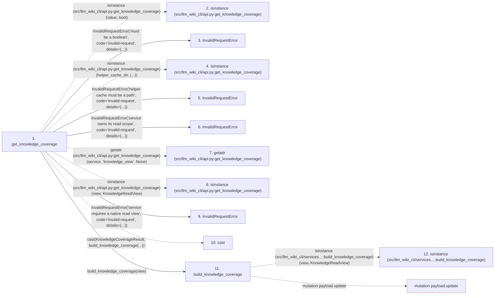

# get_knowledge_coverage

**Entry point:** `get_knowledge_coverage` (`api`)
**Source:** [api](../modules/api.md)
**Modules touched:** [analysis_capture](../modules/analysis_capture.md), [analysis_compatibility](../modules/analysis_compatibility.md), [api](../modules/api.md), [bootstrap_recovery](../modules/bootstrap_recovery.md), and 64 more

**Complete modules touched:**

- [analysis_capture](../modules/analysis_capture.md)
- [analysis_compatibility](../modules/analysis_compatibility.md)
- [api](../modules/api.md)
- [bootstrap_recovery](../modules/bootstrap_recovery.md)
- [common](../modules/common.md)
- [config](../modules/config.md)
- [context_packet](../modules/context_packet.md)
- [context_service](../modules/context_service.md)
- [data_flow](../modules/data_flow.md)
- [dependency_versions](../modules/dependency_versions.md)
- [dockerfile_parser](../modules/dockerfile_parser.md)
- [documentation_queries](../modules/documentation_queries.md)
- [documentation_query_builder](../modules/documentation_query_builder.md)
- [entrypoints](../modules/entrypoints.md)
- [extraction_service](../modules/extraction_service.md)
- [filesystem_guard](../modules/filesystem_guard.md)
- [go_calls](../modules/go_calls.md)
- [immutable](../modules/immutable.md)
- [implementation_evidence](../modules/implementation_evidence.md)
- [imports](../modules/imports.md)
- [infrastructure_inventory](../modules/infrastructure_inventory.md)
- [infrastructure_sync](../modules/infrastructure_sync.md)
- [io](../modules/io.md)
- [knowledge_artifacts](../modules/knowledge_artifacts.md)
- [knowledge_consumption](../modules/knowledge_consumption.md)
- [knowledge_coverage](../modules/knowledge_coverage.md)
- [knowledge_envelope](../modules/knowledge_envelope.md)
- [knowledge_evidence](../modules/knowledge_evidence.md)
- [knowledge_freshness](../modules/knowledge_freshness.md)
- [knowledge_generation](../modules/knowledge_generation.md)
- [knowledge_governance](../modules/knowledge_governance.md)
- [knowledge_graph](../modules/knowledge_graph.md)
- [knowledge_index](../modules/knowledge_index.md)
- [knowledge_loader](../modules/knowledge_loader.md)
- [knowledge_model](../modules/knowledge_model.md)
- [knowledge_orchestration](../modules/knowledge_orchestration.md)
- [knowledge_packs](../modules/knowledge_packs.md)
- [knowledge_reuse](../modules/knowledge_reuse.md)
- [knowledge_storage](../modules/knowledge_storage.md)
- [knowledge_storage_io](../modules/knowledge_storage_io.md)
- [knowledge_verification](../modules/knowledge_verification.md)
- [maintenance_evidence](../modules/maintenance_evidence.md)
- [maintenance_protocol](../modules/maintenance_protocol.md)
- [maintenance_service](../modules/maintenance_service.md)
- [maintenance_shapes](../modules/maintenance_shapes.md)
- [maintenance_state](../modules/maintenance_state.md)
- [maintenance_status](../modules/maintenance_status.md)
- [manifest_storage](../modules/manifest_storage.md)
- [normalization_diagnostics](../modules/normalization_diagnostics.md)
- [paths](../modules/paths.md)
- [plugins](../modules/plugins.md)
- [python_bindings](../modules/python_bindings.md)
- [python_calls](../modules/python_calls.md)
- [python_implementation](../modules/python_implementation.md)
- [python_imports](../modules/python_imports.md)
- [section_ownership](../modules/section_ownership.md)
- [services_dependencies](../modules/services_dependencies.md)
- [source_retirement](../modules/source_retirement.md)
- [source_selection](../modules/source_selection.md)
- [source_snapshot](../modules/source_snapshot.md)
- [sync_manifest](../modules/sync_manifest.md)
- [validation](../modules/validation.md)
- [verification_contracts](../modules/verification_contracts.md)
- [wiki_media](../modules/wiki_media.md)
- [wiki_surface](../modules/wiki_surface.md)
- [wiki_surface_index](../modules/wiki_surface_index.md)
- [yaml_formats](../modules/yaml_formats.md)
- [yaml_syntax](../modules/yaml_syntax.md)

## Call sequence

> Static overview in presentation order, not runtime execution order. Arrows retain captured callers; representative internal continuations and boundary examples precede repeated helper detail.

```mermaid
sequenceDiagram
    participant p0 as get_knowledge_coverage
    participant p1 as build_knowledge_coverage
    participant p2 as capture_context_read
    participant p3 as _validate_wiki_dir
    participant p4 as load_knowledge_read_view
    participant p5 as InvalidRequestError
    participant p6 as _assert_source_unchanged
    participant p7 as _assert_wiki_unchanged
    participant p8 as _wiki_anchor
    participant p9 as validate_source_root
    participant p10 as guard_maintenance_owner
    participant p11 as resolve_source_selection
    participant p12 as capture_source_selection_inputs
    participant p13 as validate_live_query_source_selection
    participant p14 as build_source_snapshot
    participant p15 as _guard_windows_inputs
    participant p16 as retained_empty_module_paths_from_wiki
    participant p17 as _assert_source_inputs_unchanged
    participant p18 as get_entry_points
    participant p19 as read_console_scripts
    participant p20 as resolve_call_edges
    participant p21 as build_flow
    participant p22 as build_data_flow_context
    participant p23 as analyze_data_flow
    participant p24 as evaluate_surface_index
    participant p25 as _build_context_knowledge_view
    participant p26 as analyze_dependencies
    participant p27 as _selected_git_changed_files
    participant p28 as _freeze_json
    participant p29 as isinstance (src/llm_wiki_cli/api.py:get_knowledge_coverage)
    participant p30 as counts
    p0->>p1: build_knowledge_coverage
    p0->>p2: capture_context_read
    p0->>p3: _validate_wiki_dir
    p0->>p4: load_knowledge_read_view
    p0->>p5: InvalidRequestError
    p0->>p6: _assert_source_unchanged
    p0->>p7: _assert_wiki_unchanged
    p0->>p8: _wiki_anchor
    p2->>p9: validate_source_root
    p2->>p10: guard_maintenance_owner
    p2->>p11: resolve_source_selection
    p2->>p12: capture_source_selection_inputs
    p2->>p13: validate_live_query_source_selection
    p2->>p14: build_source_snapshot
    p2->>p15: _guard_windows_inputs
    p2->>p16: retained_empty_module_paths_from_wiki
    p2->>p17: _assert_source_inputs_unchanged
    p2->>p18: get_entry_points
    p2->>p19: read_console_scripts
    p2->>p20: resolve_call_edges
    p2->>p21: build_flow
    p2->>p22: build_data_flow_context
    p2->>p23: analyze_data_flow
    p2->>p24: evaluate_surface_index
    p2->>p25: _build_context_knowledge_view
    p2->>p26: analyze_dependencies
    p2->>p27: _selected_git_changed_files
    p2->>p28: _freeze_json
    p0-->>p29: isinstance (src/llm_wiki_cli/api.py:get_knowledge_coverage)(value, bool)
    p1-->>p30: counts
```

<!-- Auto-generated from static call edges. Dashed arrows are external or unresolved calls. Reviewed runtime conditions and side effects belong in Behavior. -->

> Call sequence diagram shows 30 of 4259 interactions; 4229 omitted to keep the visualization within the 30-interaction and generated-diagram limits, with uncertain identities omitted rather than inferred.

> Captured boundary calls: external 1 of 1355 (1354 omitted); unresolved 1 of 1365 (1364 omitted). These counts cover the captured static trace.

Omitted captured detail, grouped by actual caller occurrence and target module:

| Caller | Parent step | Target module | Kind | Omitted interactions |
| --- | --- | --- | --- | --- |
| `src/llm_wiki_cli/api.py:get_knowledge_coverage` | 1 | - | external | 6 |
| `src/llm_wiki_cli/api.py:get_knowledge_coverage` | 1 | [src/llm_wiki_cli/api.py](../modules/api.md) | internal | 3 |
| `src/llm_wiki_cli/services/knowledge_coverage.py:build_knowledge_coverage` | 11 | - | external | 15 |
| `src/llm_wiki_cli/services/knowledge_coverage.py:build_knowledge_coverage` | 11 | - | unresolved | 6 |
| `src/llm_wiki_cli/services/knowledge_coverage.py:build_knowledge_coverage` | 11 | [src/llm_wiki_cli/services/knowledge_freshness.py](../modules/knowledge_freshness.md) | internal | 1 |
| `src/llm_wiki_cli/services/context_packet.py:capture_context_read` | 35 | - | external | 37 |
| `src/llm_wiki_cli/config.py:validate_source_root` | 48 | [src/llm_wiki_cli/config.py](../modules/config.md) | internal | 7 |
| `src/llm_wiki_cli/config.py:validate_path` | 49 | [src/llm_wiki_cli/config.py](../modules/config.md) | internal | 2 |
> Omission summary shows 8 of 1054 groups; 1046 further groups are not expanded here. Counts above include all omitted interactions.
> Detailed flow queries retain their own coverage and limits; omitted paths may execute at runtime.

> Trace truncated at the depth limit; deeper calls are omitted.

## Data flow

<!-- Auto-generated static analysis. Treat values and boundaries as best-effort hints, not runtime proof. -->

### Analysis coverage

**Effect analysis partially available.** Flow assembly and source effect analysis are separate; empty observations do not prove an empty handler body.

Source steps: 1540; effect analysis evaluated: 1037, partial: 73, unavailable: 430. Counts include steps omitted from the displayed trace.

Collector observations for 1110 source steps with known totals: observed: 6629, emitted: 6288, omitted: 341. Unavailable totals are excluded.

- Callable record unavailable for one or more source steps; those steps have no represented callable body.
- Effect collector omitted observations before flow assembly; displayed effects are partial.
- Effect collector totals unavailable; observed counts cover captured records only.

| Step | Callable record | Effect analysis | Collector totals | Observed | Emitted | Omitted |
|---|---|---|---|---:|---:|---:|
| `get_knowledge_coverage` | `available` | `evaluated` | `available` | `14` | `14` | `0` |
| `isinstance (src/llm_wiki_cli/api.py:get_knowledge_coverage)` | `not_applicable` | `not_applicable` | `not_applicable` | — | — | — |
| `InvalidRequestError` | `unavailable` | `unavailable` | `unavailable` | — | — | — |
| `isinstance (src/llm_wiki_cli/api.py:get_knowledge_coverage)` | `not_applicable` | `not_applicable` | `not_applicable` | — | — | — |
| `InvalidRequestError` | `unavailable` | `unavailable` | `unavailable` | — | — | — |
| `InvalidRequestError` | `unavailable` | `unavailable` | `unavailable` | — | — | — |
| `getattr (src/llm_wiki_cli/api.py:get_knowledge_coverage)` | `not_applicable` | `not_applicable` | `not_applicable` | — | — | — |
| `isinstance (src/llm_wiki_cli/api.py:get_knowledge_coverage)` | `not_applicable` | `not_applicable` | `not_applicable` | — | — | — |
| `InvalidRequestError` | `unavailable` | `unavailable` | `unavailable` | — | — | — |
| `cast` | `not_applicable` | `not_applicable` | `not_applicable` | — | — | — |
| `build_knowledge_coverage` | `available` | `evaluated` | `available` | `12` | `12` | `0` |
| `isinstance (src/llm_wiki_cli/services…:build_knowledge_coverage)` | `not_applicable` | `not_applicable` | `not_applicable` | — | — | — |

### Step data

| Step | Inputs | Reads | Writes | Returns |
|---|---|---|---|---|
| `get_knowledge_coverage` | `src_dir: str`, `wiki_dir: str`, `live: bool`, `service: DocumentationGraphQueryService \| None`, `allow_external_src: bool`, `source_selection: str \| Path \| None`, `helper_cache_dir: str \| Path \| None`, `comparison_policy: str \| None` | `Path`, `DEFAULT_WIKI_DIR`, `KnowledgeCoverageResult`, `KnowledgeCoverageResult` | - | `cast(...)`, `cast(...)` |
| `isinstance (src/llm_wiki_cli/api.py:get_knowledge_coverage)` | - | - | - | - |
| `InvalidRequestError` | - | - | - | - |
| `isinstance (src/llm_wiki_cli/api.py:get_knowledge_coverage)` | - | - | - | - |
| `InvalidRequestError` | - | - | - | - |
| `InvalidRequestError` | - | - | - | - |
| `getattr (src/llm_wiki_cli/api.py:get_knowledge_coverage)` | - | - | - | - |
| `isinstance (src/llm_wiki_cli/api.py:get_knowledge_coverage)` | - | - | - | - |
| `InvalidRequestError` | - | - | - | - |
| `cast` | - | - | - | - |
| `build_knowledge_coverage` | `view: KnowledgeReadView` | `KnowledgeReadView`, `KNOWLEDGE_COVERAGE_SCHEMA_VERSION`, `_KINDS`, `KNOWN_FRESHNESS_REASON_CODES`, `MAX_COVERAGE_BYTES` | `target[...]`, `target[...]`, `reasons[...]` | `payload`, `payload` |
| `isinstance (src/llm_wiki_cli/services…:build_knowledge_coverage)` | - | - | - | - |

### Call data

| From | To | Line | Call |
|---|---|---:|---|
| get_knowledge_coverage | isinstance (src/llm_wiki_cli/api.py:get_knowledge_coverage) | 952 | `isinstance(value, bool)` |
| get_knowledge_coverage | InvalidRequestError | 953 | `InvalidRequestError('must be a boolean', code='invalid-request', details={...})` |
| get_knowledge_coverage | isinstance (src/llm_wiki_cli/api.py:get_knowledge_coverage) | 956 | `isinstance(helper_cache_dir, (...))` |
| get_knowledge_coverage | InvalidRequestError | 957 | `InvalidRequestError('helper cache must be a path', code='invalid-request', details={...})` |
| get_knowledge_coverage | InvalidRequestError | 971 | `InvalidRequestError('service owns its read scope', code='invalid-request', details={...})` |
| get_knowledge_coverage | getattr (src/llm_wiki_cli/api.py:get_knowledge_coverage) | 976 | `getattr(service, 'knowledge_view', None)` |
| get_knowledge_coverage | isinstance (src/llm_wiki_cli/api.py:get_knowledge_coverage) | 977 | `isinstance(view, KnowledgeReadView)` |
| get_knowledge_coverage | InvalidRequestError | 978 | `InvalidRequestError('service requires a native read view', code='invalid-request', details={...})` |
| get_knowledge_coverage | cast | 983 | `cast(KnowledgeCoverageResult, build_knowledge_coverage(...))` |
| get_knowledge_coverage | build_knowledge_coverage | 983 | `build_knowledge_coverage(view)` |
| build_knowledge_coverage | isinstance (src/llm_wiki_cli/services…:build_knowledge_coverage) | 23 | `isinstance(view, KnowledgeReadView)` |

### Boundary effects

| Kind | Target | Step | Line |
|---|---|---|---:|
| mutation | `payload.update` | `build_knowledge_coverage` | 81 |

### Static analysis gaps

| Kind | Step | Target | Line |
|---|---|---|---:|
| external_call | `get_knowledge_coverage` | `isinstance` | 952 |
| external_call | `get_knowledge_coverage` | `isinstance` | 956 |
| external_call | `get_knowledge_coverage` | `getattr` | 976 |
| external_call | `get_knowledge_coverage` | `isinstance` | 977 |
| external_call | `get_knowledge_coverage` | `cast` | 983 |
| external_call | `build_knowledge_coverage` | `isinstance` | 23 |
| step_limit | `get_knowledge_coverage` | `first 12 steps` | 0 |
| truncated_flow | `get_knowledge_coverage` | `depth limit` | 0 |

## Behavior

This flow starts at `get_knowledge_coverage` and is classified as `api`. The generated call and data-flow sections are bounded static projections; runtime conditions and side effects require source-level confirmation.
