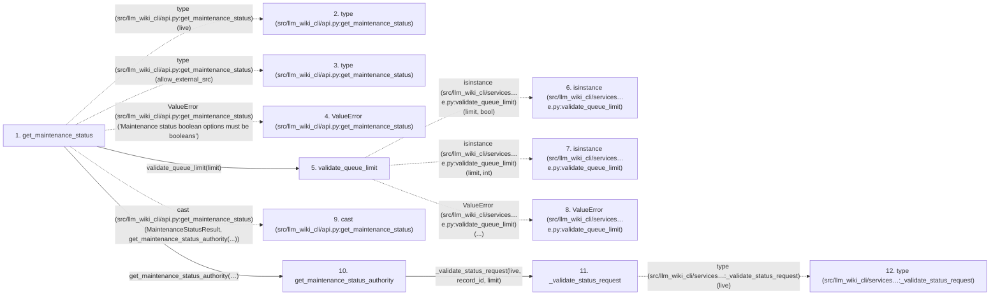

# get_maintenance_status

**Entry point:** `get_maintenance_status` (`api`)
**Source:** [api](../modules/api.md)
**Modules touched:** [analysis_compatibility](../modules/analysis_compatibility.md), [api](../modules/api.md), [common](../modules/common.md), [config](../modules/config.md), and 54 more

**Complete modules touched:**

- [analysis_compatibility](../modules/analysis_compatibility.md)
- [api](../modules/api.md)
- [common](../modules/common.md)
- [config](../modules/config.md)
- [context_packet](../modules/context_packet.md)
- [context_service](../modules/context_service.md)
- [data_flow](../modules/data_flow.md)
- [dependency_versions](../modules/dependency_versions.md)
- [documentation_queries](../modules/documentation_queries.md)
- [documentation_query_builder](../modules/documentation_query_builder.md)
- [entrypoints](../modules/entrypoints.md)
- [extraction_service](../modules/extraction_service.md)
- [filesystem_guard](../modules/filesystem_guard.md)
- [immutable](../modules/immutable.md)
- [implementation_evidence](../modules/implementation_evidence.md)
- [imports](../modules/imports.md)
- [infrastructure_inventory](../modules/infrastructure_inventory.md)
- [infrastructure_sync](../modules/infrastructure_sync.md)
- [io](../modules/io.md)
- [knowledge_artifacts](../modules/knowledge_artifacts.md)
- [knowledge_consumption](../modules/knowledge_consumption.md)
- [knowledge_envelope](../modules/knowledge_envelope.md)
- [knowledge_evidence](../modules/knowledge_evidence.md)
- [knowledge_freshness](../modules/knowledge_freshness.md)
- [knowledge_governance](../modules/knowledge_governance.md)
- [knowledge_graph](../modules/knowledge_graph.md)
- [knowledge_index](../modules/knowledge_index.md)
- [knowledge_loader](../modules/knowledge_loader.md)
- [knowledge_model](../modules/knowledge_model.md)
- [knowledge_orchestration](../modules/knowledge_orchestration.md)
- [knowledge_packs](../modules/knowledge_packs.md)
- [knowledge_reuse](../modules/knowledge_reuse.md)
- [knowledge_storage](../modules/knowledge_storage.md)
- [knowledge_storage_io](../modules/knowledge_storage_io.md)
- [knowledge_verification](../modules/knowledge_verification.md)
- [maintenance_evidence](../modules/maintenance_evidence.md)
- [maintenance_projection](../modules/maintenance_projection.md)
- [maintenance_protocol](../modules/maintenance_protocol.md)
- [maintenance_queue](../modules/maintenance_queue.md)
- [maintenance_service](../modules/maintenance_service.md)
- [maintenance_shapes](../modules/maintenance_shapes.md)
- [maintenance_state](../modules/maintenance_state.md)
- [maintenance_status](../modules/maintenance_status.md)
- [manifest_storage](../modules/manifest_storage.md)
- [markdown_sections](../modules/markdown_sections.md)
- [plugins](../modules/plugins.md)
- [python_calls](../modules/python_calls.md)
- [python_implementation](../modules/python_implementation.md)
- [python_imports](../modules/python_imports.md)
- [section_ownership](../modules/section_ownership.md)
- [services_dependencies](../modules/services_dependencies.md)
- [source_selection](../modules/source_selection.md)
- [source_snapshot](../modules/source_snapshot.md)
- [sync_manifest](../modules/sync_manifest.md)
- [validation](../modules/validation.md)
- [wiki_media](../modules/wiki_media.md)
- [wiki_surface](../modules/wiki_surface.md)
- [wiki_surface_index](../modules/wiki_surface_index.md)

## Call sequence

> Static overview in presentation order, not runtime execution order. Arrows retain captured callers; siblings are shown before deeper helper detail.

```mermaid
sequenceDiagram
    participant p0 as get_maintenance_status
    participant p1 as type (src/llm_wiki_cli/api.py:get_maintenance_status)
    participant p2 as ValueError (src/llm_wiki_cli/api.py:get_maintenance_status)
    participant p3 as validate_queue_limit
    participant p4 as cast (src/llm_wiki_cli/api.py:get_maintenance_status)
    participant p5 as get_maintenance_status_authority
    participant p6 as _validate_wiki_dir
    participant p7 as isinstance (src/llm_wiki_cli/services…e.py:validate_queue_limit)
    participant p8 as _validate_status_request
    participant p9 as validate_path
    participant p10 as _absolute_path
    participant p11 as ValueError (src/llm_wiki_cli/services…e.py:validate_queue_limit)
    participant p12 as Path (src/llm_wiki_cli/services…ntenance_status_authority)
    participant p13 as snapshot_wiki
    participant p14 as guard_maintenance_owner
    participant p15 as SyncManifest.load
    participant p16 as capture_committed_knowledge
    participant p17 as build_maintenance_status
    participant p18 as MaintenanceProtocolError
    participant p19 as _capture
    participant p20 as maintenance_report_from_captured
    participant p21 as _native_prose_coherent
    participant p22 as source_snapshot_matches_current_files
    participant p23 as prior.assert_current
    p0-->>p1: type (src/llm_wiki_cli/api.py:get_maintenance_status)(live)
    p0-->>p1: type (src/llm_wiki_cli/api.py:get_maintenance_status)(allow_external_src)
    p0-->>p2: ValueError (src/llm_wiki_cli/api.py:get_maintenance_status)('Maintenance status boolean options must be booleans')
    p0->>p3: validate_queue_limit
    p0-->>p4: cast (src/llm_wiki_cli/api.py:get_maintenance_status)(MaintenanceStatusResult, get_maintenance_status_authority(...))
    p0->>p5: get_maintenance_status_authority
    p0->>p6: _validate_wiki_dir
    p3-->>p7: isinstance (src/llm_wiki_cli/services…e.py:validate_queue_limit)(limit, bool)
    p5->>p8: _validate_status_request
    p6->>p9: validate_path
    p3-->>p7: isinstance (src/llm_wiki_cli/services…e.py:validate_queue_limit)(limit, int)
    p5->>p10: _absolute_path
    p3-->>p11: ValueError (src/llm_wiki_cli/services…e.py:validate_queue_limit)(...)
    p5-->>p12: Path (src/llm_wiki_cli/services…ntenance_status_authority)(wiki_dir)
    p5->>p13: snapshot_wiki
    p5->>p14: guard_maintenance_owner
    p5->>p15: SyncManifest.load
    p5->>p16: capture_committed_knowledge
    p5->>p17: build_maintenance_status
    p5->>p18: MaintenanceProtocolError
    p5->>p19: _capture
    p5->>p20: maintenance_report_from_captured
    p5->>p17: build_maintenance_status
    p5->>p21: _native_prose_coherent
    p5->>p22: source_snapshot_matches_current_files
    p5->>p18: MaintenanceProtocolError
    p5-->>p23: prior.assert_current
    p5->>p13: snapshot_wiki
    p5->>p18: MaintenanceProtocolError
    p5->>p18: MaintenanceProtocolError
```

<!-- Auto-generated from static call edges. Dashed arrows are external or unresolved calls. Reviewed runtime conditions and side effects belong in Behavior. -->

> Call sequence diagram shows 30 of 2357 interactions; 2327 omitted to keep the visualization within the 30-interaction and generated-diagram limits, with uncertain identities omitted rather than inferred.

> Captured boundary calls: external 8 of 781 (773 omitted); unresolved 1 of 569 (568 omitted). These counts cover the captured static trace.

Omitted captured detail, grouped by actual caller occurrence and target module:

| Caller | Parent step | Target module | Kind | Omitted interactions |
| --- | --- | --- | --- | --- |
| `src/llm_wiki_cli/services/maintenance_service.py:_validate_status_request` | 11 | - | external | 2 |
| `src/llm_wiki_cli/services/maintenance_service.py:_validate_status_request` | 11 | [src/llm_wiki_cli/services/maintenance_protocol.py](../modules/maintenance_protocol.md) | internal | 1 |
| `src/llm_wiki_cli/services/maintenance_service.py:_validate_status_request` | 11 | [src/llm_wiki_cli/services/maintenance_state.py](../modules/maintenance_state.md) | internal | 1 |
| `src/llm_wiki_cli/services/maintenance_state.py:_identity` | 15 | - | external | 2 |
| `src/llm_wiki_cli/services/maintenance_state.py:_identity` | 15 | [src/llm_wiki_cli/services/maintenance_shapes.py](../modules/maintenance_shapes.md) | internal | 2 |
| `src/llm_wiki_cli/services/maintenance_shapes.py:require` | 18 | [src/llm_wiki_cli/services/maintenance_shapes.py](../modules/maintenance_shapes.md) | internal | 1 |
| `src/llm_wiki_cli/services/knowledge_storage_io.py:_absolute_path` | 21 | - | external | 4 |
| `src/llm_wiki_cli/services/knowledge_storage_io.py:_absolute_path` | 21 | [src/llm_wiki_cli/services/io.py](../modules/io.md) | internal | 1 |
> Omission summary shows 8 of 559 groups; 551 further groups are not expanded here. Counts above include all omitted interactions.
> Detailed flow queries retain their own coverage and limits; omitted paths may execute at runtime.

> Trace truncated at the depth limit; deeper calls are omitted.

## Data flow

<!-- Auto-generated static analysis. Treat values and boundaries as best-effort hints, not runtime proof. -->

### Step data

| Step | Inputs | Reads | Writes | Returns |
|---|---|---|---|---|
| `get_maintenance_status` | `src_dir: str`, `wiki_dir: str`, `live: bool`, `record_id: str \| None`, `limit: int`, `source_selection: str \| Path \| None`, `helper_cache_dir: str \| None`, `allow_external_src: bool` | `MaintenanceStatusResult` | - | `cast(...)` |
| `type (src/llm_wiki_cli/api.py:get_maintenance_status)` | - | - | - | - |
| `type (src/llm_wiki_cli/api.py:get_maintenance_status)` | - | - | - | - |
| `ValueError (src/llm_wiki_cli/api.py:get_maintenance_status)` | - | - | - | - |
| `validate_queue_limit` | `limit: object` | `MIN_QUEUE_LIMIT`, `MAX_QUEUE_LIMIT`, `MIN_QUEUE_LIMIT`, `MAX_QUEUE_LIMIT` | - | `limit` |
| `isinstance (src/llm_wiki_cli/services…e.py:validate_queue_limit)` | - | - | - | - |
| `isinstance (src/llm_wiki_cli/services…e.py:validate_queue_limit)` | - | - | - | - |
| `ValueError (src/llm_wiki_cli/services…e.py:validate_queue_limit)` | - | - | - | - |
| `cast (src/llm_wiki_cli/api.py:get_maintenance_status)` | - | - | - | - |
| `get_maintenance_status_authority` | `src_dir`, `wiki_dir`, `live`, `record_id`, `limit`, `capture_options` | - | - | `report.to_payload(...)` |
| `_validate_status_request` | `live`, `record_id`, `limit` | - | - | - |
| `type (src/llm_wiki_cli/services…:_validate_status_request)` | - | - | - | - |

### Call data

| From | To | Line | Call |
|---|---|---:|---|
| get_maintenance_status | type (src/llm_wiki_cli/api.py:get_maintenance_status) | 1607 | `type(live)` |
| get_maintenance_status | type (src/llm_wiki_cli/api.py:get_maintenance_status) | 1607 | `type(allow_external_src)` |
| get_maintenance_status | ValueError (src/llm_wiki_cli/api.py:get_maintenance_status) | 1608 | `ValueError('Maintenance status boolean options must be booleans')` |
| get_maintenance_status | validate_queue_limit | 1609 | `validate_queue_limit(limit)` |
| validate_queue_limit | isinstance (src/llm_wiki_cli/services…e.py:validate_queue_limit) | 48 | `isinstance(limit, bool)` |
| validate_queue_limit | isinstance (src/llm_wiki_cli/services…e.py:validate_queue_limit) | 49 | `isinstance(limit, int)` |
| validate_queue_limit | ValueError (src/llm_wiki_cli/services…e.py:validate_queue_limit) | 52 | `ValueError(...)` |
| get_maintenance_status | cast (src/llm_wiki_cli/api.py:get_maintenance_status) | 1610 | `cast(MaintenanceStatusResult, get_maintenance_status_authority(...))` |
| get_maintenance_status | get_maintenance_status_authority | 1610 | `get_maintenance_status_authority(src_dir, _validate_wiki_dir(...), live=live, record_id=record_id, limit=limit, source_selection=source_selection, helper_cache_dir=helper_cache_dir, allow_external_src=allow_external_src)` |
| get_maintenance_status_authority | _validate_status_request | 384 | `_validate_status_request(live, record_id, limit)` |
| _validate_status_request | type (src/llm_wiki_cli/services…:_validate_status_request) | 311 | `type(live)` |

### Boundary effects

*No boundary effects detected.*

### Static analysis gaps

| Kind | Step | Target | Line |
|---|---|---|---:|
| external_call | `get_maintenance_status` | `type` | 1607 |
| external_call | `get_maintenance_status` | `ValueError` | 1608 |
| external_call | `validate_queue_limit` | `isinstance` | 48 |
| external_call | `validate_queue_limit` | `isinstance` | 49 |
| external_call | `validate_queue_limit` | `ValueError` | 52 |
| external_call | `get_maintenance_status` | `cast` | 1610 |
| external_call | `_validate_status_request` | `type` | 311 |
| step_limit | `get_maintenance_status` | `first 12 steps` | 0 |
| truncated_flow | `get_maintenance_status` | `depth limit` | 0 |

## Behavior

This flow starts at `get_maintenance_status` and is classified as `api`. The generated call and data-flow sections are bounded static projections; runtime conditions and side effects require source-level confirmation.
