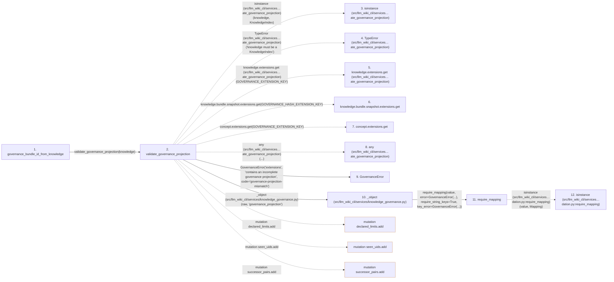

# governance_bundle_id_from_knowledge

**Entry point:** `governance_bundle_id_from_knowledge` (`api`)
**Source:** [knowledge_governance](../modules/knowledge_governance.md)
**Modules touched:** [concept_identity](../modules/concept_identity.md), [knowledge_evidence](../modules/knowledge_evidence.md), [knowledge_governance](../modules/knowledge_governance.md), and 5 more

**Complete modules touched:**

- [concept_identity](../modules/concept_identity.md)
- [knowledge_evidence](../modules/knowledge_evidence.md)
- [knowledge_governance](../modules/knowledge_governance.md)
- [knowledge_graph](../modules/knowledge_graph.md)
- [knowledge_model](../modules/knowledge_model.md)
- [validation](../modules/validation.md)
- [wiki_media](../modules/wiki_media.md)
- [wiki_surface](../modules/wiki_surface.md)

## Call sequence

> Static overview in presentation order, not runtime execution order. Arrows retain captured callers; siblings are shown before deeper helper detail.

```mermaid
sequenceDiagram
    participant p0 as governance_bundle_id_from_knowledge
    participant p1 as validate_governance_projection
    participant p2 as isinstance (src/llm_wiki_cli/services…_bundle_id_from_knowledge)
    participant p3 as isinstance (src/llm_wiki_cli/services…ate_governance_projection)
    participant p4 as TypeError (src/llm_wiki_cli/services…ate_governance_projection)
    participant p5 as knowledge.extensions.get (src/llm_wiki_cli/services…ate_governance_projection)
    participant p6 as knowledge.bundle.snapshot.extensions.get
    participant p7 as concept.extensions.get
    participant p8 as any (src/llm_wiki_cli/services…ate_governance_projection)
    participant p9 as GovernanceError
    participant p10 as _object (src/llm_wiki_cli/services/knowledge_governance.py)
    participant p11 as _exact_fields
    participant p12 as _bundle_id
    participant p13 as validate_governance_ledger
    participant p14 as _hash
    participant p15 as set (src/llm_wiki_cli/services…ate_governance_projection)
    participant p16 as _event_limit
    participant p17 as concepts_by_locator.items
    participant p18 as _validate_concept_summary
    participant p19 as _nonnegative_int
    p0->>p1: validate_governance_projection
    p0-->>p2: isinstance (src/llm_wiki_cli/services…_bundle_id_from_knowledge)(value, str)
    p1-->>p3: isinstance (src/llm_wiki_cli/services…ate_governance_projection)(knowledge, KnowledgeIndex)
    p1-->>p4: TypeError (src/llm_wiki_cli/services…ate_governance_projection)('knowledge must be a KnowledgeIndex')
    p1-->>p5: knowledge.extensions.get (src/llm_wiki_cli/services…ate_governance_projection)(GOVERNANCE_EXTENSION_KEY)
    p1-->>p6: knowledge.bundle.snapshot.extensions.get(GOVERNANCE_HASH_EXTENSION_KEY)
    p1-->>p7: concept.extensions.get(GOVERNANCE_EXTENSION_KEY)
    p1-->>p8: any (src/llm_wiki_cli/services…ate_governance_projection)(...)
    p1->>p9: GovernanceError
    p1->>p10: _object (src/llm_wiki_cli/services/knowledge_governance.py)
    p1->>p11: _exact_fields
    p1->>p9: GovernanceError
    p1->>p12: _bundle_id
    p1->>p13: validate_governance_ledger
    p1->>p9: GovernanceError
    p1->>p14: _hash
    p1->>p9: GovernanceError
    p1->>p10: _object (src/llm_wiki_cli/services/knowledge_governance.py)
    p1-->>p15: set (src/llm_wiki_cli/services…ate_governance_projection)(summaries)
    p1-->>p15: set (src/llm_wiki_cli/services…ate_governance_projection)(concepts_by_locator)
    p1->>p9: GovernanceError
    p1-->>p15: set (src/llm_wiki_cli/services…ate_governance_projection)
    p1-->>p15: set (src/llm_wiki_cli/services…ate_governance_projection)
    p1-->>p15: set (src/llm_wiki_cli/services…ate_governance_projection)
    p1->>p16: _event_limit
    p1-->>p17: concepts_by_locator.items
    p1->>p18: _validate_concept_summary
    p1->>p10: _object (src/llm_wiki_cli/services/knowledge_governance.py)
    p1->>p10: _object (src/llm_wiki_cli/services/knowledge_governance.py)
    p1->>p19: _nonnegative_int
```

<!-- Auto-generated from static call edges. Dashed arrows are external or unresolved calls. Reviewed runtime conditions and side effects belong in Behavior. -->

> Call sequence diagram shows 30 of 1065 interactions; 1035 omitted to keep the visualization within the 30-interaction and generated-diagram limits, with uncertain identities omitted rather than inferred.

> Captured boundary calls: external 9 of 317 (308 omitted); unresolved 4 of 274 (270 omitted). These counts cover the captured static trace.

Omitted captured detail, grouped by actual caller occurrence and target module:

| Caller | Parent step | Target module | Kind | Omitted interactions |
| --- | --- | --- | --- | --- |
| `src/llm_wiki_cli/services/knowledge_governance.py:_object` | 10 | [src/llm_wiki_cli/services/validation.py](../modules/validation.md) | internal | 1 |
| `src/llm_wiki_cli/services/validation.py:require_mapping` | 11 | - | external | 2 |
| `src/llm_wiki_cli/services/validation.py:require_mapping` | 11 | - | unresolved | 1 |
| `src/llm_wiki_cli/services/knowledge_governance.py:_object` | 10 | [src/llm_wiki_cli/services/knowledge_governance.py](../modules/knowledge_governance.md) | internal | 2 |
| `src/llm_wiki_cli/services/knowledge_governance.py:_object` | 10 | - | external | 1 |
| `src/llm_wiki_cli/services/knowledge_governance.py:_exact_fields` | 18 | [src/llm_wiki_cli/services/validation.py](../modules/validation.md) | internal | 1 |
| `src/llm_wiki_cli/services/validation.py:require_exact_fields` | 19 | - | external | 9 |
| `src/llm_wiki_cli/services/validation.py:require_exact_fields` | 19 | - | unresolved | 2 |
> Omission summary shows 8 of 219 groups; 211 further groups are not expanded here. Counts above include all omitted interactions.
> Detailed flow queries retain their own coverage and limits; omitted paths may execute at runtime.

> Trace truncated at the depth limit; deeper calls are omitted.

## Data flow

<!-- Auto-generated static analysis. Treat values and boundaries as best-effort hints, not runtime proof. -->

### Step data

| Step | Inputs | Reads | Writes | Returns |
|---|---|---|---|---|
| `governance_bundle_id_from_knowledge` | `knowledge: KnowledgeIndex` | - | - | `None`, `value` |
| `validate_governance_projection` | `knowledge: KnowledgeIndex`, `ledger: GovernanceLedger \| None`, `event_limit: int \| None` | `KnowledgeIndex`, `GOVERNANCE_EXTENSION_KEY`, `GOVERNANCE_HASH_EXTENSION_KEY`, `GOVERNANCE_EXTENSION_KEY`, `GOVERNANCE_SCHEMA_VERSION`, `GOVERNANCE_SCHEMA_VERSION`, `GOVERNANCE_HASH_EXTENSION_KEY`, `GOVERNANCE_EXTENSION_KEY` | - | `None`, `projection` |
| `isinstance (src/llm_wiki_cli/services…ate_governance_projection)` | - | - | - | - |
| `TypeError (src/llm_wiki_cli/services…ate_governance_projection)` | - | - | - | - |
| `knowledge.extensions.get (src/llm_wiki_cli/services…ate_governance_projection)` | - | - | - | - |
| `knowledge.bundle.snapshot.extensions.get` | - | - | - | - |
| `concept.extensions.get` | - | - | - | - |
| `any (src/llm_wiki_cli/services…ate_governance_projection)` | - | - | - | - |
| `GovernanceError` | - | - | - | - |
| `_object (src/llm_wiki_cli/services/knowledge_governance.py)` | `value: object`, `path: str` | - | - | `dict(...)` |
| `require_mapping` | `value: object`, `error: Exception`, `require_string_keys: bool`, `key_error: Exception \| None`, `require_utf8_keys: bool`, `utf8_key_error: Exception \| None` | `Mapping` | - | `value` |
| `isinstance (src/llm_wiki_cli/services…dation.py:require_mapping)` | - | - | - | - |

### Call data

| From | To | Line | Call |
|---|---|---:|---|
| governance_bundle_id_from_knowledge | validate_governance_projection | 2028 | `validate_governance_projection(knowledge)` |
| validate_governance_projection | isinstance (src/llm_wiki_cli/services…ate_governance_projection) | 1828 | `isinstance(knowledge, KnowledgeIndex)` |
| validate_governance_projection | TypeError (src/llm_wiki_cli/services…ate_governance_projection) | 1829 | `TypeError('knowledge must be a KnowledgeIndex')` |
| validate_governance_projection | knowledge.extensions.get (src/llm_wiki_cli/services…ate_governance_projection) | 1830 | `knowledge.extensions.get(GOVERNANCE_EXTENSION_KEY)` |
| validate_governance_projection | knowledge.bundle.snapshot.extensions.get | 1831 | `knowledge.bundle.snapshot.extensions.get(GOVERNANCE_HASH_EXTENSION_KEY)` |
| validate_governance_projection | concept.extensions.get | 1835 | `concept.extensions.get(GOVERNANCE_EXTENSION_KEY)` |
| validate_governance_projection | any (src/llm_wiki_cli/services…ate_governance_projection) | 1839 | `any(...)` |
| validate_governance_projection | GovernanceError | 1842 | `GovernanceError('extensions', 'contains an incomplete governance projection', code='governance-projection-mismatch')` |
| validate_governance_projection | _object (src/llm_wiki_cli/services/knowledge_governance.py) | 1848 | `_object(raw, 'governance_projection')` |
| _object (src/llm_wiki_cli/services/knowledge_governance.py) | require_mapping | 3153 | `require_mapping(value, error=GovernanceError(...), require_string_keys=True, key_error=GovernanceError(...))` |
| require_mapping | isinstance (src/llm_wiki_cli/services…dation.py:require_mapping) | 765 | `isinstance(value, Mapping)` |

### Boundary effects

| Kind | Target | Step | Line |
|---|---|---|---:|
| mutation | `declared_limits.add` | `validate_governance_projection` | 1933 |
| mutation | `seen_uids.add` | `validate_governance_projection` | 1940 |
| mutation | `successor_pairs.add` | `validate_governance_projection` | 1955 |

### Static analysis gaps

| Kind | Step | Target | Line |
|---|---|---|---:|
| external_call | `validate_governance_projection` | `isinstance` | 1828 |
| external_call | `validate_governance_projection` | `TypeError` | 1829 |
| unresolved_call | `validate_governance_projection` | `knowledge.extensions.get` | 1830 |
| unresolved_call | `validate_governance_projection` | `knowledge.bundle.snapshot.extensions.get` | 1831 |
| unresolved_call | `validate_governance_projection` | `concept.extensions.get` | 1835 |
| external_call | `validate_governance_projection` | `any` | 1839 |
| external_call | `require_mapping` | `isinstance` | 765 |
| step_limit | `governance_bundle_id_from_knowledge` | `first 12 steps` | 0 |
| truncated_flow | `governance_bundle_id_from_knowledge` | `depth limit` | 0 |

## Behavior

This flow starts at `governance_bundle_id_from_knowledge` and is classified as `api`. The generated call and data-flow sections are bounded static projections; runtime conditions and side effects require source-level confirmation.
