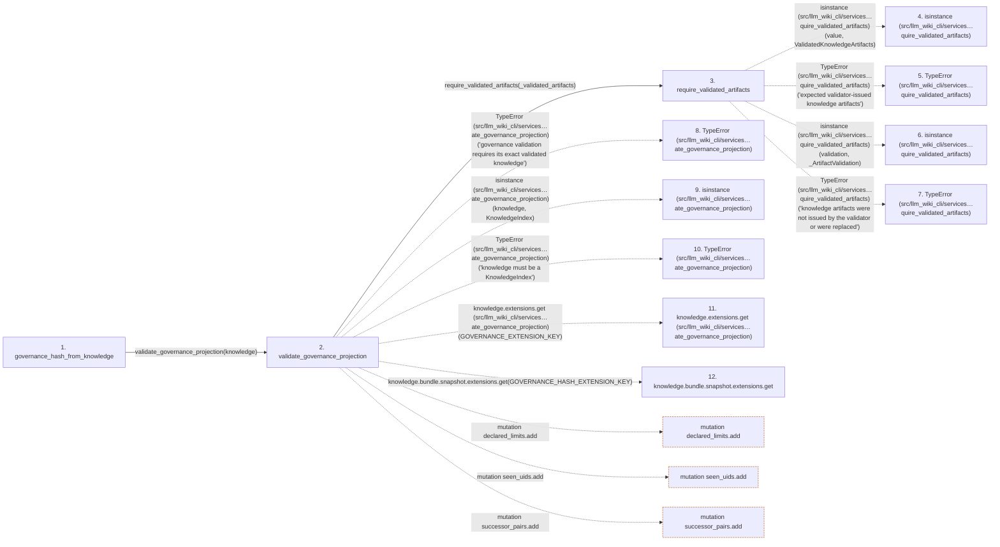

# governance_hash_from_knowledge

**Entry point:** `governance_hash_from_knowledge` (`api`)
**Source:** [knowledge_governance](../modules/knowledge_governance.md)
**Modules touched:** [concept_identity](../modules/concept_identity.md), [knowledge_artifacts](../modules/knowledge_artifacts.md), [knowledge_evidence](../modules/knowledge_evidence.md), and 6 more

**Complete modules touched:**

- [concept_identity](../modules/concept_identity.md)
- [knowledge_artifacts](../modules/knowledge_artifacts.md)
- [knowledge_evidence](../modules/knowledge_evidence.md)
- [knowledge_governance](../modules/knowledge_governance.md)
- [knowledge_graph](../modules/knowledge_graph.md)
- [knowledge_model](../modules/knowledge_model.md)
- [validation](../modules/validation.md)
- [wiki_media](../modules/wiki_media.md)
- [wiki_surface](../modules/wiki_surface.md)

## Call sequence

> Static overview in presentation order, not runtime execution order. Arrows retain captured callers; representative internal continuations and boundary examples precede repeated helper detail.

```mermaid
sequenceDiagram
    participant p0 as governance_hash_from_knowledge
    participant p1 as validate_governance_projection
    participant p2 as _object (src/llm_wiki_cli/services/knowledge_governance.py)
    participant p3 as _exact_fields
    participant p4 as _bundle_id
    participant p5 as validate_governance_ledger
    participant p6 as _event_limit
    participant p7 as _validate_concept_summary
    participant p8 as _validate_supersession_projection
    participant p9 as _validate_governance_ledger_parity
    participant p10 as apply_governance_projection
    participant p11 as validate_bundle_id
    participant p12 as _governance_concept_summaries
    participant p13 as strip_governance_projection
    participant p14 as _supersession_records
    participant p15 as _array (src/llm_wiki_cli/services/knowledge_governance.py)
    participant p16 as _add_supersession_edges
    participant p17 as _supersession_edges
    participant p18 as _governance_supersession_edge_payloads
    participant p19 as _concept_uid
    participant p20 as _concept_kind
    participant p21 as _identity_value
    participant p22 as _identity_ownership_key
    participant p23 as _validate_bounded_events
    participant p24 as _validate_lifecycle_event_fields
    participant p25 as _validate_lifecycle_histories
    participant p26 as _validate_review_event_fields
    participant p27 as _machine_text
    participant p28 as validate_concept_uid
    participant p29 as isinstance (src/llm_wiki_cli/services…nance_hash_from_knowledge)
    participant p30 as knowledge.extensions.get (src/llm_wiki_cli/services…ate_governance_projection)
    p0->>p1: validate_governance_projection
    p1->>p2: _object (src/llm_wiki_cli/services/knowledge_governance.py)
    p1->>p3: _exact_fields
    p1->>p4: _bundle_id
    p1->>p5: validate_governance_ledger
    p1->>p6: _event_limit
    p1->>p7: _validate_concept_summary
    p1->>p8: _validate_supersession_projection
    p1->>p9: _validate_governance_ledger_parity
    p1->>p10: apply_governance_projection
    p4->>p11: validate_bundle_id
    p9->>p12: _governance_concept_summaries
    p10->>p13: strip_governance_projection
    p9->>p14: _supersession_records
    p7->>p15: _array (src/llm_wiki_cli/services/knowledge_governance.py)
    p10->>p16: _add_supersession_edges
    p9->>p17: _supersession_edges
    p9->>p18: _governance_supersession_edge_payloads
    p5->>p19: _concept_uid
    p5->>p20: _concept_kind
    p5->>p21: _identity_value
    p5->>p22: _identity_ownership_key
    p7->>p23: _validate_bounded_events
    p5->>p24: _validate_lifecycle_event_fields
    p5->>p25: _validate_lifecycle_histories
    p5->>p26: _validate_review_event_fields
    p11->>p27: _machine_text
    p19->>p28: validate_concept_uid
    p0-->>p29: isinstance (src/llm_wiki_cli/services…nance_hash_from_knowledge)(value, str)
    p1-->>p30: knowledge.extensions.get (src/llm_wiki_cli/services…ate_governance_projection)(GOVERNANCE_EXTENSION_KEY)
```

<!-- Auto-generated from static call edges. Dashed arrows are external or unresolved calls. Reviewed runtime conditions and side effects belong in Behavior. -->

> Call sequence diagram shows 30 of 1084 interactions; 1054 omitted to keep the visualization within the 30-interaction and generated-diagram limits, with uncertain identities omitted rather than inferred.

> Captured boundary calls: external 1 of 325 (324 omitted); unresolved 1 of 276 (275 omitted). These counts cover the captured static trace.

Omitted captured detail, grouped by actual caller occurrence and target module:

| Caller | Parent step | Target module | Kind | Omitted interactions |
| --- | --- | --- | --- | --- |
| `src/llm_wiki_cli/services/knowledge_governance.py:validate_governance_projection` | 2 | [src/llm_wiki_cli/services/knowledge_artifacts.py](../modules/knowledge_artifacts.md) | internal | 1 |
| `src/llm_wiki_cli/services/knowledge_artifacts.py:require_validated_artifacts` | 3 | - | external | 4 |
| `src/llm_wiki_cli/services/knowledge_governance.py:validate_governance_projection` | 2 | - | external | 16 |
| `src/llm_wiki_cli/services/knowledge_governance.py:validate_governance_projection` | 2 | - | unresolved | 12 |
| `src/llm_wiki_cli/services/knowledge_governance.py:validate_governance_projection` | 2 | [src/llm_wiki_cli/services/knowledge_governance.py](../modules/knowledge_governance.md) | internal | 20 |
| `src/llm_wiki_cli/services/knowledge_governance.py:_object` | 16 | [src/llm_wiki_cli/services/validation.py](../modules/validation.md) | internal | 1 |
| `src/llm_wiki_cli/services/validation.py:require_mapping` | 17 | - | external | 2 |
| `src/llm_wiki_cli/services/validation.py:require_mapping` | 17 | - | unresolved | 1 |
> Omission summary shows 8 of 230 groups; 222 further groups are not expanded here. Counts above include all omitted interactions.
> Detailed flow queries retain their own coverage and limits; omitted paths may execute at runtime.

> Trace truncated at the depth limit; deeper calls are omitted.

## Data flow

<!-- Auto-generated static analysis. Treat values and boundaries as best-effort hints, not runtime proof. -->

### Analysis coverage

**Effect analysis partially available.** Flow assembly and source effect analysis are separate; empty observations do not prove an empty handler body.

Source steps: 484; effect analysis evaluated: 306, partial: 7, unavailable: 171. Counts include steps omitted from the displayed trace.

Collector observations for 313 source steps with known totals: observed: 1541, emitted: 1504, omitted: 37. Unavailable totals are excluded.

- Callable record unavailable for one or more source steps; those steps have no represented callable body.
- Effect collector omitted observations before flow assembly; displayed effects are partial.
- Effect collector totals unavailable; observed counts cover captured records only.

| Step | Callable record | Effect analysis | Collector totals | Observed | Emitted | Omitted |
|---|---|---|---|---:|---:|---:|
| `governance_hash_from_knowledge` | `available` | `evaluated` | `available` | `3` | `3` | `0` |
| `validate_governance_projection` | `available` | `partial` | `available` | `23` | `17` | `6` |
| `require_validated_artifacts` | `available` | `evaluated` | `available` | `4` | `4` | `0` |
| `isinstance (src/llm_wiki_cli/services…quire_validated_artifacts)` | `not_applicable` | `not_applicable` | `not_applicable` | — | — | — |
| `TypeError (src/llm_wiki_cli/services…quire_validated_artifacts)` | `not_applicable` | `not_applicable` | `not_applicable` | — | — | — |
| `isinstance (src/llm_wiki_cli/services…quire_validated_artifacts)` | `not_applicable` | `not_applicable` | `not_applicable` | — | — | — |
| `TypeError (src/llm_wiki_cli/services…quire_validated_artifacts)` | `not_applicable` | `not_applicable` | `not_applicable` | — | — | — |
| `TypeError (src/llm_wiki_cli/services…ate_governance_projection)` | `not_applicable` | `not_applicable` | `not_applicable` | — | — | — |
| `isinstance (src/llm_wiki_cli/services…ate_governance_projection)` | `not_applicable` | `not_applicable` | `not_applicable` | — | — | — |
| `TypeError (src/llm_wiki_cli/services…ate_governance_projection)` | `not_applicable` | `not_applicable` | `not_applicable` | — | — | — |
| `knowledge.extensions.get (src/llm_wiki_cli/services…ate_governance_projection)` | `not_applicable` | `not_applicable` | `not_applicable` | — | — | — |
| `knowledge.bundle.snapshot.extensions.get` | `not_applicable` | `not_applicable` | `not_applicable` | — | — | — |

### Step data

| Step | Inputs | Reads | Writes | Returns |
|---|---|---|---|---|
| `governance_hash_from_knowledge` | `knowledge: KnowledgeIndex` | - | - | `None`, `value` |
| `validate_governance_projection` | `knowledge: KnowledgeIndex`, `ledger: GovernanceLedger \| None`, `event_limit: int \| None`, `_validated_artifacts: object \| None` | `KnowledgeIndex`, `GOVERNANCE_EXTENSION_KEY`, `GOVERNANCE_HASH_EXTENSION_KEY`, `GOVERNANCE_EXTENSION_KEY`, `GOVERNANCE_SCHEMA_VERSION`, `GOVERNANCE_SCHEMA_VERSION`, `GOVERNANCE_HASH_EXTENSION_KEY`, `GOVERNANCE_EXTENSION_KEY` | - | `None`, `projection` |
| `require_validated_artifacts` | `value: object` | `ValidatedKnowledgeArtifacts`, `_ArtifactValidation` | - | `value` |
| `isinstance (src/llm_wiki_cli/services…quire_validated_artifacts)` | - | - | - | - |
| `TypeError (src/llm_wiki_cli/services…quire_validated_artifacts)` | - | - | - | - |
| `isinstance (src/llm_wiki_cli/services…quire_validated_artifacts)` | - | - | - | - |
| `TypeError (src/llm_wiki_cli/services…quire_validated_artifacts)` | - | - | - | - |
| `TypeError (src/llm_wiki_cli/services…ate_governance_projection)` | - | - | - | - |
| `isinstance (src/llm_wiki_cli/services…ate_governance_projection)` | - | - | - | - |
| `TypeError (src/llm_wiki_cli/services…ate_governance_projection)` | - | - | - | - |
| `knowledge.extensions.get (src/llm_wiki_cli/services…ate_governance_projection)` | - | - | - | - |
| `knowledge.bundle.snapshot.extensions.get` | - | - | - | - |

### Call data

| From | To | Line | Call |
|---|---|---:|---|
| governance_hash_from_knowledge | validate_governance_projection | 2110 | `validate_governance_projection(knowledge)` |
| validate_governance_projection | require_validated_artifacts | 1872 | `require_validated_artifacts(_validated_artifacts)` |
| require_validated_artifacts | isinstance (src/llm_wiki_cli/services…quire_validated_artifacts) | 177 | `isinstance(value, ValidatedKnowledgeArtifacts)` |
| require_validated_artifacts | TypeError (src/llm_wiki_cli/services…quire_validated_artifacts) | 178 | `TypeError('expected validator-issued knowledge artifacts')` |
| require_validated_artifacts | isinstance (src/llm_wiki_cli/services…quire_validated_artifacts) | 181 | `isinstance(validation, _ArtifactValidation)` |
| require_validated_artifacts | TypeError (src/llm_wiki_cli/services…quire_validated_artifacts) | 195 | `TypeError('knowledge artifacts were not issued by the validator or were replaced')` |
| validate_governance_projection | TypeError (src/llm_wiki_cli/services…ate_governance_projection) | 1874 | `TypeError('governance validation requires its exact validated knowledge')` |
| validate_governance_projection | isinstance (src/llm_wiki_cli/services…ate_governance_projection) | 1876 | `isinstance(knowledge, KnowledgeIndex)` |
| validate_governance_projection | TypeError (src/llm_wiki_cli/services…ate_governance_projection) | 1877 | `TypeError('knowledge must be a KnowledgeIndex')` |
| validate_governance_projection | knowledge.extensions.get (src/llm_wiki_cli/services…ate_governance_projection) | 1878 | `knowledge.extensions.get(GOVERNANCE_EXTENSION_KEY)` |
| validate_governance_projection | knowledge.bundle.snapshot.extensions.get | 1879 | `knowledge.bundle.snapshot.extensions.get(GOVERNANCE_HASH_EXTENSION_KEY)` |

### Boundary effects

| Kind | Target | Step | Line |
|---|---|---|---:|
| mutation | `declared_limits.add` | `validate_governance_projection` | 1981 |
| mutation | `seen_uids.add` | `validate_governance_projection` | 1988 |
| mutation | `successor_pairs.add` | `validate_governance_projection` | 2003 |

### Static analysis gaps

| Kind | Step | Target | Line |
|---|---|---|---:|
| external_call | `require_validated_artifacts` | `isinstance` | 177 |
| external_call | `require_validated_artifacts` | `TypeError` | 178 |
| external_call | `require_validated_artifacts` | `isinstance` | 181 |
| external_call | `require_validated_artifacts` | `TypeError` | 195 |
| external_call | `validate_governance_projection` | `TypeError` | 1874 |
| external_call | `validate_governance_projection` | `isinstance` | 1876 |
| external_call | `validate_governance_projection` | `TypeError` | 1877 |
| unresolved_call | `validate_governance_projection` | `knowledge.extensions.get` | 1878 |
| unresolved_call | `validate_governance_projection` | `knowledge.bundle.snapshot.extensions.get` | 1879 |
| step_limit | `governance_hash_from_knowledge` | `first 12 steps` | 0 |
| truncated_flow | `governance_hash_from_knowledge` | `depth limit` | 0 |

## Behavior

This flow starts at `governance_hash_from_knowledge` and is classified as `api`. The generated call and data-flow sections are bounded static projections; runtime conditions and side effects require source-level confirmation.
