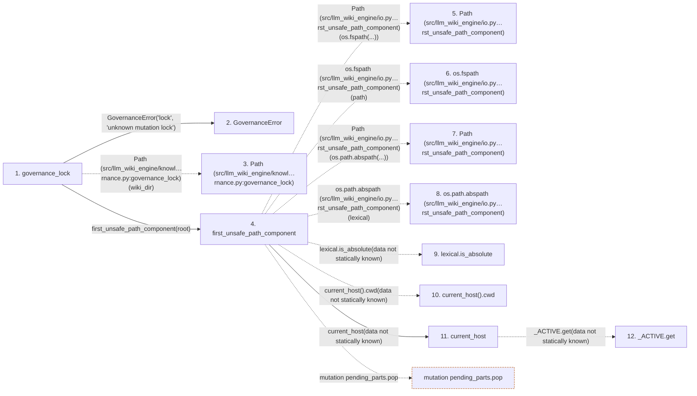

# governance_lock

**Entry point:** `governance_lock` (`api`)
**Source:** [knowledge_governance](../modules/knowledge_governance.md)
**Modules touched:** [host](../modules/host.md), [io](../modules/io.md), [knowledge_governance](../modules/knowledge_governance.md)

## Call sequence

> Static overview in presentation order, not runtime execution order. Arrows retain captured callers; representative internal continuations and boundary examples precede repeated helper detail.

```mermaid
sequenceDiagram
    participant p0 as governance_lock
    participant p1 as first_unsafe_path_component
    participant p2 as _governance_lock_root
    participant p3 as GovernanceError
    participant p4 as _lock_open_diagnostic
    participant p5 as GovernanceConflictError
    participant p6 as repository_metadata
    participant p7 as _git_file_metadata
    participant p8 as _read_plain_text_file
    participant p9 as _is_plain_directory
    participant p10 as current_host
    participant p11 as _is_reparse_point
    participant p12 as RepositoryMetadata
    participant p13 as _single_line
    participant p14 as _same_filesystem_entry
    participant p15 as _git_config_worktree
    participant p16 as Path (src/llm_wiki_engine/knowl…rnance.py:governance_lock)
    participant p17 as lock_root.mkdir
    participant p18 as getattr (src/llm_wiki_engine/knowl…rnance.py:governance_lock)
    participant p19 as os.open (src/llm_wiki_engine/knowl…rnance.py:governance_lock)
    participant p20 as os.fstat (src/llm_wiki_engine/knowl…rnance.py:governance_lock)
    participant p21 as stat.S_ISREG (src/llm_wiki_engine/knowl…rnance.py:governance_lock)
    participant p22 as os.write
    participant p23 as os.fsync
    participant p24 as os.fdopen
    participant p25 as os.close (src/llm_wiki_engine/knowl…rnance.py:governance_lock)
    participant p26 as descriptor.seek
    participant p27 as msvcrt.locking
    participant p28 as descriptor.fileno
    participant p29 as fcntl.flock
    p0->>p1: first_unsafe_path_component
    p0->>p2: _governance_lock_root
    p0->>p3: GovernanceError
    p0->>p4: _lock_open_diagnostic
    p0->>p5: GovernanceConflictError
    p2->>p6: repository_metadata
    p6->>p7: _git_file_metadata
    p7->>p8: _read_plain_text_file
    p7->>p9: _is_plain_directory
    p1->>p10: current_host
    p6->>p11: _is_reparse_point
    p6->>p12: RepositoryMetadata
    p7->>p13: _single_line
    p7->>p14: _same_filesystem_entry
    p7->>p15: _git_config_worktree
    p0-->>p16: Path (src/llm_wiki_engine/knowl…rnance.py:governance_lock)(wiki_dir)
    p0-->>p17: lock_root.mkdir(parents=True, exist_ok=True)
    p0-->>p18: getattr (src/llm_wiki_engine/knowl…rnance.py:governance_lock)(os, 'O_CLOEXEC', 0)
    p0-->>p18: getattr (src/llm_wiki_engine/knowl…rnance.py:governance_lock)(os, 'O_NOFOLLOW', 0)
    p0-->>p19: os.open (src/llm_wiki_engine/knowl…rnance.py:governance_lock)(lock_path, flags, 384)
    p0-->>p20: os.fstat (src/llm_wiki_engine/knowl…rnance.py:governance_lock)(file_descriptor)
    p0-->>p21: stat.S_ISREG (src/llm_wiki_engine/knowl…rnance.py:governance_lock)(metadata.st_mode)
    p0-->>p22: os.write(file_descriptor, b'\x00')
    p0-->>p23: os.fsync(file_descriptor)
    p0-->>p24: os.fdopen(file_descriptor, 'r+', encoding='utf-8')
    p0-->>p25: os.close (src/llm_wiki_engine/knowl…rnance.py:governance_lock)(file_descriptor)
    p0-->>p26: descriptor.seek(0)
    p0-->>p27: msvcrt.locking(descriptor.fileno(...), msvcrt.LK_NBLCK, 1)
    p0-->>p28: descriptor.fileno
    p0-->>p29: fcntl.flock(descriptor, ...)
```

<!-- Auto-generated from static call edges. Dashed arrows are external or unresolved calls. Reviewed runtime conditions and side effects belong in Behavior. -->

> Call sequence diagram shows 30 of 149 interactions; 119 omitted to keep the visualization within the 30-interaction and generated-diagram limits, with uncertain identities omitted rather than inferred.

> Captured boundary calls: external 12 of 78 (66 omitted); unresolved 3 of 34 (31 omitted). These counts cover the captured static trace.

Omitted captured detail, grouped by actual caller occurrence and target module:

| Caller | Parent step | Target module | Kind | Omitted interactions |
| --- | --- | --- | --- | --- |
| `src/llm_wiki_engine/io.py:first_unsafe_path_component` | 4 | - | external | 19 |
| `src/llm_wiki_engine/io.py:first_unsafe_path_component` | 4 | - | unresolved | 6 |
| `src/llm_wiki_engine/host.py:current_host` | 11 | - | unresolved | 1 |
| `src/llm_wiki_engine/knowledge_governance.py:governance_lock` | 1 | [src/llm_wiki_engine/knowledge_governance.py](../modules/knowledge_governance.md) | internal | 4 |
| `src/llm_wiki_engine/knowledge_governance.py:repository_metadata` | 34 | - | unresolved | 2 |
| `src/llm_wiki_engine/knowledge_governance.py:repository_metadata` | 34 | - | external | 3 |
| `src/llm_wiki_engine/knowledge_governance.py:_is_reparse_point` | 38 | - | external | 4 |
| `src/llm_wiki_engine/knowledge_governance.py:repository_metadata` | 34 | [src/llm_wiki_engine/knowledge_governance.py](../modules/knowledge_governance.md) | internal | 3 |
> Omission summary shows 8 of 28 groups; 20 further groups are not expanded here. Counts above include all omitted interactions.
> Detailed flow queries retain their own coverage and limits; omitted paths may execute at runtime.

## Data flow

<!-- Auto-generated static analysis. Treat values and boundaries as best-effort hints, not runtime proof. -->

### Analysis coverage

**Effect analysis partially available.** Flow assembly and source effect analysis are separate; empty observations do not prove an empty handler body.

Source steps: 38; effect analysis evaluated: 25, partial: 1, unavailable: 12. Counts include steps omitted from the displayed trace.

Collector observations for 26 source steps with known totals: observed: 191, emitted: 190, omitted: 1. Unavailable totals are excluded.

- Callable record unavailable for one or more source steps; those steps have no represented callable body.
- Effect collector omitted observations before flow assembly; displayed effects are partial.
- Effect collector totals unavailable; observed counts cover captured records only.

| Step | Callable record | Effect analysis | Collector totals | Observed | Emitted | Omitted |
|---|---|---|---|---:|---:|---:|
| `governance_lock` | `available` | `partial` | `available` | `11` | `10` | `1` |
| `GovernanceError` | `unavailable` | `unavailable` | `unavailable` | — | — | — |
| `Path (src/llm_wiki_engine/knowl…rnance.py:governance_lock)` | `not_applicable` | `not_applicable` | `not_applicable` | — | — | — |
| `first_unsafe_path_component` | `available` | `evaluated` | `available` | `14` | `14` | `0` |
| `Path (src/llm_wiki_engine/io.py…rst_unsafe_path_component)` | `not_applicable` | `not_applicable` | `not_applicable` | — | — | — |
| `os.fspath (src/llm_wiki_engine/io.py…rst_unsafe_path_component)` | `not_applicable` | `not_applicable` | `not_applicable` | — | — | — |
| `Path (src/llm_wiki_engine/io.py…rst_unsafe_path_component)` | `not_applicable` | `not_applicable` | `not_applicable` | — | — | — |
| `os.path.abspath (src/llm_wiki_engine/io.py…rst_unsafe_path_component)` | `not_applicable` | `not_applicable` | `not_applicable` | — | — | — |
| `lexical.is_absolute` | `not_applicable` | `not_applicable` | `not_applicable` | — | — | — |
| `current_host().cwd` | `not_applicable` | `not_applicable` | `not_applicable` | — | — | — |
| `current_host` | `available` | `evaluated` | `available` | `2` | `2` | `0` |
| `_ACTIVE.get` | `not_applicable` | `not_applicable` | `not_applicable` | — | — | — |

### Step data

| Step | Inputs | Reads | Writes | Returns |
|---|---|---|---|---|
| `governance_lock` | `wiki_dir: str \| Path`, `_lock_filename: str` | `GOVERNANCE_LOCK_FILENAME`, `DEFAULT_LAYOUT`, `os`, `os`, `os`, `sys`, `sys`, `GOVERNANCE_FILENAME` | - | - |
| `GovernanceError` | - | - | - | - |
| `Path (src/llm_wiki_engine/knowl…rnance.py:governance_lock)` | - | - | - | - |
| `first_unsafe_path_component` | `path: str \| Path`, `trusted_symlink_uids: Set[int] \| None`, `trusted_symlink_owner: Callable[[Path], bool] \| None` | `stat`, `os` | - | `lexical`, `None`, `current`, `current`, `current`, `current`, `current`, `None` |
| `Path (src/llm_wiki_engine/io.py…rst_unsafe_path_component)` | - | - | - | - |
| `os.fspath (src/llm_wiki_engine/io.py…rst_unsafe_path_component)` | - | - | - | - |
| `Path (src/llm_wiki_engine/io.py…rst_unsafe_path_component)` | - | - | - | - |
| `os.path.abspath (src/llm_wiki_engine/io.py…rst_unsafe_path_component)` | - | - | - | - |
| `lexical.is_absolute` | - | - | - | - |
| `current_host().cwd` | - | - | - | - |
| `current_host` | - | `_DEFAULT` | - | `...` |
| `_ACTIVE.get` | - | - | - | - |

### Call data

| From | To | Line | Call |
|---|---|---:|---|
| governance_lock | GovernanceError | 885 | `GovernanceError('lock', 'unknown mutation lock')` |
| governance_lock | Path (src/llm_wiki_engine/knowl…rnance.py:governance_lock) | 886 | `Path(wiki_dir)` |
| governance_lock | first_unsafe_path_component | 887 | `first_unsafe_path_component(root)` |
| first_unsafe_path_component | Path (src/llm_wiki_engine/io.py…rst_unsafe_path_component) | 52 | `Path(os.fspath(...))` |
| first_unsafe_path_component | os.fspath (src/llm_wiki_engine/io.py…rst_unsafe_path_component) | 52 | `os.fspath(path)` |
| first_unsafe_path_component | Path (src/llm_wiki_engine/io.py…rst_unsafe_path_component) | 60 | `Path(os.path.abspath(...))` |
| first_unsafe_path_component | os.path.abspath (src/llm_wiki_engine/io.py…rst_unsafe_path_component) | 60 | `os.path.abspath(lexical)` |
| first_unsafe_path_component | lexical.is_absolute | 61 | `lexical.is_absolute(data not statically known)` |
| first_unsafe_path_component | current_host().cwd | 67 | `current_host().cwd(data not statically known)` |
| first_unsafe_path_component | current_host | 67 | `current_host(data not statically known)` |
| current_host | _ACTIVE.get | 167 | `_ACTIVE.get(data not statically known)` |

### Boundary effects

| Kind | Target | Step | Line |
|---|---|---|---:|
| mutation | `pending_parts.pop` | `first_unsafe_path_component` | 72 |

### Static analysis gaps

| Kind | Step | Target | Line |
|---|---|---|---:|
| external_call | `first_unsafe_path_component` | `os.fspath` | 52 |
| external_call | `first_unsafe_path_component` | `os.path.abspath` | 60 |
| unresolved_call | `first_unsafe_path_component` | `lexical.is_absolute` | 61 |
| unresolved_call | `first_unsafe_path_component` | `current_host().cwd` | 67 |
| unresolved_call | `current_host` | `_ACTIVE.get` | 167 |
| step_limit | `governance_lock` | `first 12 steps` | 0 |

## Behavior

The mutation body runs only after a safe regular-file lock has been acquired.
Symbolic-link, reparse-point and hardlink refusals remain separate from competing
owner conflicts. A failed open raises the existing governance error and retains
its original filesystem exception; it does not retry or choose another lock.

The open-failure message identifies `lock-open-failed`, the resolved native lock
path, errno and any Windows error number, and the bounded cause. JSON quoting
preserves filesystem spelling and escapes control characters. The cause is
limited to 256 characters and discloses truncation. CLI text and JSON error routes
retain failure status; read-only storage diagnostics acquire no mutation lock.
