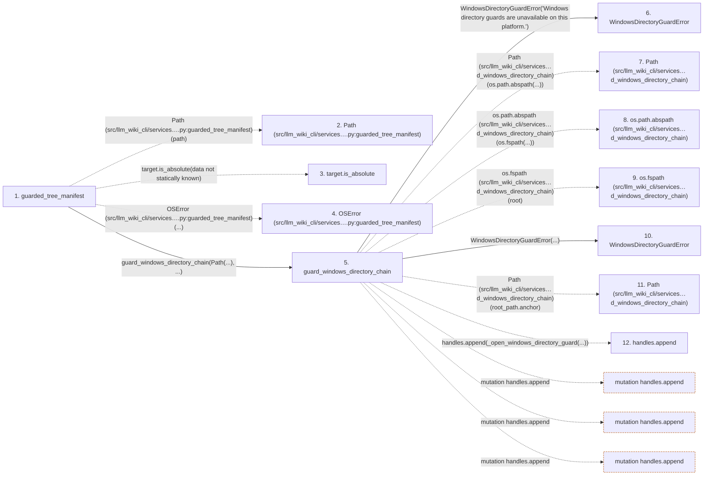

# guarded_tree_manifest

**Entry point:** `guarded_tree_manifest` (`api`)
**Source:** [filesystem_guard](../modules/filesystem_guard.md)
**Modules touched:** [filesystem_guard](../modules/filesystem_guard.md)

## Call sequence

> Static overview in presentation order, not runtime execution order. Arrows retain captured callers; siblings are shown before deeper helper detail.

```mermaid
sequenceDiagram
    participant p0 as guarded_tree_manifest
    participant p1 as Path (src/llm_wiki_cli/services….py:guarded_tree_manifest)
    participant p2 as target.is_absolute
    participant p3 as OSError (src/llm_wiki_cli/services….py:guarded_tree_manifest)
    participant p4 as guard_windows_directory_chain
    participant p5 as _guarded_tree_manifest_windows_path
    participant p6 as getattr (src/llm_wiki_cli/services….py:guarded_tree_manifest)
    participant p7 as os.open (src/llm_wiki_cli/services….py:guarded_tree_manifest)
    participant p8 as os.close (src/llm_wiki_cli/services….py:guarded_tree_manifest)
    participant p9 as _guarded_tree_manifest_posix_fd
    participant p10 as WindowsDirectoryGuardError
    participant p11 as os.walk
    participant p12 as getattr (src/llm_wiki_cli/services…ed_tree_manifest_posix_fd)
    participant p13 as Path (src/llm_wiki_cli/services…d_windows_directory_chain)
    participant p14 as directory_names.sort
    participant p15 as os.path.abspath (src/llm_wiki_cli/services…d_windows_directory_chain)
    participant p16 as file_names.sort
    participant p17 as OSError (src/llm_wiki_cli/services…ed_tree_manifest_posix_fd)
    participant p18 as os.fspath (src/llm_wiki_cli/services…d_windows_directory_chain)
    participant p19 as Path (src/llm_wiki_cli/services…ree_manifest_windows_path)
    participant p20 as candidate.relative_to(…).as_posix
    participant p21 as sorted
    p0-->>p1: Path (src/llm_wiki_cli/services….py:guarded_tree_manifest)(path)
    p0-->>p2: target.is_absolute
    p0-->>p3: OSError (src/llm_wiki_cli/services….py:guarded_tree_manifest)(...)
    p0->>p4: guard_windows_directory_chain
    p0-->>p1: Path (src/llm_wiki_cli/services….py:guarded_tree_manifest)(target.anchor)
    p0->>p5: _guarded_tree_manifest_windows_path
    p0-->>p6: getattr (src/llm_wiki_cli/services….py:guarded_tree_manifest)(os, 'O_NOFOLLOW', None)
    p0-->>p6: getattr (src/llm_wiki_cli/services….py:guarded_tree_manifest)(os, 'O_DIRECTORY', None)
    p0-->>p3: OSError (src/llm_wiki_cli/services….py:guarded_tree_manifest)('This POSIX platform cannot inventory guarded trees.')
    p0-->>p6: getattr (src/llm_wiki_cli/services….py:guarded_tree_manifest)(os, 'O_CLOEXEC', 0)
    p0-->>p7: os.open (src/llm_wiki_cli/services….py:guarded_tree_manifest)(target.anchor, flags)
    p0-->>p7: os.open (src/llm_wiki_cli/services….py:guarded_tree_manifest)(component, flags, dir_fd=descriptor)
    p0-->>p8: os.close (src/llm_wiki_cli/services….py:guarded_tree_manifest)(descriptor)
    p0->>p9: _guarded_tree_manifest_posix_fd
    p0-->>p8: os.close (src/llm_wiki_cli/services….py:guarded_tree_manifest)(descriptor)
    p4->>p10: WindowsDirectoryGuardError
    p5-->>p11: os.walk(root, topdown=True, followlinks=False)
    p9-->>p12: getattr (src/llm_wiki_cli/services…ed_tree_manifest_posix_fd)(os, 'O_NOFOLLOW', None)
    p4-->>p13: Path (src/llm_wiki_cli/services…d_windows_directory_chain)(os.path.abspath(...))
    p5-->>p14: directory_names.sort
    p9-->>p12: getattr (src/llm_wiki_cli/services…ed_tree_manifest_posix_fd)(os, 'O_DIRECTORY', None)
    p4-->>p15: os.path.abspath (src/llm_wiki_cli/services…d_windows_directory_chain)(os.fspath(...))
    p5-->>p16: file_names.sort
    p9-->>p17: OSError (src/llm_wiki_cli/services…ed_tree_manifest_posix_fd)('This POSIX platform cannot inventory guarded trees.')
    p4-->>p18: os.fspath (src/llm_wiki_cli/services…d_windows_directory_chain)(root)
    p5-->>p19: Path (src/llm_wiki_cli/services…ree_manifest_windows_path)(current_root)
    p9-->>p12: getattr (src/llm_wiki_cli/services…ed_tree_manifest_posix_fd)(os, 'O_CLOEXEC', 0)
    p4->>p10: WindowsDirectoryGuardError
    p5-->>p20: candidate.relative_to(…).as_posix
    p9-->>p21: sorted(os.listdir(...))
```

<!-- Auto-generated from static call edges. Dashed arrows are external or unresolved calls. Reviewed runtime conditions and side effects belong in Behavior. -->

> Call sequence diagram shows 30 of 335 interactions; 305 omitted to keep the visualization within the 30-interaction and generated-diagram limits, with uncertain identities omitted rather than inferred.

> Captured boundary calls: external 21 of 202 (181 omitted); unresolved 4 of 47 (43 omitted). These counts cover the captured static trace.

Omitted captured detail, grouped by actual caller occurrence and target module:

| Caller | Parent step | Target module | Kind | Omitted interactions |
| --- | --- | --- | --- | --- |
| `src/llm_wiki_cli/services/filesystem_guard.py:guard_windows_directory_chain` | 5 | - | external | 6 |
| `src/llm_wiki_cli/services/filesystem_guard.py:guard_windows_directory_chain` | 5 | - | unresolved | 4 |
| `src/llm_wiki_cli/services/filesystem_guard.py:guard_windows_directory_chain` | 5 | [src/llm_wiki_cli/services/filesystem_guard.py](../modules/filesystem_guard.md) | internal | 7 |
| `src/llm_wiki_cli/services/filesystem_guard.py:_open_windows_directory_guard` | 13 | - | external | 14 |
| `src/llm_wiki_cli/services/filesystem_guard.py:_open_windows_directory_guard` | 13 | - | unresolved | 3 |
| `src/llm_wiki_cli/services/filesystem_guard.py:_open_windows_directory_guard` | 13 | [src/llm_wiki_cli/services/filesystem_guard.py](../modules/filesystem_guard.md) | internal | 9 |
| `src/llm_wiki_cli/services/filesystem_guard.py:_windows_api_path` | 16 | - | external | 2 |
| `src/llm_wiki_cli/services/filesystem_guard.py:_windows_api_path` | 16 | - | unresolved | 2 |
> Omission summary shows 8 of 49 groups; 41 further groups are not expanded here. Counts above include all omitted interactions.
> Detailed flow queries retain their own coverage and limits; omitted paths may execute at runtime.

## Data flow

<!-- Auto-generated static analysis. Treat values and boundaries as best-effort hints, not runtime proof. -->

### Step data

| Step | Inputs | Reads | Writes | Returns |
|---|---|---|---|---|
| `guarded_tree_manifest` | `path: Path` | `os`, `os`, `os`, `os` | - | `_guarded_tree_manifest_windows_path(...)`, `_guarded_tree_manifest_posix_fd(...)` |
| `Path (src/llm_wiki_cli/services….py:guarded_tree_manifest)` | - | - | - | - |
| `target.is_absolute` | - | - | - | - |
| `OSError (src/llm_wiki_cli/services….py:guarded_tree_manifest)` | - | - | - | - |
| `guard_windows_directory_chain` | `root: Path`, `relative_components: Sequence[str]`, `create_missing: bool`, `require_restrictive_dacl: bool` | `os`, `WindowsDurabilityError` | - | - |
| `WindowsDirectoryGuardError` | - | - | - | - |
| `Path (src/llm_wiki_cli/services…d_windows_directory_chain)` | - | - | - | - |
| `os.path.abspath (src/llm_wiki_cli/services…d_windows_directory_chain)` | - | - | - | - |
| `os.fspath (src/llm_wiki_cli/services…d_windows_directory_chain)` | - | - | - | - |
| `WindowsDirectoryGuardError` | - | - | - | - |
| `Path (src/llm_wiki_cli/services…d_windows_directory_chain)` | - | - | - | - |
| `handles.append` | - | - | - | - |

### Call data

| From | To | Line | Call |
|---|---|---:|---|
| guarded_tree_manifest | Path (src/llm_wiki_cli/services….py:guarded_tree_manifest) | 1521 | `Path(path)` |
| guarded_tree_manifest | target.is_absolute | 1522 | `target.is_absolute(data not statically known)` |
| guarded_tree_manifest | OSError (src/llm_wiki_cli/services….py:guarded_tree_manifest) | 1523 | `OSError(...)` |
| guarded_tree_manifest | guard_windows_directory_chain | 1525 | `guard_windows_directory_chain(Path(...), ...)` |
| guard_windows_directory_chain | WindowsDirectoryGuardError | 170 | `WindowsDirectoryGuardError('Windows directory guards are unavailable on this platform.')` |
| guard_windows_directory_chain | Path (src/llm_wiki_cli/services…d_windows_directory_chain) | 174 | `Path(os.path.abspath(...))` |
| guard_windows_directory_chain | os.path.abspath (src/llm_wiki_cli/services…d_windows_directory_chain) | 174 | `os.path.abspath(os.fspath(...))` |
| guard_windows_directory_chain | os.fspath (src/llm_wiki_cli/services…d_windows_directory_chain) | 174 | `os.fspath(root)` |
| guard_windows_directory_chain | WindowsDirectoryGuardError | 176 | `WindowsDirectoryGuardError(...)` |
| guard_windows_directory_chain | Path (src/llm_wiki_cli/services…d_windows_directory_chain) | 179 | `Path(root_path.anchor)` |
| guard_windows_directory_chain | handles.append | 182 | `handles.append(_open_windows_directory_guard(...))` |

### Boundary effects

| Kind | Target | Step | Line |
|---|---|---|---:|
| mutation | `handles.append` | `guard_windows_directory_chain` | 182 |
| mutation | `handles.append` | `guard_windows_directory_chain` | 189 |
| mutation | `handles.append` | `guard_windows_directory_chain` | 216 |

### Static analysis gaps

| Kind | Step | Target | Line |
|---|---|---|---:|
| unresolved_call | `guarded_tree_manifest` | `target.is_absolute` | 1522 |
| external_call | `guarded_tree_manifest` | `OSError` | 1523 |
| external_call | `guard_windows_directory_chain` | `os.path.abspath` | 174 |
| external_call | `guard_windows_directory_chain` | `os.fspath` | 174 |
| step_limit | `guarded_tree_manifest` | `first 12 steps` | 0 |

## Behavior

This flow starts at `guarded_tree_manifest` and is classified as `api`. The generated call and data-flow sections are bounded static projections; runtime conditions and side effects require source-level confirmation.
