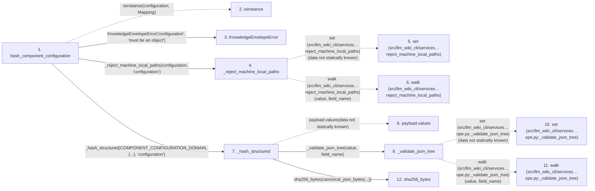

# hash_component_configuration

**Entry point:** `hash_component_configuration` (`api`)
**Source:** [knowledge_envelope](../modules/knowledge_envelope.md)
**Modules touched:** [knowledge_envelope](../modules/knowledge_envelope.md), [knowledge_evidence](../modules/knowledge_evidence.md)

## Call sequence

> Static overview in presentation order, not runtime execution order. Arrows retain captured callers; representative internal continuations and boundary examples precede repeated helper detail.

```mermaid
sequenceDiagram
    participant p0 as hash_component_configuration
    participant p1 as isinstance
    participant p2 as KnowledgeEnvelopeError
    participant p3 as _reject_machine_local_paths
    participant p4 as _hash_structured
    participant p5 as set (src/llm_wiki_cli/services…reject_machine_local_paths)
    participant p6 as payload.values
    participant p7 as walk (src/llm_wiki_cli/services…reject_machine_local_paths)
    participant p8 as _validate_json_tree
    participant p9 as sha256_bytes
    participant p10 as canonical_json_bytes
    participant p11 as set (src/llm_wiki_cli/services…ope.py:_validate_json_tree)
    participant p12 as hashlib.sha256(…).hexdigest
    participant p13 as canonical_json_text(…).encode
    participant p14 as walk (src/llm_wiki_cli/services…ope.py:_validate_json_tree)
    participant p15 as hashlib.sha256
    participant p16 as canonical_json_text
    participant p17 as json.dumps
    p0-->>p1: isinstance(configuration, Mapping)
    p0->>p2: KnowledgeEnvelopeError
    p0->>p3: _reject_machine_local_paths
    p0->>p4: _hash_structured
    p3-->>p5: set (src/llm_wiki_cli/services…reject_machine_local_paths)
    p4-->>p6: payload.values
    p3-->>p7: walk (src/llm_wiki_cli/services…reject_machine_local_paths)(value, field_name)
    p4->>p8: _validate_json_tree
    p4->>p9: sha256_bytes
    p4->>p10: canonical_json_bytes
    p4->>p2: KnowledgeEnvelopeError
    p8-->>p11: set (src/llm_wiki_cli/services…ope.py:_validate_json_tree)
    p9-->>p12: hashlib.sha256(…).hexdigest
    p10-->>p13: canonical_json_text(…).encode('utf-8')
    p8-->>p14: walk (src/llm_wiki_cli/services…ope.py:_validate_json_tree)(value, field_name)
    p9-->>p15: hashlib.sha256(value)
    p10->>p16: canonical_json_text
    p16-->>p17: json.dumps(value, ensure_ascii=False, separators=(...), sort_keys=True, allow_nan=False)
```

<!-- Auto-generated from static call edges. Dashed arrows are external or unresolved calls. Reviewed runtime conditions and side effects belong in Behavior. -->

> Call sequence diagram shows 18 of 18 interactions; 0 omitted to keep the visualization within the 30-interaction and generated-diagram limits, with uncertain identities omitted rather than inferred.

> Captured boundary calls: external 5 of 5 (0 omitted); unresolved 5 of 5 (0 omitted). These counts cover the captured static trace.
> Detailed flow queries retain their own coverage and limits; omitted paths may execute at runtime.

## Data flow

<!-- Auto-generated static analysis. Treat values and boundaries as best-effort hints, not runtime proof. -->

### Analysis coverage

**Effect analysis partially available.** Flow assembly and source effect analysis are separate; empty observations do not prove an empty handler body.

Source steps: 9; effect analysis evaluated: 7, partial: 0, unavailable: 2. Counts include steps omitted from the displayed trace.

Collector observations for 7 source steps with known totals: observed: 19, emitted: 19, omitted: 0. Unavailable totals are excluded.

- Callable record unavailable for one or more source steps; those steps have no represented callable body.
- Effect collector totals unavailable; observed counts cover captured records only.

| Step | Callable record | Effect analysis | Collector totals | Observed | Emitted | Omitted |
|---|---|---|---|---:|---:|---:|
| `hash_component_configuration` | `available` | `evaluated` | `available` | `4` | `4` | `0` |
| `isinstance` | `not_applicable` | `not_applicable` | `not_applicable` | — | — | — |
| `KnowledgeEnvelopeError` | `unavailable` | `unavailable` | `unavailable` | — | — | — |
| `_reject_machine_local_paths` | `available` | `evaluated` | `available` | `2` | `2` | `0` |
| `set (src/llm_wiki_cli/services…reject_machine_local_paths)` | `not_applicable` | `not_applicable` | `not_applicable` | — | — | — |
| `walk (src/llm_wiki_cli/services…reject_machine_local_paths)` | `not_applicable` | `not_applicable` | `not_applicable` | — | — | — |
| `_hash_structured` | `available` | `evaluated` | `available` | `5` | `5` | `0` |
| `payload.values` | `not_applicable` | `not_applicable` | `not_applicable` | — | — | — |
| `_validate_json_tree` | `available` | `evaluated` | `available` | `2` | `2` | `0` |
| `set (src/llm_wiki_cli/services…ope.py:_validate_json_tree)` | `not_applicable` | `not_applicable` | `not_applicable` | — | — | — |
| `walk (src/llm_wiki_cli/services…ope.py:_validate_json_tree)` | `not_applicable` | `not_applicable` | `not_applicable` | — | — | — |
| `sha256_bytes` | `available` | `evaluated` | `available` | `2` | `2` | `0` |

### Step data

| Step | Inputs | Reads | Writes | Returns |
|---|---|---|---|---|
| `hash_component_configuration` | `configuration: Mapping[str, Any]` | `Mapping`, `COMPONENT_CONFIGURATION_DOMAIN` | - | `_hash_structured(...)` |
| `isinstance` | - | - | - | - |
| `KnowledgeEnvelopeError` | - | - | - | - |
| `_reject_machine_local_paths` | `value: object`, `field_name: str` | - | - | - |
| `set (src/llm_wiki_cli/services…reject_machine_local_paths)` | - | - | - | - |
| `walk (src/llm_wiki_cli/services…reject_machine_local_paths)` | - | - | - | - |
| `_hash_structured` | `domain: str`, `payload: Mapping[str, Any]`, `field_name: str` | `KnowledgeEnvelopeError` | - | `sha256_bytes(...)` |
| `payload.values` | - | - | - | - |
| `_validate_json_tree` | `value: object`, `field_name: str` | - | - | - |
| `set (src/llm_wiki_cli/services…ope.py:_validate_json_tree)` | - | - | - | - |
| `walk (src/llm_wiki_cli/services…ope.py:_validate_json_tree)` | - | - | - | - |
| `sha256_bytes` | `value: bytes` | - | - | `...` |

### Call data

| From | To | Line | Call |
|---|---|---:|---|
| hash_component_configuration | isinstance | 859 | `isinstance(configuration, Mapping)` |
| hash_component_configuration | KnowledgeEnvelopeError | 860 | `KnowledgeEnvelopeError('configuration', 'must be an object')` |
| hash_component_configuration | _reject_machine_local_paths | 861 | `_reject_machine_local_paths(configuration, 'configuration')` |
| _reject_machine_local_paths | set (src/llm_wiki_cli/services…reject_machine_local_paths) | 1717 | `set(data not statically known)` |
| _reject_machine_local_paths | walk (src/llm_wiki_cli/services…reject_machine_local_paths) | 1761 | `walk(value, field_name)` |
| hash_component_configuration | _hash_structured | 862 | `_hash_structured(COMPONENT_CONFIGURATION_DOMAIN, {...}, 'configuration')` |
| _hash_structured | payload.values | 1608 | `payload.values(data not statically known)` |
| _hash_structured | _validate_json_tree | 1609 | `_validate_json_tree(value, field_name)` |
| _validate_json_tree | set (src/llm_wiki_cli/services…ope.py:_validate_json_tree) | 1630 | `set(data not statically known)` |
| _validate_json_tree | walk (src/llm_wiki_cli/services…ope.py:_validate_json_tree) | 1671 | `walk(value, field_name)` |
| _hash_structured | sha256_bytes | 1610 | `sha256_bytes(canonical_json_bytes(...))` |

### Boundary effects

*No boundary-effect observations were captured in this static trace.*

### Static analysis gaps

| Kind | Step | Target | Line |
|---|---|---|---:|
| external_call | `hash_component_configuration` | `isinstance` | 859 |
| unresolved_call | `_reject_machine_local_paths` | `walk` | 1761 |
| unresolved_call | `_hash_structured` | `payload.values` | 1608 |
| unresolved_call | `_validate_json_tree` | `walk` | 1671 |
| step_limit | `hash_component_configuration` | `first 12 steps` | 0 |

## Behavior

This flow starts at `hash_component_configuration` and is classified as `api`. The generated call and data-flow sections are bounded static projections; runtime conditions and side effects require source-level confirmation.
