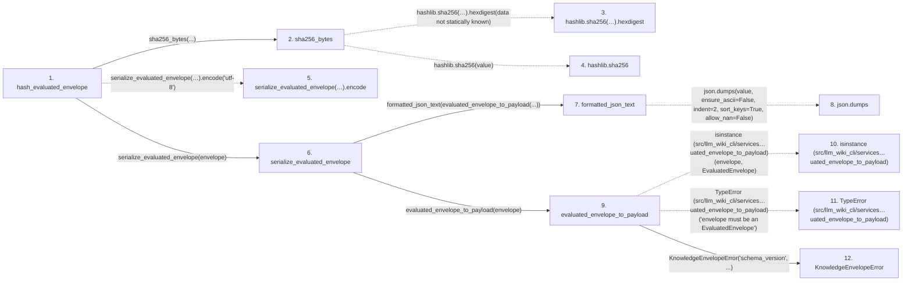

# hash_evaluated_envelope

**Entry point:** `hash_evaluated_envelope` (`api`)
**Source:** [knowledge_envelope](../modules/knowledge_envelope.md)
**Modules touched:** [implementation_evidence](../modules/implementation_evidence.md), [knowledge_envelope](../modules/knowledge_envelope.md), [knowledge_evidence](../modules/knowledge_evidence.md), and 3 more

**Complete modules touched:**

- [implementation_evidence](../modules/implementation_evidence.md)
- [knowledge_envelope](../modules/knowledge_envelope.md)
- [knowledge_evidence](../modules/knowledge_evidence.md)
- [knowledge_governance](../modules/knowledge_governance.md)
- [knowledge_model](../modules/knowledge_model.md)
- [maintenance_projection](../modules/maintenance_projection.md)

## Call sequence

> Static overview in presentation order, not runtime execution order. Arrows retain captured callers; representative internal continuations and boundary examples precede repeated helper detail.

```mermaid
sequenceDiagram
    participant p0 as hash_evaluated_envelope
    participant p1 as serialize_evaluated_envelope
    participant p2 as sha256_bytes
    participant p3 as evaluated_envelope_to_payload
    participant p4 as _validated_bundle_payload
    participant p5 as knowledge_index_to_payload
    participant p6 as _emit_extensions
    participant p7 as _bundle_to_payload
    participant p8 as _concept_to_payload
    participant p9 as _relationship_to_payload
    participant p10 as parse_knowledge_index
    participant p11 as _knowledge_index_to_payload_unchecked
    participant p12 as formatted_json_text
    participant p13 as KnowledgeEnvelopeError
    participant p14 as is_valid_sha256
    participant p15 as KnowledgeIndex
    participant p16 as KnowledgeModelError
    participant p17 as _wire_enum
    participant p18 as _record
    participant p19 as _parse_extensions
    participant p20 as _string
    participant p21 as _basis_to_payload
    participant p22 as _relationship_target_to_payload
    participant p23 as _parse_bundle
    participant p24 as _component_to_payload
    participant p25 as _relationship_evidence_to_payload
    participant p26 as _array
    participant p27 as _actor_to_payload
    participant p28 as _parse_concept
    participant p29 as hashlib.sha256
    participant p30 as serialize_evaluated_envelope(…).encode
    p0->>p1: serialize_evaluated_envelope
    p0->>p2: sha256_bytes
    p1->>p3: evaluated_envelope_to_payload
    p3->>p4: _validated_bundle_payload
    p4->>p5: knowledge_index_to_payload
    p5->>p6: _emit_extensions
    p5->>p7: _bundle_to_payload
    p5->>p8: _concept_to_payload
    p5->>p9: _relationship_to_payload
    p5->>p10: parse_knowledge_index
    p5->>p11: _knowledge_index_to_payload_unchecked
    p1->>p12: formatted_json_text
    p1->>p13: KnowledgeEnvelopeError
    p3->>p14: is_valid_sha256
    p4->>p15: KnowledgeIndex
    p5->>p16: KnowledgeModelError
    p8->>p17: _wire_enum
    p10->>p18: _record
    p6->>p19: _parse_extensions
    p10->>p20: _string
    p8->>p21: _basis_to_payload
    p9->>p22: _relationship_target_to_payload
    p10->>p23: _parse_bundle
    p7->>p24: _component_to_payload
    p9->>p25: _relationship_evidence_to_payload
    p10->>p26: _array
    p8->>p27: _actor_to_payload
    p10->>p28: _parse_concept
    p2-->>p29: hashlib.sha256(value)
    p0-->>p30: serialize_evaluated_envelope(…).encode('utf-8')
```

<!-- Auto-generated from static call edges. Dashed arrows are external or unresolved calls. Reviewed runtime conditions and side effects belong in Behavior. -->

> Call sequence diagram shows 30 of 103 interactions; 73 omitted to keep the visualization within the 30-interaction and generated-diagram limits, with uncertain identities omitted rather than inferred.

> Captured boundary calls: external 1 of 29 (28 omitted); unresolved 1 of 6 (5 omitted). These counts cover the captured static trace.

Omitted captured detail, grouped by actual caller occurrence and target module:

| Caller | Parent step | Target module | Kind | Omitted interactions |
| --- | --- | --- | --- | --- |
| `src/llm_wiki_cli/services/knowledge_evidence.py:sha256_bytes` | 2 | - | unresolved | 1 |
| `src/llm_wiki_cli/services/knowledge_evidence.py:formatted_json_text` | 7 | - | external | 1 |
| `src/llm_wiki_cli/services/knowledge_envelope.py:evaluated_envelope_to_payload` | 9 | - | external | 2 |
| `src/llm_wiki_cli/services/knowledge_envelope.py:evaluated_envelope_to_payload` | 9 | [src/llm_wiki_cli/services/knowledge_envelope.py](../modules/knowledge_envelope.md) | internal | 2 |
| `src/llm_wiki_cli/services/knowledge_envelope.py:_validated_bundle_payload` | 13 | - | external | 3 |
| `src/llm_wiki_cli/services/knowledge_envelope.py:_validated_bundle_payload` | 13 | - | unresolved | 1 |
| `src/llm_wiki_cli/services/knowledge_model.py:knowledge_index_to_payload` | 18 | - | external | 2 |
| `src/llm_wiki_cli/services/knowledge_model.py:_emit_extensions` | 21 | - | external | 1 |
> Omission summary shows 8 of 22 groups; 14 further groups are not expanded here. Counts above include all omitted interactions.
> Detailed flow queries retain their own coverage and limits; omitted paths may execute at runtime.

> Trace truncated at the depth limit; deeper calls are omitted.

## Data flow

<!-- Auto-generated static analysis. Treat values and boundaries as best-effort hints, not runtime proof. -->

### Analysis coverage

**Effect analysis partially available.** Flow assembly and source effect analysis are separate; empty observations do not prove an empty handler body.

Source steps: 69; effect analysis evaluated: 57, partial: 1, unavailable: 11. Counts include steps omitted from the displayed trace.

Collector observations for 58 source steps with known totals: observed: 260, emitted: 254, omitted: 6. Unavailable totals are excluded.

- Callable record unavailable for one or more source steps; those steps have no represented callable body.
- Effect collector omitted observations before flow assembly; displayed effects are partial.
- Effect collector totals unavailable; observed counts cover captured records only.

| Step | Callable record | Effect analysis | Collector totals | Observed | Emitted | Omitted |
|---|---|---|---|---:|---:|---:|
| `hash_evaluated_envelope` | `available` | `evaluated` | `available` | `2` | `2` | `0` |
| `sha256_bytes` | `available` | `evaluated` | `available` | `2` | `2` | `0` |
| `hashlib.sha256(…).hexdigest` | `not_applicable` | `not_applicable` | `not_applicable` | — | — | — |
| `hashlib.sha256` | `not_applicable` | `not_applicable` | `not_applicable` | — | — | — |
| `serialize_evaluated_envelope(…).encode` | `not_applicable` | `not_applicable` | `not_applicable` | — | — | — |
| `serialize_evaluated_envelope` | `available` | `evaluated` | `available` | `3` | `3` | `0` |
| `formatted_json_text` | `available` | `evaluated` | `available` | `2` | `2` | `0` |
| `json.dumps` | `not_applicable` | `not_applicable` | `not_applicable` | — | — | — |
| `evaluated_envelope_to_payload` | `available` | `evaluated` | `available` | `7` | `7` | `0` |
| `isinstance (src/llm_wiki_cli/services…uated_envelope_to_payload)` | `not_applicable` | `not_applicable` | `not_applicable` | — | — | — |
| `TypeError (src/llm_wiki_cli/services…uated_envelope_to_payload)` | `not_applicable` | `not_applicable` | `not_applicable` | — | — | — |
| `KnowledgeEnvelopeError` | `unavailable` | `unavailable` | `unavailable` | — | — | — |

### Step data

| Step | Inputs | Reads | Writes | Returns |
|---|---|---|---|---|
| `hash_evaluated_envelope` | `envelope: EvaluatedEnvelope` | - | - | `sha256_bytes(...)` |
| `sha256_bytes` | `value: bytes` | - | - | `...` |
| `hashlib.sha256(…).hexdigest` | - | - | - | - |
| `hashlib.sha256` | - | - | - | - |
| `serialize_evaluated_envelope(…).encode` | - | - | - | - |
| `serialize_evaluated_envelope` | `envelope: EvaluatedEnvelope` | `KnowledgeEnvelopeError` | - | `formatted_json_text(...)` |
| `formatted_json_text` | `value: Any` | - | - | `...` |
| `json.dumps` | - | - | - | - |
| `evaluated_envelope_to_payload` | `envelope: EvaluatedEnvelope` | `EvaluatedEnvelope`, `EVALUATED_ENVELOPE_VERSION`, `EVALUATED_ENVELOPE_VERSION`, `INVENTORY_HASH_EXTENSION`, `INVENTORY_HASH_EXTENSION` | - | `{...}` |
| `isinstance (src/llm_wiki_cli/services…uated_envelope_to_payload)` | - | - | - | - |
| `TypeError (src/llm_wiki_cli/services…uated_envelope_to_payload)` | - | - | - | - |
| `KnowledgeEnvelopeError` | - | - | - | - |

### Call data

| From | To | Line | Call |
|---|---|---:|---|
| hash_evaluated_envelope | sha256_bytes | 1180 | `sha256_bytes(...)` |
| sha256_bytes | hashlib.sha256(…).hexdigest | 221 | `hashlib.sha256(value).hexdigest(data not statically known)` |
| sha256_bytes | hashlib.sha256 | 221 | `hashlib.sha256(value)` |
| hash_evaluated_envelope | serialize_evaluated_envelope(…).encode | 1180 | `serialize_evaluated_envelope(envelope).encode('utf-8')` |
| hash_evaluated_envelope | serialize_evaluated_envelope | 1180 | `serialize_evaluated_envelope(envelope)` |
| serialize_evaluated_envelope | formatted_json_text | 1167 | `formatted_json_text(evaluated_envelope_to_payload(...))` |
| formatted_json_text | json.dumps | 201 | `json.dumps(value, ensure_ascii=False, indent=2, sort_keys=True, allow_nan=False)` |
| serialize_evaluated_envelope | evaluated_envelope_to_payload | 1167 | `evaluated_envelope_to_payload(envelope)` |
| evaluated_envelope_to_payload | isinstance (src/llm_wiki_cli/services…uated_envelope_to_payload) | 1141 | `isinstance(envelope, EvaluatedEnvelope)` |
| evaluated_envelope_to_payload | TypeError (src/llm_wiki_cli/services…uated_envelope_to_payload) | 1142 | `TypeError('envelope must be an EvaluatedEnvelope')` |
| evaluated_envelope_to_payload | KnowledgeEnvelopeError | 1144 | `KnowledgeEnvelopeError('schema_version', ...)` |

### Boundary effects

*No boundary-effect observations were captured in this static trace.*

### Static analysis gaps

| Kind | Step | Target | Line |
|---|---|---|---:|
| unresolved_call | `sha256_bytes` | `hashlib.sha256(value).hexdigest` | 221 |
| external_call | `sha256_bytes` | `hashlib.sha256` | 221 |
| unresolved_call | `hash_evaluated_envelope` | `serialize_evaluated_envelope(envelope).encode` | 1180 |
| external_call | `formatted_json_text` | `json.dumps` | 201 |
| external_call | `evaluated_envelope_to_payload` | `isinstance` | 1141 |
| external_call | `evaluated_envelope_to_payload` | `TypeError` | 1142 |
| step_limit | `hash_evaluated_envelope` | `first 12 steps` | 0 |
| truncated_flow | `hash_evaluated_envelope` | `depth limit` | 0 |

## Behavior

This flow starts at `hash_evaluated_envelope` and is classified as `api`. The generated call and data-flow sections are bounded static projections; runtime conditions and side effects require source-level confirmation.
