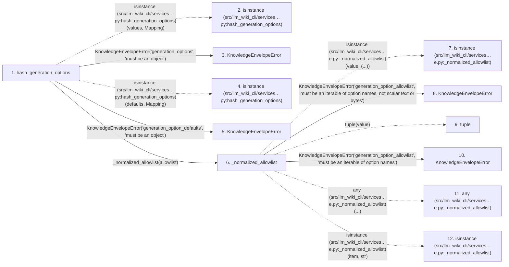

# hash_generation_options

**Entry point:** `hash_generation_options` (`api`)
**Source:** [knowledge_envelope](../modules/knowledge_envelope.md)
**Modules touched:** [knowledge_envelope](../modules/knowledge_envelope.md), [knowledge_evidence](../modules/knowledge_evidence.md)

## Call sequence

> Static overview in presentation order, not runtime execution order. Arrows retain captured callers; siblings are shown before deeper helper detail.

```mermaid
sequenceDiagram
    participant p0 as hash_generation_options
    participant p1 as isinstance (src/llm_wiki_cli/services…py:hash_generation_options)
    participant p2 as KnowledgeEnvelopeError
    participant p3 as _normalized_allowlist
    participant p4 as _reject_unknown_option_keys
    participant p5 as _reject_machine_local_paths
    participant p6 as _hash_structured
    participant p7 as isinstance (src/llm_wiki_cli/services…e.py:_normalized_allowlist)
    participant p8 as any (src/llm_wiki_cli/services…reject_unknown_option_keys)
    participant p9 as set (src/llm_wiki_cli/services…reject_machine_local_paths)
    participant p10 as payload.values
    participant p11 as isinstance (src/llm_wiki_cli/services…reject_unknown_option_keys)
    participant p12 as walk (src/llm_wiki_cli/services…reject_machine_local_paths)
    participant p13 as _validate_json_tree
    participant p14 as tuple
    participant p15 as sha256_bytes
    participant p16 as set (src/llm_wiki_cli/services…reject_unknown_option_keys)
    participant p17 as canonical_json_bytes
    participant p18 as any (src/llm_wiki_cli/services…e.py:_normalized_allowlist)
    participant p19 as min
    p0-->>p1: isinstance (src/llm_wiki_cli/services…py:hash_generation_options)(values, Mapping)
    p0->>p2: KnowledgeEnvelopeError
    p0-->>p1: isinstance (src/llm_wiki_cli/services…py:hash_generation_options)(defaults, Mapping)
    p0->>p2: KnowledgeEnvelopeError
    p0->>p3: _normalized_allowlist
    p0->>p4: _reject_unknown_option_keys
    p0->>p4: _reject_unknown_option_keys
    p0->>p2: KnowledgeEnvelopeError
    p0->>p5: _reject_machine_local_paths
    p0->>p6: _hash_structured
    p3-->>p7: isinstance (src/llm_wiki_cli/services…e.py:_normalized_allowlist)(value, (...))
    p4-->>p8: any (src/llm_wiki_cli/services…reject_unknown_option_keys)(...)
    p5-->>p9: set (src/llm_wiki_cli/services…reject_machine_local_paths)
    p6-->>p10: payload.values
    p3->>p2: KnowledgeEnvelopeError
    p4-->>p11: isinstance (src/llm_wiki_cli/services…reject_unknown_option_keys)(key, str)
    p5-->>p12: walk (src/llm_wiki_cli/services…reject_machine_local_paths)(value, field_name)
    p6->>p13: _validate_json_tree
    p3-->>p14: tuple(value)
    p4->>p2: KnowledgeEnvelopeError
    p6->>p15: sha256_bytes
    p3->>p2: KnowledgeEnvelopeError
    p4-->>p16: set (src/llm_wiki_cli/services…reject_unknown_option_keys)(value)
    p6->>p17: canonical_json_bytes
    p3-->>p18: any (src/llm_wiki_cli/services…e.py:_normalized_allowlist)(...)
    p4-->>p16: set (src/llm_wiki_cli/services…reject_unknown_option_keys)(allowlist)
    p6->>p2: KnowledgeEnvelopeError
    p3-->>p7: isinstance (src/llm_wiki_cli/services…e.py:_normalized_allowlist)(item, str)
    p4-->>p19: min(unknown)
    p3->>p2: KnowledgeEnvelopeError
```

<!-- Auto-generated from static call edges. Dashed arrows are external or unresolved calls. Reviewed runtime conditions and side effects belong in Behavior. -->

> Call sequence diagram shows 30 of 44 interactions; 14 omitted to keep the visualization within the 30-interaction and generated-diagram limits, with uncertain identities omitted rather than inferred.

> Captured boundary calls: external 12 of 20 (8 omitted); unresolved 2 of 5 (3 omitted). These counts cover the captured static trace.

Omitted captured detail, grouped by actual caller occurrence and target module:

| Caller | Parent step | Target module | Kind | Omitted interactions |
| --- | --- | --- | --- | --- |
| `src/llm_wiki_cli/services/knowledge_envelope.py:_normalized_allowlist` | 6 | - | external | 5 |
| `src/llm_wiki_cli/services/knowledge_envelope.py:_normalized_allowlist` | 6 | [src/llm_wiki_cli/services/knowledge_envelope.py](../modules/knowledge_envelope.md) | internal | 1 |
| `src/llm_wiki_cli/services/knowledge_envelope.py:_reject_unknown_option_keys` | 20 | [src/llm_wiki_cli/services/knowledge_envelope.py](../modules/knowledge_envelope.md) | internal | 1 |
| `src/llm_wiki_cli/services/knowledge_envelope.py:_validate_json_tree` | 35 | - | external | 1 |
| `src/llm_wiki_cli/services/knowledge_envelope.py:_validate_json_tree` | 35 | - | unresolved | 1 |
| `src/llm_wiki_cli/services/knowledge_evidence.py:sha256_bytes` | 38 | - | unresolved | 1 |
| `src/llm_wiki_cli/services/knowledge_evidence.py:sha256_bytes` | 38 | - | external | 1 |
| `src/llm_wiki_cli/services/knowledge_evidence.py:canonical_json_bytes` | 41 | - | unresolved | 1 |
> Omission summary shows 8 of 10 groups; 2 further groups are not expanded here. Counts above include all omitted interactions.
> Detailed flow queries retain their own coverage and limits; omitted paths may execute at runtime.

## Data flow

<!-- Auto-generated static analysis. Treat values and boundaries as best-effort hints, not runtime proof. -->

### Step data

| Step | Inputs | Reads | Writes | Returns |
|---|---|---|---|---|
| `hash_generation_options` | `values: Mapping[str, Any]`, `defaults: Mapping[str, Any]`, `allowlist: Iterable[str]` | `Mapping`, `Mapping`, `GENERATION_OPTIONS_DOMAIN` | `effective[...]`, `effective[...]` | `_hash_structured(...)` |
| `isinstance (src/llm_wiki_cli/services…py:hash_generation_options)` | - | - | - | - |
| `KnowledgeEnvelopeError` | - | - | - | - |
| `isinstance (src/llm_wiki_cli/services…py:hash_generation_options)` | - | - | - | - |
| `KnowledgeEnvelopeError` | - | - | - | - |
| `_normalized_allowlist` | `value: Iterable[str]` | - | - | `tuple(...)` |
| `isinstance (src/llm_wiki_cli/services…e.py:_normalized_allowlist)` | - | - | - | - |
| `KnowledgeEnvelopeError` | - | - | - | - |
| `tuple` | - | - | - | - |
| `KnowledgeEnvelopeError` | - | - | - | - |
| `any (src/llm_wiki_cli/services…e.py:_normalized_allowlist)` | - | - | - | - |
| `isinstance (src/llm_wiki_cli/services…e.py:_normalized_allowlist)` | - | - | - | - |

### Call data

| From | To | Line | Call |
|---|---|---:|---|
| hash_generation_options | isinstance (src/llm_wiki_cli/services…py:hash_generation_options) | 827 | `isinstance(values, Mapping)` |
| hash_generation_options | KnowledgeEnvelopeError | 828 | `KnowledgeEnvelopeError('generation_options', 'must be an object')` |
| hash_generation_options | isinstance (src/llm_wiki_cli/services…py:hash_generation_options) | 829 | `isinstance(defaults, Mapping)` |
| hash_generation_options | KnowledgeEnvelopeError | 830 | `KnowledgeEnvelopeError('generation_option_defaults', 'must be an object')` |
| hash_generation_options | _normalized_allowlist | 834 | `_normalized_allowlist(allowlist)` |
| _normalized_allowlist | isinstance (src/llm_wiki_cli/services…e.py:_normalized_allowlist) | 1675 | `isinstance(value, (...))` |
| _normalized_allowlist | KnowledgeEnvelopeError | 1676 | `KnowledgeEnvelopeError('generation_option_allowlist', 'must be an iterable of option names, not scalar text or bytes')` |
| _normalized_allowlist | tuple | 1681 | `tuple(value)` |
| _normalized_allowlist | KnowledgeEnvelopeError | 1683 | `KnowledgeEnvelopeError('generation_option_allowlist', 'must be an iterable of option names')` |
| _normalized_allowlist | any (src/llm_wiki_cli/services…e.py:_normalized_allowlist) | 1687 | `any(...)` |
| _normalized_allowlist | isinstance (src/llm_wiki_cli/services…e.py:_normalized_allowlist) | 1687 | `isinstance(item, str)` |

### Boundary effects

*No boundary effects detected.*

### Static analysis gaps

| Kind | Step | Target | Line |
|---|---|---|---:|
| external_call | `hash_generation_options` | `isinstance` | 827 |
| external_call | `hash_generation_options` | `isinstance` | 829 |
| external_call | `_normalized_allowlist` | `isinstance` | 1675 |
| external_call | `_normalized_allowlist` | `any` | 1687 |
| external_call | `_normalized_allowlist` | `isinstance` | 1687 |
| step_limit | `hash_generation_options` | `first 12 steps` | 0 |

## Behavior

This flow starts at `hash_generation_options` and is classified as `api`. The generated call and data-flow sections are bounded static projections; runtime conditions and side effects require source-level confirmation.
