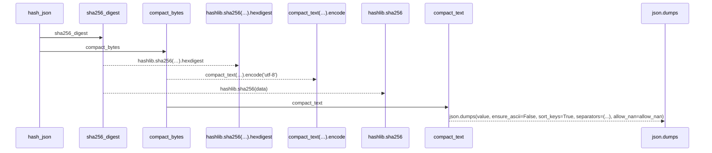
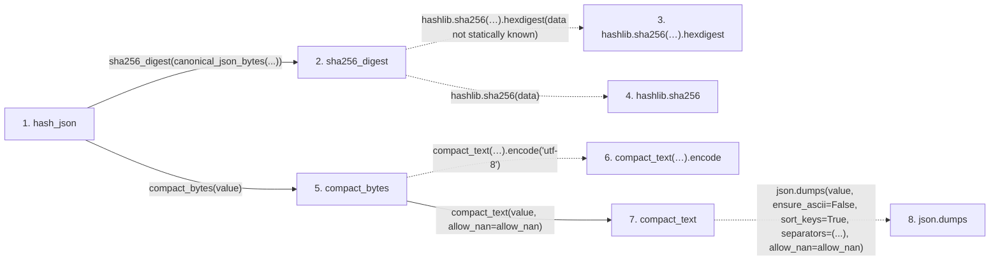

# hash_json

**Entry point:** `hash_json` (`api`)
**Source:** [knowledge_evidence](../modules/knowledge_evidence.md)
**Modules touched:** [canonical_json](../modules/canonical_json.md), [knowledge_evidence](../modules/knowledge_evidence.md)

## Call sequence

> Static overview in presentation order, not runtime execution order. Arrows retain captured callers; representative internal continuations and boundary examples precede repeated helper detail.

<!-- Auto-generated from static call edges. Dashed arrows are external or unresolved calls. Reviewed runtime conditions and side effects belong in Behavior. -->

> Call sequence diagram shows 7 of 7 interactions; 0 omitted to keep the visualization within the 30-interaction and generated-diagram limits, with uncertain identities omitted rather than inferred.

> Captured boundary calls: external 2 of 2 (0 omitted); unresolved 2 of 2 (0 omitted). These counts cover the captured static trace.
> Detailed flow queries retain their own coverage and limits; omitted paths may execute at runtime.

## Data flow

<!-- Auto-generated static analysis. Treat values and boundaries as best-effort hints, not runtime proof. -->

### Analysis coverage

**Effect analysis evaluated.** Flow assembly and source effect analysis are separate; empty observations do not prove an empty handler body.

Source steps: 4; effect analysis evaluated: 4, partial: 0, unavailable: 0. Counts include steps omitted from the displayed trace.

Collector observations for 4 source steps with known totals: observed: 10, emitted: 10, omitted: 0. Unavailable totals are excluded.

### Step data

| Step | Inputs | Reads | Writes | Returns |
|---|---|---|---|---|
| `hash_json` | `value: Any` | - | - | `sha256_bytes(...)` |
| `sha256_digest` | `data: bytes` | - | - | `...` |
| `hashlib.sha256(…).hexdigest` | - | - | - | - |
| `hashlib.sha256` | - | - | - | - |
| `compact_bytes` | `value: Any`, `allow_nan: bool` | - | - | `...` |
| `compact_text(…).encode` | - | - | - | - |
| `compact_text` | `value: Any`, `allow_nan: bool` | - | - | `json.dumps(...)` |
| `json.dumps` | - | - | - | - |

### Call data

| From | To | Line | Call |
|---|---|---:|---|
| hash_json | sha256_digest | 198 | `sha256_bytes(canonical_json_bytes(...))` |
| sha256_digest | hashlib.sha256(…).hexdigest | 56 | `hashlib.sha256(data).hexdigest(data not statically known)` |
| sha256_digest | hashlib.sha256 | 56 | `hashlib.sha256(data)` |
| hash_json | compact_bytes | 198 | `canonical_json_bytes(value)` |
| compact_bytes | compact_text(…).encode | 37 | `compact_text(value, allow_nan=allow_nan).encode('utf-8')` |
| compact_bytes | compact_text | 37 | `compact_text(value, allow_nan=allow_nan)` |
| compact_text | json.dumps | 32 | `json.dumps(value, ensure_ascii=False, sort_keys=True, separators=(...), allow_nan=allow_nan)` |

### Boundary effects

*No boundary-effect observations were captured in this static trace.*

### Static analysis gaps

| Kind | Step | Target | Line |
|---|---|---|---:|
| unresolved_call | `sha256_digest` | `hashlib.sha256(data).hexdigest` | 56 |
| external_call | `sha256_digest` | `hashlib.sha256` | 56 |
| unresolved_call | `compact_bytes` | `compact_text(value, allow_nan=allow_nan).encode` | 37 |
| external_call | `compact_text` | `json.dumps` | 32 |

## Behavior

This flow starts at `hash_json` and is classified as `api`. The generated call and data-flow sections are bounded static projections; runtime conditions and side effects require source-level confirmation.
