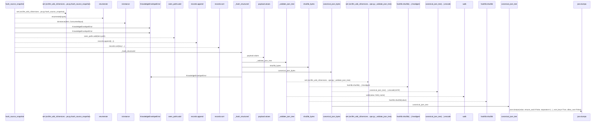
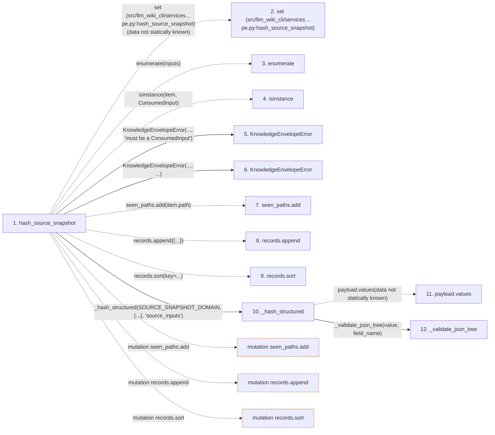

# hash_source_snapshot

**Entry point:** `hash_source_snapshot` (`api`)
**Source:** [knowledge_envelope](../modules/knowledge_envelope.md)
**Modules touched:** [knowledge_envelope](../modules/knowledge_envelope.md), [knowledge_evidence](../modules/knowledge_evidence.md)

## Call sequence

> Static overview in presentation order, not runtime execution order. Arrows retain captured callers; representative internal continuations and boundary examples precede repeated helper detail.

<!-- Auto-generated from static call edges. Dashed arrows are external or unresolved calls. Reviewed runtime conditions and side effects belong in Behavior. -->

> Call sequence diagram shows 21 of 21 interactions; 0 omitted to keep the visualization within the 30-interaction and generated-diagram limits, with uncertain identities omitted rather than inferred.

> Captured boundary calls: external 6 of 6 (0 omitted); unresolved 7 of 7 (0 omitted). These counts cover the captured static trace.
> Detailed flow queries retain their own coverage and limits; omitted paths may execute at runtime.

## Data flow

<!-- Auto-generated static analysis. Treat values and boundaries as best-effort hints, not runtime proof. -->

### Analysis coverage

**Effect analysis partially available.** Flow assembly and source effect analysis are separate; empty observations do not prove an empty handler body.

Source steps: 9; effect analysis evaluated: 6, partial: 0, unavailable: 3. Counts include steps omitted from the displayed trace.

Collector observations for 6 source steps with known totals: observed: 20, emitted: 20, omitted: 0. Unavailable totals are excluded.

- Callable record unavailable for one or more source steps; those steps have no represented callable body.
- Effect collector totals unavailable; observed counts cover captured records only.

| Step | Callable record | Effect analysis | Collector totals | Observed | Emitted | Omitted |
|---|---|---|---|---:|---:|---:|
| `hash_source_snapshot` | `available` | `evaluated` | `available` | `7` | `7` | `0` |
| `set (src/llm_wiki_cli/services…pe.py:hash_source_snapshot)` | `not_applicable` | `not_applicable` | `not_applicable` | — | — | — |
| `enumerate` | `not_applicable` | `not_applicable` | `not_applicable` | — | — | — |
| `isinstance` | `not_applicable` | `not_applicable` | `not_applicable` | — | — | — |
| `KnowledgeEnvelopeError` | `unavailable` | `unavailable` | `unavailable` | — | — | — |
| `KnowledgeEnvelopeError` | `unavailable` | `unavailable` | `unavailable` | — | — | — |
| `seen_paths.add` | `not_applicable` | `not_applicable` | `not_applicable` | — | — | — |
| `records.append` | `not_applicable` | `not_applicable` | `not_applicable` | — | — | — |
| `records.sort` | `not_applicable` | `not_applicable` | `not_applicable` | — | — | — |
| `_hash_structured` | `available` | `evaluated` | `available` | `5` | `5` | `0` |
| `payload.values` | `not_applicable` | `not_applicable` | `not_applicable` | — | — | — |
| `_validate_json_tree` | `available` | `evaluated` | `available` | `2` | `2` | `0` |

### Step data

| Step | Inputs | Reads | Writes | Returns |
|---|---|---|---|---|
| `hash_source_snapshot` | `inputs: Iterable[ConsumedInput]` | `ConsumedInput`, `SOURCE_SNAPSHOT_DOMAIN` | - | `_hash_structured(...)` |
| `set (src/llm_wiki_cli/services…pe.py:hash_source_snapshot)` | - | - | - | - |
| `enumerate` | - | - | - | - |
| `isinstance` | - | - | - | - |
| `KnowledgeEnvelopeError` | - | - | - | - |
| `KnowledgeEnvelopeError` | - | - | - | - |
| `seen_paths.add` | - | - | - | - |
| `records.append` | - | - | - | - |
| `records.sort` | - | - | - | - |
| `_hash_structured` | `domain: str`, `payload: Mapping[str, Any]`, `field_name: str` | `KnowledgeEnvelopeError` | - | `sha256_bytes(...)` |
| `payload.values` | - | - | - | - |
| `_validate_json_tree` | `value: object`, `field_name: str` | - | - | - |

### Call data

| From | To | Line | Call |
|---|---|---:|---|
| hash_source_snapshot | set (src/llm_wiki_cli/services…pe.py:hash_source_snapshot) | 734 | `set(data not statically known)` |
| hash_source_snapshot | enumerate | 735 | `enumerate(inputs)` |
| hash_source_snapshot | isinstance | 736 | `isinstance(item, ConsumedInput)` |
| hash_source_snapshot | KnowledgeEnvelopeError | 737 | `KnowledgeEnvelopeError(..., 'must be a ConsumedInput')` |
| hash_source_snapshot | KnowledgeEnvelopeError | 742 | `KnowledgeEnvelopeError(..., ...)` |
| hash_source_snapshot | seen_paths.add | 746 | `seen_paths.add(item.path)` |
| hash_source_snapshot | records.append | 747 | `records.append({...})` |
| hash_source_snapshot | records.sort | 754 | `records.sort(key=...)` |
| hash_source_snapshot | _hash_structured | 755 | `_hash_structured(SOURCE_SNAPSHOT_DOMAIN, {...}, 'source_inputs')` |
| _hash_structured | payload.values | 1608 | `payload.values(data not statically known)` |
| _hash_structured | _validate_json_tree | 1609 | `_validate_json_tree(value, field_name)` |

### Boundary effects

| Kind | Target | Step | Line |
|---|---|---|---:|
| mutation | `seen_paths.add` | `hash_source_snapshot` | 746 |
| mutation | `records.append` | `hash_source_snapshot` | 747 |
| mutation | `records.sort` | `hash_source_snapshot` | 754 |

### Static analysis gaps

| Kind | Step | Target | Line |
|---|---|---|---:|
| external_call | `hash_source_snapshot` | `enumerate` | 735 |
| external_call | `hash_source_snapshot` | `isinstance` | 736 |
| unresolved_call | `_hash_structured` | `payload.values` | 1608 |
| step_limit | `hash_source_snapshot` | `first 12 steps` | 0 |

## Behavior

This flow starts at `hash_source_snapshot` and is classified as `api`. The generated call and data-flow sections are bounded static projections; runtime conditions and side effects require source-level confirmation.
