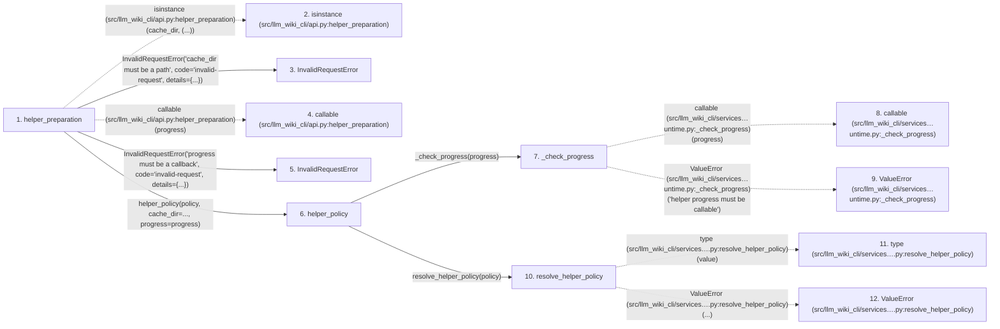

# helper_preparation

**Entry point:** `helper_preparation` (`api`)
**Source:** [api](../modules/api.md)
**Modules touched:** [api](../modules/api.md), [context_packet](../modules/context_packet.md), [helper_runtime](../modules/helper_runtime.md)

## Call sequence

> Static overview in presentation order, not runtime execution order. Arrows retain captured callers; representative internal continuations and boundary examples precede repeated helper detail.

```mermaid
sequenceDiagram
    participant p0 as helper_preparation
    participant p1 as helper_policy
    participant p2 as _raise_api_error
    participant p3 as InvalidRequestError
    participant p4 as _raise_required_knowledge_api_error
    participant p5 as _raise_context_packet_api_error
    participant p6 as _raise_maintenance_api_error
    participant p7 as _calibration_error_category
    participant p8 as _check_progress
    participant p9 as resolve_helper_policy
    participant p10 as HelperConfiguration
    participant p11 as _cache_value
    participant p12 as _is_maintenance_error
    participant p13 as _wiki_path_policy_details
    participant p14 as ArtifactIntegrityError
    participant p15 as WorkspaceStateError
    participant p16 as _caused_by
    participant p17 as _required_knowledge_failure
    participant p18 as _has_exception_origin
    participant p19 as describe_context_packet_error
    participant p20 as isinstance (src/llm_wiki_cli/api.py:helper_preparation)
    participant p21 as manager.__enter__
    participant p22 as callable (src/llm_wiki_cli/api.py:helper_preparation)
    participant p23 as str (src/llm_wiki_cli/api.py:helper_preparation)
    participant p24 as manager.__exit__
    participant p25 as isinstance (src/llm_wiki_cli/api.py:_raise_api_error)
    participant p26 as _CONFIGURATION.get
    participant p27 as _OPERATION.get
    participant p28 as ValueError (src/llm_wiki_cli/services…_runtime.py:helper_policy)
    participant p29 as str (src/llm_wiki_cli/api.py:_raise_api_error)
    p0->>p1: helper_policy
    p0->>p2: _raise_api_error
    p0->>p3: InvalidRequestError
    p2->>p4: _raise_required_knowledge_api_error
    p2->>p5: _raise_context_packet_api_error
    p2->>p6: _raise_maintenance_api_error
    p2->>p7: _calibration_error_category
    p1->>p8: _check_progress
    p1->>p9: resolve_helper_policy
    p1->>p10: HelperConfiguration
    p1->>p11: _cache_value
    p2->>p12: _is_maintenance_error
    p2->>p13: _wiki_path_policy_details
    p2->>p14: ArtifactIntegrityError
    p2->>p15: WorkspaceStateError
    p2->>p16: _caused_by
    p4->>p17: _required_knowledge_failure
    p7->>p18: _has_exception_origin
    p5->>p19: describe_context_packet_error
    p0-->>p20: isinstance (src/llm_wiki_cli/api.py:helper_preparation)(cache_dir, (...))
    p0-->>p21: manager.__enter__
    p0-->>p22: callable (src/llm_wiki_cli/api.py:helper_preparation)(progress)
    p0-->>p23: str (src/llm_wiki_cli/api.py:helper_preparation)(cache_dir)
    p0-->>p24: manager.__exit__(None, None, None)
    p2-->>p25: isinstance (src/llm_wiki_cli/api.py:_raise_api_error)(exc, context_packet_service.ContextPacketError)
    p1-->>p26: _CONFIGURATION.get
    p1-->>p27: _OPERATION.get
    p2-->>p25: isinstance (src/llm_wiki_cli/api.py:_raise_api_error)(exc, WorkflowRequestError)
    p1-->>p28: ValueError (src/llm_wiki_cli/services…_runtime.py:helper_policy)('a strict helper scope cannot enable automatic preparation')
    p2-->>p29: str (src/llm_wiki_cli/api.py:_raise_api_error)(exc)
```

<!-- Auto-generated from static call edges. Dashed arrows are external or unresolved calls. Reviewed runtime conditions and side effects belong in Behavior. -->

> Call sequence diagram shows 30 of 150 interactions; 120 omitted to keep the visualization within the 30-interaction and generated-diagram limits, with uncertain identities omitted rather than inferred.

> Captured boundary calls: external 7 of 95 (88 omitted); unresolved 4 of 18 (14 omitted). These counts cover the captured static trace.

Omitted captured detail, grouped by actual caller occurrence and target module:

| Caller | Parent step | Target module | Kind | Omitted interactions |
| --- | --- | --- | --- | --- |
| `src/llm_wiki_cli/api.py:helper_preparation` | 1 | [src/llm_wiki_cli/api.py](../modules/api.md) | internal | 1 |
| `src/llm_wiki_cli/services/helper_runtime.py:_check_progress` | 7 | - | external | 2 |
| `src/llm_wiki_cli/services/helper_runtime.py:resolve_helper_policy` | 10 | - | external | 6 |
| `src/llm_wiki_cli/services/helper_runtime.py:_cache_value` | 21 | - | external | 3 |
| `src/llm_wiki_cli/services/helper_runtime.py:helper_policy` | 6 | - | unresolved | 2 |
| `src/llm_wiki_cli/api.py:_required_knowledge_failure` | 31 | - | external | 10 |
| `src/llm_wiki_cli/api.py:_required_knowledge_failure` | 31 | - | unresolved | 2 |
| `src/llm_wiki_cli/api.py:_raise_required_knowledge_api_error` | 30 | [src/llm_wiki_cli/api.py](../modules/api.md) | internal | 1 |
> Omission summary shows 8 of 26 groups; 18 further groups are not expanded here. Counts above include all omitted interactions.
> Detailed flow queries retain their own coverage and limits; omitted paths may execute at runtime.

## Data flow

<!-- Auto-generated static analysis. Treat values and boundaries as best-effort hints, not runtime proof. -->

### Analysis coverage

**Effect analysis partially available.** Flow assembly and source effect analysis are separate; empty observations do not prove an empty handler body.

Source steps: 38; effect analysis evaluated: 17, partial: 1, unavailable: 20. Counts include steps omitted from the displayed trace.

Collector observations for 18 source steps with known totals: observed: 98, emitted: 82, omitted: 16. Unavailable totals are excluded.

- Callable record unavailable for one or more source steps; those steps have no represented callable body.
- Effect collector omitted observations before flow assembly; displayed effects are partial.
- Effect collector totals unavailable; observed counts cover captured records only.

| Step | Callable record | Effect analysis | Collector totals | Observed | Emitted | Omitted |
|---|---|---|---|---:|---:|---:|
| `helper_preparation` | `available` | `evaluated` | `available` | `4` | `4` | `0` |
| `isinstance (src/llm_wiki_cli/api.py:helper_preparation)` | `not_applicable` | `not_applicable` | `not_applicable` | — | — | — |
| `InvalidRequestError` | `unavailable` | `unavailable` | `unavailable` | — | — | — |
| `callable (src/llm_wiki_cli/api.py:helper_preparation)` | `not_applicable` | `not_applicable` | `not_applicable` | — | — | — |
| `InvalidRequestError` | `unavailable` | `unavailable` | `unavailable` | — | — | — |
| `helper_policy` | `available` | `evaluated` | `available` | `3` | `3` | `0` |
| `_check_progress` | `available` | `evaluated` | `available` | `1` | `1` | `0` |
| `callable (src/llm_wiki_cli/services…untime.py:_check_progress)` | `not_applicable` | `not_applicable` | `not_applicable` | — | — | — |
| `ValueError (src/llm_wiki_cli/services…untime.py:_check_progress)` | `not_applicable` | `not_applicable` | `not_applicable` | — | — | — |
| `resolve_helper_policy` | `available` | `evaluated` | `available` | `6` | `6` | `0` |
| `type (src/llm_wiki_cli/services….py:resolve_helper_policy)` | `not_applicable` | `not_applicable` | `not_applicable` | — | — | — |
| `ValueError (src/llm_wiki_cli/services….py:resolve_helper_policy)` | `not_applicable` | `not_applicable` | `not_applicable` | — | — | — |

### Step data

| Step | Inputs | Reads | Writes | Returns |
|---|---|---|---|---|
| `helper_preparation` | `policy: Literal['auto', 'never']`, `cache_dir: str \| Path \| None`, `progress: Callable[[str], None] \| None` | `Path` | - | - |
| `isinstance (src/llm_wiki_cli/api.py:helper_preparation)` | - | - | - | - |
| `InvalidRequestError` | - | - | - | - |
| `callable (src/llm_wiki_cli/api.py:helper_preparation)` | - | - | - | - |
| `InvalidRequestError` | - | - | - | - |
| `helper_policy` | `policy: str`, `cache_dir: str \| Path \| None`, `progress: HelperProgress \| None` | - | - | - |
| `_check_progress` | `progress: HelperProgress \| None` | - | - | - |
| `callable (src/llm_wiki_cli/services…untime.py:_check_progress)` | - | - | - | - |
| `ValueError (src/llm_wiki_cli/services…untime.py:_check_progress)` | - | - | - | - |
| `resolve_helper_policy` | `requested: str \| None`, `strict_read_only: bool`, `preview: bool`, `offline: bool` | `HelperPolicy` | - | `...` |
| `type (src/llm_wiki_cli/services….py:resolve_helper_policy)` | - | - | - | - |
| `ValueError (src/llm_wiki_cli/services….py:resolve_helper_policy)` | - | - | - | - |

### Call data

| From | To | Line | Call |
|---|---|---:|---|
| helper_preparation | isinstance (src/llm_wiki_cli/api.py:helper_preparation) | 793 | `isinstance(cache_dir, (...))` |
| helper_preparation | InvalidRequestError | 794 | `InvalidRequestError('cache_dir must be a path', code='invalid-request', details={...})` |
| helper_preparation | callable (src/llm_wiki_cli/api.py:helper_preparation) | 798 | `callable(progress)` |
| helper_preparation | InvalidRequestError | 799 | `InvalidRequestError('progress must be a callback', code='invalid-request', details={...})` |
| helper_preparation | helper_policy | 803 | `helper_policy(policy, cache_dir=..., progress=progress)` |
| helper_policy | _check_progress | 173 | `_check_progress(progress)` |
| _check_progress | callable (src/llm_wiki_cli/services…untime.py:_check_progress) | 161 | `callable(progress)` |
| _check_progress | ValueError (src/llm_wiki_cli/services…untime.py:_check_progress) | 162 | `ValueError('helper progress must be callable')` |
| helper_policy | resolve_helper_policy | 174 | `resolve_helper_policy(policy)` |
| resolve_helper_policy | type (src/llm_wiki_cli/services….py:resolve_helper_policy) | 40 | `type(value)` |
| resolve_helper_policy | ValueError (src/llm_wiki_cli/services….py:resolve_helper_policy) | 41 | `ValueError(...)` |

### Boundary effects

*No boundary-effect observations were captured in this static trace.*

### Static analysis gaps

| Kind | Step | Target | Line |
|---|---|---|---:|
| external_call | `helper_preparation` | `isinstance` | 793 |
| external_call | `helper_preparation` | `callable` | 798 |
| external_call | `_check_progress` | `callable` | 161 |
| external_call | `_check_progress` | `ValueError` | 162 |
| external_call | `resolve_helper_policy` | `type` | 40 |
| external_call | `resolve_helper_policy` | `ValueError` | 41 |
| step_limit | `helper_preparation` | `first 12 steps` | 0 |

## Behavior

This flow starts at `helper_preparation` and is classified as `api`. The generated call and data-flow sections are bounded static projections; runtime conditions and side effects require source-level confirmation.
