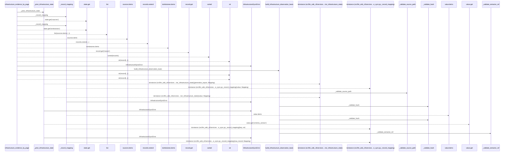
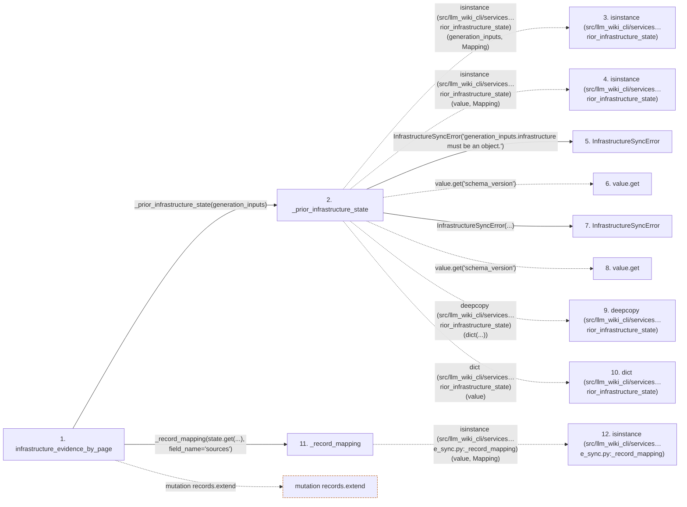

# infrastructure_evidence_by_page

**Entry point:** `infrastructure_evidence_by_page` (`api`)
**Source:** [infrastructure_sync](../modules/infrastructure_sync.md)
**Modules touched:** [infrastructure_sync](../modules/infrastructure_sync.md), [knowledge_evidence](../modules/knowledge_evidence.md), [validation](../modules/validation.md)

## Call sequence

> Static overview in presentation order, not runtime execution order. Arrows retain captured callers; siblings are shown before deeper helper detail.

<!-- Auto-generated from static call edges. Dashed arrows are external or unresolved calls. Reviewed runtime conditions and side effects belong in Behavior. -->

> Call sequence diagram shows 30 of 165 interactions; 135 omitted to keep the visualization within the 30-interaction and generated-diagram limits, with uncertain identities omitted rather than inferred.

> Captured boundary calls: external 10 of 55 (45 omitted); unresolved 8 of 47 (39 omitted). These counts cover the captured static trace.

Omitted captured detail, grouped by actual caller occurrence and target module:

| Caller | Parent step | Target module | Kind | Omitted interactions |
| --- | --- | --- | --- | --- |
| `src/llm_wiki_cli/services/infrastructure_sync.py:_prior_infrastructure_state` | 2 | - | unresolved | 1 |
| `src/llm_wiki_cli/services/infrastructure_sync.py:_prior_infrastructure_state` | 2 | - | external | 2 |
| `src/llm_wiki_cli/services/infrastructure_sync.py:_record_mapping` | 11 | [src/llm_wiki_cli/services/infrastructure_sync.py](../modules/infrastructure_sync.md) | internal | 16 |
| `src/llm_wiki_cli/services/infrastructure_sync.py:_valid_repository_path` | 18 | - | external | 1 |
| `src/llm_wiki_cli/services/infrastructure_sync.py:_valid_repository_path` | 18 | [src/llm_wiki_cli/services/validation.py](../modules/validation.md) | internal | 1 |
| `src/llm_wiki_cli/services/validation.py:is_portable_relative_path` | 20 | [src/llm_wiki_cli/services/validation.py](../modules/validation.md) | internal | 1 |
| `src/llm_wiki_cli/services/validation.py:require_portable_relative_path` | 21 | - | external | 4 |
| `src/llm_wiki_cli/services/validation.py:require_portable_relative_path` | 21 | [src/llm_wiki_cli/services/validation.py](../modules/validation.md) | internal | 13 |
> Omission summary shows 8 of 46 groups; 38 further groups are not expanded here. Counts above include all omitted interactions.
> Detailed flow queries retain their own coverage and limits; omitted paths may execute at runtime.

> Trace truncated at the depth limit; deeper calls are omitted.

## Data flow

<!-- Auto-generated static analysis. Treat values and boundaries as best-effort hints, not runtime proof. -->

### Step data

| Step | Inputs | Reads | Writes | Returns |
|---|---|---|---|---|
| `infrastructure_evidence_by_page` | `generation_inputs: Mapping[str, object] \| None` | `INFRASTRUCTURE_EXTRACTOR_REF` | `result[...]` | `{...}`, `result` |
| `_prior_infrastructure_state` | `generation_inputs: Mapping[str, object] \| None` | `Mapping`, `INFRASTRUCTURE_GENERATION_INPUT_KEY`, `INFRASTRUCTURE_GENERATION_INPUT_KEY`, `Mapping`, `INFRASTRUCTURE_SYNC_SCHEMA_VERSION` | - | `{...}`, `{...}`, `deepcopy(...)` |
| `isinstance (src/llm_wiki_cli/services…rior_infrastructure_state)` | - | - | - | - |
| `isinstance (src/llm_wiki_cli/services…rior_infrastructure_state)` | - | - | - | - |
| `InfrastructureSyncError` | - | - | - | - |
| `value.get` | - | - | - | - |
| `InfrastructureSyncError` | - | - | - | - |
| `value.get` | - | - | - | - |
| `deepcopy (src/llm_wiki_cli/services…rior_infrastructure_state)` | - | - | - | - |
| `dict (src/llm_wiki_cli/services…rior_infrastructure_state)` | - | - | - | - |
| `_record_mapping` | `value: object`, `field_name: str` | `Mapping`, `Mapping`, `Mapping`, `INFRASTRUCTURE_DISCOVERY_ROOT` | `result[...]` | `{...}`, `result` |
| `isinstance (src/llm_wiki_cli/services…e_sync.py:_record_mapping)` | - | - | - | - |

### Call data

| From | To | Line | Call |
|---|---|---:|---|
| infrastructure_evidence_by_page | _prior_infrastructure_state | 262 | `_prior_infrastructure_state(generation_inputs)` |
| _prior_infrastructure_state | isinstance (src/llm_wiki_cli/services…rior_infrastructure_state) | 107 | `isinstance(generation_inputs, Mapping)` |
| _prior_infrastructure_state | isinstance (src/llm_wiki_cli/services…rior_infrastructure_state) | 112 | `isinstance(value, Mapping)` |
| _prior_infrastructure_state | InfrastructureSyncError | 113 | `InfrastructureSyncError('generation_inputs.infrastructure must be an object.')` |
| _prior_infrastructure_state | value.get | 116 | `value.get('schema_version')` |
| _prior_infrastructure_state | InfrastructureSyncError | 117 | `InfrastructureSyncError(...)` |
| _prior_infrastructure_state | value.get | 119 | `value.get('schema_version')` |
| _prior_infrastructure_state | deepcopy (src/llm_wiki_cli/services…rior_infrastructure_state) | 121 | `deepcopy(dict(...))` |
| _prior_infrastructure_state | dict (src/llm_wiki_cli/services…rior_infrastructure_state) | 121 | `dict(value)` |
| infrastructure_evidence_by_page | _record_mapping | 265 | `_record_mapping(state.get(...), field_name='sources')` |
| _record_mapping | isinstance (src/llm_wiki_cli/services…e_sync.py:_record_mapping) | 149 | `isinstance(value, Mapping)` |

### Boundary effects

| Kind | Target | Step | Line |
|---|---|---|---:|
| mutation | `records.extend` | `infrastructure_evidence_by_page` | 268 |

### Static analysis gaps

| Kind | Step | Target | Line |
|---|---|---|---:|
| external_call | `_prior_infrastructure_state` | `isinstance` | 107 |
| external_call | `_prior_infrastructure_state` | `isinstance` | 112 |
| unresolved_call | `_prior_infrastructure_state` | `value.get` | 116 |
| unresolved_call | `_prior_infrastructure_state` | `value.get` | 119 |
| external_call | `_prior_infrastructure_state` | `deepcopy` | 121 |
| external_call | `_record_mapping` | `isinstance` | 149 |
| step_limit | `infrastructure_evidence_by_page` | `first 12 steps` | 0 |
| truncated_flow | `infrastructure_evidence_by_page` | `depth limit` | 0 |

## Behavior

This flow starts at `infrastructure_evidence_by_page` and is classified as `api`. The generated call and data-flow sections are bounded static projections; runtime conditions and side effects require source-level confirmation.
