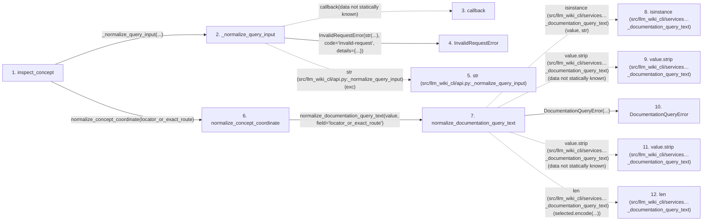

# inspect_concept

**Entry point:** `inspect_concept` (`api`)
**Source:** [api](../modules/api.md)
**Modules touched:** [analysis_capture](../modules/analysis_capture.md), [analysis_compatibility](../modules/analysis_compatibility.md), [api](../modules/api.md), [common](../modules/common.md), and 52 more

**Complete modules touched:**

- [analysis_capture](../modules/analysis_capture.md)
- [analysis_compatibility](../modules/analysis_compatibility.md)
- [api](../modules/api.md)
- [common](../modules/common.md)
- [config](../modules/config.md)
- [context_packet](../modules/context_packet.md)
- [context_service](../modules/context_service.md)
- [data_flow](../modules/data_flow.md)
- [dependency_versions](../modules/dependency_versions.md)
- [documentation_queries](../modules/documentation_queries.md)
- [documentation_query_builder](../modules/documentation_query_builder.md)
- [entrypoints](../modules/entrypoints.md)
- [extraction_service](../modules/extraction_service.md)
- [filesystem_guard](../modules/filesystem_guard.md)
- [go_calls](../modules/go_calls.md)
- [immutable](../modules/immutable.md)
- [implementation_evidence](../modules/implementation_evidence.md)
- [imports](../modules/imports.md)
- [infrastructure_inventory](../modules/infrastructure_inventory.md)
- [infrastructure_sync](../modules/infrastructure_sync.md)
- [io](../modules/io.md)
- [knowledge_artifacts](../modules/knowledge_artifacts.md)
- [knowledge_consumption](../modules/knowledge_consumption.md)
- [knowledge_coverage](../modules/knowledge_coverage.md)
- [knowledge_envelope](../modules/knowledge_envelope.md)
- [knowledge_evidence](../modules/knowledge_evidence.md)
- [knowledge_freshness](../modules/knowledge_freshness.md)
- [knowledge_generation](../modules/knowledge_generation.md)
- [knowledge_loader](../modules/knowledge_loader.md)
- [knowledge_model](../modules/knowledge_model.md)
- [knowledge_orchestration](../modules/knowledge_orchestration.md)
- [knowledge_storage](../modules/knowledge_storage.md)
- [knowledge_storage_io](../modules/knowledge_storage_io.md)
- [knowledge_verification](../modules/knowledge_verification.md)
- [maintenance_evidence](../modules/maintenance_evidence.md)
- [maintenance_protocol](../modules/maintenance_protocol.md)
- [maintenance_service](../modules/maintenance_service.md)
- [maintenance_state](../modules/maintenance_state.md)
- [maintenance_status](../modules/maintenance_status.md)
- [manifest_storage](../modules/manifest_storage.md)
- [native_inspection](../modules/native_inspection.md)
- [packages](../modules/packages.md)
- [plugins](../modules/plugins.md)
- [python_bindings](../modules/python_bindings.md)
- [python_calls](../modules/python_calls.md)
- [python_implementation](../modules/python_implementation.md)
- [python_imports](../modules/python_imports.md)
- [services_dependencies](../modules/services_dependencies.md)
- [source_selection](../modules/source_selection.md)
- [source_snapshot](../modules/source_snapshot.md)
- [sync_manifest](../modules/sync_manifest.md)
- [validation](../modules/validation.md)
- [verification_contracts](../modules/verification_contracts.md)
- [wiki_media](../modules/wiki_media.md)
- [wiki_surface](../modules/wiki_surface.md)
- [wiki_surface_index](../modules/wiki_surface_index.md)

## Call sequence

> Static overview in presentation order, not runtime execution order. Arrows retain captured callers; siblings are shown before deeper helper detail.

```mermaid
sequenceDiagram
    participant p0 as inspect_concept
    participant p1 as _normalize_query_input
    participant p2 as normalize_concept_coordinate
    participant p3 as _normalize_query_limit
    participant p4 as isinstance (src/llm_wiki_cli/api.py:inspect_concept)
    participant p5 as InvalidRequestError
    participant p6 as cast
    participant p7 as inspect_native_concept
    participant p8 as _validate_wiki_dir
    participant p9 as callback
    participant p10 as normalize_documentation_query_text
    participant p11 as capture_context_read
    participant p12 as validate_path
    participant p13 as validate_exact_page_coordinate
    participant p14 as normalize_documentation_query_limit
    participant p15 as str (src/llm_wiki_cli/services…py:inspect_native_concept)
    participant p16 as str (src/llm_wiki_cli/api.py:_normalize_query_input)
    participant p17 as validator
    participant p18 as DocumentationQueryError
    participant p19 as build_documentation_query_service_from_view
    participant p20 as _wiki_anchor
    participant p21 as build_snapshot_documentation_query_service
    participant p22 as service.get_concept
    participant p23 as service.traverse_typed_graph
    participant p24 as service.list_concept_sections
    participant p25 as build_knowledge_coverage
    p0->>p1: _normalize_query_input
    p0->>p2: normalize_concept_coordinate
    p0->>p3: _normalize_query_limit
    p0-->>p4: isinstance (src/llm_wiki_cli/api.py:inspect_concept)(value, bool)
    p0->>p5: InvalidRequestError
    p0-->>p4: isinstance (src/llm_wiki_cli/api.py:inspect_concept)(helper_cache_dir, (...))
    p0->>p5: InvalidRequestError
    p0-->>p6: cast(NativeInspectionResult, inspect_native_concept(...))
    p0->>p7: inspect_native_concept
    p0->>p8: _validate_wiki_dir
    p1-->>p9: callback
    p2->>p10: normalize_documentation_query_text
    p3->>p1: _normalize_query_input
    p7->>p11: capture_context_read
    p8->>p12: validate_path
    p1->>p5: InvalidRequestError
    p2->>p13: validate_exact_page_coordinate
    p3->>p14: normalize_documentation_query_limit
    p7-->>p15: str (src/llm_wiki_cli/services…py:inspect_native_concept)(wiki_root)
    p1-->>p16: str (src/llm_wiki_cli/api.py:_normalize_query_input)(exc)
    p2-->>p17: validator(selected)
    p7-->>p15: str (src/llm_wiki_cli/services…py:inspect_native_concept)(helper_cache_dir)
    p2->>p18: DocumentationQueryError
    p7->>p19: build_documentation_query_service_from_view
    p7->>p20: _wiki_anchor
    p7->>p21: build_snapshot_documentation_query_service
    p7-->>p22: service.get_concept(coordinate)
    p7-->>p23: service.traverse_typed_graph(coordinate, include_evidence=include_evidence)
    p7-->>p24: service.list_concept_sections(coordinate)
    p7->>p25: build_knowledge_coverage
```

<!-- Auto-generated from static call edges. Dashed arrows are external or unresolved calls. Reviewed runtime conditions and side effects belong in Behavior. -->

> Call sequence diagram shows 30 of 2785 interactions; 2755 omitted to keep the visualization within the 30-interaction and generated-diagram limits, with uncertain identities omitted rather than inferred.

> Captured boundary calls: external 6 of 936 (930 omitted); unresolved 5 of 883 (878 omitted). These counts cover the captured static trace.

Omitted captured detail, grouped by actual caller occurrence and target module:

| Caller | Parent step | Target module | Kind | Omitted interactions |
| --- | --- | --- | --- | --- |
| `src/llm_wiki_cli/services/documentation_query_builder.py:normalize_documentation_query_text` | 7 | - | external | 2 |
| `src/llm_wiki_cli/services/documentation_query_builder.py:normalize_documentation_query_text` | 7 | - | unresolved | 3 |
| `src/llm_wiki_cli/services/documentation_query_builder.py:normalize_documentation_query_text` | 7 | [src/llm_wiki_cli/services/documentation_queries.py](../modules/documentation_queries.md) | internal | 2 |
| `src/llm_wiki_cli/services/wiki_surface.py:validate_exact_page_coordinate` | 15 | - | external | 4 |
| `src/llm_wiki_cli/services/wiki_surface.py:validate_exact_page_coordinate` | 15 | - | unresolved | 2 |
| `src/llm_wiki_cli/services/wiki_surface.py:validate_exact_page_coordinate` | 15 | [src/llm_wiki_cli/services/wiki_surface.py](../modules/wiki_surface.md) | internal | 7 |
| `src/llm_wiki_cli/services/wiki_surface.py:_matches_directory_path` | 24 | - | unresolved | 2 |
| `src/llm_wiki_cli/services/wiki_surface.py:_matches_directory_path` | 24 | - | external | 3 |
> Omission summary shows 8 of 666 groups; 658 further groups are not expanded here. Counts above include all omitted interactions.
> Detailed flow queries retain their own coverage and limits; omitted paths may execute at runtime.

> Trace truncated at the depth limit; deeper calls are omitted.

## Data flow

<!-- Auto-generated static analysis. Treat values and boundaries as best-effort hints, not runtime proof. -->

### Step data

| Step | Inputs | Reads | Writes | Returns |
|---|---|---|---|---|
| `inspect_concept` | `locator_or_exact_route: object`, `src_dir: str`, `wiki_dir: str`, `live: bool`, `limit: int`, `include_evidence: bool`, `allow_external_src: bool`, `source_selection: str \| Path \| None` | `Path`, `NativeInspectionResult` | - | `cast(...)` |
| `_normalize_query_input` | `callback: Callable[[], _R]`, `field: str` | `DocumentationQueryError` | - | `callback(...)` |
| `callback` | - | - | - | - |
| `InvalidRequestError` | - | - | - | - |
| `str (src/llm_wiki_cli/api.py:_normalize_query_input)` | - | - | - | - |
| `normalize_concept_coordinate` | `value: object` | `wiki_surface`, `validate_concept_uid`, `validate_natural_key`, `ConceptIdentityError` | - | `wiki_surface.validate_exact_page_coordinate(...)`, `validator(...)` |
| `normalize_documentation_query_text` | `value: object`, `field: str` | `QUERY_IDENTITY_BYTE_LIMIT`, `QUERY_IDENTITY_BYTE_LIMIT` | - | `selected` |
| `isinstance (src/llm_wiki_cli/services…_documentation_query_text)` | - | - | - | - |
| `value.strip (src/llm_wiki_cli/services…_documentation_query_text)` | - | - | - | - |
| `DocumentationQueryError` | - | - | - | - |
| `value.strip (src/llm_wiki_cli/services…_documentation_query_text)` | - | - | - | - |
| `len (src/llm_wiki_cli/services…_documentation_query_text)` | - | - | - | - |

### Call data

| From | To | Line | Call |
|---|---|---:|---|
| inspect_concept | _normalize_query_input | 1030 | `_normalize_query_input(...)` |
| _normalize_query_input | callback | 1998 | `callback(data not statically known)` |
| _normalize_query_input | InvalidRequestError | 2000 | `InvalidRequestError(str(...), code='invalid-request', details={...})` |
| _normalize_query_input | str (src/llm_wiki_cli/api.py:_normalize_query_input) | 2001 | `str(exc)` |
| inspect_concept | normalize_concept_coordinate | 1031 | `normalize_concept_coordinate(locator_or_exact_route)` |
| normalize_concept_coordinate | normalize_documentation_query_text | 77 | `normalize_documentation_query_text(value, field='locator_or_exact_route')` |
| normalize_documentation_query_text | isinstance (src/llm_wiki_cli/services…_documentation_query_text) | 64 | `isinstance(value, str)` |
| normalize_documentation_query_text | value.strip (src/llm_wiki_cli/services…_documentation_query_text) | 64 | `value.strip(data not statically known)` |
| normalize_documentation_query_text | DocumentationQueryError | 65 | `DocumentationQueryError(...)` |
| normalize_documentation_query_text | value.strip (src/llm_wiki_cli/services…_documentation_query_text) | 66 | `value.strip(data not statically known)` |
| normalize_documentation_query_text | len (src/llm_wiki_cli/services…_documentation_query_text) | 67 | `len(selected.encode(...))` |

### Boundary effects

*No boundary effects detected.*

### Static analysis gaps

| Kind | Step | Target | Line |
|---|---|---|---:|
| unresolved_call | `_normalize_query_input` | `callback` | 1998 |
| external_call | `normalize_documentation_query_text` | `isinstance` | 64 |
| unresolved_call | `normalize_documentation_query_text` | `value.strip` | 64 |
| unresolved_call | `normalize_documentation_query_text` | `value.strip` | 66 |
| step_limit | `inspect_concept` | `first 12 steps` | 0 |
| truncated_flow | `inspect_concept` | `depth limit` | 0 |

## Behavior

This flow starts at `inspect_concept` and is classified as `api`. The generated call and data-flow sections are bounded static projections; runtime conditions and side effects require source-level confirmation.
