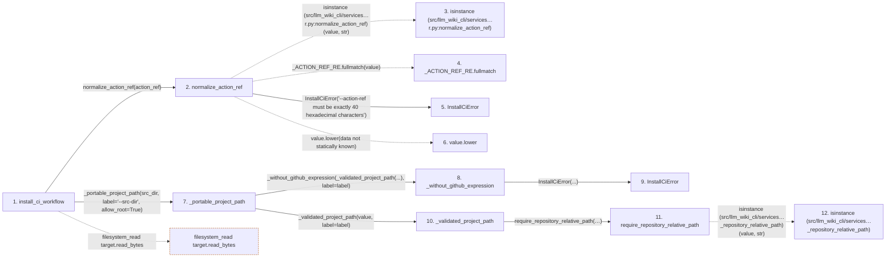

# install_ci_workflow

**Entry point:** `install_ci_workflow` (`api`)
**Source:** [ci_installer](../modules/ci_installer.md)
**Modules touched:** [ci_installer](../modules/ci_installer.md), [common](../modules/common.md), [config](../modules/config.md), [current_contracts](../modules/current_contracts.md), and 13 more

**Complete modules touched:**

- [ci_installer](../modules/ci_installer.md)
- [common](../modules/common.md)
- [config](../modules/config.md)
- [current_contracts](../modules/current_contracts.md)
- [filesystem_guard](../modules/filesystem_guard.md)
- [io](../modules/io.md)
- [knowledge_evidence](../modules/knowledge_evidence.md)
- [knowledge_storage](../modules/knowledge_storage.md)
- [knowledge_storage_io](../modules/knowledge_storage_io.md)
- [maintenance_state](../modules/maintenance_state.md)
- [manifest_storage](../modules/manifest_storage.md)
- [source_selection](../modules/source_selection.md)
- [sync_manifest](../modules/sync_manifest.md)
- [validation](../modules/validation.md)
- [wiki_lifecycle](../modules/wiki_lifecycle.md)
- [wiki_surface](../modules/wiki_surface.md)
- [wiki_write_basis](../modules/wiki_write_basis.md)

## Call sequence

> Static overview in presentation order, not runtime execution order. Arrows retain captured callers; representative internal continuations and boundary examples precede repeated helper detail.

```mermaid
sequenceDiagram
    participant p0 as install_ci_workflow
    participant p1 as normalize_action_ref
    participant p2 as _portable_project_path
    participant p3 as _project_directory
    participant p4 as classify_wiki_lifecycle
    participant p5 as _validate_default_selection_contract
    participant p6 as render_managed_workflow
    participant p7 as _validate_workflow_target
    participant p8 as is_unmodified_managed_workflow
    participant p9 as write_bytes_atomic
    participant p10 as InstallCiError
    participant p11 as _normalize_newlines
    participant p12 as InstallCiResult
    participant p13 as _without_github_expression
    participant p14 as locate_exact_repository_path
    participant p15 as _validated_project_path
    participant p16 as is_pristine_wiki_target
    participant p17 as SyncManifest.load
    participant p18 as resolve_source_selection
    participant p19 as validate_persisted_source_selection_identity
    participant p20 as require_repository_relative_path
    participant p21 as _locate_exact_path
    participant p22 as source_selection_identity_from_generation_inputs
    participant p23 as source_selection_inputs_from_generation_inputs
    participant p24 as _override_text
    participant p25 as StorageReadSession.read
    participant p26 as SyncManifest.from_payload
    participant p27 as _read_config
    participant p28 as _policy_from_content
    participant p29 as Path.cwd (src/llm_wiki_cli/services…er.py:install_ci_workflow)
    participant p30 as Path.cwd().resolve
    p0->>p1: normalize_action_ref
    p0->>p2: _portable_project_path
    p0->>p3: _project_directory
    p0->>p4: classify_wiki_lifecycle
    p0->>p5: _validate_default_selection_contract
    p0->>p6: render_managed_workflow
    p0->>p7: _validate_workflow_target
    p0->>p8: is_unmodified_managed_workflow
    p0->>p9: write_bytes_atomic
    p0->>p10: InstallCiError
    p0->>p11: _normalize_newlines
    p0->>p12: InstallCiResult
    p2->>p13: _without_github_expression
    p3->>p14: locate_exact_repository_path
    p2->>p15: _validated_project_path
    p4->>p16: is_pristine_wiki_target
    p5->>p17: SyncManifest.load
    p5->>p18: resolve_source_selection
    p5->>p19: validate_persisted_source_selection_identity
    p15->>p20: require_repository_relative_path
    p14->>p21: _locate_exact_path
    p19->>p22: source_selection_identity_from_generation_inputs
    p19->>p23: source_selection_inputs_from_generation_inputs
    p18->>p24: _override_text
    p17->>p25: StorageReadSession.read
    p17->>p26: SyncManifest.from_payload
    p18->>p27: _read_config
    p18->>p28: _policy_from_content
    p0-->>p29: Path.cwd (src/llm_wiki_cli/services…er.py:install_ci_workflow)
    p0-->>p30: Path.cwd().resolve
```

<!-- Auto-generated from static call edges. Dashed arrows are external or unresolved calls. Reviewed runtime conditions and side effects belong in Behavior. -->

> Call sequence diagram shows 30 of 740 interactions; 710 omitted to keep the visualization within the 30-interaction and generated-diagram limits, with uncertain identities omitted rather than inferred.

> Captured boundary calls: external 1 of 221 (220 omitted); unresolved 1 of 177 (176 omitted). These counts cover the captured static trace.

Omitted captured detail, grouped by actual caller occurrence and target module:

| Caller | Parent step | Target module | Kind | Omitted interactions |
| --- | --- | --- | --- | --- |
| `src/llm_wiki_cli/services/ci_installer.py:normalize_action_ref` | 2 | - | external | 1 |
| `src/llm_wiki_cli/services/ci_installer.py:normalize_action_ref` | 2 | - | unresolved | 2 |
| `src/llm_wiki_cli/services/ci_installer.py:normalize_action_ref` | 2 | [src/llm_wiki_cli/services/ci_installer.py](../modules/ci_installer.md) | internal | 1 |
| `src/llm_wiki_cli/services/ci_installer.py:_without_github_expression` | 8 | [src/llm_wiki_cli/services/ci_installer.py](../modules/ci_installer.md) | internal | 1 |
| `src/llm_wiki_cli/services/validation.py:require_repository_relative_path` | 11 | - | external | 7 |
| `src/llm_wiki_cli/services/validation.py:require_repository_relative_path` | 11 | [src/llm_wiki_cli/services/validation.py](../modules/validation.md) | internal | 4 |
| `src/llm_wiki_cli/services/validation.py:_syntax_key` | 13 | - | external | 6 |
| `src/llm_wiki_cli/services/validation.py:_known_syntax` | 20 | - | unresolved | 2 |
> Omission summary shows 8 of 206 groups; 198 further groups are not expanded here. Counts above include all omitted interactions.
> Detailed flow queries retain their own coverage and limits; omitted paths may execute at runtime.

> Trace truncated at the depth limit; deeper calls are omitted.

## Data flow

<!-- Auto-generated static analysis. Treat values and boundaries as best-effort hints, not runtime proof. -->

### Step data

| Step | Inputs | Reads | Writes | Returns |
|---|---|---|---|---|
| `install_ci_workflow` | `action_ref: str`, `src_dir: str`, `wiki_dir: str`, `dry_run: bool`, `force: bool`, `project_root: str \| Path \| None` | `WikiLifecycleState`, `MANIFEST_FILENAME`, `MANAGED_WORKFLOW_PATH`, `MANAGED_WORKFLOW_PATH`, `MANAGED_WORKFLOW_PATH`, `MANAGED_WORKFLOW_PATH`, `MANAGED_WORKFLOW_PATH` | - | `InstallCiResult(...)`, `InstallCiResult(...)` |
| `normalize_action_ref` | `value: object` | - | - | `value.lower(...)` |
| `isinstance (src/llm_wiki_cli/services…r.py:normalize_action_ref)` | - | - | - | - |
| `_ACTION_REF_RE.fullmatch` | - | - | - | - |
| `InstallCiError` | - | - | - | - |
| `value.lower` | - | - | - | - |
| `_portable_project_path` | `value: object`, `label: str`, `allow_root: bool` | - | - | `'.'`, `_without_github_expression(...)` |
| `_without_github_expression` | `path: str`, `label: str` | - | - | `path` |
| `InstallCiError` | - | - | - | - |
| `_validated_project_path` | `value: object`, `label: str` | - | - | `require_repository_relative_path(...)` |
| `require_repository_relative_path` | `value: object`, `text_error: Exception`, `posix_error: Exception`, `normalized_error: Exception`, `absolute_error: Exception \| None`, `separator_error: Exception \| None`, `control_error: Exception \| None`, `reject_delete_character: bool` | - | - | `cached`, `_remember_syntax(...)` |
| `isinstance (src/llm_wiki_cli/services…_repository_relative_path)` | - | - | - | - |

### Call data

| From | To | Line | Call |
|---|---|---:|---|
| install_ci_workflow | normalize_action_ref | 297 | `normalize_action_ref(action_ref)` |
| normalize_action_ref | isinstance (src/llm_wiki_cli/services…r.py:normalize_action_ref) | 63 | `isinstance(value, str)` |
| normalize_action_ref | _ACTION_REF_RE.fullmatch | 63 | `_ACTION_REF_RE.fullmatch(value)` |
| normalize_action_ref | InstallCiError | 64 | `InstallCiError('--action-ref must be exactly 40 hexadecimal characters')` |
| normalize_action_ref | value.lower | 65 | `value.lower(data not statically known)` |
| install_ci_workflow | _portable_project_path | 298 | `_portable_project_path(src_dir, label='--src-dir', allow_root=True)` |
| _portable_project_path | _without_github_expression | 100 | `_without_github_expression(_validated_project_path(...), label=label)` |
| _without_github_expression | InstallCiError | 93 | `InstallCiError(...)` |
| _portable_project_path | _validated_project_path | 101 | `_validated_project_path(value, label=label)` |
| _validated_project_path | require_repository_relative_path | 69 | `require_repository_relative_path(value, text_error=InstallCiError(...), posix_error=InstallCiError(...), normalized_error=InstallCiError(...), absolute_error=InstallCiError(...), separator_error=InstallCiError(...), control_error=InstallCiError(...), reject_delete_character=True, leading_backslash_is_absolute=True, portability_error=InstallCiError(...))` |
| require_repository_relative_path | isinstance (src/llm_wiki_cli/services…_repository_relative_path) | 299 | `isinstance(value, str)` |

### Boundary effects

| Kind | Target | Step | Line |
|---|---|---|---:|
| filesystem_read | `target.read_bytes` | `install_ci_workflow` | 328 |

### Static analysis gaps

| Kind | Step | Target | Line |
|---|---|---|---:|
| external_call | `normalize_action_ref` | `isinstance` | 63 |
| unresolved_call | `normalize_action_ref` | `_ACTION_REF_RE.fullmatch` | 63 |
| unresolved_call | `normalize_action_ref` | `value.lower` | 65 |
| external_call | `require_repository_relative_path` | `isinstance` | 299 |
| step_limit | `install_ci_workflow` | `first 12 steps` | 0 |
| truncated_flow | `install_ci_workflow` | `depth limit` | 0 |

## Behavior

This flow starts at `install_ci_workflow` and is classified as `api`. The generated call and data-flow sections are bounded static projections; runtime conditions and side effects require source-level confirmation.
